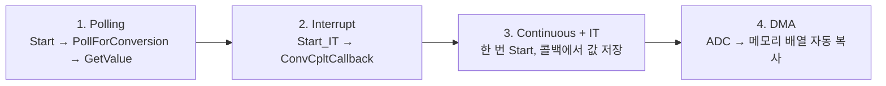
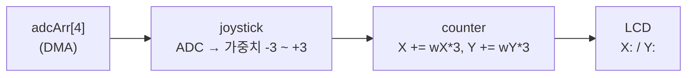

# ADC — 조도센서 · 조이스틱 ADC (polling → interrupt → DMA)

> 📅 2026-11-03 · 보드: NUCLEO-F411RE

조도센서(CDS)로 ADC 기본 개념을 익히고, 변환 결과를 가져오는 방식을 **polling → interrupt → continuous → DMA** 순서로 바꿔 가며 비교한 실습.
마지막에는 4채널을 DMA로 계속 읽어 두고, 조이스틱 값으로 I2C LCD의 X / Y 카운터를 움직이는 앱을 만듦.

## 파일 구조

```
Core/Src/
├── main.c                     # __io_putchar → UART2 printf
├── common/delay/
├── app/
│   ├── ap_main.c              # counter_init / counter_task 호출
│   └── service/counter/       # 조이스틱 가중치 → LCD X, Y 카운터
└── driver/
    ├── adc/                   # DMA로 채널 4개를 adcArr[]에 계속 갱신
    ├── cds/  joystick/        # adc 드라이버 위에서 값 해석
    └── lcd/
```

## 사용 핀

| 항목 | 핀 | ADC 채널 / Rank |
|---|---|---|
| 조도센서 (CDS) | PA0 | IN0 / Rank 1 |
| 테스트 입력 (VCC/GND 연결 확인용) | PA1 | IN1 / Rank 2 |
| 조이스틱 X | PA4 | IN4 / Rank 3 |
| 조이스틱 Y | PB0 | IN8 / Rank 4 |
| 조이스틱 SW | PC2 | GPIO |
| I2C LCD | PB8 SCL / PB9 SDA | — |

ADC1: Scan ON, Continuous ON, 4 conversions, sampling time 480 cycles, DMA2 Stream0 (circular, half-word)

---

## ADC 기본

- 0 ~ 3.3V의 연속적인 전압을 **12bit** 디지털 값(0 ~ 4095)으로 변환
- F411에는 ADC가 1개, 입력 채널은 IN0 ~ IN15 (16개) → 여러 채널은 **rank**(변환 순서)로 묶어서 차례로 변환
- 결과는 12bit지만 데이터 레지스터는 16bit → left / right align 선택 가능 (`HAL_ADC_GetValue`는 레지스터라 `uint32_t` 반환)
- injected 채널: regular 변환을 잠깐 멈추고 다른 채널을 먼저 변환한 뒤 이어서 진행

| 설정 | 의미 |
|---|---|
| Single | 한 번 변환하고 끝 |
| Continuous | 시작 후 계속 반복 변환 |
| Scan | rank 1 ~ n 채널을 순서대로 스캔 (multi channel) |
| Discontinuous | scan 중에도 한 번에 한 채널씩만 변환 |

값 환산 (조도센서는 밝을수록 ADC 값이 작아져서 반전):

```c
pout = 100 - (value * 100 / 4096);   // 밝기 %
vout = value * 3300 / 4096;          // mV
```

> PA1을 VCC에 연결하면 3297mV, GND에 연결하면 0mV → 채널 매핑 확인

## 결과값을 가져오는 4가지 방식



### 1. Polling (single / multi channel)

```c
HAL_ADC_Start(&hadc1);                    // rank 1
HAL_ADC_PollForConversion(&hadc1, 1000);  // 최대 1초 대기 (CPU가 묶여 있음)
value[0] = HAL_ADC_GetValue(&hadc1);

HAL_ADC_Start(&hadc1);                    // rank 2 (discontinuous라 한 채널씩)
HAL_ADC_PollForConversion(&hadc1, 1000);
value[1] = HAL_ADC_GetValue(&hadc1);
HAL_ADC_Stop(&hadc1);
```

### 2. Interrupt

```c
void HAL_ADC_ConvCpltCallback(ADC_HandleTypeDef *hadc) {
	adcCpltFlag = 1;
	// 여기서 HAL_ADC_Start_IT()를 다시 부르면 main 처리 전에 다음 변환이 끝나 순서가 꼬임
}

HAL_ADC_Start_IT(&hadc1);
while (1) {
	if (adcCpltFlag) {
		adcCpltFlag = 0;
		value[adcIndex] = HAL_ADC_GetValue(&hadc1);
		adcIndex = (adcIndex + 1) % 2;
		HAL_ADC_Start_IT(&hadc1);   // 처리 다 끝난 뒤 다음 변환 시작
	}
}
```

- 변환 완료 → ISR → 콜백에서 flag만 세우고, 실제 처리는 main loop에서

### 3. Continuous

- Continuous ON이면 `Start_IT`를 한 번만 부르면 계속 변환 → 콜백에서 `GetValue`로 바로 저장
- 다시 Start할 필요 없음

### 4. DMA

```c
#define ADC_CH_SIZE 4
volatile uint16_t adcArr[ADC_CH_SIZE] = {0,};

void adc_init(ADC_HandleTypeDef* adc) {
	if (isRunDMA) return;   // cds, joystick 어느 쪽에서 init해도 한 번만 시작
	HAL_ADC_Start_DMA(adc, (uint32_t*) adcArr, ADC_CH_SIZE);
	isRunDMA = true;
}
```

- ADC 결과를 **DMA가 CPU 개입 없이** 배열에 rank 순서대로 계속 덮어씀 (circular)
- 앱은 그냥 `adcArr[]`를 읽기만 하면 됨 → 콜백 / flag 관리 불필요
- 변수는 CPU 밖에서 바뀌므로 `volatile`

## 실습: 조이스틱으로 LCD 숫자 제어



```c
static int8_t joystick_calcWeight(uint16_t adc) {
    if      (adc <= 10)   return -3;
    else if (adc <= 1000) return -2;
    else if (adc <= 1900) return -1;
    else if (adc <= 2100) return  0;   // 중앙 (약 2048) 데드존
    else if (adc <= 3000) return  1;
    else if (adc <= 4000) return  2;
    else                  return  3;
}
```

- 기울인 정도에 따라 증가량이 달라지도록 구간을 나눠 가중치로 변환
- LCD는 값이 바뀐 줄만 다시 씀 (`counterX != curX`일 때만 `Lcd_writeStringXY`)
- 드라이버 계층: `adc`(하드웨어 / DMA) ↔ `cds`, `joystick`(값 해석) ↔ `counter`(서비스) 로 분리

전체 코드: [`Core/Src/driver/adc/adc.c`](Core/Src/driver/adc/adc.c), [`Core/Src/app/service/counter/counter.c`](Core/Src/app/service/counter/counter.c)
