# C_Lang — 임베디드 C 문법 정리

> 📅 2026-10-13 ~ 2026-10-15 · 보드: NUCLEO-F411RE (USART2로 printf 출력)

STM32에서 UART(USART2)로 `printf`를 띄워가며 임베디드 관점의 C 문법을 정리한 프로젝트.
컴파일 과정, 메모리/엔디안, 자료형, 포인터, 배열, 문자열, 구조체, 전처리까지.

## 목차

- [UART 사용 설정](#uart-사용-설정)
- [C언어를 쓰는 이유 / 컴파일 과정](#c언어)
- [메모리와 리틀 엔디안](#메모리와-리틀-엔디안)
- [자료형](#자료형)
- [call by value / 재귀함수](#call-by-value)
- [배열](#배열)
- [포인터](#포인터)
- [배열과 포인터](#배열과-포인터)
- [아스키코드 / 문자열](#아스키코드)
- [2차원 배열, 이중 포인터, 함수 포인터, void 포인터](#2차원-배열-포인터-배열)
- [동적 할당](#임베디드에서는-동적-할당-사용-지양)
- [사용자 정의 자료형 (struct / union / enum)](#사용자-정의-자료형-1-구조체)
- [전처리 / 분할 컴파일](#전처리)

---

## UART 사용 설정

| 항목 | 설정 |
|---|---|
| 위치 | Connectivity → USART2 |
| Mode | Asynchronous |
| Baud Rate | 115200 Bits/s |
| Word Length / Parity / Stop Bits | 8 Bits / None / 1 |

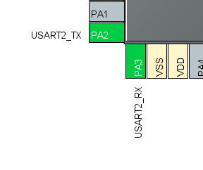

- 설정 후 디폴트핀 설정 확인 (PA2 = TX, PA3 = RX → 보드의 ST-LINK 가상 COM 포트로 연결됨)

## C언어

- C언어 사용 이유: 메모리를 직접 접근해서 다룰 수 있음
- 거치는 단계 없이 CPU가 직접 읽어서 CPU에 직접 명령을 내림 (컴파일러 언어)
  - 거치는 단계 없이 CPU 직접 접근 → 실수해도 막아주는애 없지만 빠르다
- 그래서 쓰는거임
- 하드웨어를 제어하기 위해서
- 파이썬도 많이 쓰긴 하는데.. 간단한 테스트 용도
- 잘되면 전부 상용은 C언어로 재작성함

### 컴파일 과정

1. 전처리: .i 파일 → .s, #include, #define 내용 가져와서 펼쳐둠
2. 컴파일: .s파일 → .o, C → ASM (컴파일러가 함)

```
// arm-none-eabi-gcc = arm gcc 컴파일러
arm-none-eabi-gcc ".../C_Lang/Core/Src/main.c" -mcpu=cortex-m4 -std=gnu11 -g3 -DDEBUG -DUSE_HAL_DRIVER -DSTM32F411xE -c -I../../Core/Inc ... -O0 -ffunction-sections -fdata-sections -Wall ... -o "Application/User/Core/main.o"
arm-none-eabi-gcc -o "C_Lang.elf" @"objects.list" -mcpu=cortex-m4 -T".../STM32F411RETX_FLASH.ld" --specs=nosys.specs -Wl,-Map="C_Lang.map" -Wl,--gc-sections -static ...
Finished building target: C_Lang.elf
```

3. 어셈블: .o - 오브젝트 파일, 각 파일마다 오브젝트 파일 생김, ASM → 기계어 (어셈블러가 함)
4. 링크: 통합된 실행파일 생성 (링커가 함), 라이브러리 붙임, **함수 호출 주소 할당**

- 링크 과정에서 하나의 파일로 만들며 어떤 위치로 점프할지 → 호출할 주소 어디인지도 할당

---

- in 임베디드, 펌웨어: 실수형은 지양하라
- printf는 쓰지만 scanf는 쓰지 않음

## 메모리와 리틀 엔디안

- age 값 지정 이전 → 메모리에 0 저장

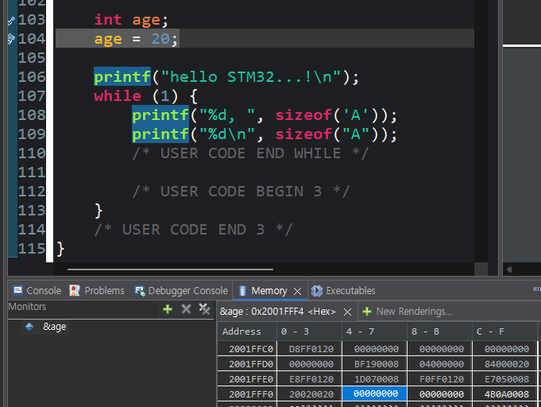

- age 값 지정 이후 → 메모리에 0x14 == 20 저장

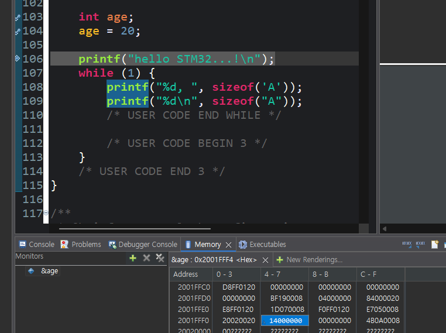

- age = 0x12345678 이면

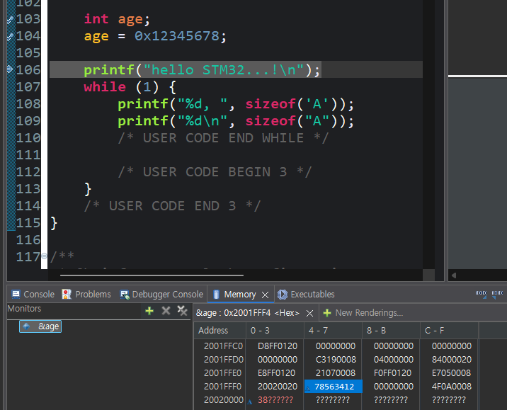

- 1 byte씩 리틀엔디안으로 저장되어 숫자가 뒤집혀보이는거임

`int age = 0x12345678;` (4 byte, `&age` = 0x2001FFF4)

| 주소 | +0 | +1 | +2 | +3 |
|---|---|---|---|---|
| **Little Endian** (STM32) | 78 | 56 | 34 | 12 |
| Big Endian | 12 | 34 | 56 | 78 |

- 리틀엔디안: MSB가 가장 큰 주소에 들어가고 LSB가 가장 작은 주소에 들어간다
- 메모리 뷰에서 4 byte 단위로 보면 `78563412`로 뒤집혀 보이는 이유

```c
int age; age = 20;

int count = 0;
const int age = 20;
```

const로 상수형 → 선언과 동시에 값 대입 진행되어야 한다

## 자료형

- 기본 자료형

| 자료형 | 크기 (byte) | 담는 것 | 서식 |
|---|---|---|---|
| `char` | 1 | 문자, 아주 작은 정수 | `%c` `%d` |
| `short` | 2 | 작은 정수 | `%hd` |
| `int` | 4 | 정수 | `%d` |
| `long` | 4 or 8 | 큰 정수 | `%ld` |
| `float` | 4 | 실수 (유효숫자 약 7자리) | `%f` |
| `double` | 8 | 실수 (유효숫자 약 15자리) | `%lf` |

- long은 리눅스 컴파일러일때 8 byte, 아니면 4 byte

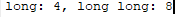

- stm32에서 사용하는 컴파일러에선 4 byte다 → 잡는 크기 컴파일러마다 다름에 주의

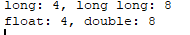

- `char`: -128 ~ 127 / `unsigned char`: 0 ~ 255
- 크기가 중요한 코드에서는 `sizeof`로 확인하거나 `<stdint.h>`의 고정 크기 자료형을 쓴다
- 임베디드에서는 int32_t, uint8_t를 많이 쓴다
- 잡는 크기가 컴파일러마다 다르면 시스템이 이상하다 → 딱 정해서 사용함

| 자료형 | 크기 (byte) | 범위 |
|---|---|---|
| `uint8_t` / `int8_t` | 1 | 0 ~ 255 / -128 ~ 127 |
| `uint16_t` / `int16_t` | 2 | 0 ~ 65,535 / -32,768 ~ 32,767 |
| `uint32_t` / `int32_t` | 4 | 0 ~ 4,294,967,295 / -2,147,483,648 ~ 2,147,483,647 |
| `uint64_t` / `int64_t` | 8 | 0 ~ 2^64-1 / -2^63 ~ 2^63-1 |

---

## call by value

```c
void change(int x)
{
	x = 100; /* 복사본을 바꾼다 */
	printf(" 안에서 x = %d\n", x); /* 100 */
}

int main(void)
{
	int n = 10;
	change(n);
	printf(" 밖에서 n = %d\n", n); /* 100 이 아니라 10 */
	return 0;
}
```

```
main   :  n = 10                 ← 그대로
change :  x = 10 → 100           ← n의 값을 복사해 온 별개의 변수 (주소가 다름)
```

- 매개변수에는 그냥 값을 복사한거만 넣어준거임
- 두 변수의 주소가 다르니까 함수 내부에서 print와 main의 print 결과값이 다름

### 재귀함수 → 함수 호출시마다 메모리 씀 → 임베디드에서는 사용 금지 (메모리 낭비임)

## 배열

```
int score[5];

 score[0] score[1] score[2] score[3] score[4]
┌────────┬────────┬────────┬────────┬────────┐
│   4B   │   4B   │   4B   │   4B   │   4B   │   총 20 byte, 빈틈없이 연속
└────────┴────────┴────────┴────────┴────────┘
```

- 자료형이 메모리에 연속적인 주소로 5개 할당됨
- 배열이름 == 대표 주소 == 첫번째 주소
- arr[0] == arr
- arr[1] == arr + 1 (주소값은 4 증가, 인덱스는 1 증가)
- 모든 주소는 제일 앞에 있는 주소, 첫번째 주소를 뜻함

```c
int a[5] = {10, 20, 30, 40, 50};
int b[5] = {10, 20};    /* 나머지는 0 → 10 20 0 0 0 */
int c[5] = {0};         /* 전부 0 */
int d[]  = {1, 2, 3};   /* 크기 생략 → 개수대로 3 */
int e[5];               /* 지역변수면 쓰레기값 */
```

- 하나라도 초기화하지 않으면 쓰레기값

```c
char s[20];
s = "Hello";        /* 오류: 배열 이름에는 대입할 수 없다 */
strcpy(s, "Hello"); /* OK: 복사는 strcpy (string.h) */
```

- strcpy 사용해서 문자열 값을 변경 가능 (s에다 hello를 복사해서 넣는다)

## 포인터

| 연산자 | 의미 |
|---|---|
| `&x` | x의 주소를 꺼낸다 (주소 연산자) |
| `*p` | p가 가리키는 곳의 값 (간접 참조 연산자) |

- \*&x == x
- 포인터 변수 = 주소를 넣는 변수

```c
int age = 10;
int *p; /* int 를 가리키는 포인터 */

p = &age; /* p 에 age 의 주소를 넣는다 */

printf("%d\n", age); /* 10 */
printf("%d\n", *p); /* 10 — p 가 가진 주소에 저장된 실제 값 */

*p = 20; /* p 가 가지는 주소에 저장된 실제 값에 접근, 20 을 쓴다 */
// == *&age == age == (int *) 0x2001fff0 = 20

printf("%d\n", age); /* 20 — age 가 바뀌었다! */
```

```
      p (0x2001fff4)            age (0x2001fff0)
   ┌──────────────┐          ┌──────────┐
   │  0x2001fff0  │ ───────► │    20    │
   └──────────────┘          └──────────┘
```

<p>
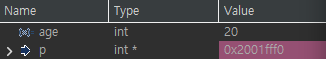
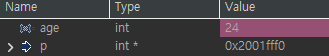
</p>

| | |
|---|---|
| 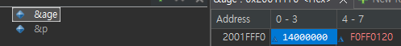<br>0x14 = 16+4 = 20 | 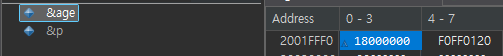<br>0x18 = 16+8 = 24 |

| 선언 | 가리키는 자료형 크기 | `sizeof(포인터)` |
|---|---|---|
| `char *c` | 1 | 4 |
| `short *s` | 2 | 4 |
| `int *i` | 4 | 4 |
| `long long *l` | 8 | 4 |

- 포인터 변수 → 주소를 저장
- 따라서 포인터 변수의 size == 주소 크기 항상 4 == 따라서 포인터변수는 항상 4 byte (32bit MCU 기준)

```c
char *c;
short *s;
int *i;
long long *l;

printf("size of c: %d, s: %d, i: %d, l: %d\n", sizeof(c), sizeof(s),
		sizeof(i), sizeof(l));
```

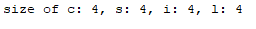

```c
int    *p;   /* 이 주소에서 4 바이트를 읽는다 */
char   *q;   /* 이 주소에서 1 바이트를 읽는다 */
double *r;   /* 이 주소에서 8 바이트를 읽는다 */
```

- 포인터변수에 자료형이 필요한 이유: 그 주소에서 몇 바이트를 읽어올지 결정

### 함수 매개변수로 포인터변수 사용

```c
void change(int *p) /* 주소를 받는다 */
{
	*p = 100; /* 그 주소에 저장 값을 바꾼다 */
}

int main(void)
{
	int n = 10;
	change(&n); /* 주소를 준다 */
	printf("%d\n", n); /* 100 */
}
```

- int \*p = &n이 되어 main의 지역변수 n에 직접 접근해 값을 변경

```c
void div_mod(int a, int b, int *q, int *r)
{
	*q = a / b;   // 원본 변수(quot)에 바로 저장
	*r = a % b;   // 원본 변수(rem)에 바로 저장
}

int quot, rem;
div_mod(7, 2, &quot, &rem);
printf("7/2 = %d, 나머지 %d\n", quot, rem);
```

- 한 함수에서 두 값 이상 리턴하고 싶을때도 잘 쓴다

```c
const int *p;   /* 가리키는 값을 못 바꾼다: *p = 10 (X) */
int *const p;   /* 포인터 자체를 못 바꾼다: p = &x (X) */

void print(const int *data, int n);   /* "읽기만 한다"는 약속 */
```

- const로 포인터 접근은 하되 값을 변경하지 못하게 제한

```c
int *p = NULL;     /* 아무것도 안 가리킨다 */

if (p != NULL) {
	*p = 10;       /* 가리키는 게 있을 때만 쓴다 */
}
```

- NULL을 `*`로 따라가면 프로그램이 죽는다 → 포인터는 NULL로 초기화하고, 쓰기 전에 검사
- 초기화를 아예 안 한 포인터는 더 위험

## 배열과 포인터

```
int a[5];  int *p = a;

 index    0       1       2       3       4
       ┌───────┬───────┬───────┬───────┬───────┐
 a     │       │       │       │       │       │
       └───────┴───────┴───────┴───────┴───────┘
 addr  0x100   0x104   0x108   0x10C   0x110

 p + 1 → int 1칸 = 4 byte 이동 (0x104)
 p + 2 → int 2칸 = 8 byte 이동 (0x108)
```

- 배열이름 == 대표 주소 == 첫번째 주소
- arr[0] == arr
- arr[1] == arr + 1 (주소값은 4 증가, 인덱스는 1 증가)
- `a[2] == *(a + 2) == p[2] == *(p + 2)`

```c
int a[5];
int *p = a;

sizeof(a) /* 20 —배열 전체 */
sizeof(p) /* 4 —포인터 하나 (32bit 기준, 64bit PC면 8) */

a = p; /* 오류. 배열 이름에는 대입할 수 없다 */
p = a; /* 된다. 포인터는 변수다 */

p++; /* 된다 이것도 인덱스 기준으로 +1 됨 (주소로는 +4) */
a++; /* 오류 a+1 써야함 */
```

### 배열을 함수로 넘기기

```c
void print(int arr[], int n); /* 이렇게 써도 */
void print(int *arr, int n); /* 사실은 이것과 같다 */
```

- 컴파일러가 int arr[] 를 int \*arr 로 바꿔 버림
- 그래서 함수 안에서 배열을 고치면 원본이 변경

#### C 에서 배열을 넘길 때는 개수를 함께 넘기기

- 예외 없음
- 주소값만 알고 있으니까 sizeof도 안먹힘. 크기 알수 없음
- 따라서 배열 크기를 넘겨줘야 한다

---

## 아스키코드

| 구간 | 10진 | 16진 |
|---|---|---|
| 제어 문자 (NUL, LF=10, CR=13 …) | 0 ~ 31 | 0x00 ~ 0x1F |
| 공백 `' '` | 32 | 0x20 |
| `'0'` ~ `'9'` | 48 ~ 57 | 0x30 ~ 0x39 |
| `'A'` ~ `'Z'` | 65 ~ 90 | 0x41 ~ 0x5A |
| `'a'` ~ `'z'` | 97 ~ 122 | 0x61 ~ 0x7A |

- 0: 48, 0x30
- A: 65, 0x41
- a: 97, 0x61 (소문자는 대문자 + 32)

### ctype.h

| 함수 | 하는 일 |
|---|---|
| `isdigit(c)` | 숫자인가 |
| `isalpha(c)` | 영문자인가 |
| `isupper(c)` / `islower(c)` | 대문자 / 소문자인가 |
| `isspace(c)` | 공백·탭·줄바꿈인가 |
| `toupper(c)` / `tolower(c)` | 대문자 / 소문자로 바꾼다 |

## 문자열

```c
char arr[] = "Hello"; /* ① 배열 */
char *ptr = "Hello"; /* ② 포인터 */

arr[0] = 'J'; /* 된다 */
ptr[0] = 'J'; /* 컴파일은 되는데 실행하면 죽는다 */

ptr = "World"; /* 된다. 다른 곳을 가리킨다 */
arr = "World"; /* 오류 배열 이름 == 주소, 값이 들어가면 안됨*/
```

```
① arr  [ H | e | l | l | o | \0 ]          ← 내 배열(stack). 고칠 수 있다

② ptr  [ 주소 ] ──► [ H | e | l | l | o | \0 ]   ← 읽기 전용 영역. 고치면 죽는다
```

| | `char arr[]` | `char *ptr` |
|---|---|---|
| 글자가 있는 곳 | 내 배열 안 (stack) | 읽기 전용 영역 |
| 내용 고치기 | 된다 | 안 된다 |
| 가리키는 곳 바꾸기 | 안 된다 | 된다 |
| `sizeof` | 6 (전체) | 4 (포인터) |

- 포인터는 문자열이 있는 주소를 가지고 있음
- ptr의 인덱스 하나하나를 고치기 → 불가
- 그냥 한번에 바꾸기는 됨 → 그냥 포인터가 가리키는 곳이 바뀌는거니까

```
 높은 주소 ┌──────────────────────────┐
           │ stack  ↓  (지역변수)      │
           │                          │
           │ heap   ↑  (동적 할당)     │
           ├──────────────────────────┤
           │ .bss   초기화 안 된 전역   │
           │ .data  초기화된 전역       │
           │ .rodata 읽기 전용 (문자열) │
 낮은 주소 │ .text  코드               │
           └──────────────────────────┘
```

- .text 다음으로 read only (읽기 전용) 영역이 들어간다
- 읽기 전용 영역에 ptr이 들어가는것임
- 배열: stack 영역에 arr 만들어지고 hello\n도 stack에 들어감
- 포인터: stack 영역에 주소 저장을 위한 포인터변수 공간 ptr이 만들어지고 hello\n는 read only 영역에 위치. ptr은 read only 영역에 있는 hello\n의 주소를 가짐
- char \* 을 size of → 주소 크기마다 8(64bit) or 4(32bit)로 다름

```c
const char *ptr = "Hello"; /* 고치려 하면 컴파일 오류로 잡힌다 */
```

- const: 변수를 상수화
  - 사용 이유: 다른 값으로 변경하는 실수 미연에 방지, 실수하면 컴파일 오류로 찍힌다

### 문자열 관련 함수 (string.h)

| 함수 | 하는 일 | 주의 |
|---|---|---|
| `strlen(s)` | 글자 수 (`\0` 제외) | |
| `strcpy(d, s)` | s를 d로 복사 | **d 크기를 검사 안 한다** |
| `strcat(d, s)` | d 뒤에 s를 붙인다 | **d 크기를 검사 안 한다** |
| `strcmp(a, b)` | 비교 | **같으면 0** |
| `strchr(s, c)` | 글자 찾기 | 없으면 NULL |

- strcpy와 strcat은 받는 쪽의 주소 (d)의 크기를 검사하지 않음
- 만약 d 크기가 s를 받을 만큼, s를 완전히 붙일만큼 크지 않으면?
  - 그래도 s에서 \0 (널문자) 만날때까지 계속 d에 넣음
  - 근데 d 바로 뒤 주소에 중요한 값이 있다면?
  - 속수무책으로 값이 훼손된다! (오류도 안띄워줌)
- 그래서 메모리 빡빡한 임베디드에서는 쓰지 말자
- 같은 라이브러리에 있는 **memcpy(d, s, n)** (n은 복사할 바이트 크기) 사용 권장

### 포인터를 함수의 인수로 사용하는 세가지 경우

```c
void swap(int *a, int *b); /* 1. 원본을 고쳐야 한다 */
void div_mod(int a, int b, int *q, int *r); /* 2. 결과가 둘 이상이다 */
void print(struct Student s); /* 구조체 전체를 복사한다 - 큰 구조체 전체를 복사하는건 오버헤드 크다 */
void print(const struct Student *s); /* 3. 큰 구조체 전체가 아닌 주소 8 바이트만 넘긴다 */
```

## 2차원 배열, 포인터 배열

```
int a[2][3];   /* 앞이 행, 뒤가 열 → 2행 3열 */

        [0]   [1]   [2]
 [0]  ┌─────┬─────┬─────┐
      ├─────┼─────┼─────┤
 [1]  │     │     │     │
      └─────┴─────┴─────┘
```

- 초기화

```c
int a[2][3] = { {1, 2, 3}, {4, 5, 6} }; /* 행별로 묶는다 */
int a[2][3] = {1, 2, 3, 4, 5, 6}; /* 같은 결과. 순서대로 채운다 */
int a[2][3] = { {1}, {4} }; /* 나머지는 0 */
int a[][3] = { {1,2,3}, {4,5,6} }; /* 행 크기만 생략 가능 */
```

- 함수 인수로 전달 - 매개변수 선언

```c
void print(int a[][3], int rows); /* 열 크기를 반드시 적는다 */
void print(int (*a)[3], int rows); /* 같은 뜻 */

void print(int **a, int rows); // 이건 불가
```

- 열 크기는 생략할 수 없다
- a[i][j] 의 위치를 계산하려면 한 행의 길이를 알아야 한다.
- a[i][j] = 시작주소 + (i \* 열개수 + j) \* 원소크기

```c
int *p[3];     /* [] 가 먼저 → 배열.   "int* 3개짜리 배열" */
int (*p)[3];   /* () 로 묶음 → 포인터. "int[3]을 가리키는 포인터" */
```

```
int *p[3]                       int (*p)[3]
┌────┬────┬────┐                ┌──────┐
│ p0 │ p1 │ p2 │                │ 주소 │ ──► ┌───┬───┬───┐
└─┬──┴─┬──┴─┬──┘                └──────┘     │   │   │   │  int 3개
  ▼    ▼    ▼  각자 어딘가를 가리킨다          └───┴───┴───┘
```

| | `const char *names[3]` | `char table[3][10]` |
|---|---|---|
| 메모리 | 포인터 3개 + 문자열 | 30 byte 고정 |
| 길이 | 제각각 가능 | 전부 10칸 |
| 내용 고치기 | 안 된다 | 된다 |
| 가리킬 곳 바꾸기 | 된다 | 안 된다 |

### 이중 포인터

```c
int x = 10;
int *p = &x; /* p 는 x 를 가리킨다 */
int **pp = &p; /* pp 는 p 를 가리킨다 */

x /* 10 */
*p /* 10 */
**pp /* 10 */
*pp /* p 의 값, 즉 x 의 주소 */
```

- 값을 바꾸려면 → 값의 주소를 넘긴다 int \*
- 포인터를 바꾸려면 → 포인터의 주소를 넘긴다 int \*\*

### 함수 포인터

```c
int add(int a, int b) { return a + b; }

int (*fp)(int, int); /* 선언 */
fp = add; /* 함수 이름이 곧 주소다. &add 도 된다 */

fp(3, 4); /* 7. == add(3,4) == (*fp)(3,4) */
```

```c
int (*fp)(int, int);   /* fp는 "int 둘을 받아 int를 주는 함수"를 가리키는 포인터 */
int  *fp(int, int);    /* 괄호가 빠지면: int* 를 돌려주는 함수 선언 */
```

```c
// if-else 사슬을 표 하나로 바꿀 수 있다 → 할 일을 골라서 넘긴다
int add(int a, int b) { return a + b; }
int sub(int a, int b) { return a - b; }
int mul(int a, int b) { return a * b; }

int (*ops[3])(int, int) = {add, sub, mul};  /* 함수 포인터 배열 */

ops[0](6, 3);   /* 9 */
ops[2](6, 3);   /* 18 */
```

#### 애초에 포인터를 왜 쓰냐?

- 메모리 직접 접근하려고
- 포인터 함수든 변수든 포인터는 주소 대입을 받으면 그 순간부터 대입받은 변수/함수 원본의 대리자 역할
- 복제본이 아니다! 원본이랑 똑같은 역할 수행 가능한거임

```c
int (*fp)(int, int);    // 함수 포인터 선언
int add(int, int);      // 대입할 함수 → 리턴 타입, 매개변수 타입이 같아야 한다
```

- 함수 포인터의 자료형: 대입 받을 함수의 리턴값과 매개변수의 타입
- 따라서 아래와 같이 쓰기도 한다
- 자료형이 같아야 대입받을 수있음 == 함수 포인터와 대입할 함수의 리턴, 매개변수 타입이 같아야 대입 가능

### void 포인터

자료형이 없는 포인터 == 모든 자료형을 담을 수 있다

```c
void *vp;

int n = 10;
double d = 3.14;

vp = &n; /* 된다 */
vp = &d; /* 된다 */

// 그냥 사용 불가
*vp /* 오류. 몇 바이트를 읽을지 모른다 */
vp + 1 /* 오류. 보폭을 모른다 */

// 사용할 때는 자료형 명시 필수!!
printf("%d\n", *(int *)vp);
printf("%.2f\n", *(double *)vp);
```

```c
// "자료형을 가리지 않는 함수"를 만들 때 쓴다 (표준 라이브러리)
void *malloc(size_t size);
void *memcpy(void *d, const void *s, size_t n);
void  qsort(void *base, size_t n, size_t size,
            int (*cmp)(const void *, const void *));
```

- 담을 때의 자료형과 꺼낼 때의 자료형을 맞춰줘야 함

```c
vp = &d; /* double 을 담아 놓고 */
printf("%d\n", *(int *)vp); /* int 로 꺼낸다. 쓰레기 값 */
```

- void \* 는 자료형 검사를 포기한 것이다. 맞추는 책임이 사람에게 있다.

## 임베디드에서는 동적 할당 사용 지양

- 가용할 수 있는 메모리가 애초에 작다..
- 실수로 free 안하면 큰일남 (c++에선 delete) → 메모리 leak (누수) - 자바에서는 가비지컬렉터 있어서 알아서 한다
- soc, 펌웨어쪽이면 흔하게 쓰진 않음 (아예 안쓰는건 아니다)
- 일반 pc나 서버쪽이면 자주 쓰긴해

```c
int *p = malloc(sizeof(int) * 10);   /* int 10개 = 40 byte를 heap에 잡고 시작 주소를 받음 */

if (p == NULL) {                     /* ① 실패를 확인한다 */
	printf("메모리 부족\n");
	return 1;
}

p[0] = 100;                          /* 배열처럼 쓴다 */

free(p);                             /* ② 반드시 돌려준다 (free 전까지 heap 영역에 할당되어 있음) */
p = NULL;                            /* ③ 쓴 포인터는 비워 둔다 */
```

## 사용자 정의 자료형 1. 구조체

- 흩어져 있는 걸 묶는다
- 자료형이 달라도 묶을 수 있다

```c
// 자료형: struct Student
struct Student {
	char name[20];
	int age;
	double score;
};

// 자료형: Student
typedef struct {
	char name[20];
	int age;
	double score;
} Student;
```

```c
struct Student s1; /* 변수 하나 */
Student s2 = {"Hong", 20, 88.5}; /* 초기화 */

s1.age = 21; /* 점으로 접근 */
printf("%s\n", s2.name);
```

- typedef 없으면 struct Student 까지가 자료형임
- typedef 있으면 Student 만 자료형

### 구조체 포인터와 ->

```c
Student s = {"Hong", 20, 88.5};
Student *p = &s;
(*p).age /* 괄호가 꼭 필요하다. 번거롭다 */
p->age /* 같은 뜻. 이걸 쓴다 */
```

- -> 는 (\*p). 의 줄임
- 구조체 변수면 .
- 구조체 포인터면 ->

#### -> 가 왜 필요? 언제 구조체 포인터를 쓰는데?

- 구조체를 값으로 넘기면 통째로 복사된다.
- 구조체 크기가 크고 내부 변수들이 많으면 오버헤드 크다
- 구조체 포인터를 인자로 넘기면? → 주소 8바이트만 쓴다!

```c
void print(Student s); /* 32 바이트가 복사된다 (5 byte가 아니라 8 byte) */
void print(const Student *s); /* 주소 8 바이트만 */
```

- 구조체 크기는 멤버 크기의 합이 아님
- CPU 가 빠르게 읽을 수 있게 빈 칸(패딩) 넣기 때문

- 구조체끼리 대입 가능

```c
Student a = {"Hong", 20, 88.5};
Student b;
b = a; /* 된다. 통째로 복사된다 */
```

- 구조체 안에 구조체

```c
typedef struct { int year, month, day; } Date;

typedef struct {
	char name[20];
	Date birth; /* 구조체를 멤버로 */
} Person;

Person p;
p.birth.year = 2000; /* 점을 이어서 */
```

- 자기 자신도 구조체의 멤버로 가질 수있다

```c
typedef struct Node { /* 이름이 필요하다 */
	int data;
	struct Node *next; /* 자기 자신 " 포인터" */
} Node;
```

### 2. union - 잘 안씀

멤버들이 같은 메모리를 공유

```c
union Value {
	int i;
	float f;
	char c[4];
};

sizeof(union Value) /* 4 —가장 큰 멤버 크기 */
```

- int로 썼다면 int로 읽고, float로 썼다면 float로 읽어야함 달라지면 의미가 없음

### 3. enum - 얘도 잘 쓴다

```c
// 기본 시작 = 0, 다음부터는 + 1
typedef enum { RED, GREEN, BLUE } Color; /* 0, 1, 2 */

Color c = GREEN;
if (c == GREEN) { ... }

// 값 지정도 가능
typedef enum { A = 1, B, C, Z = 100 } E; /* 1, 2, 3, 100 */
```

### 사용자 정의 자료형 주의사항

1. 구조체는 흩어진 변수를 하나로 묶는다. typedef 를 같이 쓴다.
2. 변수면 ., 포인터면 ->. 함수에는 포인터로 넘긴다 (복사 비용).
3. 구조체 전체 대입은 되지만, 안의 배열 멤버는 strcpy 로.
4. 패딩 때문에 크기는 멤버 합이 아니다. sizeof 로 확인한다.
5. 상태·모드는 enum. 마지막에 ..._COUNT 를 두면 개수가 따라온다.

## 전처리

- 전처리할 때 define을 상수로 변경, include 삽입 진행

```c
#include <stdio.h>   /* 표준 경로에서 찾는다 */
#include "mylib.h"   /* 현재 폴더부터 찾는다 → 내가 만든 헤더 */

#define MAX 100      /* 매크로 상수: 컴파일러는 MAX를 모름, 전처리기가 이미 100으로 바꿔 놨다 */

#define SQ(x) x * x
SQ(2 + 3)   →  2 + 3 * 2 + 3 = 11        /* 25가 아니다 */
#define SQ(x) ((x) * (x))
SQ(2 + 3)   →  ((2+3) * (2+3)) = 25      /* 괄호를 겹겹이 친다 */
SQ(i++)     →  ((i++) * (i++))           /* i가 두 번 증가 → 인수에 ++ 넣지 않기 */
```

- 요즘은 매크로 함수보다 `static inline` 함수를 권장 (자료형 검사를 받기 때문)

```c
#ifdef DEBUG
	printf("x = %d\n", x);   /* DEBUG가 정의 안 되면 코드 자체가 없어진다 (if와 다름) */
#endif

// gcc -DDEBUG ...  → 컴파일할 때 정의

__FILE__  __LINE__  __DATE__  __func__   /* 파일 이름, 줄 번호, 컴파일 날짜, 함수 이름 */
```

| 지시자 | 뜻 |
|---|---|
| `#ifdef` / `#ifndef` | 정의돼 있으면 / 안 돼 있으면 |
| `#if` / `#elif` / `#else` | 값을 따진다 |
| `#endif` | 끝 |
| `#undef` | 정의를 지운다 |

- 인클루드 가드

```c
#ifndef STUDENT_H /* STUDENT_H 가 없으면 */
#define STUDENT_H /* 정의하고 */
/* ... 헤더 내용 ... */
#endif /* 끝 */
```

### 분할 컴파일

- `.h` (헤더) → 선언: "이런 게 있다"
- `.c` (소스) → 정의: "실제로 이렇게 생겼다"

| 헤더에 넣는 것 | 소스에 넣는 것 |
|---|---|
| 함수 **선언** | 함수 **정의** (몸통) |
| `struct` · `enum` · `typedef` | 전역 변수 **정의** |
| `#define` | `static` 함수 |
| `extern` 전역 변수 선언 | |

- 헤더를 인클루드해야지 소스파일(.c)를 입력하면 안된다
