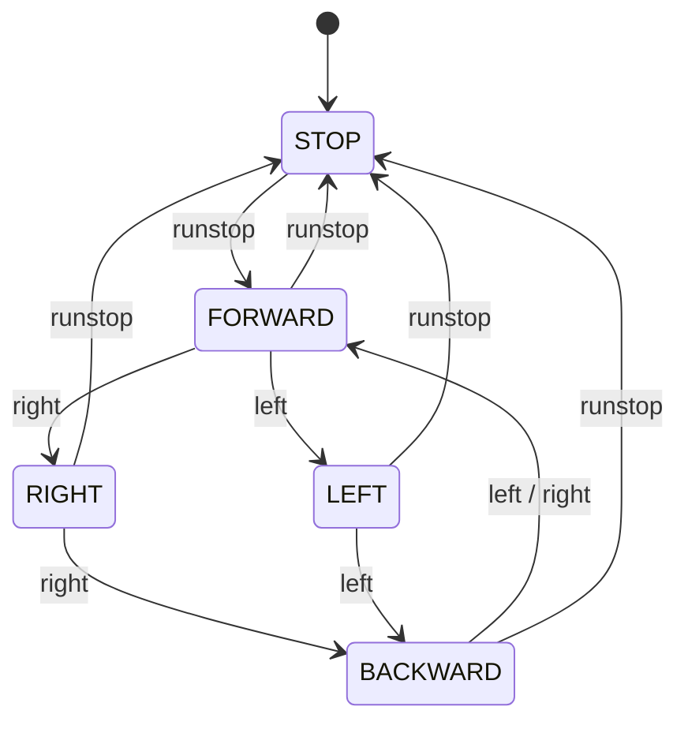

# DC_Motor_Controller — L298N DC 모터 PWM 제어 (슈퍼루프)

> 📅 2026-11-11 · 보드: NUCLEO-F411RE

스마트카 프로젝트 준비로 **L298N 모터 드라이버**로 좌 / 우 바퀴 DC 모터를 구동한 실습.
속도는 TIM3 PWM duty로, 방향은 IN1 / IN2 GPIO로 제어하고, 버튼 3개로 정지 / 전진 / 좌회전 / 우회전 / 후진 FSM을 만듦.
같은 동작을 RTOS로 옮긴 버전은 [RTOS_DC_Motor](../RTOS_DC_Motor).

## 파일 구조

```
Core/Src/
├── main.c                     # 모터 FSM (슈퍼루프)
└── driver/
    ├── dc_motor/              # motor_t, 방향 / 속도 제어
    └── button/
```

## 사용 핀

| 항목 | 핀 |
|---|---|
| 왼쪽 모터 ENA (PWM) | PC6 — TIM3_CH1 |
| 왼쪽 모터 IN1 / IN2 | PB6 / PA7 |
| 오른쪽 모터 ENB (PWM) | PC8 — TIM3_CH3 |
| 오른쪽 모터 IN3 / IN4 | PA5 / PA6 |
| Button | PC0 (run·stop) / PC1 (left) / PC2 (right) |

TIM3: Prescaler 100-1, Period 1000-1 → 100MHz / 100 / 1000 = **1kHz PWM**, ARR preload enable

---

## L298N 동작

| IN1 | IN2 | 모터 |
|---|---|---|
| 1 | 0 | 정회전 |
| 0 | 1 | 역회전 |
| 0 | 0 | 정지 |

- EN 핀에 PWM을 넣어 **duty = 속도** (ARR 0 ~ 999 중 CCR 900-1 → duty 90%)
- 회전은 한쪽 바퀴만 돌리고 반대쪽은 IN1 = IN2 = 0으로 세우는 방식 (`motor_right`: 왼쪽 정지 / 오른쪽 run, `motor_left`: 반대)

## 드라이버

```c
typedef struct {
	TIM_HandleTypeDef *htim;
	uint32_t ch;
	GPIO_TypeDef *GPIO1;  uint16_t GPIO1_Pin;
	GPIO_TypeDef *GPIO2;  uint16_t GPIO2_Pin;
} motor_t;

void motor_forward(void) {
	__HAL_TIM_SET_COMPARE(motorL.htim, motorL.ch, motor_speed - 1);
	HAL_GPIO_WritePin(motorL.GPIO1, motorL.GPIO1_Pin, GPIO_PIN_SET);
	HAL_GPIO_WritePin(motorL.GPIO2, motorL.GPIO2_Pin, GPIO_PIN_RESET);

	__HAL_TIM_SET_COMPARE(motorR.htim, motorR.ch, motor_speed - 1);
	HAL_GPIO_WritePin(motorR.GPIO1, motorR.GPIO1_Pin, GPIO_PIN_SET);
	HAL_GPIO_WritePin(motorR.GPIO2, motorR.GPIO2_Pin, GPIO_PIN_RESET);

	HAL_TIM_PWM_Start(motorL.htim, motorL.ch);
	HAL_TIM_PWM_Start(motorR.htim, motorR.ch);
}
```

- 모터 하나 = 타이머 채널 1개 + 방향 핀 2개를 구조체로 묶음
- `motor_setSpeed`로 1 ~ 1000 범위 속도를 저장해 두고 방향 함수들이 CCR에 반영
- 이 버전은 드라이버가 `extern motor_t motorL, motorR`로 main의 전역 변수를 직접 참조 → RTOS 버전에서 포인터 인자로 개선

## 모터 FSM



```c
while (1) {
	state_runstop = button_getState(&btn_runstop);
	state_right = button_getState(&btn_right);
	state_left = button_getState(&btn_left);

	switch (state) {
	case STOP:
		if (state_runstop == ACT_RELEASE) state = FORWARD;
		motor_stop();
		break;
	case FORWARD:
		if (state_runstop == ACT_RELEASE) state = STOP;
		else if (state_right == ACT_RELEASE) state = RIGHT;
		else if (state_left == ACT_RELEASE) state = LEFT;
		motor_forward();
		break;
	// BACKWARD, RIGHT, LEFT ...
	}
}
```

전체 코드: [`Core/Src/main.c`](Core/Src/main.c), [`Core/Src/driver/dc_motor/dc_motor.c`](Core/Src/driver/dc_motor/dc_motor.c)
