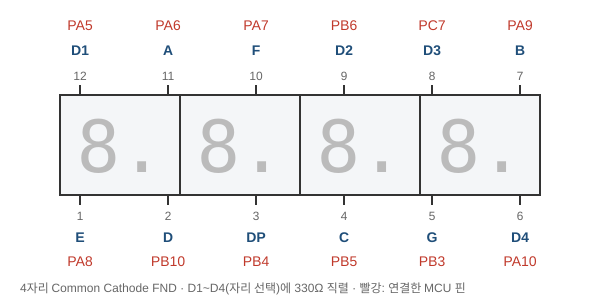
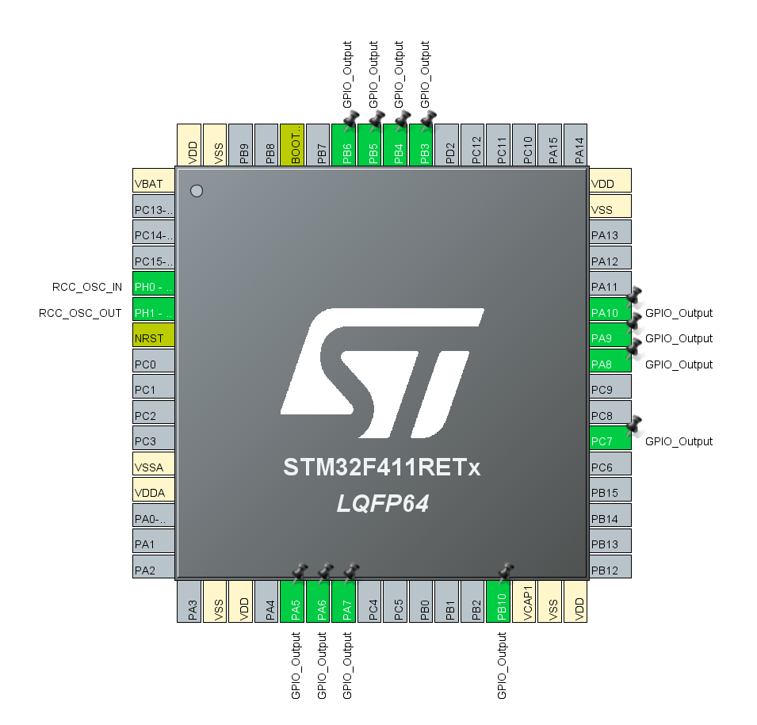

# FND — 7 Segment Display (1234 표시, 9999 카운터)

> 📅 2026-10-13 · 보드: NUCLEO-F411RE

4자리 7-segment(FND)를 GPIO로 직접 구동. 자리(Digit)를 1ms씩 번갈아 켜는 **다이나믹 구동**으로 숫자 4개를 동시에 보이게 함.

## 사용 핀

| 신호 | 핀 |
|---|---|
| D1 ~ D4 (자리 선택) | PA5, PB6, PC7, PA10 |
| A, B, C, D | PA6, PA9, PB5, PB10 |
| E, F, G, DP | PA8, PA7, PB3, PB4 |

---

## 활동: 7 segment display



- cathode: - 연결시 켜진다
- cathode / anode 구분법: Anode는 +와 연결시 켜진다
- D → -, A~G → + 전압차줘서 다이오드 불들어오게 한다

```
Anode (+) ──▶|── Cathode (−)      전류는 + → − 방향으로만 흐름
```

- Common Cathode 4자리 FND 내부: 자리마다 세그먼트 8개(A~G, DP)의 cathode가 하나로 묶여 D1~D4 핀이 되고,
  같은 이름의 세그먼트(A~G, DP)는 4자리 모두 anode끼리 연결되어 있음
  - 그래서 12핀만으로 32개 LED를 제어 → 대신 한 번에 한 자리만 켜고 빠르게 돌아가며 켜야 함 (다이나믹 구동)

| 켜고 싶은 것 | 자리 핀 (D1~D4) | 세그먼트 핀 (A~G, DP) |
|---|---|---|
| ON | LOW (`GPIO_PIN_RESET`) | HIGH (`GPIO_PIN_SET`) |
| OFF | HIGH | LOW |

- 7segment와 연결된 포트 gpio output으로 설정



## 실습: FND에 1234 띄우기

```c
// 초기화 -> 모두 끄기
HAL_GPIO_WritePin(GPIOA, GPIO_PIN_5, GPIO_PIN_SET); // D1
HAL_GPIO_WritePin(GPIOB, GPIO_PIN_6, GPIO_PIN_SET); // D2
HAL_GPIO_WritePin(GPIOC, GPIO_PIN_7, GPIO_PIN_SET); // D3
HAL_GPIO_WritePin(GPIOA, GPIO_PIN_10, GPIO_PIN_SET); // D4

HAL_GPIO_WritePin(GPIOA, GPIO_PIN_6, GPIO_PIN_SET); // A
HAL_GPIO_WritePin(GPIOA, GPIO_PIN_9, GPIO_PIN_SET); // B
HAL_GPIO_WritePin(GPIOB, GPIO_PIN_5, GPIO_PIN_SET); // C
HAL_GPIO_WritePin(GPIOB, GPIO_PIN_10, GPIO_PIN_SET); // D
HAL_GPIO_WritePin(GPIOA, GPIO_PIN_8, GPIO_PIN_SET); // E
HAL_GPIO_WritePin(GPIOA, GPIO_PIN_7, GPIO_PIN_SET); // F
HAL_GPIO_WritePin(GPIOB, GPIO_PIN_3, GPIO_PIN_SET); // G
HAL_GPIO_WritePin(GPIOB, GPIO_PIN_4, GPIO_PIN_SET); // DP

while (1) {
		// 1 출력
		HAL_GPIO_WritePin(GPIOA, GPIO_PIN_6, GPIO_PIN_RESET); // A
		HAL_GPIO_WritePin(GPIOA, GPIO_PIN_9, GPIO_PIN_SET); // B
		HAL_GPIO_WritePin(GPIOB, GPIO_PIN_5, GPIO_PIN_SET); // C
		HAL_GPIO_WritePin(GPIOB, GPIO_PIN_10, GPIO_PIN_RESET); // D
		HAL_GPIO_WritePin(GPIOA, GPIO_PIN_8, GPIO_PIN_RESET); // E
		HAL_GPIO_WritePin(GPIOA, GPIO_PIN_7, GPIO_PIN_RESET); // F
		HAL_GPIO_WritePin(GPIOB, GPIO_PIN_3, GPIO_PIN_RESET); // G
		HAL_GPIO_WritePin(GPIOB, GPIO_PIN_4, GPIO_PIN_RESET); // DP

		HAL_GPIO_WritePin(GPIOA, GPIO_PIN_5, GPIO_PIN_RESET); // D1
		HAL_GPIO_WritePin(GPIOB, GPIO_PIN_6, GPIO_PIN_SET); // D2
		HAL_GPIO_WritePin(GPIOC, GPIO_PIN_7, GPIO_PIN_SET); // D3
		HAL_GPIO_WritePin(GPIOA, GPIO_PIN_10, GPIO_PIN_SET); // D4
		HAL_Delay(1);

		HAL_GPIO_WritePin(GPIOA, GPIO_PIN_5, GPIO_PIN_SET); // D1
		HAL_GPIO_WritePin(GPIOB, GPIO_PIN_6, GPIO_PIN_SET); // D2
		HAL_GPIO_WritePin(GPIOC, GPIO_PIN_7, GPIO_PIN_SET); // D3
		HAL_GPIO_WritePin(GPIOA, GPIO_PIN_10, GPIO_PIN_SET); // D4

		// 2
		HAL_GPIO_WritePin(GPIOA, GPIO_PIN_6, GPIO_PIN_SET); // A
		HAL_GPIO_WritePin(GPIOA, GPIO_PIN_9, GPIO_PIN_SET); // B
		HAL_GPIO_WritePin(GPIOB, GPIO_PIN_5, GPIO_PIN_RESET); // C
		HAL_GPIO_WritePin(GPIOB, GPIO_PIN_10, GPIO_PIN_SET); // D
		HAL_GPIO_WritePin(GPIOA, GPIO_PIN_8, GPIO_PIN_SET); // E
		HAL_GPIO_WritePin(GPIOA, GPIO_PIN_7, GPIO_PIN_RESET); // F
		HAL_GPIO_WritePin(GPIOB, GPIO_PIN_3, GPIO_PIN_SET); // G
		HAL_GPIO_WritePin(GPIOB, GPIO_PIN_4, GPIO_PIN_RESET); // DP

		HAL_GPIO_WritePin(GPIOA, GPIO_PIN_5, GPIO_PIN_SET); // D1
		HAL_GPIO_WritePin(GPIOB, GPIO_PIN_6, GPIO_PIN_RESET); // D2
		HAL_GPIO_WritePin(GPIOC, GPIO_PIN_7, GPIO_PIN_SET); // D3
		HAL_GPIO_WritePin(GPIOA, GPIO_PIN_10, GPIO_PIN_SET); // D4
		HAL_Delay(1);

		HAL_GPIO_WritePin(GPIOA, GPIO_PIN_5, GPIO_PIN_SET); // D1
		HAL_GPIO_WritePin(GPIOB, GPIO_PIN_6, GPIO_PIN_SET); // D2
		HAL_GPIO_WritePin(GPIOC, GPIO_PIN_7, GPIO_PIN_SET); // D3
		HAL_GPIO_WritePin(GPIOA, GPIO_PIN_10, GPIO_PIN_SET); // D4

		// 3
		HAL_GPIO_WritePin(GPIOA, GPIO_PIN_6, GPIO_PIN_SET); // A
		HAL_GPIO_WritePin(GPIOA, GPIO_PIN_9, GPIO_PIN_SET); // B
		HAL_GPIO_WritePin(GPIOB, GPIO_PIN_5, GPIO_PIN_SET); // C
		HAL_GPIO_WritePin(GPIOB, GPIO_PIN_10, GPIO_PIN_SET); // D
		HAL_GPIO_WritePin(GPIOA, GPIO_PIN_8, GPIO_PIN_RESET); // E
		HAL_GPIO_WritePin(GPIOA, GPIO_PIN_7, GPIO_PIN_RESET); // F
		HAL_GPIO_WritePin(GPIOB, GPIO_PIN_3, GPIO_PIN_SET); // G
		HAL_GPIO_WritePin(GPIOB, GPIO_PIN_4, GPIO_PIN_RESET); // DP

		HAL_GPIO_WritePin(GPIOA, GPIO_PIN_5, GPIO_PIN_SET); // D1
		HAL_GPIO_WritePin(GPIOB, GPIO_PIN_6, GPIO_PIN_SET); // D2
		HAL_GPIO_WritePin(GPIOC, GPIO_PIN_7, GPIO_PIN_RESET); // D3
		HAL_GPIO_WritePin(GPIOA, GPIO_PIN_10, GPIO_PIN_SET); // D4
		HAL_Delay(1);

		HAL_GPIO_WritePin(GPIOA, GPIO_PIN_5, GPIO_PIN_SET); // D1
		HAL_GPIO_WritePin(GPIOB, GPIO_PIN_6, GPIO_PIN_SET); // D2
		HAL_GPIO_WritePin(GPIOC, GPIO_PIN_7, GPIO_PIN_SET); // D3
		HAL_GPIO_WritePin(GPIOA, GPIO_PIN_10, GPIO_PIN_SET); // D4

		// 4
		HAL_GPIO_WritePin(GPIOA, GPIO_PIN_6, GPIO_PIN_RESET); // A
		HAL_GPIO_WritePin(GPIOA, GPIO_PIN_9, GPIO_PIN_SET); // B
		HAL_GPIO_WritePin(GPIOB, GPIO_PIN_5, GPIO_PIN_SET); // C
		HAL_GPIO_WritePin(GPIOB, GPIO_PIN_10, GPIO_PIN_RESET); // D
		HAL_GPIO_WritePin(GPIOA, GPIO_PIN_8, GPIO_PIN_RESET); // E
		HAL_GPIO_WritePin(GPIOA, GPIO_PIN_7, GPIO_PIN_SET); // F
		HAL_GPIO_WritePin(GPIOB, GPIO_PIN_3, GPIO_PIN_SET); // G
		HAL_GPIO_WritePin(GPIOB, GPIO_PIN_4, GPIO_PIN_RESET); // DP

		HAL_GPIO_WritePin(GPIOA, GPIO_PIN_5, GPIO_PIN_SET); // D1
		HAL_GPIO_WritePin(GPIOB, GPIO_PIN_6, GPIO_PIN_SET); // D2
		HAL_GPIO_WritePin(GPIOC, GPIO_PIN_7, GPIO_PIN_SET); // D3
		HAL_GPIO_WritePin(GPIOA, GPIO_PIN_10, GPIO_PIN_RESET); // D4
		HAL_Delay(1);

		HAL_GPIO_TogglePin(GPIOA, GPIO_PIN_5); // D1
		HAL_GPIO_TogglePin(GPIOB, GPIO_PIN_6); // D2
		HAL_GPIO_TogglePin(GPIOC, GPIO_PIN_7); // D3
		HAL_GPIO_TogglePin(GPIOA, GPIO_PIN_10); // D4
	}
```

## 과제: 9999 카운터 fnd

> 전원(Reset) 인가하면 0000 ~ 9999를 0.1초 간격으로 up counter 하기 (반복)

소스: [`Core/Src/main.c`](Core/Src/main.c)

> 같은 기능을 구조체·배열로 정리한 버전은 [FND_review](../FND_review) 참고
