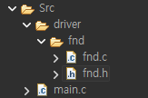
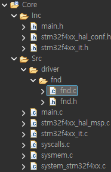
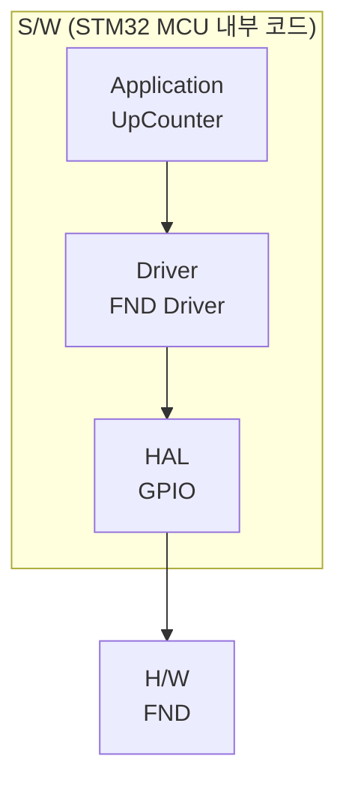

# FND_review — 구조체·배열로 9999 Up Counter + FND 드라이버 분리

> 📅 2026-10-14 · 보드: NUCLEO-F411RE

[FND](../FND)에서 숫자마다 함수를 따로 만들던 코드를 **구조체 배열 + 2차원 폰트 배열**로 정리하고, FND 제어 코드를 `driver/fnd`로 분리함. `HAL_GetTick()` 오버플로우 동작과 소프트웨어 스택 구조도 정리.

## 파일 구조

```
Core/Src/
├── main.c            # 9999 up counter (application)
└── driver/fnd/
    ├── fnd.c         # FND 드라이버
    └── fnd.h
```

---

- ioc 확장자 파일: cubemx 정보 파일임
  - 얘만 복사하면 새로운 프로젝트에서도 똑같이 설정한거 사용 가능
  - ioc 파일 복사 → 폴더와 똑같은 이름으로 맞추기 → ioc 파일 열어서 generate code

## 리뷰: 구조체와 배열 활용해서 9999 up counter

```c
void fnd_all_off() {
	HAL_GPIO_WritePin(D1_GPIO, D1_PIN, GPIO_PIN_SET); // D1
	HAL_GPIO_WritePin(D2_GPIO, D2_PIN, GPIO_PIN_SET); // D2
	HAL_GPIO_WritePin(D3_GPIO, D3_PIN, GPIO_PIN_SET); // D3
	HAL_GPIO_WritePin(D4_GPIO, D4_PIN, GPIO_PIN_SET); // D4
}

void fnd_sel_digit(int digit) {
	fnd_all_off();

	switch (digit) {
	case 1:
		HAL_GPIO_WritePin(D1_GPIO, D1_PIN, GPIO_PIN_RESET); // D1
		break;
	case 2:
		HAL_GPIO_WritePin(D2_GPIO, D2_PIN, GPIO_PIN_RESET); // D2
		break;
	case 3:
		HAL_GPIO_WritePin(D3_GPIO, D3_PIN, GPIO_PIN_RESET); // D3
		break;
	case 4:
		HAL_GPIO_WritePin(D4_GPIO, D4_PIN, GPIO_PIN_RESET); // D4
		break;
	}
}

void fnd_disp_number(int num) {

	// 구조체 배열
	seg_port seg_font[8] = { { GPIOA, GPIO_PIN_6 }, // A
			{ GPIOA, GPIO_PIN_9 }, // B
			{ GPIOB, GPIO_PIN_5 }, // C
			{ GPIOB, GPIO_PIN_10 }, // D
			{ GPIOA, GPIO_PIN_8 }, // E
			{ GPIOA, GPIO_PIN_7 }, // F
			{ GPIOB, GPIO_PIN_3 }, // G
			{ GPIOB, GPIO_PIN_4 } // DP
	};

	// 2차원 배열
	int seg_font_data[12][8] = { { 1, 1, 1, 1, 1, 1, 0, 0 }, // 0
			{ 0, 1, 1, 0, 0, 0, 0, 0 }, // 1
			{ 1, 1, 0, 1, 1, 0, 1, 0 }, // 2
			{ 1, 1, 1, 1, 0, 0, 1, 0 }, // 3
			{ 0, 1, 1, 0, 0, 1, 1, 0 }, // 4
			{ 1, 0, 1, 1, 0, 1, 1, 0 }, // 5
			{ 1, 0, 1, 1, 1, 1, 1, 0 }, // 6
			{ 1, 1, 1, 0, 0, 0, 0, 0 }, // 7
			{ 1, 1, 1, 1, 1, 1, 1, 0 }, // 8
			{ 1, 1, 1, 1, 0, 1, 1, 0 }, // 9
			{ 1, 1, 1, 1, 1, 1, 1, 1 }, // set all
			{ 0, 0, 0, 0, 0, 0, 0, 0 }  // reset all
	};

	for (int i = 0; i < 8; i++) {
		HAL_GPIO_WritePin(seg_font[i].GPIOx, seg_font[i].GPIO_Pin,
				seg_font_data[num][i]);
	}
}

void fnd_show_one_digit(int num, int idx) {
	// display digit in D idx
	fnd_disp_number(num);
	fnd_sel_digit(idx);
	HAL_Delay(1);

	fnd_all_off();
}

void fnd_show_number(int num) {
	int temp;
	temp = num;

	for (int i = 4; i >= 1; i--) {
		fnd_show_one_digit(temp % 10, i);
		temp = temp / 10;
	}
}
```

```c
uint16_t counter = 0;
uint32_t prevTime = 0;

while (1) {

	prevTime = HAL_GetTick();
	if (counter != 9999) {
		counter++;
	} else {
		counter = 0;
	}

	// hal_gettick: 1ms 간격으로 tick 숫자를 셈
	// 시스템에 전원이 인가되면 도는 내부 tick의 카운터임
	while (HAL_GetTick() - prevTime < 100) {
		fnd_show_number(counter);
	}
}
```

- 기존 방식에 비해 fnd seg 선택하는 코드가 엄청 줄어들었다!
  - 코드 자체도 줄었고 함수 개수도 0~9 까지 10개 다 만들어줬던걸 1개 함수로 퉁칠 수 있게 됨
- main 함수도 깔끔해짐
- 근데 함수 너무 많아져서 main.c가 복잡해졌다 → driver로 분리!



## tick이 오버플로우나면 어떻게 됨? 오류 동작?

4bit 카운터(0000 ~ 1111)로 단순화해서 보면:

```
  현재 tick(1) - 과거 tick(14)
=   0001 - 1110
=   0001 + 0010      (1110의 2의 보수 = 0010)
=   0011 = 3         → 14 → 15 → 0 → 1 사이 간격 3과 같다
```

- 오버플로우나서 현재 hal tick = 1
- 과거 tick = 14일때
- 0001 - 1110 = 0001 + 0010 = 0011 = 3 → 14 — 15 — 0 — 1 간격 개수와 똑같이 계산된다!
- 오버플로우가 나도 현재 hal tick - 과거 tick 계산이 정상적으로 동작함을 확인

## 소프트웨어 구조

<table><tr>
<td></td>
<td><br>

- stm32가 제공하는 라이브러리 (api)
- stm32에 연결된 주변장치 동작 api code 제공

</td></tr></table>

### 소프트웨어 stack architecture



- driver: 하드웨어를 제어하기 위한 코드
- stack 구조로 fnd를 제어하고 있다!
- 파일 시스템, 파일 구조를 stack 구조 반영해서 만들거임 앞으로도
- 화살표 (아래) 방향으로 call 한다
  - application인 upcounter가 driver인 fnd driver를 call
  - driver인 fnd driver가 gpio 제어를 위한 api hal을 call
  - gpio를 제어하기 위한 api인 hal이 fnd에 전기적 신호를 보냄
- 누가 나를 부르고 있는지 사용 당하는 입장, call 당하는, 하위 모듈 입장에서는 모름
  - 의존성이 일방향 (상위에서 하위를 의존)
  - 하위는 누가 날 사용하는지 모르는 상태에서 구현되어있는거임
