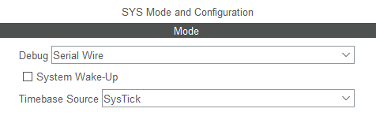
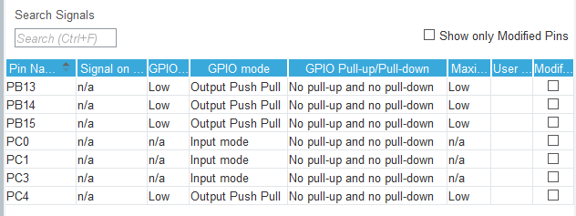
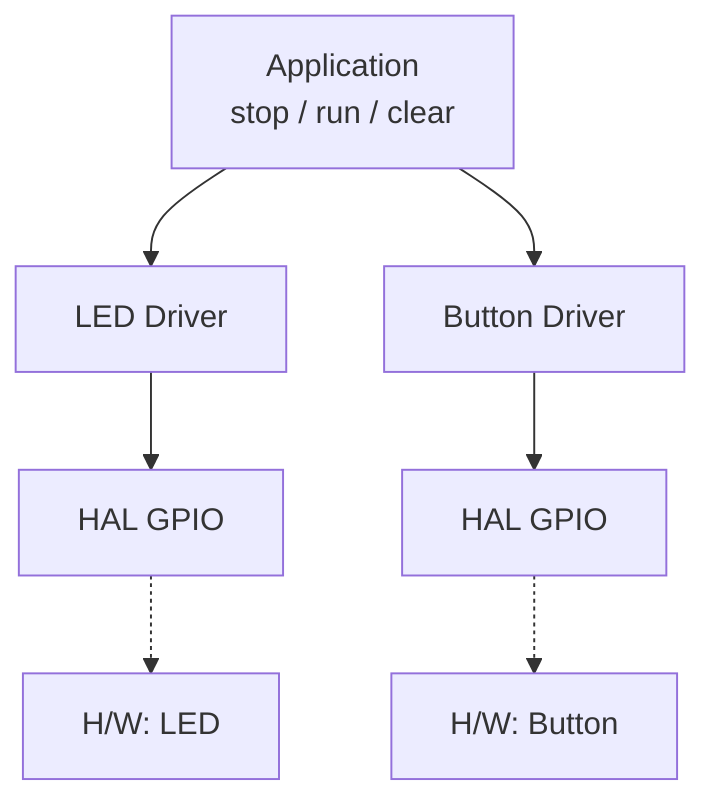

# LED_Button — LED / Button 드라이버 만들기

> 📅 2026-10-16 · 보드: NUCLEO-F411RE

LED와 버튼을 `GPIOx + Pin` 구조체로 추상화한 **드라이버 계층**을 만들고, 애플리케이션(`ap_main`)은 드라이버 함수만 호출하도록 분리함.

## 파일 구조

```
Core/Src/
├── main.c              # HAL 초기화 후 ap_main() 호출
├── ap/ap_main.c        # application
└── driver/
    ├── led/led.c, led.h
    └── button/button.c, button.h
```

## 사용 핀

| 핀 | 용도 |
|---|---|
| PB15, PB14, PB13, PC4 | LED (power / run / stop / clear) |
| PC0, PC1, PC3 | 택트 버튼 |
| PA13, PA14 | SWD 디버그 (Serial Wire) |

---

- sys 설정 → debug를 serial wire로



- gpio 설정 가보면 핀 세팅된거 나옴



- output level: 초기화 레벨, 초기값이 1(high)이냐 0(low)이냐

## 실습: led, button 드라이버 만들기

- led 깜빡이는 코드

```c
while (1) {
		HAL_GPIO_WritePin(GPIOB, GPIO_PIN_15, GPIO_PIN_SET);
		HAL_GPIO_WritePin(GPIOB, GPIO_PIN_14, GPIO_PIN_SET);
		HAL_GPIO_WritePin(GPIOB, GPIO_PIN_13, GPIO_PIN_SET);
		HAL_GPIO_WritePin(GPIOC, GPIO_PIN_4, GPIO_PIN_SET);
		HAL_Delay(100);
		HAL_GPIO_WritePin(GPIOB, GPIO_PIN_15, GPIO_PIN_RESET);
		HAL_GPIO_WritePin(GPIOB, GPIO_PIN_14, GPIO_PIN_RESET);
		HAL_GPIO_WritePin(GPIOB, GPIO_PIN_13, GPIO_PIN_RESET);
		HAL_GPIO_WritePin(GPIOC, GPIO_PIN_4, GPIO_PIN_RESET);
		HAL_Delay(100);
	}
```

```c
while (1)
{
	led_on(led이름1);
	led_on(led이름2);
	led_on(led이름3);
	led_on(led이름4);
	HAL_Delay(100);
	led_off(led이름1);
	led_off(led이름2);
	led_off(led이름3);
	led_off(led이름4);
	HAL_Delay(100);
}
```

- 위에걸 이렇게 만들고 싶음

- 이렇게 만들어서

```c
typedef struct {
	GPIO_TypeDef* GPIOx;
	uint16_t GPIO_Pin;
} led_t;

void led_on(const led_t* led) {
	HAL_GPIO_WritePin(led->GPIOx, led->GPIO_Pin, GPIO_PIN_SET);
}

void led_off(const led_t* led) {
	HAL_GPIO_WritePin(led->GPIOx, led->GPIO_Pin, GPIO_PIN_RESET);
}

void led_toggle(const led_t* led) {
	HAL_GPIO_TogglePin(led->GPIOx, led->GPIO_Pin);
}
```

- 이렇게 썼다~

```c
led_t led_power = {GPIOB, GPIO_PIN_15};
led_t led_run 	= {GPIOB, GPIO_PIN_14};
led_t led_stop	= {GPIOB, GPIO_PIN_13};
led_t led_clear	= {GPIOC, GPIO_PIN_4};

led_on(&led_power);
led_on(&led_run);
led_on(&led_stop);
led_on(&led_clear);
HAL_Delay(100);
led_off(&led_power);
led_off(&led_run);
led_off(&led_stop);
led_off(&led_clear);
HAL_Delay(100);
```

- 직관적이다~

### led 드라이버

- led.h

```c
#ifndef SRC_DRIVER_LED_LED_H_
#define SRC_DRIVER_LED_LED_H_

#include "stm32f4xx_hal.h"

typedef struct {
	GPIO_TypeDef *GPIOx;
	uint16_t GPIO_Pin;
} led_t;

void led_on(const led_t *led);
void led_off(const led_t *led);
void led_toggle(const led_t *led);

#endif /* SRC_DRIVER_LED_LED_H_ */
```

- led.c

```c
#include "led.h"

void led_on(const led_t *led) {
	HAL_GPIO_WritePin(led->GPIOx, led->GPIO_Pin, GPIO_PIN_SET);
}

void led_off(const led_t *led) {
	HAL_GPIO_WritePin(led->GPIOx, led->GPIO_Pin, GPIO_PIN_RESET);
}

void led_toggle(const led_t *led) {
	HAL_GPIO_TogglePin(led->GPIOx, led->GPIO_Pin);
}
```

### button 드라이버

- button.h

```c
#ifndef SRC_DRIVER_BUTTON_BUTTON_H_
#define SRC_DRIVER_BUTTON_BUTTON_H_

#include "stm32f4xx_hal.h"

typedef enum {
	NO_ACT,		// 아무것도 안하고 있을 때의 동작
	ACT_PUSH,	// 누르기 시작했을때의 동작
	ACT_RELEASE // 누르고 있다가 뗐을 때의 동작
} button_state_t;

enum {
	PUSHED = 0, RELEASED
};

typedef struct {
	GPIO_TypeDef *GPIOx;
	uint16_t GPIO_Pin;
	int prevState;
} button_t;

button_state_t button_getState(button_t *btn);

#endif /* SRC_DRIVER_BUTTON_BUTTON_H_ */
```

- button.c

```c
#include "button.h"

button_state_t button_getState(button_t *btn) {
	int curState;

	curState = HAL_GPIO_ReadPin(btn->GPIOx, btn->GPIO_Pin);

	if ((btn->prevState == RELEASED) && (curState == PUSHED)) {
		btn->prevState = curState;
		HAL_Delay(5); // 채터링(바운싱) 방지용 딜레이
		return ACT_PUSH;
	} else if ((btn->prevState == PUSHED) && (curState == RELEASED)) {
		btn->prevState = curState;
		HAL_Delay(5); // 채터링(바운싱) 방지용 딜레이
		return ACT_RELEASE;
	}

	btn->prevState = curState;
	return NO_ACT;
}
```

## 전체 sw 구조




- callee는 caller를 모른다
  - 상관없이 짜야함 - 서로 의존하고 있는 코드는 나쁜 코드

> 이 드라이버를 그대로 가져가서 타이머 인터럽트 스톱워치를 만든 건 [upcounter_stopwatch](../upcounter_stopwatch)
