# LedBlink — STM32 세팅, LED Blink

> 📅 2026-10-12 · 보드: NUCLEO-F411RE (STM32F411RET6)

STM32CubeMX/CubeIDE로 프로젝트를 만들고, HAL로 GPIO를 제어해 LED를 깜빡이고 버튼 입력을 읽어봄.

## 사용 핀

| 핀 | 용도 |
|---|---|
| PA5 | LD2 (보드 green LED) |
| PC13 | B1 (보드 blue button) |
| PB15, PB14, PB13, PC4 | 외부 LED 4개 |
| PC0, PC1, PC2 | 외부 택트 스위치 3개 |

---

## STM32CubeMX

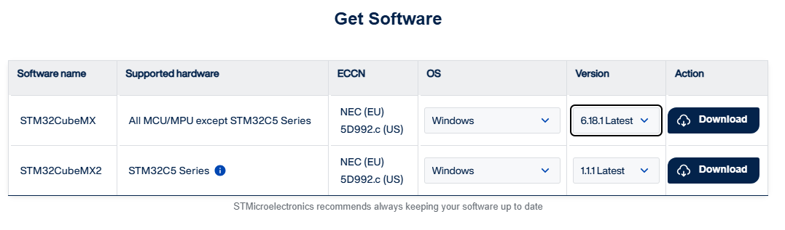

- mx2 말고 mx

<p>
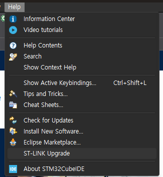
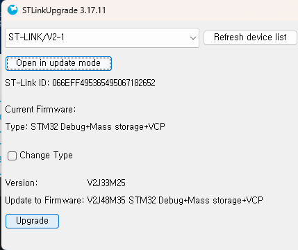
</p>

- ide에서 st-link 업그레이드로 stm32 보드 버전업

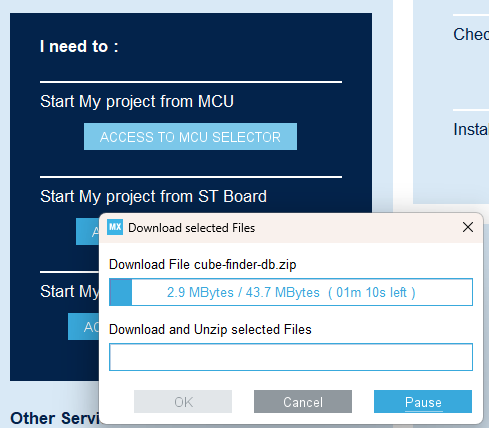

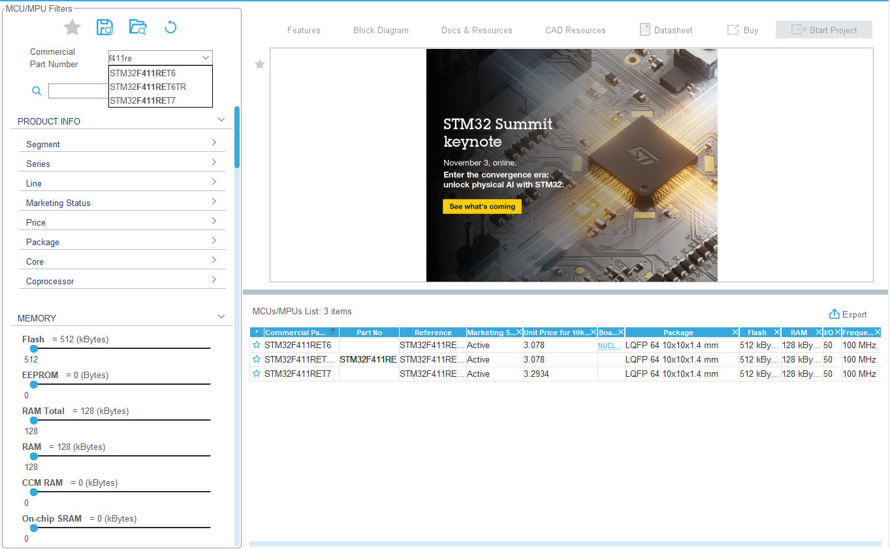

- stm32 보드에 ret6이라 써있으니까 ret6 ㄱㄱ

### 시스템 clock 설정

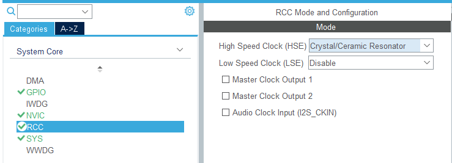

- 시스템코어 → RCC
- HSE → Crystal

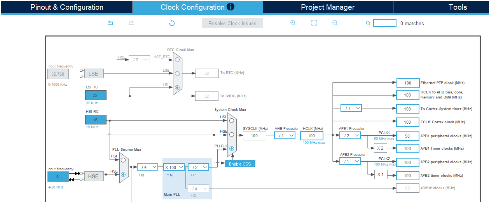

외부 입력과 내부 clk 주파수를 설정하면 알아서 잘 만들어줌

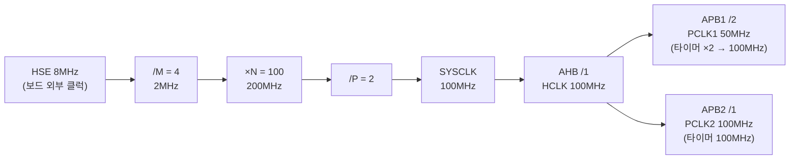

- 외부 입력은 왜 8MHz인가?

  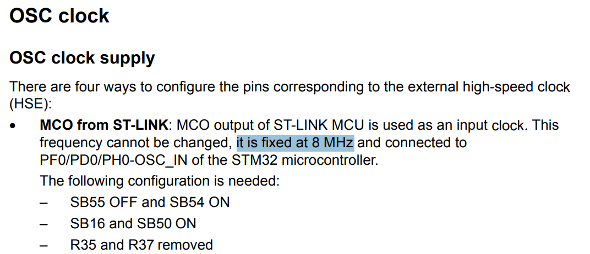
  <sub>출처: UM1724 STM32 Nucleo-64 user manual</sub>

  - 칩 외부에 위치한 8MHz 크리스탈 clock (OSC - 오실레이터 클럭) 출력이 8MHz로 고정되어 있음
    - 크리스탈 - 수정 오실레이터: 마이크로컨트롤러(MCU)가 동작하는 기준 클럭(시간 박자)을 만들어주는 부품
- 외부 clock을 쓰는 이유?
  - 외부 clock 없어도 내부 clock만으로 동작 가능하긴 해
  - 근데 외부 clock이 있으면 안정적
  - 내부 clock은 칩 온도에 따라 clock이 빨라졌다 느려졌다 - 불안정
  - 그래서 상대적으로 칩 온도에 영향을 안받는 안정적인 외부 clock을 사용
  - 시스템의 안정성 → clock이 중요하다

| 구분 | 타이머 클럭 (Timer Clock) | 주변장치 클럭 (Peripheral Clock, PCLK) |
|---|---|---|
| **주요 목적** | 시간 측정, 주기적인 인터럽트 발생, PWM 생성, 카운팅 | UART, SPI, I2C, GPIO 등 일반 주변장치(Peripheral)의 동작 및 통신 동기화 |
| **소스/공급** | 내부 고정 클럭, 외부 클럭(RTC 등), 또는 분주된 버스 클럭 | 시스템 버스 클럭(AHB, APB 등)에서 프리스케일러(Prescaler)를 거쳐 공급 |
| **특징** | 정확한 시간 지연(Delay)이나 타임아웃을 위해 **프리스케일러를 통한 세밀한 주파수 조절**이 필수적인 경우가 많음 | 각 주변장치 버스의 최대 동작 주파수 한계 내에서 통신 속도나 레지스터 제어를 위해 사용됨 |

### GPIO 핀 설정

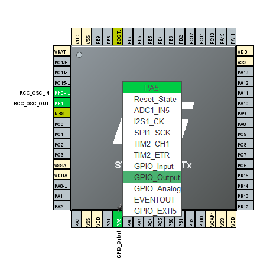

### 프로젝트 설정

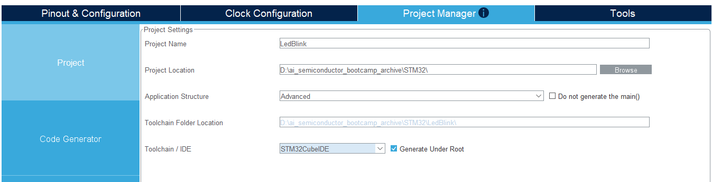

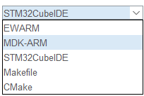

CMake 요즘 많이 쓰고, EWARM, MDK-ARM은 유료 ide

- 꼭 CubeIDE가 IDE가 되도록

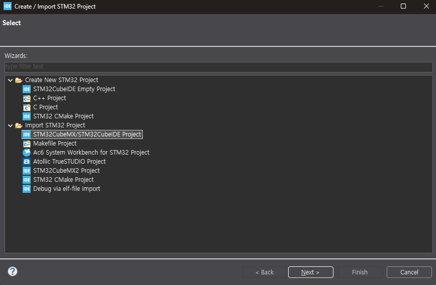

### 코드 작성

```c
int main(void)
{
  HAL_Init();
  SystemClock_Config();
  MX_GPIO_Init();

  /* USER CODE BEGIN WHILE */
  // 여기에 유저 코드 작성!!
  while (1)
  {
    /* USER CODE END WHILE */
		// PA5를 gpio output으로 연결했으므로 GPIOA + pin 5번
		HAL_GPIO_TogglePin(GPIOA, GPIO_PIN_5);
		HAL_Delay(500); // 0.5s delay
    /* USER CODE BEGIN 3 */
  }
  /* USER CODE END 3 */
}
```

> ctrl + space: 자동완성

### 디버그


### 실행

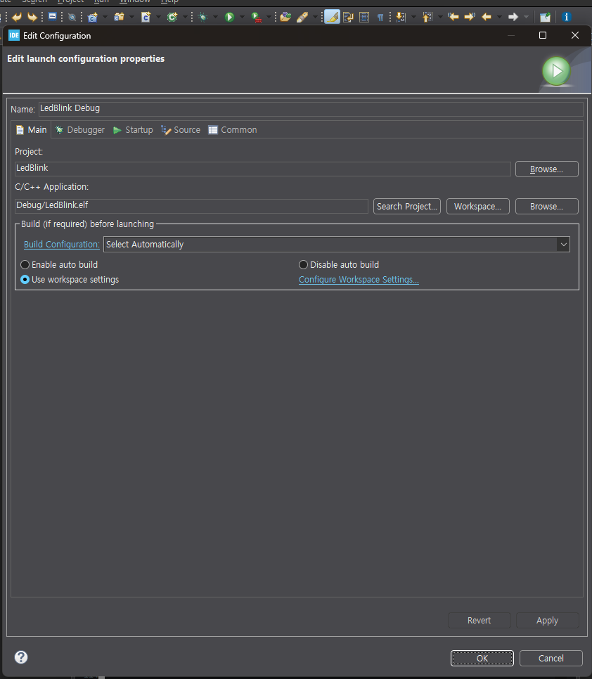

- ok 누르면 됨
- 0.5초마다 led 깜빡깜빡 확인

### Nucleo f411re user manual

- [UM1724 - STM32 Nucleo-64 boards user manual](https://www.st.com/resource/en/user_manual/um1724-stm32-nucleo64-boards-mb1136-stmicroelectronics.pdf)
- 핀 배치

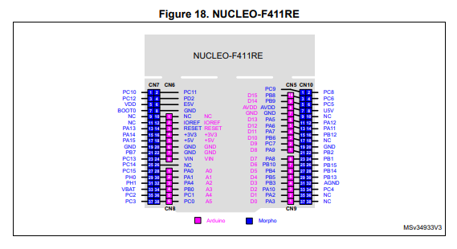
<sub>출처: UM1724</sub>

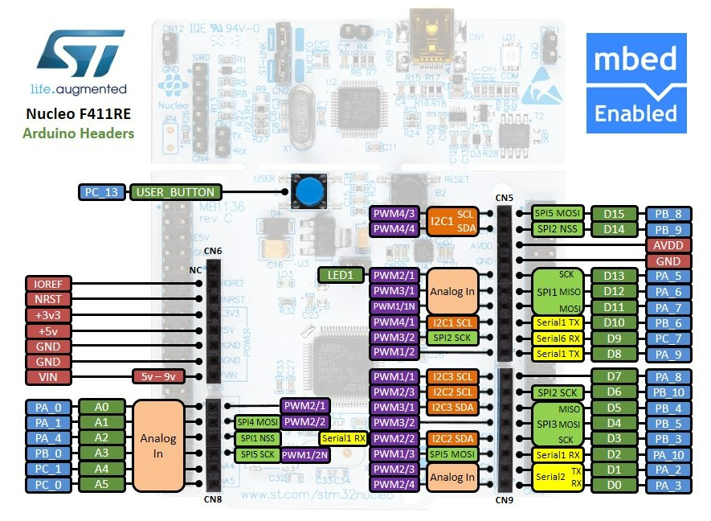
<sub>출처: Arm Mbed NUCLEO-F411RE 페이지</sub>

- LD2 연결 (green led)

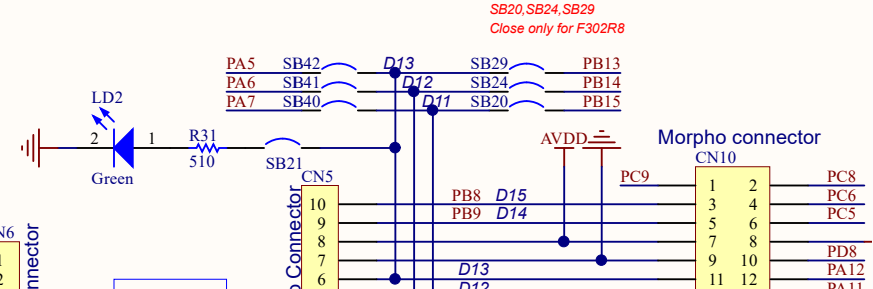
<sub>출처: MB1136 schematic</sub>

- B1 연결 (blue button)

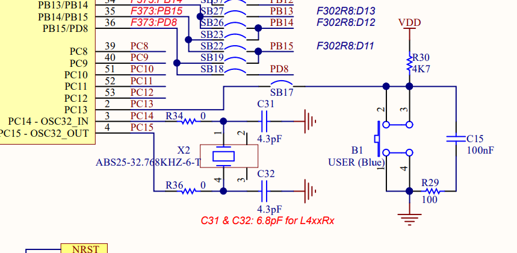
<sub>출처: MB1136 schematic</sub>

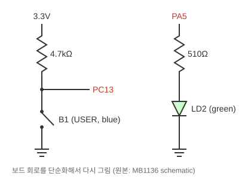

- led의 경우 gnd랑 연결 - 꺼짐되어있다가 pa5를 통해 Vdd 들어오면 켜짐
- 스위치의 경우 3.3v vdd와 연결되어있다가 스위치를 누르면 gnd와 연결됨

### Nucleo f411re schematics

- [MB1136 schematic](https://www.st.com/resource/en/schematic_pack/mb1136-default-c04_schematic.pdf)

---

## 활동1: 4개의 led 깜빡거리기

> 외부 LED 4개를 0.2초 on / 0.2초 off로 toggle 하기

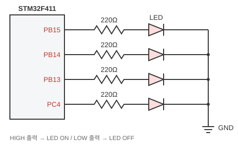

- 모포 커넥터 CN10의 PB15, PB14, PB13, PC4 + CN6의 GND 사용

1. pinout 설정 후 generate code

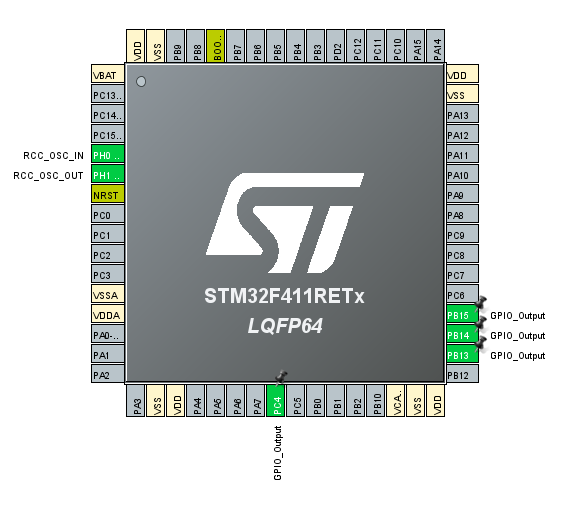

2. 코드 작성 후 run

```c
while (1)
  {
    /* USER CODE END WHILE */
	  HAL_GPIO_TogglePin(GPIOB, GPIO_PIN_15);
	  HAL_GPIO_TogglePin(GPIOB, GPIO_PIN_14);
	  HAL_GPIO_TogglePin(GPIOB, GPIO_PIN_13);
	  HAL_GPIO_TogglePin(GPIOC, GPIO_PIN_4);
	  HAL_Delay(200);
    /* USER CODE BEGIN 3 */
  }
```

## 활동2: 버튼 누르면 led 켜지게하기

> User Button(PC13)을 누르면 LED ON, 떼면 LED OFF

- 버튼 입력은 PC13과 연결되어있다 (위 [board_io](images/board_io.svg) 회로)
- PC13의 전압이 3.3v(vdd)인지 0(gnd)인지 확인하기
- 버튼은 떼져있으면 VDD와 연결 → 3.3v / 누르면 GND와 연결 → 0v

| 버튼 | PC13 전압 | `HAL_GPIO_ReadPin` | LED |
|---|---|---|---|
| 누름 | 0V | 0 | ON |
| 뗌 | 3.3V | 1 | OFF |

```c
while (1)
    {
    /* USER CODE END WHILE */
	  if (!HAL_GPIO_ReadPin(GPIOC, GPIO_PIN_13)) { // pc13 == button == 0 == 눌렀다
		  HAL_GPIO_WritePin(GPIOB, GPIO_PIN_15, GPIO_PIN_SET); // on -> set = 1
		  HAL_GPIO_WritePin(GPIOB, GPIO_PIN_14, GPIO_PIN_SET); // on
		  HAL_GPIO_WritePin(GPIOB, GPIO_PIN_13, GPIO_PIN_SET); // on
		  HAL_GPIO_WritePin(GPIOC, GPIO_PIN_4, GPIO_PIN_SET); // on
	  } else { // pc13 == button == 1 == 뗐다
		  HAL_GPIO_WritePin(GPIOB, GPIO_PIN_15, GPIO_PIN_RESET); // off -> reset = 0
		  HAL_GPIO_WritePin(GPIOB, GPIO_PIN_14, GPIO_PIN_RESET); // off
		  HAL_GPIO_WritePin(GPIOB, GPIO_PIN_13, GPIO_PIN_RESET); // off
		  HAL_GPIO_WritePin(GPIOC, GPIO_PIN_4, GPIO_PIN_RESET); // off
	  }
    /* USER CODE BEGIN 3 */
    }
```

## 활동3: 택트스위치 + led 점등

> 외부 택트 스위치 3개로 LED 4개 제어
>
> 1. 버튼1 → LED 4개 ON
> 2. 버튼2 → LED 4개 OFF
> 3. 버튼3 → LED 4개 0.2초 간격으로 toggle

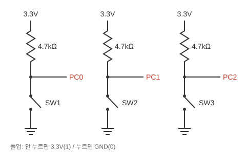

- LED 배선은 활동1과 동일, 버튼은 PC0, PC1, PC2에 연결
- 택트 스위치: 누르면 GND = 0 / 떼면 VCC = 1
- 택트 스위치 4핀: 1-2, 3-4가 내부에서 이미 연결되어 있고, 누르면 두 쌍이 연결됨 → 대각선 핀을 쓰면 안전

1. 핀아웃

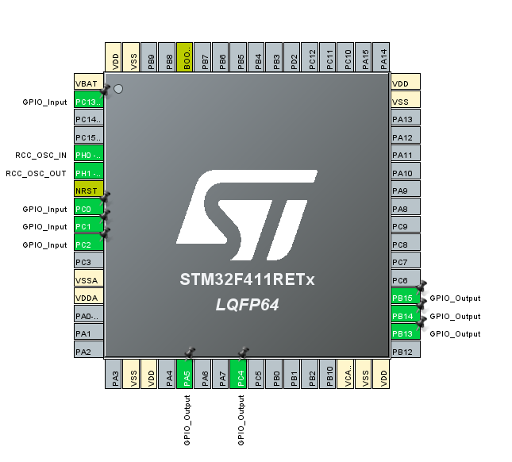

2. 코드

```c
int toggle_trigger = 0;
	/* USER CODE BEGIN WHILE */
	while (1) {
		/* USER CODE END WHILE */

		// 1 버튼을 누르면 led 4개 on
		if (!HAL_GPIO_ReadPin(GPIOC, GPIO_PIN_0)) {
			toggle_trigger = 0;
			HAL_GPIO_WritePin(GPIOB, GPIO_PIN_15, GPIO_PIN_SET); // on -> set = 1
			HAL_GPIO_WritePin(GPIOB, GPIO_PIN_14, GPIO_PIN_SET); // on
			HAL_GPIO_WritePin(GPIOB, GPIO_PIN_13, GPIO_PIN_SET); // on
			HAL_GPIO_WritePin(GPIOC, GPIO_PIN_4, GPIO_PIN_SET); // on
		}
		// 2버튼을 누르면 led 4개 off
		else if (!HAL_GPIO_ReadPin(GPIOC, GPIO_PIN_1)) {
			toggle_trigger = 0;
			HAL_GPIO_WritePin(GPIOB, GPIO_PIN_15, GPIO_PIN_RESET); // off -> reset = 0
			HAL_GPIO_WritePin(GPIOB, GPIO_PIN_14, GPIO_PIN_RESET); // off
			HAL_GPIO_WritePin(GPIOB, GPIO_PIN_13, GPIO_PIN_RESET); // off
			HAL_GPIO_WritePin(GPIOC, GPIO_PIN_4, GPIO_PIN_RESET); // off
		}
		// 3버튼을 누르면 led 4개 0.2초 간격으로 toggle
		else if (!HAL_GPIO_ReadPin(GPIOC, GPIO_PIN_2)) {
			toggle_trigger = 1;
		}

		if (toggle_trigger) {
			HAL_GPIO_TogglePin(GPIOB, GPIO_PIN_15);
			HAL_GPIO_TogglePin(GPIOB, GPIO_PIN_14);
			HAL_GPIO_TogglePin(GPIOB, GPIO_PIN_13);
			HAL_GPIO_TogglePin(GPIOC, GPIO_PIN_4);
			HAL_Delay(200);
		}
		/* USER CODE BEGIN 3 */
	}
```
