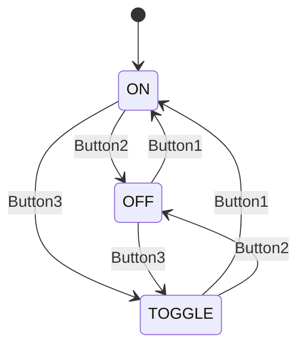

# Ledblink_review — 버튼 3개 + LED Blink FSM

> 📅 2026-10-13 · 보드: NUCLEO-F411RE

[LedBlink](../LedBlink)에서 if-else로 짰던 버튼/LED 제어를 **FSM(상태 머신)** 구조로 다시 짜고, 상태별 동작을 함수로 분리해 main을 정리함.

## 사용 핀

| 핀 | 용도 |
|---|---|
| PB15, PB14, PB13, PC4 | LED 1~4 |
| PC0, PC1, PC3 | 버튼 1~3 (ON / OFF / TOGGLE) |

---

## 버튼3 + led blink FSM

- verilog에서 했던 것처럼 fsm으로 생각하자



- context switch한다~

```c
// enum
enum {LED_ON, LED_OFF, LED_TOGGLE};

// func
// led on -> set = 1
void led_on(GPIO_TypeDef* GPIOx, uint16_t GPIO_Pin) {
	HAL_GPIO_WritePin(GPIOx, GPIO_Pin, GPIO_PIN_SET);
}

// led off -> reset = 0
void led_off(GPIO_TypeDef* GPIOx, uint16_t GPIO_Pin) {
	HAL_GPIO_WritePin(GPIOx, GPIO_Pin, GPIO_PIN_RESET);
}

void led_toggle(GPIO_TypeDef* GPIOx, uint16_t GPIO_Pin) {
	HAL_GPIO_TogglePin(GPIOx, GPIO_Pin);
}

// main
int state = LED_ON;
	/* USER CODE BEGIN WHILE */
	while (1) {
		switch (state) {
		case LED_ON:
			if (!HAL_GPIO_ReadPin(BTN2_GPIO, BTN2_PIN)) {
				state = LED_OFF;
			} else if (!HAL_GPIO_ReadPin(BTN3_GPIO, BTN3_PIN)) {
				state = LED_TOGGLE;
			}

			led_on(LED1_GPIO, LED1_PIN); // on
			led_on(LED2_GPIO, LED2_PIN); // on
			led_on(LED3_GPIO, LED3_PIN); // on
			led_on(LED4_GPIO, LED4_PIN); // on
			break;
		case LED_OFF:
			if (!HAL_GPIO_ReadPin(BTN1_GPIO, BTN1_PIN)) {
				state = LED_ON;
			} else if (!HAL_GPIO_ReadPin(BTN3_GPIO, BTN3_PIN)) {
				state = LED_TOGGLE;
			}

			led_off(LED1_GPIO, LED1_PIN); // off
			led_off(LED2_GPIO, LED2_PIN); // off
			led_off(LED3_GPIO, LED3_PIN); // off
			led_off(LED4_GPIO, LED4_PIN); // off
			break;
		case LED_TOGGLE:
			if (!HAL_GPIO_ReadPin(BTN2_GPIO, BTN2_PIN)) {
				state = LED_OFF;
			} else if (!HAL_GPIO_ReadPin(BTN1_GPIO, BTN1_PIN)) {
				state = LED_ON;
			}

			led_toggle(LED1_GPIO, LED1_PIN);
			led_toggle(LED2_GPIO, LED2_PIN);
			led_toggle(LED3_GPIO, LED3_PIN);
			led_toggle(LED4_GPIO, LED4_PIN);
			HAL_Delay(200);
			break;
		default:
			state = LED_ON;
			break;
		}
	}
```

- main 함수를 깔끔하게 만들기 → 모듈화

```c
// 함수로 만들고
void led_on_state() {
	if (!HAL_GPIO_ReadPin(BTN2_GPIO, BTN2_PIN)) {
		state = LED_OFF;
	} else if (!HAL_GPIO_ReadPin(BTN3_GPIO, BTN3_PIN)) {
		state = LED_TOGGLE;
	}

	led_on(LED1_GPIO, LED1_PIN); // on
	led_on(LED2_GPIO, LED2_PIN); // on
	led_on(LED3_GPIO, LED3_PIN); // on
	led_on(LED4_GPIO, LED4_PIN); // on
}


// 갖다 쓰기
case LED_ON:
			led_on_state();
			break;
```
