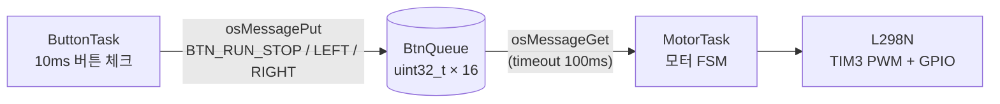
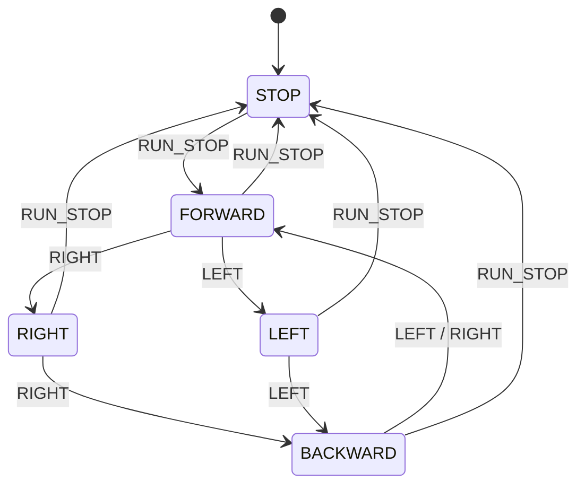

# RTOS_DC_Motor — FreeRTOS message queue로 버튼 → 모터 task 통신

> 📅 2026-11-11 ~ 12 · 보드: NUCLEO-F411RE · FreeRTOS (CMSIS-RTOS v1)

[DC_Motor_Controller](../DC_Motor_Controller)의 슈퍼루프 모터 제어를 **버튼 task / 모터 task**로 나누고,
두 task 사이 데이터를 전역 변수 대신 RTOS가 제공하는 **message queue**로 주고받도록 바꾼 실습.
11/12에 `freertos.c`에 몰려 있던 task 본문을 `ap/task/`로 분리함.

## 파일 구조

```
Core/Src/
├── main.c
├── freertos.c                 # queue / task 생성, 각 task는 init 후 무한루프에서 *_task() 호출
├── gpio.c  tim.c              # CubeMX가 주변장치 init을 파일별로 분리 생성
├── ap/
│   ├── message.h              # 큐 핸들 extern, btn_status_t
│   └── task/
│       ├── button/            # button_task — 버튼 release → BtnQueue
│       └── motor_control/     # motor_control_task — BtnQueue → 모터 FSM
└── driver/
    ├── dc_motor/              # motor_t* 인자로 받는 버전
    └── button/
```

## 사용 핀

| 항목 | 핀 |
|---|---|
| 왼쪽 모터 ENA / IN1 / IN2 | PC6 (TIM3_CH1) / PB6 / PA7 |
| 오른쪽 모터 ENB / IN3 / IN4 | PC8 (TIM3_CH3) / PA5 / PA6 |
| Button | PC0 (run·stop) / PC1 (left) / PC2 (right) |

TIM3 1kHz PWM (Prescaler 100-1, Period 1000-1)

---

## 구조



| Task | 우선순위 | 스택 | 하는 일 |
|---|---|---|---|
| defaultTask | Normal | 128 | `osDelay(1)`만 |
| MotorTask | Normal | 128 | `motor_control_task()` — 큐에서 버튼 이벤트 받아 FSM + 모터 구동 |
| ButtonTask | Normal | 128 | `button_task()` — 버튼 release를 큐에 넣음 (10ms 주기) |

```c
// freertos.c — task 함수는 init + 루프만 남기고 본문은 ap/task로
void StartButtonTask(void const *argument) {
	button_task_init();
	for (;;) {
		button_task();
		osDelay(10);
	}
}
```

다른 task 파일에서 큐를 쓰려면 핸들을 `extern`으로 공유:

```c
// ap/message.h
#include "cmsis_os.h"
extern osMessageQId BtnQueueHandle;

typedef enum { BTN_NO, BTN_RUN_STOP, BTN_LEFT, BTN_RIGHT } btn_status_t;
```

## Message Queue

CubeMX → FREERTOS → Tasks and Queues에서 생성하면 `freertos.c`에 핸들이 만들어짐.

```c
osMessageQId BtnQueueHandle;

osMessageQDef(BtnQueue, 16, uint32_t);   // 32bit 데이터 칸 16개
BtnQueueHandle = osMessageCreate(osMessageQ(BtnQueue), NULL);
```

### 넣기 — `button_task()`

```c
void button_task(void) {
	if (button_getState(&btn_runstop) == ACT_RELEASE) {
		osMessagePut(BtnQueueHandle, BTN_RUN_STOP, 10);
	} else if (button_getState(&btn_left) == ACT_RELEASE) {
		// 큐가 full이면 최대 10ms 기다리고, 그래도 full이면 버림
		osMessagePut(BtnQueueHandle, BTN_LEFT, 10);
	} else if (button_getState(&btn_right) == ACT_RELEASE) {
		osMessagePut(BtnQueueHandle, BTN_RIGHT, 10);
	}
}
```

### 꺼내기 — `motor_control_task()`

```c
void motor_control_task(void) {
	osEvent evt;
	btn_status_t btn_status = BTN_NO;
	evt = osMessageGet(BtnQueueHandle, 100);   // 최대 100ms 동안 Blocked로 대기
	if (evt.status == osEventMessage) {
		btn_status = evt.value.v;               // 값으로 받기 (포인터로 받는 것도 가능)
	}

	switch (manual_state) {
	case STOP:
		if (btn_status == BTN_RUN_STOP) manual_state = FORWARD;
		motor_stop(&motorL, &motorR);
		break;
	case FORWARD:
		if (btn_status == BTN_RUN_STOP) manual_state = STOP;
		else if (btn_status == BTN_RIGHT) manual_state = RIGHT;
		else if (btn_status == BTN_LEFT) manual_state = LEFT;
		motor_forward(&motorL, &motorR);
		break;
	// BACKWARD, RIGHT, LEFT ...
	}
}
```



- 큐가 비어 있으면 `osMessageGet`이 task를 **Blocked**로 보내서 CPU를 다른 task에 양보
- 이벤트가 큐에 쌓이므로 처리 중에 들어온 버튼 입력도 순서대로 유지됨
- [RTOS_test](../RTOS_test)처럼 전역 변수를 두 task가 같이 쓰면 읽기 / 지우기 타이밍이 겹칠 수 있는데, 큐는 OS가 동기화를 보장

## 슈퍼루프 버전과 비교

| | DC_Motor_Controller | RTOS_DC_Motor |
|---|---|---|
| 실행 구조 | while(1) 하나에서 버튼 읽기 + FSM | ButtonTask / MotorTask 분리 |
| 버튼 → 모터 전달 | 같은 루프의 지역 변수 | message queue |
| 모터 객체 | main 전역, 드라이버가 `extern`으로 참조 | `motor_control_task.c` 안에 두고 `motor_t*` 인자로 전달 |
| 버튼 체크 주기 | 루프 속도에 의존 | `osDelay(10)`으로 10ms 고정 |

다음 단계: [RTOS_DC_Motor_UART_Mutex](../RTOS_DC_Motor_UART_Mutex) — UART 명령 task 추가, LCD 공유를 mutex로 보호

전체 코드: [`Core/Src/freertos.c`](Core/Src/freertos.c), [`Core/Src/ap/task/`](Core/Src/ap/task), [`Core/Src/driver/dc_motor/dc_motor.c`](Core/Src/driver/dc_motor/dc_motor.c)
