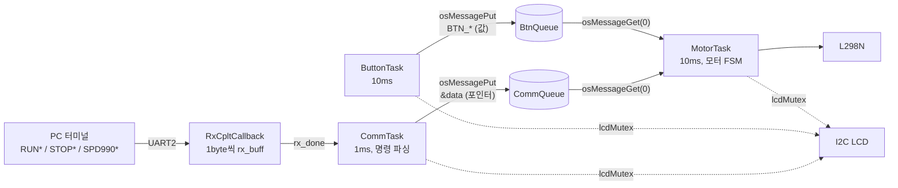
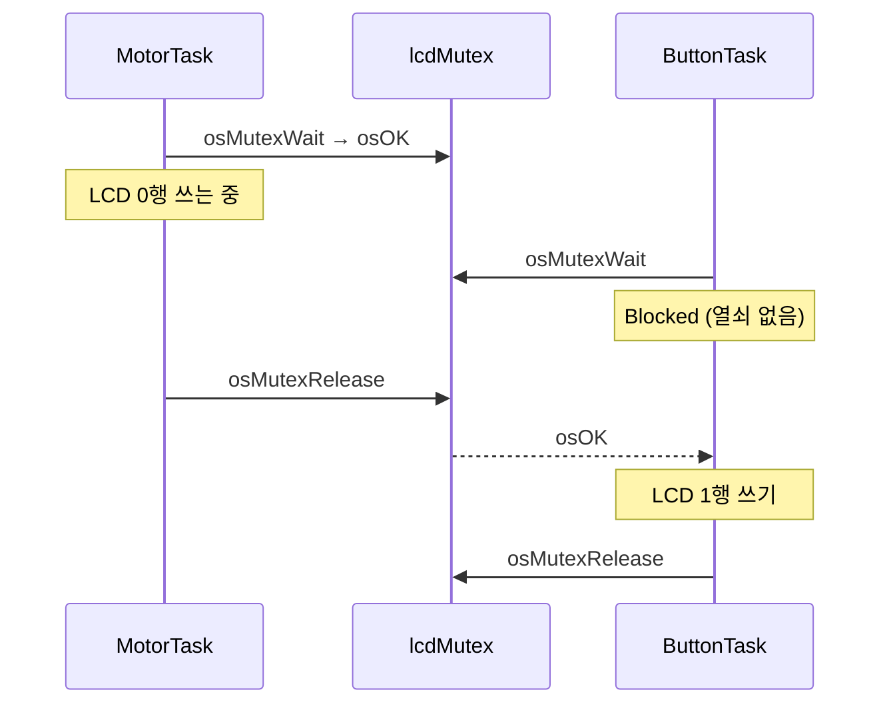

# RTOS_DC_Motor_UART_Mutex — UART 명령 task + LCD 공유 mutex

> 📅 2026-11-12 · 보드: NUCLEO-F411RE · FreeRTOS (CMSIS-RTOS v1)

[RTOS_DC_Motor](../RTOS_DC_Motor)에 두 가지를 추가한 실습.

1. **CommTask** — PC에서 UART로 보낸 문자열 명령(`RUN*`, `STOP*`, `SPD990*`)을 받아 두 번째 message queue로 모터 task에 전달
2. **lcdMutex** — I2C LCD 하나를 task 3개가 같이 쓰므로, mutex로 한 번에 한 task만 LCD에 쓰도록 보호

## 파일 구조

```
Core/Src/
├── main.c
├── freertos.c                 # mutex / queue 2개 / task 4개 생성, LCD init
├── gpio.c  tim.c  i2c.c  usart.c
├── ap/
│   ├── message.h              # BtnQueue, CommQueue, lcdMutex 핸들 extern, 상태 enum
│   └── task/
│       ├── button/            # 버튼 → BtnQueue, LCD 2번째 줄 표시
│       ├── comm/              # UART RX 인터럽트 → 명령 파싱 → CommQueue
│       └── motor_control/     # 두 큐를 non-blocking으로 확인 → 모터 FSM, LCD 1번째 줄 표시
└── driver/
    ├── dc_motor/  button/
    └── lcd/                   # I2C LCD (PCF8574)
```

## 사용 핀

| 항목 | 핀 |
|---|---|
| 왼쪽 모터 ENA / IN1 / IN2 | PC6 (TIM3_CH1) / PB6 / PA7 |
| 오른쪽 모터 ENB / IN3 / IN4 | PC8 (TIM3_CH3) / PA5 / PA6 |
| Button | PC0 (run·stop) / PC1 (left) / PC2 (right) |
| UART2 (ST-Link VCP) | PA2 TX / PA3 RX, 115200 bps, RX 인터럽트 |
| I2C1 LCD | PB8 SCL / PB9 SDA |

TIM3 1kHz PWM (Prescaler 100-1, Period 1000-1)

---

## 구조



| Task | 우선순위 | 주기 | 하는 일 |
|---|---|---|---|
| defaultTask | Normal | — | mutex 잡고 `Lcd_init`, 이후 `osDelay(1)` |
| MotorTask | Normal | 10ms | 두 큐 확인 → FSM + 모터 구동, LCD 0행에 상태 |
| ButtonTask | Normal | 10ms | 버튼 release → BtnQueue, LCD 1행 |
| CommTask | Normal | 1ms | 명령 수신 완료 시 파싱 → CommQueue, LCD 1행 |

CubeMX → FREERTOS → Tasks and Queues에서 `CommQueue`(16 × uint32_t), Mutexes 탭에서 `lcdMutex`를 추가.

## UART 명령 수신

PC → STM32로 문자열 명령을 보낼 때는 **여기까지가 한 명령**이라는 끝 문자를 정해야 함.
보통 `\n`, `\r`, `#` 등을 쓰는데 여기서는 `*`.

```c
static uint8_t rx_data = 0;
static uint8_t rx_index = 0;
static uint8_t rx_done = 0;
static char rx_buff[32] = { 0, };

void HAL_UART_RxCpltCallback(UART_HandleTypeDef *huart) {
	if (huart->Instance == USART2) {
		if (rx_data == '*') {
			rx_buff[rx_index++] = '\0';   // 끝 문자 자리에 NULL → C 문자열로 비교 가능
			rx_done = 1;
		} else {
			rx_buff[rx_index++] = rx_data;
		}
		HAL_UART_Receive_IT(&huart2, &rx_data, 1);   // 다음 1byte 수신 재등록
	}
}
```

- 1byte 받을 때마다 인터럽트 → `rx_buff`에 저장
- ISR에서는 저장 + 플래그만, 문자열 비교는 CommTask에서

```c
void comm_task() {
	if (rx_done) {
		if (strcmp(rx_buff, "RUN") == 0) {          // 같으면 0
			data.status = COMM_RUN;
			osMessagePut(CommQueueHandle, (uint32_t) &data, 10);
		} else if (strcmp(rx_buff, "STOP") == 0) {
			data.status = COMM_STOP;
			osMessagePut(CommQueueHandle, (uint32_t) &data, 10);
		} else if (strncmp(rx_buff, "SPD", 3) == 0) {
			data.status = COMM_SPEED;
			data.speed = atoi(&rx_buff[3]);          // "SPD990" → 990
			osMessagePut(CommQueueHandle, (uint32_t) &data, 10);
		}
		// 정의 안 된 명령은 무시
		rx_done = 0;
		rx_index = 0;
	}
}
```

| 명령 | 동작 |
|---|---|
| `RUN*` | STOP → FORWARD |
| `STOP*` | 어느 상태든 → STOP |
| `SPD<n>*` | PWM duty를 n으로 (1 ~ 1000, `motor_setSpeed`에서 clamp) |

## 큐로 구조체 넘기기 — 값 vs 포인터

처음엔 버튼처럼 enum 값만 넣었는데, `SPD`는 **상태 + 속도** 두 개를 넘겨야 함.
큐 한 칸은 32bit라서 구조체를 통째로 못 넣으므로 **구조체 주소**를 넣고 꺼낼 때 `value.p`로 받음.

```c
typedef struct {
	comm_status_t status;
	int speed;
} comm_data_t;

// 받는 쪽 (motor_control_task)
comm_evt = osMessageGet(CommQueueHandle, 0);
if (comm_evt.status == osEventMessage) {
	comm_status = ((comm_data_t *)comm_evt.value.p)->status;
	speed       = ((comm_data_t *)comm_evt.value.p)->speed;
}
```

| | BtnQueue | CommQueue |
|---|---|---|
| 넣는 것 | `BTN_RUN_STOP` 등 enum 값 | `&data` (구조체 주소) |
| 꺼내기 | `evt.value.v` | `evt.value.p` → 캐스팅 |

> 큐에는 주소만 들어가므로 `data`는 전역/static이어야 함 (지역 변수 주소를 넣으면 함수가 끝난 뒤 사라짐).
> 같은 `data` 하나를 재사용하므로, MotorTask가 꺼내기 전에 다음 명령이 오면 앞 내용이 덮어써질 수 있음.

## 큐 대기시간 100 → 0 (non-blocking)

```c
btn_evt  = osMessageGet(BtnQueueHandle, 0);
comm_evt = osMessageGet(CommQueueHandle, 0);
```

- 이전: `osMessageGet(BtnQueueHandle, 100)` → 버튼 큐가 빌 때 최대 100ms **Blocked**
  - 큐가 2개가 되면 버튼 큐에서 기다리는 동안 UART 명령이 늦게 처리됨
- 지금: timeout 0 → 값이 있으면 꺼내고, 없으면 바로 다음 동작
- 대신 task 주기는 `osDelay(10)`으로 줌 → 계속 CPU를 잡고 있지 않음

## Mutex

LCD는 I2C로 여러 바이트를 보내는 동작이라, 중간에 task가 바뀌어 다른 task가 LCD에 쓰면 화면이 깨짐.
→ LCD를 쓰기 전에 **열쇠(mutex)를 얻고**, 다 쓰면 **돌려주기**.

```c
osMutexId lcdMutexHandle;   // CubeMX에서 mutex 추가하면 생성됨

if (osMutexWait(lcdMutexHandle, osWaitForever) == osOK) {   // 열쇠 얻을 때까지 Blocked
	Lcd_writeStringXY(0, 0, "Motor Task RUN   ");
	osMutexRelease(lcdMutexHandle);                         // 다 썼으니 반납
}
```



- `Lcd_init`도 defaultTask에서 mutex를 잡고 실행 → 초기화 도중 다른 task가 LCD에 쓰는 것 방지

### Mutex vs Semaphore

| | Mutex | Semaphore |
|---|---|---|
| 목적 | 공유 자원 **독점** (상호 배제) | task 간 **신호 전달 / 순서 조율** |
| 소유권 | 있음 — 잠근 task만 해제 가능 | 없음 — 다른 task가 release 가능 |
| 개수 | 열쇠 1개 | binary(0/1) 또는 counting(여러 개) |

## 정리 / 개선할 점

- 공유 자원(LCD)은 mutex, task 간 데이터 전달은 queue — 전역 변수 직접 공유를 피함
- `rx_buff`는 32byte인데 `*` 없이 길게 들어오면 인덱스 범위 검사가 없음 → `rx_index` 상한 체크 필요
- `rx_done`은 ISR과 task가 같이 쓰는 플래그 → `volatile`이 안전
- 이 구조를 확장해서 RC카 프로젝트로 이어짐

전체 코드: [`Core/Src/freertos.c`](Core/Src/freertos.c), [`Core/Src/ap/task/`](Core/Src/ap/task)
