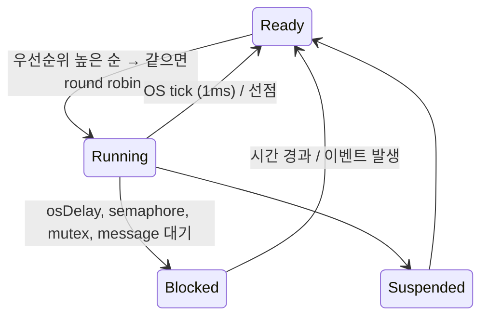
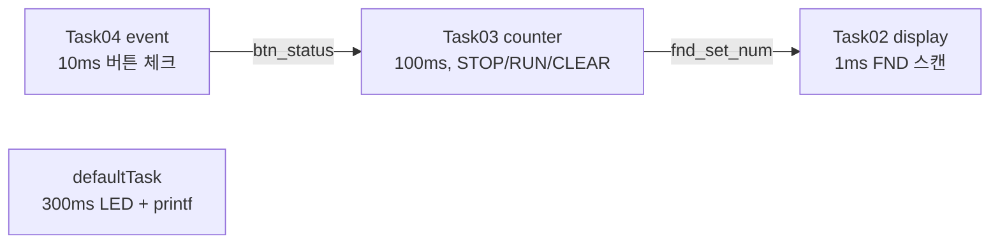

# RTOS_test — FreeRTOS 기초, task로 나눈 FND 카운터

> 📅 2026-11-10 · 보드: NUCLEO-F411RE · FreeRTOS (CMSIS-RTOS v1)

슈퍼루프 대신 **FreeRTOS task**로 동작을 나눠 본 첫 실습.
처음엔 task 4개가 각각 다른 주기로 LED를 깜빡이게 하고, 이후 버튼 이벤트 / 카운터 / FND 표시를 각각 task로 분리한 업카운터로 바꿈.

## 파일 구조

```
Core/Src/
├── main.c                     # task 생성, 각 task 함수 (StartDefaultTask ~ StartTask04)
├── freertos.c
├── ap/task/
│   ├── event/                 # 버튼 → btn_status
│   ├── counter/               # STOP / RUN / CLEAR FSM, FND 값 설정
│   └── display/               # FND 다이나믹 구동
└── driver/
    ├── button/  fnd/
```

## 사용 핀

| 항목 | 핀 |
|---|---|
| Button | PC0 (run·stop) / PC1 (clear) |
| LED | PB15 (heartbeat) |
| FND | PA5 ~ PA10, PB3 ~ PB6, PB10, PC7 |

---

## RTOS가 뭔가

- **Real Time** = 정해진 시간 안에 동작이 끝나는 것을 보장
- 수십 ~ 수백 KB의 작은 OS지만 **스케줄링**을 해줌 → ECU, 방산 장비, 소형 의료기기처럼 리눅스를 올릴 수 없는 작은 컨트롤러에 사용
- 슈퍼루프에서는 타이밍 맞추기, 인터럽트 고려 때문에 예상치 못한 타이밍 오류가 생김 → OS에 맡기면 **task만 만들면 되니** 서비스 코드가 훨씬 단순해짐

| | 의미 |
|---|---|
| Process | 실행 중인 프로그램, 메모리를 독립적으로 할당받음 |
| Thread | 프로세스 안의 실행 흐름, 프로세스 메모리 공유 |
| **Task** | RTOS의 thread. 각자 **우선순위, 상태, 스택**을 가짐 |

## 스케줄링



- Running은 한순간에 **task 1개**뿐. 빠른 **context switching** 때문에 동시에 도는 것처럼 보임
- 일반 OS는 round robin 위주지만 RTOS는 **우선순위가 1순위**, 같은 우선순위끼리만 round robin
- Blocked: OS 기능을 기다리는 상태
  - `osDelay` — 지정 시간 동안 대기
  - semaphore — 자원 사용권(카운트)을 얻을 때까지 대기
  - mutex — 한 task만 자원을 쓰도록 잠금, 풀릴 때까지 대기
  - message queue — 큐가 비었거나(수신) 가득 찼을 때(송신) 대기

## CubeMX 설정

- Middleware → FREERTOS, Interface **CMSIS_V1**
  - CMSIS-RTOS는 FreeRTOS 커널의 wrapper → 다른 RTOS로 바꿔도 같은 함수 호출 유지
- **SYS Timebase를 SysTick → TIM10**: SysTick은 RTOS tick이 쓰므로, `HAL_GetTick`은 별도 타이머로
- `USE_NEWLIB_REENTRANT` Enable → task 안에서 `printf`, `malloc` 등 C 표준 라이브러리 사용
- task 함수는 FLASH(text)에 있고 task는 함수 포인터 + 스택만 RAM에 가짐 → RAM이 작은 MCU에서도 여러 task 가능

## 실습 1: task 4개로 LED 깜빡이기

```c
void StartDefaultTask(void const *argument) {
	for (;;) {
		HAL_GPIO_TogglePin(GPIOB, GPIO_PIN_15);
		osDelay(300);
	}
}
void StartTask02(void const *argument) {
	for (;;) {
		HAL_GPIO_TogglePin(GPIOB, GPIO_PIN_14);
		osDelay(500);
	}
}
// Task03: PB13 1000ms, Task04: PC4 2000ms
```

- 각 task 함수가 **자기만의 main + 무한루프**라고 생각하고 작성 (Verilog의 `always` 여러 개 / `fork ~ join` 느낌)
- 서로의 delay가 다른 task를 막지 않음 → 부저처럼 긴 동작이 있어도 다른 동작이 밀리지 않음

## 실습 2: event / counter / display task 분리



| Task | 우선순위 | 주기 | 하는 일 |
|---|---|---|---|
| defaultTask | Normal | 300ms | LED 토글, `osKernelSysTick()` 출력 |
| myTask02 | Idle | 1ms | `display_task()` — FND 한 자리씩 표시 |
| myTask03 | Idle | 100ms | `counter_task()` — 0.1초마다 +1 |
| myTask04 | Idle | 10ms | `event_task()` — 버튼 입력 |

```c
void counter_task() {
	switch (state) {
	case STOP:
		if (btn_status == BTN_RUN_STOP) { state = RUN; btn_status = BTN_NO; }
		else if (btn_status == BTN_CLEAR) { state = CLEAR; btn_status = BTN_NO; }
		break;
	case RUN:
		if (btn_status == BTN_RUN_STOP) { state = STOP; btn_status = BTN_NO; }
		number++;
		break;
	case CLEAR:
		state = STOP;
		number = 0;
		break;
	}
	fnd_set_num(number);
}
```

- 슈퍼루프에서 `HAL_GetTick()`으로 주기를 직접 재던 코드가 `osDelay(주기)` 하나로 바뀜
- 여기서는 task 간 데이터를 전역 변수 `btn_status`로 넘김 → 다음 실습([RTOS_DC_Motor](../RTOS_DC_Motor))에서 message queue로 개선

## ITM printf (SWV)

```c
int __io_putchar(int ch) {
	ITM_SendChar(ch);   // SWO 핀으로 디버그 출력
	return ch;
}
```

- RTOS에서 UART printf는 task 전환과 겹쳐 출력이 깨지는 경우가 있음 → 디버거의 **ITM(Serial Wire Viewer)** 로 출력하면 빠르고 안정적
- Debug 설정에서 Serial Wire Viewer enable 후 SWV ITM Data Console로 확인

## 주의: task에는 osDelay가 꼭 필요

- `osDelay`(최소 1) 없이 도는 task는 Blocked로 내려가지 않음 → 우선순위가 높으면 **CPU를 계속 점유**해서 다른 task가 영영 실행되지 못함
