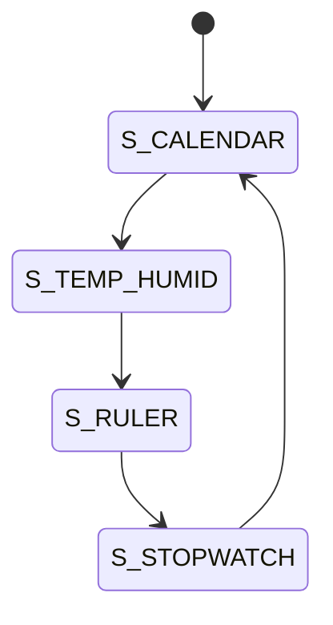

# SmartWatch_review — 스마트 워치 구조 리뷰 (작업 중)

> 📅 2026-11-02 · 보드: NUCLEO-F411RE

[digital_clock_all_in_one](../digital_clock_all_in_one) 과제를 리뷰하며 SW 구조를 처음부터 다시 잡는 중인 프로젝트.
모드별 동작을 `task` 함수로 나누고 `ap_main`의 super loop에서 상태(FSM)에 따라 하나씩 호출하는 뼈대만 만들어 둔 상태 (온습도·줄자·스톱워치 task는 아직 빈 함수).

## 파일 구조

```
Core/Src/
├── main.c
├── common/
│   ├── delay/  queue/
├── ap/
│   ├── ap_main.c              # smartWatch_state FSM
│   └── service/
│       ├── TimeClock/  StopWatch/  Display/
└── driver/
    ├── DS3231/  lcd/  buzzer/
    └── button/  led/
```

## 사용 핀

| 항목 | 설정 |
|---|---|
| I2C1 (PB8 / PB9) | LCD (0x27), DS3231 (0x68) |
| PC0 / PC1 / PC3 | 버튼 |
| PB15, PB14, PB13, PC4 | LED |

---

## 구조



```c
typedef enum {
	S_CALENDAR = 0,
	S_TEMP_HUMID,
	S_RULER,
	S_STOPWATCH
} smartWatch_state_t;

int ap_main(void) {
	while (1) {
		timeClock_task();                 // 시계는 모드와 상관없이 항상 갱신

		switch (smartWatch_state) {
		case S_CALENDAR:
			TimeClock_calendar_task();
			break;
		case S_TEMP_HUMID:
			tempHumid_task();
			break;
		case S_RULER:
			ruler_task();
			break;
		case S_STOPWATCH:
			stopwatch_task();
			break;
		default:
			break;
		}
	}
	return 0;
}
```

- 시계 데이터(`TimeClock`)는 DS3231에서 읽어온 `rtc_datetime`을 중심 데이터로 사용
