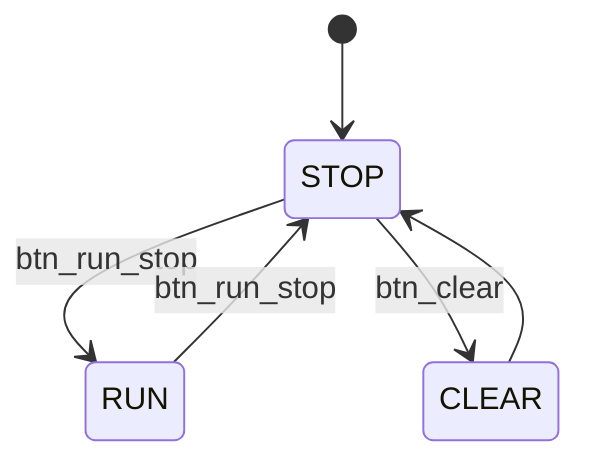
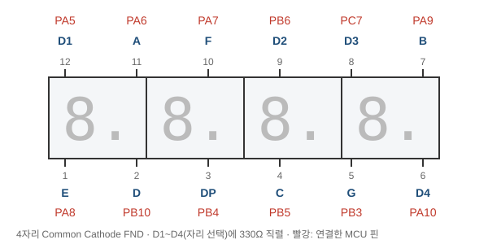
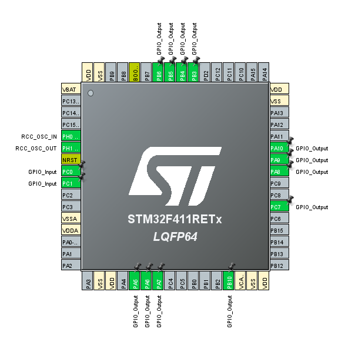

# Stopwatch — FND 스톱워치 (버튼 디바운싱 + FSM)

> 📅 2026-10-14 · 보드: NUCLEO-F411RE

[FND_review](../FND_review)의 FND 드라이버를 그대로 쓰고, 버튼 2개로 RUN/STOP/CLEAR를 제어하는 스톱워치. `HAL_GetTick()` 기반 **논블로킹 디바운서**와 FSM으로 구성.

## 사용 핀

| 핀 | 용도 |
|---|---|
| PC0 | RUN / STOP 버튼 |
| PC1 | CLEAR 버튼 |
| PA5, PB6, PC7, PA10 | FND D1 ~ D4 |
| PA6, PA9, PB5, PB10, PA8, PA7, PB3, PB4 | FND A ~ G, DP |

---

## 실습: stopwatch



FND 배선은 [FND](../FND)와 동일:



- pc0: runstop
- pc1: clear

### 핀아웃



### 버튼 디바운서 코드

```c
typedef enum {
	RUN_STOP_BTN = 0,
	CLEAR_BTN
} CounterButton;

typedef struct {
	int press_flag;
	int last_input;
	uint32_t last_changed_time;
} DebounceInfo;

static DebounceInfo btn_info[] = {{0,1,0}, {0,1,0}};

int Button_Debouncer(CounterButton btn) {
	int pressed = 0;
	int cur_input = 1;
	switch (btn) {
	case RUN_STOP_BTN:
		cur_input = (int) HAL_GPIO_ReadPin(RUN_STOP_GPIO, RUN_STOP_PIN);
		break;
	case CLEAR_BTN:
		cur_input = (int) HAL_GPIO_ReadPin(CLEAR_GPIO, CLEAR_PIN);
		break;
	}

	// 현재 버튼 입력 = 0 -> 눌려있을 때
	if (!cur_input) {
		if (btn_info[btn].last_input) {
			// 이전 버튼 입력 = 1 -> 0 (falling edge)
			// 새로 press 시작함으로 판단 -> time 및 flag 초기화
			btn_info[btn].press_flag = 0;
			btn_info[btn].last_changed_time = HAL_GetTick();
		} else {
			// 이전 버튼 입력 = 0 -> 0 (버튼 눌림 유지)
			// press 시작했을 때의 시간과 비교해 지속 시간 계산 + press마다 처음 지속시간 20ms 이상일때만 반영
			int period_0 = HAL_GetTick() - btn_info[btn].last_changed_time;
			if (period_0 >= 20 && !btn_info[btn].press_flag) {
				btn_info[btn].press_flag = 1;
				pressed = 1;
			}
		}
	}

	btn_info[btn].last_input = cur_input;

	return pressed;
}
```

### 메인 루프

```c
uint16_t counter = 0;
uint32_t prevTime = 0;

int state = STOP;

while (1) {
	fnd_show_number(counter);

	switch (state) {
	case STOP:
		if (Button_Debouncer(RUN_STOP_BTN)) {
			state = RUN;
			prevTime = HAL_GetTick();
		} else if (Button_Debouncer(CLEAR_BTN)) {
			state = CLEAR;
		}
		break;
	case RUN:
		if (Button_Debouncer(RUN_STOP_BTN)) {
			state = STOP;
		}

		// hal_gettick: 1ms 간격으로 tick 숫자를 셈
		// 시스템에 전원이 인가되면 도는 내부 tick의 카운터임
		if (HAL_GetTick() - prevTime >= 100) {
			prevTime = HAL_GetTick();
			if (counter != 9999) {
				counter++;
			} else {
				counter = 0;
			}
		}
		break;
	case CLEAR:
		counter = 0;
		state = STOP;
		break;
	default:
		state = STOP;
		break;
	}
}
```
