# baremetal_gpio — HAL 없이 레지스터로 GPIO 제어

> 📅 2026-10-15 · 보드: NUCLEO-F411RE

HAL을 쓰지 않고 레퍼런스 매뉴얼의 메모리 맵과 레지스터 설명만 보고 GPIO를 직접 제어함.
주소 매크로 → 구조체 매핑 → 함수화 순서로 발전시키며 "버튼(PC13)을 누르면 LED(PA5)가 켜지는" 동작을 구현.

## 사용 핀

| 핀 | 용도 |
|---|---|
| PA5 | LD2 (green LED), GPIO output |
| PC13 | B1 (blue button), GPIO input + pull-up |

## 참고 문서

- [RM0383 - STM32F411xC/E Reference Manual](https://www.st.com/resource/en/reference_manual/rm0383-stm32f411xce-advanced-armbased-32bit-mcus-stmicroelectronics.pdf)
- [STM32F411xC/E Datasheet](https://www.st.com/resource/en/datasheet/stm32f411ce.pdf)

---

## STM32F411 내부 구조

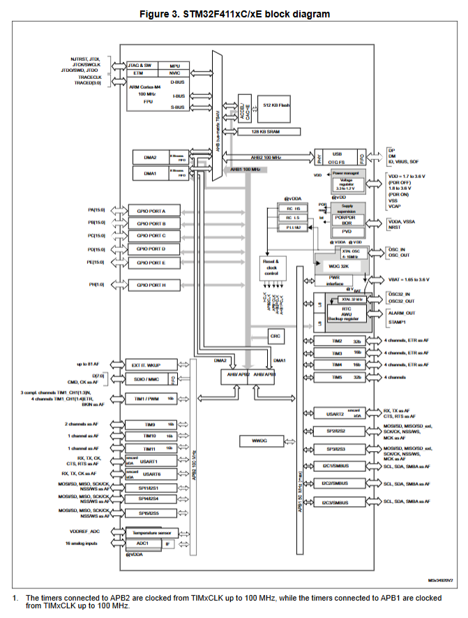
<sub>출처: STM32F411xC/E Datasheet, Figure 3</sub>

| 블록 | 역할 |
|---|---|
| ARM Cortex-M4 (100MHz, FPU) | CPU |
| 512KB Flash | instruction memory (코드) |
| 128KB SRAM | data memory |
| AHB1 bus (100MHz) | GPIO A~E, H / RCC / DMA 가 물려 있음 → **GPIO는 AHB1** |
| AHB/APB bridge | AHB → APB1 / APB2 연결 |
| APB2 (100MHz) | TIM1, TIM9~11, USART1/6, SPI1/4/5, ADC1 |
| APB1 (50MHz) | TIM2~5, USART2, SPI2/3, I2C1~3 |
| XTAL OSC (4~16MHz) | 외부 크리스탈 오실레이터 |
| RCC (Reset & clock control) | clock 분주기, 주변장치별 clock enable |

- memory map

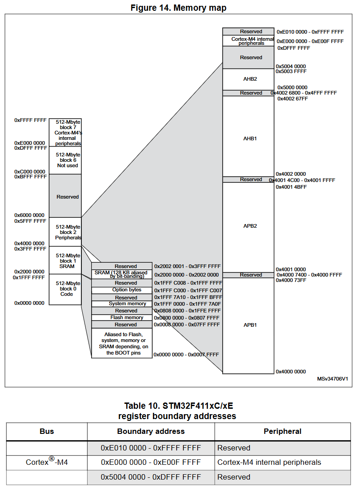
<sub>출처: RM0383 Reference Manual, Figure 14</sub>

## GPIO 내부 회로

- gpio 내부 회로 블럭도: RM0383 **Figure 16. Basic structure of a 5 V-tolerant I/O port bit**
  - 입력: I/O pin → (pull-up/pull-down) → TTL schmitt trigger → **Input data register (IDR)**
  - 출력: **Output data register (ODR)** ← Bit set/reset register (BSRR) → Output control → P-MOS / N-MOS → I/O pin
  - pull-up / pull-down 저항은 칩 내부에 있어서 on/off 가능
- 전원 인가를 더 확실하게 세게 하기 위해서 PMOS에 VDD (외부 전원) 붙여줌
- 기존 register를 거쳐서 PMOS에 들어온 전류 바로 보내기에는 좀 약하다

**Port bit configuration (RM0383 Table 23)**

| MODER | 모드 | OTYPER | PUPDR | 결과 |
|---|---|---|---|---|
| 00 | Input | x | 00 / 01 / 10 | Floating / Pull-up / Pull-down |
| 01 | General purpose output | 0 / 1 | 00 / 01 / 10 | Push-pull / Open-drain (+PU/PD) |
| 10 | Alternate function | 0 / 1 | 00 / 01 / 10 | AF Push-pull / Open-drain (+PU/PD) |
| 11 | Analog | x | 00 | Analog |

alternate function

- gpio가 아닌 다른 기능들을 사용할 수 있도록 만드는거 (예: PB8/PB9 → I2C1 SCL/SDA)

- gpio마다 레지스터가 있고

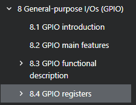

레퍼런스 메뉴얼에 설명 나옴

- gpio 모드

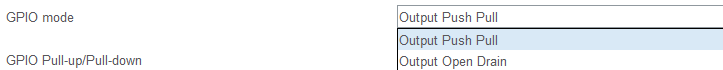

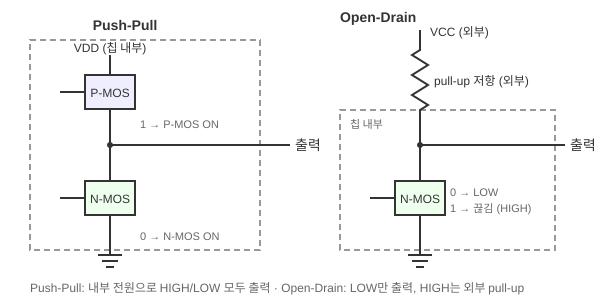

- push pull: 칩 내부 전압, 전류 출력하는 방식
- open drain/ open collector : 칩 외부 전압, 전류를 이용한 i/o
  - 내부에 vdd가 연결되지 않고, 외부에서 vcc가 따로 연결됨

- speed register
- speed는 뭘 의미하는걸까? 무슨 속도임?
  - 출력 신호의 low와 high가 얼마나 빠르게 전환되느냐 (LOW → HIGH로 올라가는 기울기)
  - 빠를수록 전환 시간이 짧지만 노이즈·전력 소모가 커짐

- pull up/pull down 레지스터
- 내부 회로에서 pull up/pull down 동작시킬 수 있음 (GPIO 안쪽의 저항을 켜고 끄는 것)

### GPIO 레지스터 정리 (RM0383 8.4)

핀 하나당 2bit 쓰는 레지스터는 핀 y가 **[2y+1 : 2y]** 비트를 차지 (예: PA5 → [11:10], PC13 → [27:26])

| 레지스터 | offset | 핀당 bit | 값 |
|---|---|---|---|
| `MODER` | 0x00 | 2 | 00 input / 01 output / 10 AF / 11 analog |
| `OTYPER` | 0x04 | 1 | 0 push-pull / 1 open-drain |
| `OSPEEDR` | 0x08 | 2 | 00 low / 01 medium / 10 fast / 11 high |
| `PUPDR` | 0x0C | 2 | 00 none / 01 pull-up / 10 pull-down |
| `IDR` | 0x10 | 1 | 입력 값 (read only) |
| `ODR` | 0x14 | 1 | 출력 값 |
| `BSRR` | 0x18 | 1+1 | [15:0] set / [31:16] reset |

| 레지스터 | 주소 | 사용한 bit |
|---|---|---|
| `RCC_AHB1ENR` | 0x4002_3800 + 0x30 | bit0 GPIOAEN, bit2 GPIOCEN |

---

## 실습 1: 베어메탈 gpio에서 버튼을 누르면 led를 켜보자

- PA5에 gpio output → led 연결함
- PC13에 gpio input → 버튼 연결함

<p>
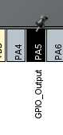
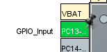
</p>

| Bus | Boundary address | Peripheral |
|---|---|---|
| AHB1 | 0x4002 3800 - 0x4002 3BFF | RCC |
| AHB1 | 0x4002 0800 - 0x4002 0BFF | GPIOC |
| AHB1 | 0x4002 0000 - 0x4002 03FF | GPIOA |

<sub>RM0383 Table 10. register boundary addresses 중 사용한 부분</sub>

- gpioA와 gpioc의 주소 확인
- rcc 주소 확인: clock enable register 켜기 위함

- led : mode register gpo 모드 → 01

- PA5 → moder5에 01 넣어야 함
- 11번 비트에 0, 10번 비트 1 넣기

```c
*((uint32_t *)(0x40020000 + 0x00)) |= (1 << 10);
*((uint32_t *)(0x40020000 + 0x00)) &= ~(1 << 11);
```

### 원하는 비트만 set 하기: `|=` , `<<` 연산자 활용

```c
*((uint32_t *)(0x40020000 + 0x00)) |= (1 << 10);

|= // 좌항 = 좌항 | 우항
-> (1 << 10) -> 100_0000_0000 (10번 비트만 1로 만든 것)을 현재 mode register와 or 연산
-> 10번 비트는 무조건 set 됨
-> 다른 비트는 원래거 유지

ex) 1100_1101 의 4번 비트만 set하고 싶다
int a = 2b1100_1101;
a |= (1 << 4);

1100_1101 | 0001_0000 = 1101_1101
-> 다른 비트 관계 없이 4번 비트만 set 가능
```


### 원하는 비트만 reset 하기: `&=` , `<<` 연산자 활용

```c
*((uint32_t *)(0x40020000 + 0x00)) &= ~(1 << 11);

&= // 좌항 = 좌항 & 우항
-> ~(1 << 11) -> 0111_1111_1111 (11번 비트만 0로 만든 것)을 현재 mode register와 and 연산
-> 11번 비트는 무조건 reset 됨
-> 다른 비트는 원래거 유지

ex) 1100_1101 의 3번 비트만 reset하고 싶다
int a = 2b1100_1101;
a &= ~(1 << 3);

1100_1101 & 1111_0111 = 1100_0101
-> 다른 비트 관계 없이 3번 비트만 reset 가능
```

### 원하는 비트만 toggle 하기: `^=`, `<<` 연산자 활용

```c
reg ^= (1 << 1);   // 1번 bit toggle
// == reg = reg ^ (2b0000_0010)

  1100_1101
^ 0000_0010
= 1100_1111   // 1번 bit 0 → 1

  1100_1111
^ 0000_0010
= 1100_1101   // 다시 하면 1 → 0
```

- output type: push pull (기본값) 이지만 설정해보자
- PA5 → OT5 → 5번 비트를 reset

- led 출력: output data register (ODR) → PA5 = ODR5

- gpioa clock enable: RCC_AHB1ENR
- 0번 1로 세팅

### 코드

```c
#include <stdint.h>

#define RCC_BASE	0x40023800UL // unsigned long
#define GPIOA_BASE 	0x40020000UL // unsigned long

// 매크로 함수 define -> 가장 바깥을 괄호로 감싸야 함!!
#define	REG(addr)	(*(volatile uint32_t *)(addr))

#define RCC_AHB1ENR		REG(RCC_BASE + 0x30)
#define GPIOA_MODER		REG(GPIOA_BASE + 0x00)
#define GPIOA_OTYPER	REG(GPIOA_BASE + 0x04)
#define GPIOA_OSPEEDR	REG(GPIOA_BASE + 0x08)
#define GPIOA_PUPDR		REG(GPIOA_BASE + 0x0c)
#define GPIOA_IDR		REG(GPIOA_BASE + 0x10)
#define GPIOA_ODR		REG(GPIOA_BASE + 0x14)

void delay(uint32_t n) {
	while (n--)
		;
}

int main(void) {

	// rcc base address: 0x4002_3800
	// clock enable register offset: 0x30
	// *((volatile uint32_t*) (0x40023800 + 0x30)) |= (1 << 0);	// set
	// 위처럼 숫자로 하면 좀 복잡하니까
	// define으로 설정해서 보기 편하게 바꿨음!
	RCC_AHB1ENR |= (1 << 0); // set

	// MODE register (MODER): output 으로 설정 (01, gpo 모드)
	// gpioa의 moder[11:10] = 2b01로 만들기
	GPIOA_MODER |= (1 << 10);	// set
	GPIOA_MODER &= ~(1 << 11);	// reset

	// output type register (OTYPER): push pull로 설정 (0)
	GPIOA_OTYPER &= ~(1 << 5);	// reset

	// OSPEEDR: medium speed로 설정 (01)
	GPIOA_OSPEEDR &= ~(1 << 11);	// reset
	GPIOA_OSPEEDR |= (1 << 10); 	// set

	// PUPDR: pull up (01)
	GPIOA_PUPDR &= ~(1 << 11);	// reset
	GPIOA_PUPDR |= (1 << 10);	// set

	while (1) {
		GPIOA_ODR |= (1 << 5); // odr[5] set
		delay(1000000);
		GPIOA_ODR &= ~(1 << 5); // odr[5] reset
		delay(1000000);
	}

	return 0;
}
```

### 최종 코드: 버튼을 누르면 led가 켜지는 코드

```c
#include <stdint.h>

#define RCC_BASE	0x40023800UL // unsigned long
#define GPIOA_BASE 	0x40020000UL // unsigned long
#define GPIOC_BASE	0x40020800UL

#define	REG(addr)	(*(volatile uint32_t *)(addr))

#define RCC_AHB1ENR		REG(RCC_BASE + 0x30)

#define GPIOA_MODER		REG(GPIOA_BASE + 0x00)
#define GPIOA_OTYPER	REG(GPIOA_BASE + 0x04)
#define GPIOA_OSPEEDR	REG(GPIOA_BASE + 0x08)
#define GPIOA_PUPDR		REG(GPIOA_BASE + 0x0c)
#define GPIOA_ODR		REG(GPIOA_BASE + 0x14)

#define GPIOC_MODER		REG(GPIOC_BASE + 0x00)
#define GPIOC_PUPDR		REG(GPIOC_BASE + 0x0c)
#define GPIOC_IDR		REG(GPIOC_BASE + 0x10)

int main(void) {
	RCC_AHB1ENR |= (1 << 0); // gpioa에 clock enable
	RCC_AHB1ENR |= (1 << 2); // gpioc에 clock enable

	// pa5 = green led
	GPIOA_MODER &= ~(1 << 11);	// reset
	GPIOA_MODER |= (1 << 10);	// set
	GPIOA_OTYPER &= ~(1 << 5);	// push pull
	GPIOA_OSPEEDR &= ~(1 << 11);
	GPIOA_OSPEEDR |= (1 << 10); // medium speed
	GPIOA_PUPDR &= ~(1 << 11);
	GPIOA_PUPDR |= (1 << 10);	// pull up

	// pc13 = 버튼 b1
	// gpioc moder: 00 (input)
	GPIOC_MODER &= ~(1 << 27);
	GPIOC_MODER &= ~(1 << 26);

	// gpioc pupdr: pull up (01)
	GPIOC_PUPDR &= ~(1 << 27);
	GPIOC_PUPDR |= (1 << 26);

	while (1) {
		if ((GPIOC_IDR & (1 << 13)) == 0) {
			GPIOA_ODR |= (1 << 5); // odr[5] set
		} else {
			GPIOA_ODR &= ~(1 << 5); // odr[5] reset
		}
	}

	return 0;
}
```

### 더 편하게 구조체로 묶기

```c
#define GPIOA_BASE 	0x40020000UL // unsigned long

typedef struct {
	volatile uint32_t MODER; 	// offset 0x00
	volatile uint32_t OTYPER; 	// offset 0x04
	volatile uint32_t OSPEEDR; 	// offset 0x08
	volatile uint32_t PUPDR; 	// offset 0x0c
	volatile uint32_t IDR; 		// offset 0x10
	volatile uint32_t ODR; 		// offset 0x14
	volatile uint32_t BSRR; 	// offset 0x18
	volatile uint32_t LCKR; 	// offset 0x1c
	volatile uint32_t AFRL; 	// offset 0x20
	volatile uint32_t AFRH; 	// offset 0x24
} gpio_regs_t;

#define GPIOA ((gpio_regs_t *)GPIOA_BASE)
```

**각 멤버에 오프셋을 따로 지정하지 않아도 바로 쓸 수 있어.**

C언어의 `struct`(구조체)는 메모리에 정의된 순서대로 **차례대로(연속해서) 공간을 할당**하는 규칙이 있기 때문이야.

- 구조체 안에서 `MODER`가 맨 처음 선언되었으므로 **오프셋 `0x00`** 위치에 배정됨.
- 그 바로 다음인 `OTYPER`는 자동으로 그 다음 4바이트 뒤인 오프셋 `0x04`에 배정됨.
- 이런 식으로 순서대로 자리를 잡기 때문에, 개발자가 일일이 수동으로 오프셋 주소를 계산해서 적어줄 필요가 없어.

따라서 `GPIOA->OTYPER`라고 접근하면 컴파일러가 알아서 `GPIOA_BASE + 0x04` 번지에 접근하도록 코드를 만들어 준단다.

```
GPIOA_BASE (0x40020000)
      │
      ▼
 +0x00 ┌──────────┐  GPIOA->MODER
 +0x04 ├──────────┤  GPIOA->OTYPER
 +0x08 ├──────────┤  GPIOA->OSPEEDR
  ...  │   ...    │
 +0x24 └──────────┘  GPIOA->AFRH       (멤버 하나 = 4 byte)
```

- 주변장치(peripheral)의 레지스터가 이미 이 순서대로 정의되어 있으니, 같은 순서의 구조체 포인터로 덮어씌우면 된다

## 디버그 - SFRs

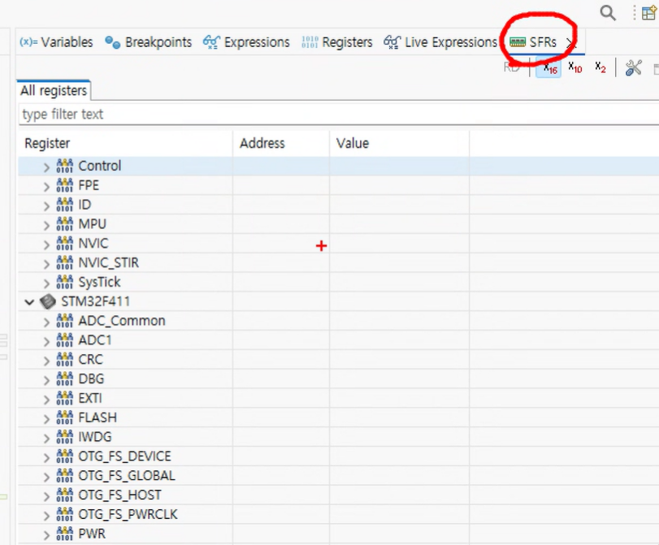

- 패리패럴과 관련된 레지스터 다 나온다

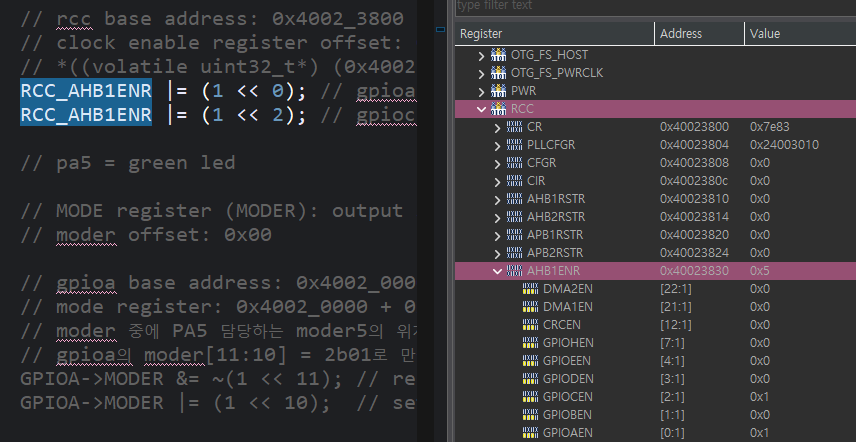

- gpioa enable = 1, gpioc enable = 1된거 확인

<p>
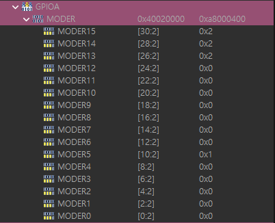
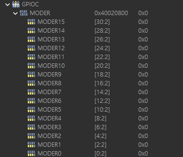
</p>

- gpioa moder5 = 01 (output), gpioc moder13 = 00 (input) 된것 확인

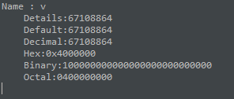

- v = gpioc의 moder
- moder13 = 27:26
- pull up = 27:26 = 01
- 26번째 bit 1된것 확인
- 27번째 bit는 안나오지만 0이라 생략된것

## 실습: 함수로 묶고 보기 편하게 만들기

최종 코드: [`Core/Src/main.c`](Core/Src/main.c)

```c
typedef enum {
	GPIO_MODE_IN = 0, GPIO_MODE_OUT, GPIO_MODE_AF, GPIO_MODE_ANALOG
} gpio_mode_t;
typedef enum {
	GPIO_PULL_NONE, GPIO_PULL_UP, GPIO_PULL_DOWN
} gpio_pull_t;

void gpio_set_mode(gpio_regs_t *port, uint16_t pin, gpio_mode_t mode) {
	uint32_t v = port->MODER;

	// 00으로 먼저 해당 bit를 초기화해두고
	v &= ~(3 << (pin * 2));

	// mode에 맞게 bit 변경
	v |= ((uint32_t)mode << (pin * 2));
	port->MODER = v;
}

void gpio_set_pull(gpio_regs_t *port, uint16_t pin, gpio_pull_t pull) {
	uint32_t v = port->PUPDR;

	// 00으로 먼저 해당 bit를 초기화해두고
	v &= ~(3 << (pin * 2));

	// pull에 맞게 bit 변경
	v |= ((uint32_t)pull << (pin * 2));
	port->PUPDR = v;
}

void gpio_write(gpio_regs_t *port, uint16_t pin, bool level) {
	// BSRR = bit set/reset register
	// level이 참이면 BSRR의 pin번째 bit를 set (pin = 0이면 0번째 set)
	// level이 거짓이면 BSRR의 pin+16번째 bit를 set (pin = 0이면 16번째 set)
	port->BSRR = level ? (1 << pin) : (1 << (pin + 16));
}

bool gpio_read(const gpio_regs_t *port, uint16_t pin) {
	// idr 읽어와서 pin번째 bit가 0번째 bit가 되도록 shift
	// 0번째 bit와 1 (1bit)를 and 연산해 출력 -> 1 bit만 출력되도록
	return (port->IDR >> pin) & 1;
}

void gpio_toggle(gpio_regs_t *port, uint16_t pin) {
	// 어느 bit만 사용할건지 선택
	uint32_t mask = 1 << pin;
	uint32_t odr = port->ODR;
	// odr의 pin번째 bit만 가져와 16번 shift (brr 위치)
	// odr의 pin번째 bit에 not 취하기 (bsr 위치)
	// 둘을 합침
	// reset은 현재 상태, set은 현재 상태의 not -> toggle 된다
	// 현재상태 0 -> reset 0, set 1 -> set 된다
	// 현재상태 1 -> reset 1, set 0 -> reset 된다
	port->BSRR = ((odr & mask) << 16) | (~odr & mask);
}

int main(void) {
	RCC_AHB1ENR |= (1 << 0); // gpioa에 clock enable
	RCC_AHB1ENR |= (1 << 2); // gpioc에 clock enable

	gpio_set_mode(GPIOA, 5, GPIO_MODE_OUT);
	gpio_set_mode(GPIOC, 13, GPIO_MODE_IN);
	gpio_set_pull(GPIOC, 13, GPIO_PULL_UP);
	while (1) {
		if (gpio_read(GPIOC, 13) == 0) {
			gpio_write(GPIOA, 5, 1); // odr[5] set
		} else {
			gpio_write(GPIOA, 5, 0); // odr[5] reset
		}
	}

	return 0;
}
```
