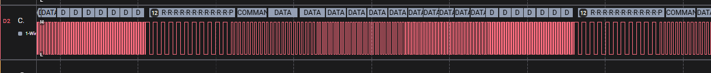
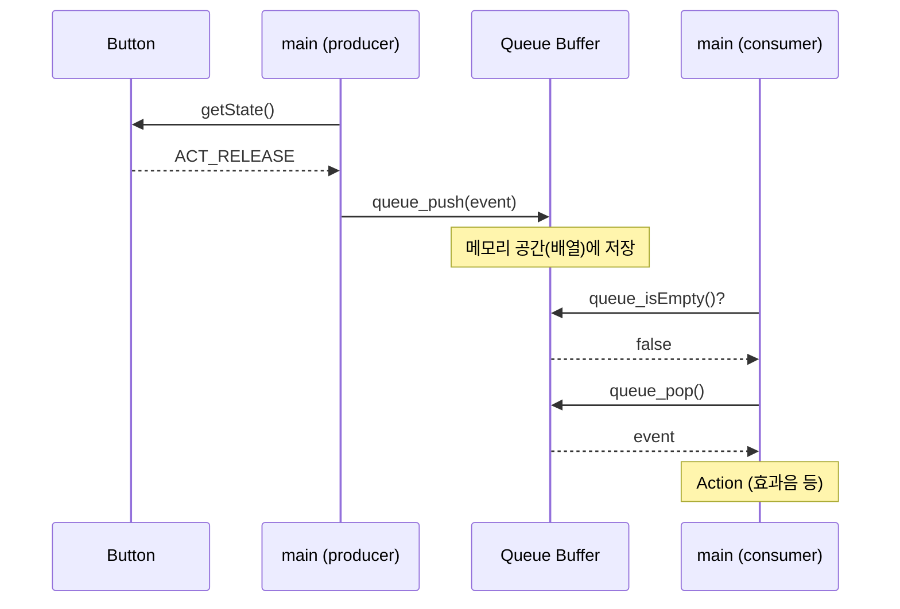

# buzzer — PWM 부저 + Queue(Ring Buffer)

> 📅 2026-10-29 ~ 2026-10-30 · 보드: NUCLEO-F411RE

TIM1 CH4 PWM의 **주파수(ARR)** 를 바꿔 부저로 음계를 내는 `driver/buzzer` + 효과음 `service/sound`를 만들고,
버튼 이벤트를 쌓아둘 **Queue(FIFO, 링 버퍼)** 를 `common/queue`에 구현함.

## 파일 구조

```
Core/Src/
├── main.c
├── common/
│   ├── delay/
│   └── queue/                 # 범용 queue (void* + element_size)
├── ap/
│   ├── ap_main.c              # 버튼 → 효과음, LCD 카운트 표시
│   └── service/sound/         # 부팅음 / 버튼음 / 에러음 / 알람음
└── driver/
    ├── buzzer/                # PWM 주파수로 음 내기
    └── button/  lcd/
```

## 사용 핀 / 설정

| 항목 | 설정 |
|---|---|
| PA11 | TIM1_CH4 → 부저 |
| TIM1 | PSC 100-1 → 1MHz 카운트 (ARR로 주파수 결정) |
| PC0 / PC1 / PC3 | 버튼 → 버튼음 / 에러음 / 알람음 |
| I2C1 (PB8 / PB9) | LCD |

---

## 실습: 주파수 바꾸기

- PWM 원리 (ARR → 주파수, CCR → duty비)는 [dht11_sr04_review](../dht11_sr04_review#timer-pwm-ccr) 참고
- 1MHz로 세는 카운터에서 `ARR = 1,000,000 / 주파수 - 1` 이면 원하는 주파수가 나옴
- duty는 50%로 고정 → `CCR = (ARR + 1) / 2`

```c
void buzzer_on(uint32_t freq_hz) {
	if (freq_hz == 0) {
		buzzer_off();
		return;
	}
	// 가청 주파수: 20hz ~ 20khz
	if (freq_hz < 20)
		freq_hz = 20;
	if (freq_hz > 20000)
		freq_hz = 20000;

	uint32_t arr = 1000000 / freq_hz - 1;
	uint32_t ccr = (arr + 1) / 2; // 50% duty ratio
	__HAL_TIM_SET_AUTORELOAD(buz_htim, arr);
	__HAL_TIM_SET_COMPARE(buz_htim, buz_ch, ccr);
}

void buzzer_off() {
	// ccr = 0 → HIGH가 안 나옴 → 계속 0 출력
	__HAL_TIM_SET_COMPARE(buz_htim, buz_ch, 0);
}
```

```c
while (1) {
	buzzer_on(1000);
	HAL_Delay(10);
	buzzer_on(2000);
	HAL_Delay(10);
	buzzer_on(3000);
	HAL_Delay(10);
	buzzer_on(4000);
	HAL_Delay(10);
	buzzer_on(5000);
	HAL_Delay(10);
}
```



- 로직 분석기로 주파수가 바뀌는 것 확인

### 주파수 대역으로 부팅음 만들기

옥타브 4 표준 주파수 (정수형으로 만들거니까 반올림)

| 음 | C4 | D4 | E4 | F4 | G4 | A4 | B4 |
|---|---|---|---|---|---|---|---|
| Hz | 262 | 294 | 330 | 349 | 392 | 440 | 494 |

- 한 옥타브 올라가면 주파수 ×2 (C5 = C4 × 2)

```c
void sound_boot() {
	buzzer_on(G4);
	HAL_Delay(150);
	buzzer_on(D4);
	HAL_Delay(150);
	buzzer_on(G4);
	HAL_Delay(150);
	buzzer_on(C4 * 2);   // C5
	HAL_Delay(300);
	buzzer_on(B4);
	HAL_Delay(400);
	buzzer_off();
}

void sound_button() {
	buzzer_on(G4 * 2 * 2 * 2);   // G7
	HAL_Delay(40);
	buzzer_on(C4 * 2 * 2);       // C6
	HAL_Delay(60);
	buzzer_off();
}

void sound_error() {
	buzzer_on(C4 * 2);
	HAL_Delay(150);
	buzzer_off();
	HAL_Delay(60);
	buzzer_on(C4 * 2);
	HAL_Delay(150);
	buzzer_off();
}
```

전체 코드: [`Core/Src/ap/service/sound/sound.c`](Core/Src/ap/service/sound/sound.c)

---

## Queue (FIFO) Buffer, Ring Buffer

- 임시 저장 장소 (memory)
- 통신 Rx Data, Button event 같은 데이터가 들어오면 **공유 메모리(queue)** 에 쌓아두고, 사용하는 모듈이 꺼내 감

| | Queue | Stack |
|---|---|---|
| 순서 | **FIFO** (First In First Out) | LIFO (Last In First Out) |
| 비유 | 줄 서기 — 먼저 온 사람이 먼저 나감 | 쌓기 — 마지막에 넣은 것이 먼저 나감 |

### Ring buffer 동작

```
int que[4];      head: 다음에 넣을 칸 / tail: 다음에 꺼낼 칸

  [0]   [1]   [2]   [3]
┌─────┬─────┬─────┬─────┐
│ D5  │     │ D3  │ D4  │      D1, D2는 이미 꺼냄 → 칸 재사용
└─────┴─────┴─────┴─────┘
         ↑     ↑
        head  tail
```

| 동작 | 방법 |
|---|---|
| 저장 (push) | Full이면 return → `que[head] = data` → `head = (head + 1) % 4` |
| 읽기 (pop) | Empty면 return → `var = que[tail]` → `tail = (tail + 1) % 4` |
| Empty 판단 | `head == tail` |
| Full 판단 | 칸을 하나 비워 두면 `(head + 1) % 4 == tail` / 우리 구현은 `isFull` flag 사용 |

- `% 4` (메모리 공간 개수)로 끝에 닿으면 처음으로 돌아감 → 원형(ring)
- `head == tail`만으로는 empty와 full이 구분이 안 됨 → 칸 하나를 비우거나 flag로 구분

### 실습: queue 구현하기

자료형에 상관없이 쓸 수 있도록 `void*` + `element_size`로 구현

```c
typedef struct {
	uint8_t *buf;			// 저장 공간 배열의 주소
	uint16_t element_size;  // 버퍼에 저장할 데이터 사이즈
	uint16_t capacity;		// 버퍼 크기
	uint16_t head;		// 다음 데이터 push할 인덱스
	uint16_t tail;		// 다음 데이터 pop할 인덱스
	bool isFull;	// 버퍼 차있으면 true
	bool isEmpty;	// 버퍼 비어있으면 true
} queue_buf_t;

uint8_t *slot(queue_buf_t *q, uint16_t n) {
	return (uint8_t*)(q->buf + n * q->element_size);
}

uint16_t next(queue_buf_t *q, uint16_t idx) {
	return (uint16_t) ((idx+1) % q->capacity);
}

bool queue_push(queue_buf_t* q, void* element) {
	if (q->isFull)
		return false;
	if (q->isEmpty)
		q->isEmpty = false;

	// buf가 8bit짜리라서 data 4byte짜리 가져오려면 주소 4씩 증가시켜야함
	memcpy(slot(q, q->head), element, q->element_size);
	q->head = next(q, q->head);

	if (q->head == q->tail)
		q->isFull = true;
	return true;
}

bool queue_pop(queue_buf_t* q, void *element) {
	if (q->isEmpty)
		return false;
	if (q->isFull)
		q->isFull = false;

	memcpy(element, slot(q, q->tail), q->element_size);
	q->tail = next(q, q->tail);

	if (q->head == q->tail)
		q->isEmpty = true;
	return true;
}
```



전체 코드: [`Core/Src/common/queue/queue_buffer.c`](Core/Src/common/queue/queue_buffer.c)

> 부저 + queue를 디지털 시계에 통합한 과제는 [digital_clock_all_in_one](../digital_clock_all_in_one)
