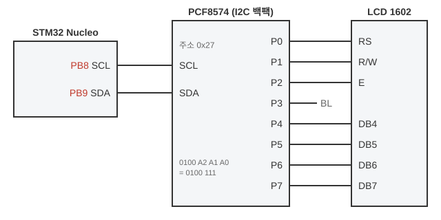
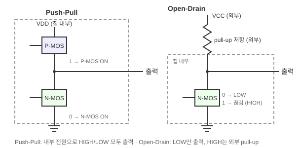
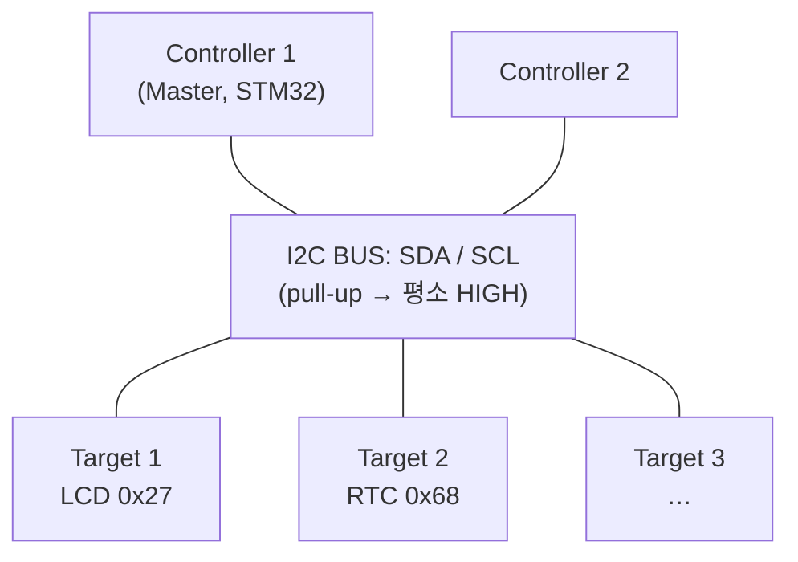
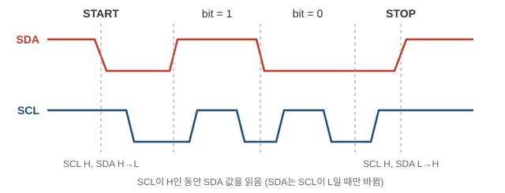
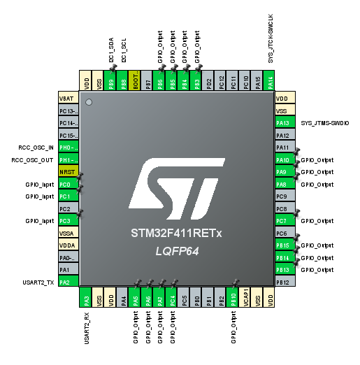
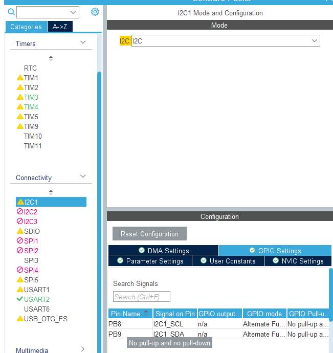
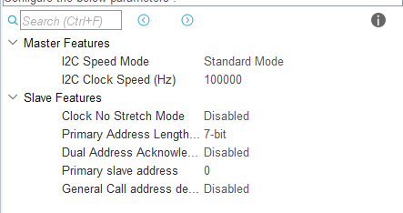
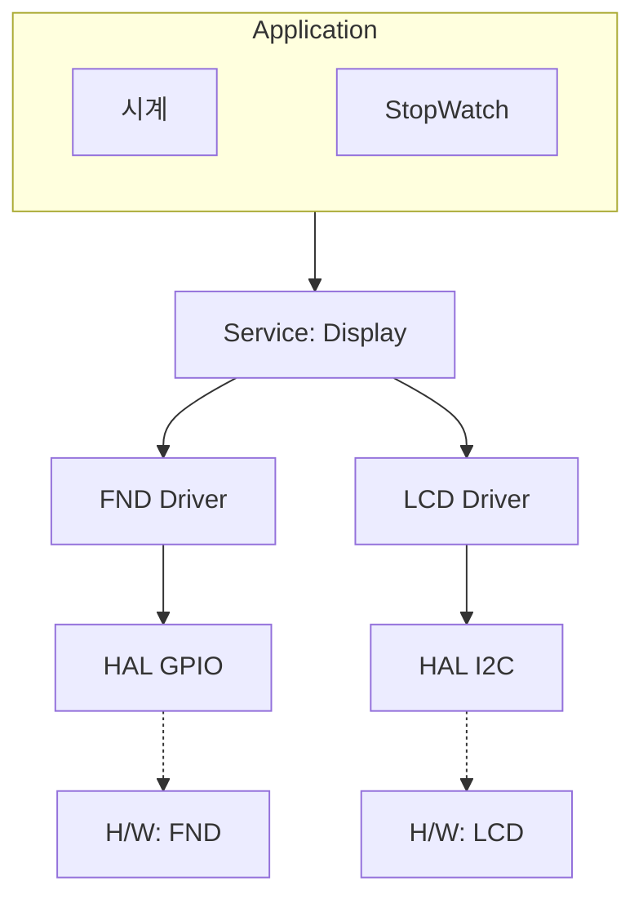
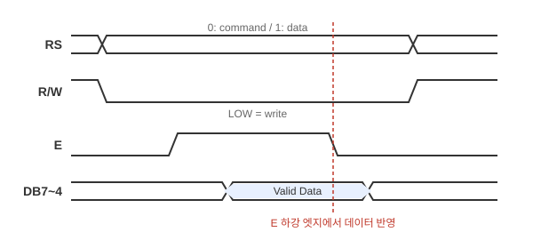

# clock_I2C_LCD — I2C 통신으로 Character LCD 출력

> 📅 2026-10-20 ~ 2026-10-21 · 보드: NUCLEO-F411RE

[stopwatch_timeclock_I2C_LCD](../stopwatch_timeclock_I2C_LCD)에서 분리한 Display 모듈에 **I2C LCD(PCF8574 백팩 + HD44780 계열 LCD)** 출력을 붙이기 위해, I2C 프로토콜과 LCD 모듈의 동작을 분석하고 `driver/lcd` 드라이버를 작성함.

## 파일 구조

```
Core/Src/
├── main.c
├── ap/
│   ├── ap_main.c
│   ├── StopWatch/  TimeClock/  Display/
└── driver/
    ├── button/  led/  fnd/
    └── lcd/               # I2C LCD 드라이버
```

## 사용 핀 / 설정

| 항목 | 설정 |
|---|---|
| I2C1 SCL | PB8 |
| I2C1 SDA | PB9 (기본 PB7에서 옮김) |
| I2C 속도 | Standard mode 100kHz, 7bit 주소 |
| LCD 슬레이브 주소 | 0x27 (A2~A0 미연결 → pull-up) |

---

## I2C (PB8, 9) 로 LCD 모듈 출력하기

- LCD 모듈 (1602, 16글자 × 2줄): 내부 Control IC (SPLC780D1 / HD44780 호환)가 LCD 패널을 구동
  - 입력 핀: VSS, VDD, V0(명암), RS, R/W, E, DB0~DB7, LED+/LED-(백라이트)
- LCD 출력을 위한 프로토콜을 driver로 작성해야한다!



- LCD 뒤에 위치한 보드 (PCF8574): I2C data → 8bit 병렬 data로 변환하는 역할
- D0~D3까지 4bit data
- SCL, SDA 선에는 보드에 pull-up 저항이 달려 있음

## I2C (Inter Integrated Circuit)

- 많이 쓰는 시리얼 통신
- 2개의 신호선만으로 여러개의 IC와 마이크로 컨트롤러가 서로 통신할 수 있게 만든 동기식 시리얼통신 프로토콜
- SDA (serial data) → pb9: 데이터 전송 라인
- SCL (serial clock) → pb8: 동기화를 위한 clock 신호 라인
- 풀업 저항 (pull up resistor): 두 선 모두 오픈드레인 구조 → 입력없으면 HIGH(1) 유지 (저항 - vcc 연결)

<details>
<summary>오픈 드레인 (open drain)</summary>

**오픈드레인(Open-Drain)** 구조는 디지털 회로에서 여러 개의 장치가 **단일 신호선을 공유**할 수 있도록 만든 출력 방식입니다.



- pull up 저항 없으면 gate가 뭐가되든 아무 값도 안나간다
- pull up 혹은 pull down 저항을 칩 내부(push pull)에서 하는지 외부(open drain)에서 하는지
- 칩 내부 전압/전류: 약하다
- 칩 외부 전압/전류: 강하다 → 높은 전압으로 값을 내보낼 수 있다. 내부 전압만으로 출력이 딸리면 open drain 해야지

#### 핵심 특징

- **출력 방식:** MOSFET 드레인(출력단)이 칩 내부 전원과 연결되지 않고 열려(Open) 있어서, 외부 전원(Pull-up 저항)에 의존하는 구조입니다.
- **풀업 저항(Pull-up Resistor):** 출력단이 떠 있으면 상태가 불안정해지므로, 신호선을 저항을 통해 전원(VCC)에 미리 연결해 둡니다. 평상시에는 **HIGH(1)** 상태를 유지합니다.
- **동작 원리:**
  - 출력을 LOW(0)로 만들고 싶을 때: 내부 트랜지스터를 켜서 신호선을 GND(접지)로 끌어내립니다.
  - 출력을 HIGH(1)로 만들고 싶을 때: 트랜지스터를 끄면, 풀업 저항 덕분에 자연스럽게 전압이 올라가 HIGH 상태가 됩니다.

#### 왜 쓸까요?

- **와이어드 앤(Wired-AND) / 버스 공유:** 여러 장치가 하나의 선(SDA, SCL 등)에 동시에 연결되어 있어도 충돌(Short Circuit) 위험 없이 안전하게 통신할 수 있습니다. (누군가 0을 보내면 전체가 0이 됨)
- **전압 레벨 변환:** 서로 다른 전압(예: 3.3V 마이크로컨트롤러와 5V 센서)을 사용하는 시스템끼리 안전하게 연결할 수 있습니다.

</details>

- 마스터 - 슬레이브 구조
  - 마스터: 통신 시작, 클록 발생 (멀티 마스터 가능)
  - 슬레이브: 마스터의 명령에 따라 응답
- 각 슬레이브 장치는 고유 주소 (7bit - 일반적 or 10bit) 가짐
  - 마스터가 슬레이브 고유주소 호출해 특정 장치와만 데이터 통신
- 통신 속도: 표준 (100kbps) / 고속 (400kbps) / 최대 3.4Mbps

**데이터 전송 프레임 순서**

1. START 조건: SCL이 High인 상태에서 SDA가 High → Low
2. 주소 + 읽기/쓰기 비트: 7bit 슬레이브 주소 + R/W 1bit (쓰기 0 / 읽기 1)
3. ACK / NACK: 받는 쪽이 응답 (ACK = Low)
4. DATA 전송: 8bit 단위로 전송 후 ACK/NACK 반복
5. STOP 조건: SCL이 High인 상태에서 SDA가 Low → High

- 장점: pin 2개 만으로 다양한 센서, 메모리 (주변장치) 연결 가능 (7bit 주소 → 최대 127개)
- 속도는 좀 느리다 (최대 3.4mbps고 보통 100k~400kbps..), 거리도 짧다



- 물리적으로 연결됨
- master는 통신을 위해 i2c 버스에 broadcast (단, 주소 지정)



1. start 신호: pull up 되어있던 신호를 0으로 끌어 내리며 시작 (clk H 유지 + data H → L)
   - slave 들은 0 보자마자 통신 준비 해야함

| S | A6 … A0 (7bit) | R/W | ACK | D7 … D0 (8bit) | ACK | … | P |
|---|---|---|---|---|---|---|---|
| START | slave 주소 | 0 write / 1 read | slave | data | 받는 쪽 | 반복 | STOP |

2. slave 주소(7bit) + r(high)/w(low): start 신호 보내서 slave들 대기하고 있을 때 master가 고유 주소 하나를 보내서 통신할 slave 특정
   - 고유 주소 불려서 특정된 slave만 통신 살아있고
   - 아닌 slave는 통신에서 관심을 꺼야 함
   - 주소와 읽기할지 쓰기할지 같이 보냄
   - slave의 주소는 내가 설정하는게 아니라 디바이스의 데이터 시트 살펴봐야 함
3. data (8bit)

- bit 식별 방법 (위 그림의 bit = 1 / bit = 0)
  - 0: clk 0→1→0 한 틱 동안 Data가 0 유지하면 0
  - 1: clk 0→1→0 한 틱 동안 Data가 1 유지하면 1

4. stop 신호: 통신하면서 0이었던 신호에 입력을 끊으며 pull up되어 1이 되면 끝 (clk H유지 + data L → H)

- ACK: 잘 받았다~ 고 slave가 low 보내는거
  - slave 주소와 r/w 받으면 잘 받았다~ 말해줘야하고
  - data도 받으면 잘 받았다~ 말해줘야 함
  - slave address(7) + r/w(1) or data(8) 총 8bit 받으면 slave에서 ack 전송하는거임

### LCD 모듈의 고유 주소 찾기

PCF8574 데이터시트의 slave address:

| bit | 6 | 5 | 4 | 3 | 2 | 1 | 0 |
|---|---|---|---|---|---|---|---|
| 고정 / 핀 | 0 | 1 | 0 | 0 | A2 | A1 | A0 |
| 우리 보드 | 0 | 1 | 0 | 0 | 1 | 1 | 1 |

- slave address에 0100A2A1A0 있음
- 보드 보면 A2 A1 A0은 아무곳과도 연결되어있지않음 (short)
- 따라서 vcc와 연결되어 pull up 되어있다~
- 그래서 각각 1 넣어주면 된다? → **아무 처리도 하지 않았을 경우 lcd 보드의 고유 주소 == 0100111 == 0x27**
- 만약 lcd 보드가 여러개면? A2, A1, A0 하드웨어적으로 GND에 연결해 접지시키거나 그대로 두거나(short) 해서 lcd 보드 8개까지 구분 가능!

## 실습: i2c lcd 모듈

### 1. pin 배치



- I2C1 사용 설정



- 기본 SDA pin pb7로 되어있는거 ctrl + 드래그해서 pb9로 옮김



- standard speed: 100khz
- slave 주소: 7bit

```c
I2C_HandleTypeDef hi2c1;
```

i2c 포트 설정하면 이런거 생긴다

### 2. sw stack (structure)



- Hal 활용해 하드웨어 제어하기 위한 driver 만드는 개발자: bsp 개발자

### 3. lcd 모듈 분석해 driver 만들기



- R/W는 LOW로 유지 → lcd 모듈에 write
- 유지한 상태에서 E(enable)를 high로 바꿔
- 그 상태에서 db (데이터) 들어온걸 적용함
  - RS 신호(instruction or data register)에 맞게 data를 적용된다
- 끝나면 E low → r/w도 high로 바꾸기
  - enable 하강 엣지에서 읽은 데이터가 반영됨

| Pin | Symbol | 설명 |
|---|---|---|
| 1 / 2 | VSS / VDD | GND / +5V |
| 3 | V0 | LCD 명암 조절 |
| 4 | RS | 1: Data Register / 0: Instruction Register |
| 5 | R/W | H: Read / L: Write |
| 6 | E | Enable (read/write 신호) |
| 7 ~ 14 | DB0 ~ DB7 | 8bit 양방향 data bus |
| 15 / 16 | LED+ / LED- | 백라이트 전원 |

- 하드웨어 description 보면 우리가 사용하는 lcd 모듈은 4bit operation (DB4~7만 PCF8574에 연결)
- 만약 4bit operation으로 8bit 전송하고 싶음? 그럼 2번 전송해라 (상위 4bit 후 하위 4bit)
- p3은 backlight on/off와 연결됨

**전송 순서**

1. RS pin: H (data) or L (command)
2. R/W pin: Low → write
3. DB7~4: 상위 4bit 전송
4. E: H → L
5. DB7~4: 하위 4bit 전송
6. E: H → L

- 이걸 그래서 I2C로 시리얼로 어떻게 전송하는데?
- sda로 data 8bit 보내는걸 순서대로 1bit씩 나눠가진다! (PCF8574의 P7~P0)

| PCF8574 bit | 7 | 6 | 5 | 4 | 3 | 2 | 1 | 0 |
|---|---|---|---|---|---|---|---|---|
| LCD 핀 | DB7 | DB6 | DB5 | DB4 | BL | E | R/W | RS |

- 4 bit는 nibble이라고 부른다

## LCD driver 만들기 (10/21)

드라이버 구현: [`Core/Src/driver/lcd/lcd.c`](Core/Src/driver/lcd/lcd.c)

```c
void Lcd_writeNibble(uint8_t data) {
	Lcd_enHigh();
	// lcd 데이터의 하위 4bit (3:0, rs, rw, e, bl) + 상위 4bit(7:4)는 데이터
	lcdData = (lcdData & 0x0f) | (data & 0xf0);
	Lcd_sendData(lcdData);
	Lcd_enLow();
}
```

- reset function → lcd 모듈 사용하기 전 초기화 (HD44780 4bit 초기화 순서)

```c
void Lcd_init(void) {
	HAL_Delay(40);              // 전원 인가 후 40ms 이상 대기
	Lcd_cmdMode();
	Lcd_writeMode();
	Lcd_writeNibble(0x30);      // 8bit mode 3번 (reset)
	HAL_Delay(5);
	Lcd_writeNibble(0x30);
	HAL_Delay(1);
	Lcd_writeNibble(0x30);

	Lcd_writeNibble(0x20);      // 4bit mode로 전환
	Lcd_writeByte(0x28);        // function set
	Lcd_writeByte(0x08);        // display off
	Lcd_writeByte(0x01);        // display clear
	Lcd_writeByte(0x06);        // entry mode set
	// 초기화 끝

	Lcd_writeByte(0x0C);        // display on
	Lcd_backlightOn();
}
```

| 명령 | 값 | bit | 설정 |
|---|---|---|---|
| Function set | 0x28 = `0010 1000` | `0 0 1 DL N F x x` | DL = 0 (4bit), **N = 1 (2 line)**, **F = 0 (5×8 dots)** |
| Display on/off | 0x08 = `0000 1000` | `0 0 0 0 1 D C B` | **D = 0 (display off)**, C = 0 (cursor x), B = 0 (blink x) |
| Clear display | 0x01 | | 화면 지우기 |
| Entry mode set | 0x06 = `0000 0110` | `0 0 0 0 0 1 I/D S` | **I/D = 1 (오른쪽으로 이동)**, S = 0 (shift 안 씀) |
| Display on | 0x0C = `0000 1100` | `0 0 0 0 1 D C B` | D = 1 |
| Set DDRAM addr | 0x80 + addr | | 1번째 줄 0x00~, 2번째 줄 0x40~ (`Lcd_gotoXY`) |
