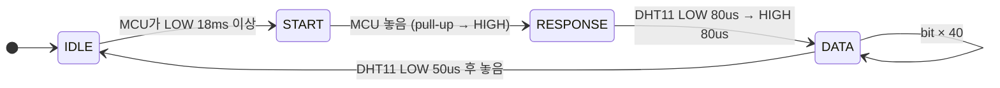
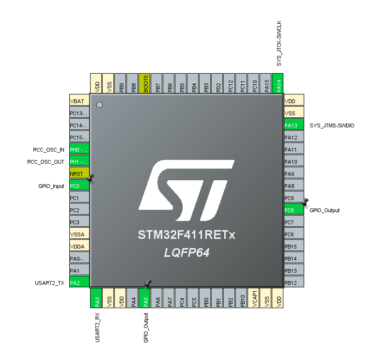
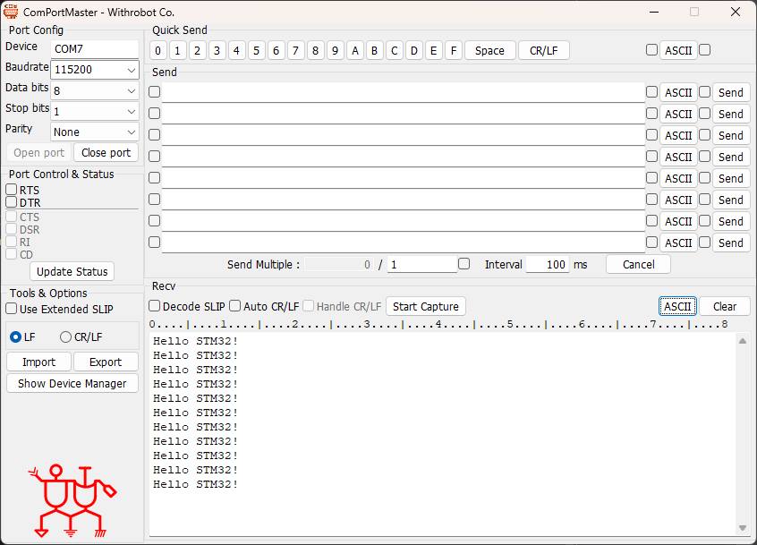

# dht11 — DHT11 온습도 센서 드라이버 (1-wire 직접 구현)

> 📅 2026-10-27 · 보드: NUCLEO-F411RE

전용 통신 IP가 없는 DHT11 센서의 단선(single-bus) 프로토콜을 **GPIO 입출력 전환 + us 단위 시간 측정**으로 직접 구현함.
UART2로 `printf` 디버깅 환경도 이때 만듦.

> 아날로그 시계 프로젝트([proj_analog_clock_stopwatch](https://github.com/jeongmin-0113/proj_analog_clock_stopwatch), 별도 레포) 코드를 기반으로 시작한 폴더라
> 아날로그 시계 서비스 코드(`ap/AnalogClock`)도 같이 들어있음.

## 파일 구조

```
Core/Src/
├── main.c                 # __io_putchar → UART2 printf
├── common/delay/          # us 단위 delay / 경과시간 측정
├── ap/
│   ├── ap_main.c
│   ├── TempHum/           # 온습도 측정 service
│   ├── AnalogClock/  StopWatch/  TimeClock/  Display/
└── driver/
    ├── dht11/             # DHT11 드라이버
    └── button/  led/  fnd/  lcd/  DS3231/  stepmotor/
```

## 사용 핀 / 설정

| 항목 | 설정 |
|---|---|
| PC8 | DHT11 DATA (output ↔ input 전환) |
| PC0 | 택트 버튼 |
| PA5 | LED (동작 확인용) |
| USART2 (PA2 TX / PA3 RX) | Asynchronous, 115200 → printf |
| I2C1 (PB8 / PB9) | LCD 출력 |

---

## dht11 datasheet

- [DHT11 datasheet (Mouser)](https://www.mouser.com/datasheet/2/758/DHT11-Technical-Data-Sheet-Translated-Version-1143054.pdf)

| 항목 | 범위 | 정확도 |
|---|---|---|
| 온도 | 0 ~ 50 ℃ | ±2 ℃ → 영하는 안찍힘 |
| 습도 | 20 ~ 90 %RH | ±5 %RH → 얘는 소수점이 찍히기도 함 |

- dht11 회로 구성 → data 선에 pull up 저항 (5k) 을 달아라
- 우리 센서 모듈에는 이미 저항 달려있음 (모듈 핀: VCC, DATA, GND)

### data format

| byte | 0 | 1 | 2 | 3 | 4 |
|---|---|---|---|---|---|
| 내용 | 습도 정수부 | 습도 실수부 | 온도 정수부 | 온도 실수부 | checksum |

- 총 40bit, **상위비트(MSB)부터** 먼저 보낸다 → 좌 shift 하며 (하위 → 상위로 밀어 올리며) 전송받기
- checksum = 습도 정수부 + 습도 실수부 + 온도 정수부 + 온도 실수부 (carry 버림, 하위 8bit)

### 통신 과정



- idle 상태: pull up 저항으로 1(high) 일 때
- idle → start: low로 떨어뜨리기 (최소 18ms low 유지)
- 18ms 후 1로 바꾸든 연결을 끊어서 pull up이 high로 올리게 놔두든지 하기
- 수신: 매 bit는 LOW 50us로 시작하고, 이어지는 **HIGH 길이**로 0/1 구분

| bit | LOW | HIGH |
|---|---|---|
| 0 | 50us | 26 ~ 28us |
| 1 | 50us | 70us |

<details>
<summary>노트에서 고친 부분</summary>

- 노트에는 "low 50ms / high 26~28ms / 70ms"로 적혀있었는데 데이터시트 기준 단위는 **us** 라서 고쳐서 옮김

</details>

### 구현 순서

1. 5 byte (40 bit) 메모리 공간 확보 (buffer)
2. output mode → GPIO LOW → 18ms 이상 delay → GPIO HIGH
3. input mode
4. LOW signal 대기 → HIGH signal 대기 (DHT11 응답)
5. bit마다: LOW 대기 → HIGH 시간 측정 → **HIGH 시간이 40us 보다 길면 1, 아니면 0** → buffer에 bit 저장
6. 5번을 40번 반복
7. checksum 확인 (byte0 + 1 + 2 + 3 == byte4) → OK면 buffer를 온습도 데이터로 활용

## 실습: dht11 드라이버 만들기

### pin



- uart2 async
- pc8: dht11
- pc0: tact button
- pa5: led
- rcc, sys(debug - serial wire)

### code

```c
int __io_putchar(int ch) {
	// print문이 어디를 통해서 나갈지 결정
	HAL_UART_Transmit(&huart2, (uint8_t*) &ch, 1, HAL_MAX_DELAY);
	return ch;
}

printf("Hello STM32!\n");
```

- uart2를 통해 print



- reset할 때마다 print한게 나옴

```c
void power_indicator() {
	static uint32_t prevTime = 0;
	if (HAL_GetTick() - prevTime < 200) {
		return;
	}
	prevTime = HAL_GetTick();
	HAL_GPIO_TogglePin(GPIOA, GPIO_PIN_5);
}
```

- 왜 멈춰있지않고 깜빡깜빡할까? → 시스템 소프트웨어가 잘 돌아가고있는지 확인용

### 온습도 service

```c
dht11_data_t* temphum_getData(uint8_t sec) {
	if ((sec % 2) == 1) {
		return &measure_data;   // 홀수 초에는 이전 값
	}
	temphum_measure();          // 짝수 초에만 측정 (DHT11은 1초 이상 간격 필요)
	return &measure_data;
}
```

전체 드라이버: [`Core/Src/driver/dht11/dht11.c`](Core/Src/driver/dht11/dht11.c) · 리뷰 버전은 [dht11_temp_humid](../dht11_temp_humid)
