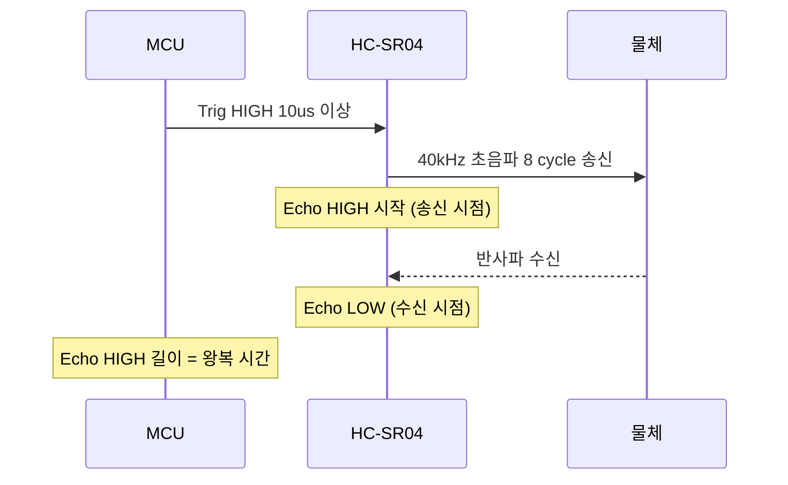
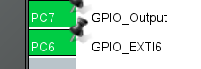
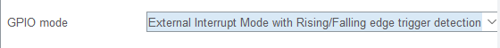
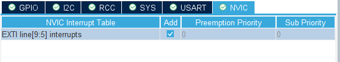
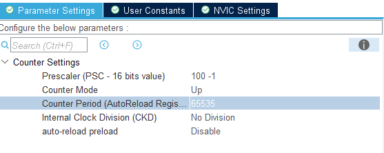
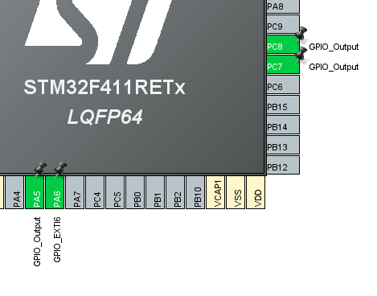
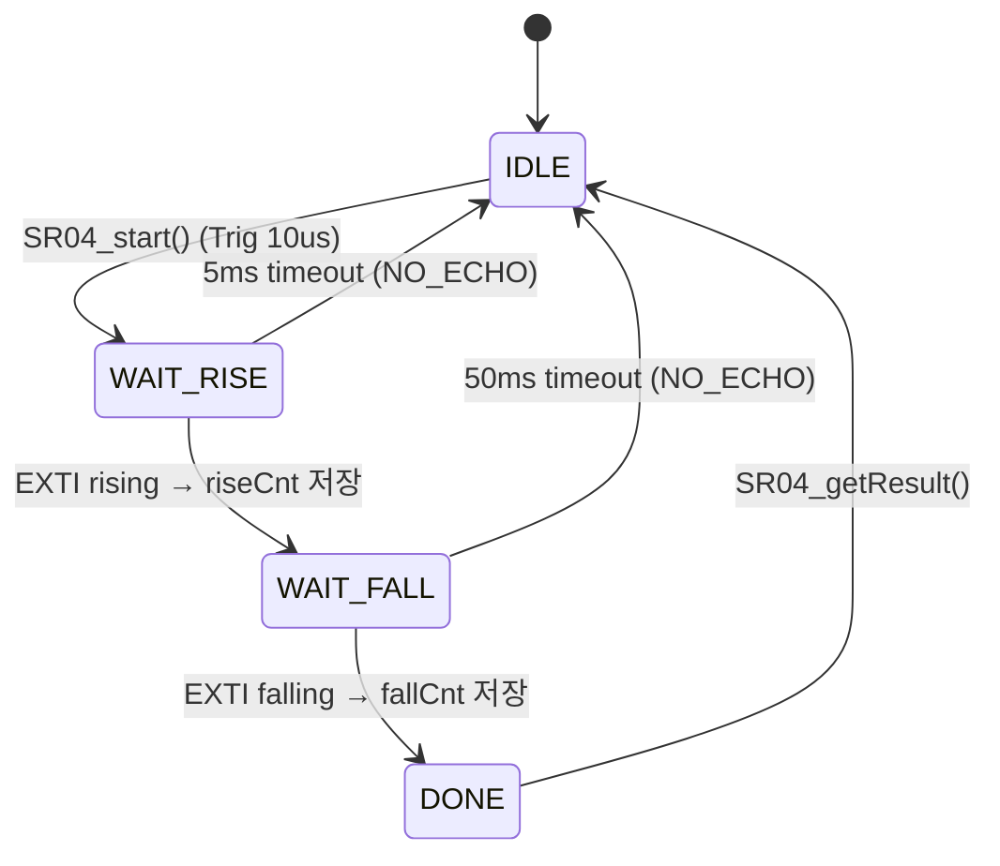

# dht11_sr04 — HC-SR04 초음파 거리 센서 드라이버 (EXTI + Timer)

> 📅 2026-10-28 · 보드: NUCLEO-F411RE

[dht11_temp_humid](../dht11_temp_humid) 온습도계에 **HC-SR04 초음파 센서**를 추가함.
Echo 핀의 상승/하강 엣지를 **외부 인터럽트(EXTI)** 로 잡고, 그 사이 시간을 **TIM10 카운터(1us)** 로 재서 거리를 계산함.

## 파일 구조

```
Core/Src/
├── main.c
├── stm32f4xx_it.c             # EXTI9_5_IRQHandler
├── common/delay/
├── ap/
│   ├── ap_main.c
│   └── service/
│       ├── temp_humid/  distance/  Display/
└── driver/
    ├── DHT11/  lcd/  button/
    └── SR04/                  # 초음파 센서 드라이버
```

## 사용 핀 / 설정

| 항목 | 설정 |
|---|---|
| PC5 | SR04 Trig (GPIO Output) |
| PC6 | SR04 Echo (GPIO_EXTI6, Rising/Falling edge) |
| PC8 | DHT11 |
| PC0 | 측정 버튼 |
| TIM10 | PSC 100, ARR 65535 → 1us 카운터 (interrupt 아님) |
| NVIC | EXTI line[9:5] interrupts 활성화 |

---

## sr04 datasheet

- [HC-SR04 datasheet (SparkFun)](https://cdn.sparkfun.com/datasheets/Sensors/Proximity/HCSR04.pdf)

### HC-SR04 센서 정보

- **측정 범위:** 2cm ~ 400cm (정밀도 최대 3mm)
- **동작 전압 / 전류:** DC 5V / 15mA
- **동작 주파수:** 40kHz
- **측정 각도:** 15도 이하
- **핀 구성 (4핀):** VCC (5V), Trig (Trigger), Echo, GND

### 드라이버 구현에 필요한 핵심 정보 (타이밍 및 로직)



- **트리거 신호 (Trigger):**
  - 마이크로컨트롤러(MCU)에서 10µs(마이크로초) 이상의 High 레벨 펄스를 Trig 핀으로 인가합니다.
- **센서 동작:**
  - 트리거를 받으면 센서가 자동으로 40kHz 초음파 버스트(8사이클)를 송신합니다.
- **에코 신호 (Echo):**
  - 초음파를 송신 시점 ~ 반사되어 돌아오는 시점까지 Echo 핀이 High 상태를 유지합니다.
- **측정 주기:**
  - 오인식 방지를 위해 측정 주기는 **60ms 이상**을 권장합니다.

### 거리 계산

| 시간 | 소리가 가는 거리 (340 m/s) |
|---|---|
| 1 s | 340 m |
| 1 ms | 0.34 m = 34 cm |
| 1 us | 0.034 cm |

- Echo HIGH 시간은 **왕복** 시간이라 2로 나눈다 → **1us 당 0.017cm (0.17mm)**
- 예) 100us → 1.7cm, 1000us → 17cm
- 데이터시트 공식: `us / 58 = cm`

## sr04 driver 만들기

### 1. pin



- exti → external interrupt
- 상승엣지/하강엣지 시점 정해서 인터럽트 걸 수 있음



- echo 핀의 상승/하강엣지 모두에 인터럽트 거는걸로 설정
  - 상승엣지~하강엣지까지 시간을 재서 거리를 측정함



- 인터럽트는 꼭 nvic 설정하기

- 타이머 (tim10 사용)



- 1us 주기 신호를 prescaler로 만들고
- arr 레지스터로 숫자만 세는거임 → 이 타이머는 인터럽트용 x 거리 측정을 위한 초세기 카운터

```c
void EXTI9_5_IRQHandler(void)
{
  /* USER CODE BEGIN EXTI9_5_IRQn 0 */

  /* USER CODE END EXTI9_5_IRQn 0 */
  HAL_GPIO_EXTI_IRQHandler(GPIO_PIN_6);
  /* USER CODE BEGIN EXTI9_5_IRQn 1 */

  /* USER CODE END EXTI9_5_IRQn 1 */
}
```

- 외부 인터럽트 핸들러 생김

### EXTI line 공유

- EXTIn 라인 하나에 PAn ~ PHn 중 **하나만** 연결된다 (SYSCFG_EXTICR 레지스터로 선택, RM0383 Figure 30)
  - pa0을 exti로 썼다면 pb~ph0은 외부 인터럽트로 사용 불가
- EXTI5 ~ 9는 IRQ 하나(`EXTI9_5_IRQHandler`)를 같이 쓴다



- 원래 인터럽트가 pc6인데, pa6을 exti로 설정하면 pc6은 자동으로 해제됨!

### 2. 드라이버 코드



```c
// 인터럽트 내부에서 실행되는 변수들은 컴파일러 최적화될 수 있음
// 컴파일러 최적화로 값 사라지는거 방지하기 위해 volatile
volatile uint32_t riseCnt, fallCnt;
volatile echo_state_t state;

void SR04_echoISR(void) {
	// sr04 htim의 타이머 카운터 값을 가져옴
	uint32_t cnt = __HAL_TIM_GET_COUNTER(sr04_htim);
	bool isHigh = echo_is_high();

	if ((state == STATE_WAIT_RISE) && isHigh) {
		// isr이 걸린 시점에서 echo가 high -> rising edge
		riseCnt = cnt;
		state = STATE_WAIT_FALL;
	} else if ((state == STATE_WAIT_FALL) && !isHigh) {
		// isr이 걸린 시점에서 echo가 low -> falling edge
		fallCnt = cnt;
		state = STATE_DONE;
	}
}

uint32_t timer_diff(uint32_t start, uint32_t end) {
	// arr *auto reload register에 설정된 값 = 65535
	uint32_t arr_max = __HAL_TIM_GET_AUTORELOAD(sr04_htim);
	if (end >= start)
		return end - start;
	else
		return (arr_max - start) + end + 1;   // 카운터가 한 바퀴 돈 경우
}
```

전체 코드: [`Core/Src/driver/SR04/SR04.c`](Core/Src/driver/SR04/SR04.c)

> 리뷰 버전: [dht11_sr04_review](../dht11_sr04_review)
