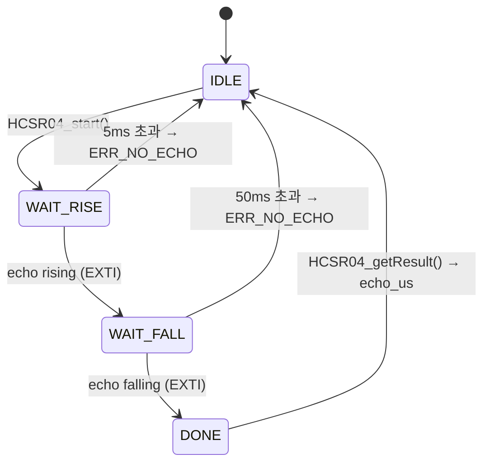
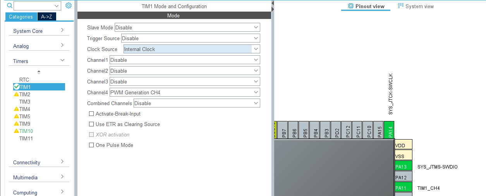
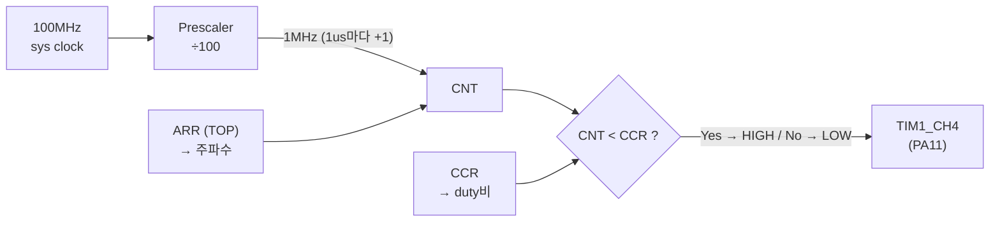
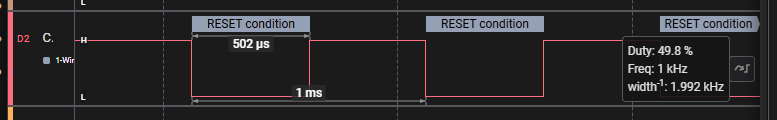

# dht11_sr04_review — 초음파 드라이버 리뷰 + Timer PWM (CCR)

> 📅 2026-10-29 · 보드: NUCLEO-F411RE

1. [dht11_sr04](../dht11_sr04)의 초음파 드라이버를 리뷰해서 `driver/HCSR04` + `service/distance`로 다시 정리
2. **Timer PWM**: TIM1 CH4(PA11)로 PWM을 내보내고, ARR로 주파수 / CCR로 duty비를 바꾸는 실습

## 파일 구조

```
Core/Src/
├── main.c                     # TIM1 PWM 실습 코드 (incPeriod / incDuty)
├── common/delay/
├── ap/
│   ├── ap_main.c              # EXTI 콜백 → dist_ISR, 버튼 → dist_request
│   └── service/
│       ├── distance/          # 측정 요청 / 결과 처리
│       ├── temp_humid/  display/
└── driver/
    ├── HCSR04/                # 초음파 드라이버 (리뷰 버전)
    └── DHT11/  lcd/  button/
```

## 사용 핀 / 설정

| 항목 | 설정 |
|---|---|
| PC5 / PC6 | HC-SR04 Trig / Echo (EXTI6) |
| PC8 | DHT11 |
| PC0 / PC1 | 버튼 (측정 / PWM 실습용) |
| PA11 | **TIM1_CH4** PWM 출력 |
| TIM1 | PSC 100-1 → 1MHz, ARR 1000-1 → 1kHz PWM |
| TIM10 | 1us 카운터 (초음파 시간 측정) |

---

## HC-SR04 driver 리뷰



```c
typedef enum {
	HCSR04_OK = 0,
	HCSR04_IN_PROGRESS,
	HCSR04_ERR_NOT_STARTED,
	HCSR04_ERR_BUSY,
	HCSR04_ERR_NO_ECHO,
	HCSR04_ERR_OUT_OF_RANGE
} hcsr04_status_t;

hcsr04_status_t HCSR04_getResult(uint32_t *echo_us)
{
	uint32_t elapsed_ms = HAL_GetTick() - start_ms;
	switch (state)
	{
	case STATE_WAIT_RISE:
		if (elapsed_ms <= RISE_TIMEOUT_MS) {
			return HCSR04_IN_PROGRESS;
		}
		state = STATE_IDLE;
		return HCSR04_ERR_NO_ECHO;
	case STATE_WAIT_FALL:
		if (elapsed_ms <= FALL_TIMEOUT_MS) {
			return HCSR04_IN_PROGRESS;
		}
		state = STATE_IDLE;
		return HCSR04_ERR_NO_ECHO;
	case STATE_DONE:
		uint32_t us = timer_diff(rise_cnt, fall_cnt);
		state = STATE_IDLE;
		*echo_us = us;
		return HCSR04_OK;
	case STATE_IDLE:
	default:
		return HCSR04_ERR_NOT_STARTED;
	}
}
```

- 측정 시작(`start`)과 결과 확인(`getResult`)을 분리 → main loop를 막지 않는 **non-blocking** 구조
- driver는 echo 시간(us)만 돌려주고, cm 변환은 `service/distance`에서 처리

전체 코드: [`Core/Src/driver/HCSR04/HCSR04.c`](Core/Src/driver/HCSR04/HCSR04.c)

---

## timer pwm, ccr



- 채널4를 pwm generation ch4로 설정 → PA11 배정

### timer pwm?

- pwm 출력은 TIM 기능 중 하나이다
- 채널별로 출력이 나감
- 듀티 비 duty ratio: 주기 대비 High 신호 비율



- 어떤 원리로 주기를 정하고 duty cycle(high 길이)을 정하는가?
- timer pwm은 기본적으로 타이머 기능임
- prescaler → 증가 속도 (증가하는 함수의 기울기)에 영향
- arr → 증가 가능한 최댓값
- **prescaler와 arr로 주기(주파수)를 조정함** → ARR 값 조절로 PWM 출력의 주파수를 변경
- **CCR 값 조절로 PWM 출력의 duty비를 변경**

```
CNT
 ARR ┤      /|      /|      /|
     │     / |     / |     / |
 CCR ┤----/--|----/--|----/--|----
     │   /   |   /   |   /   |
   0 ┼──/────┴──/────┴──/────┴──→ t
OUT    ‾‾‾|___  ‾‾‾|___  ‾‾‾|___     (PWM mode 1)
       H    L
       |<-주기->|
```

- 0값을 만나면 high
- 정해놓은 값 (ccr) 을 cnt가 넘으면 low로 떨어짐
- ccr이 0에 가까울수록 전체 주기에서 high 비율 감소 → 듀티비 감소
- arr (top) 까지의 카운터가 channel에 들어가서 capture compare register (ccr)와 비교
- 비교한 값을 기준으로 output control에서 pwm의 출력을 결정함
  - 0 \< cnt \< ccr = high
  - ccr \< cnt \< arr = low

| PWM mode | CNT < CCR | CNT > CCR | 특징 |
|---|---|---|---|
| **mode 1** | HIGH | LOW | ccr 커지면 듀티비도 비례해서 늘어남 → 직관적이라 많이 씀 |
| mode 2 | LOW | HIGH | 반비례 → 덜 직관적 |

- pulse: ccr 값 조정
- 50% duty비를 출력할 경우 CCR 값에 ARR/2 값을 넣으면 된다

### 50% 듀티비의 신호 생성하기

```c
	uint32_t arr;
	__HAL_TIM_SET_AUTORELOAD(&htim1, 1000 - 1); // 1khz 주파수 생성 (preload로 1m, arr로 1k)

	arr = __HAL_TIM_GET_AUTORELOAD(&htim1);
	__HAL_TIM_SET_COMPARE(&htim1, TIM_CHANNEL_4, arr/2 - 1); // 50% 듀티비의 신호 생성

	HAL_TIM_PWM_Start(&htim1, TIM_CHANNEL_4);
```



- 로직 분석기로 확인: **1kHz, duty 49.8%** (HIGH 502us / 주기 1ms)

### PWM 활용

- pwm의 듀티비를 조정해서 dc 모터의 속도를 조절한다
- start\_it 하지 않는 이상 인터럽트는 걸리지 않음 타이머를 쓴다고 다 인터럽트가 아니다

### 실습: 버튼 2개로 주파수 / duty비 바꾸기

> - 버튼 ① → 주기 증가: 20Hz ~ 20kHz (ARR 50 ~ 50000, 50씩 증가)
> - 버튼 ② → duty cycle 10% 씩 증가 (0 ~ 90%)

```c
void incPeriod() {
	// 20hz: 50000분주 20khz: 50분주
	static uint32_t prevTime = 0;

	__HAL_TIM_SET_AUTORELOAD(&htim1, prevArr - 1);
	__HAL_TIM_SET_COMPARE(&htim1, TIM_CHANNEL_4, prevArr / 2 - 1); // 50% 듀티비 유지

	if (HAL_GetTick() - prevTime >= 1) {
		if (prevArr < 50000) {
			prevArr += 50;
		} else {
			prevArr = 50;
		}
		prevTime = HAL_GetTick();
	}
}

void incDuty() {
	static uint32_t prevTime = 10;

	__HAL_TIM_SET_AUTORELOAD(&htim1, 1000 - 1); // 1khz 고정
	uint32_t arr = __HAL_TIM_GET_AUTORELOAD(&htim1);
	__HAL_TIM_SET_COMPARE(&htim1, TIM_CHANNEL_4, prevDuty);

	if (HAL_GetTick() - prevTime >= 1) {
		if (prevDuty < arr * 90 / 100) {
			prevDuty += arr * 10 / 100;
		} else {
			prevDuty = 0;
		}
		prevTime = HAL_GetTick();
	}
}
```

> PWM으로 부저 소리 내기는 [buzzer](../buzzer)
