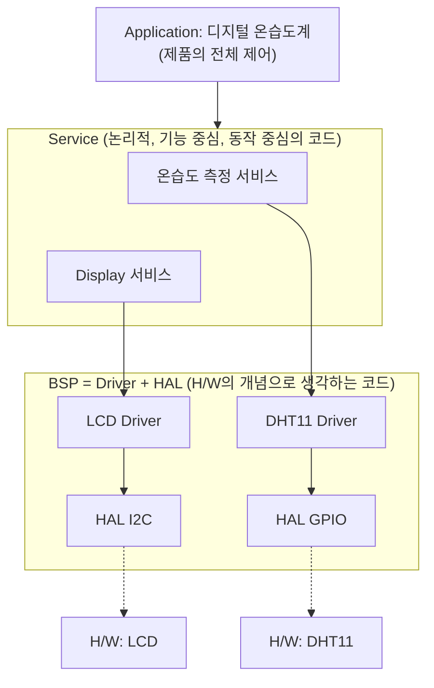
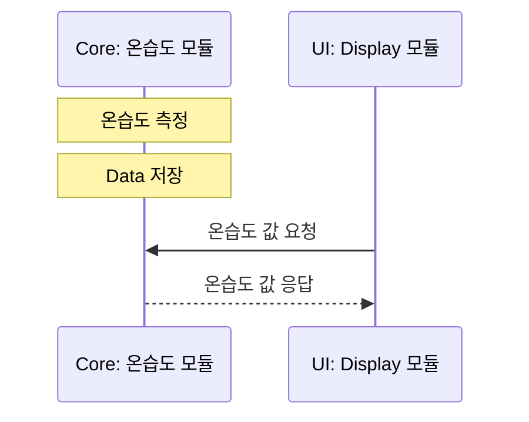

# dht11_temp_humid — DHT11 드라이버 리뷰 + 디지털 온습도계

> 📅 2026-10-28 · 보드: NUCLEO-F411RE

[dht11](../dht11)의 드라이버를 리뷰해서 다시 짜고, **온습도 측정 service + Display service** 구조로 LCD 온습도계를 만듦.
UI(Display)가 필요할 때 Core(온습도)에서 값을 가져가는 **pull 방식**을 적용함.

## 파일 구조

```
Core/Src/
├── main.c
├── common/delay/              # DWT cycle counter 기반 us delay
├── ap/
│   ├── ap_main.c              # TH_task() + Disp_task() super loop
│   └── service/
│       ├── temp_humid/        # Core: 온습도 측정
│       └── Display/           # UI: LCD 출력
└── driver/
    ├── DHT11/
    └── lcd/
```

## 사용 핀 / 설정

| 항목 | 설정 |
|---|---|
| PC8 | DHT11 DATA |
| I2C1 (PB8 / PB9) | LCD (0x27) |
| USART2 | printf 디버깅 |

---

## sw 구조



### bsp

- driver + hal 단을 bsp (Board Support Package) 라고 부름
- peripheral 하드웨어 주변기기를 제어하는 파트
- 여기에서 하드웨어를 제어하는거지 서비스나 앱에서는 하드웨어 제어에 대한 부분은 믿고 쓰는거임

## pull 방식



- core에서 ui가 데이터를 땡겨온다

## DHT11 driver (리뷰)

```c
static int32_t wait_while(GPIO_PinState level, uint32_t timeout_us)
{
	uint32_t start = delay_get_cycle();
	while(line_read() == level) {
		if (delay_elapsed_us(start) > timeout_us) {
			return -1;                       // timeout
		}
	}
	return (int32_t)delay_elapsed_us(start); // level이 유지된 시간(us)
}

static dht11_status_t dht11_readFrame(uint8_t *buf)
{
	// 응답: LOW 80us, HIGH 80us
	if (wait_while(GPIO_PIN_SET, RESPONSE_TIMEOUT_US) < 0) return DHT11_ERR_NO_RESPONSE;
	if (wait_while(GPIO_PIN_RESET, RESPONSE_TIMEOUT_US) < 0) return DHT11_ERR_NO_RESPONSE;
	if (wait_while(GPIO_PIN_SET, RESPONSE_TIMEOUT_US) < 0) return DHT11_ERR_NO_RESPONSE;

	// bit 40개: MSB 부터
	for (int i=0; i<40; i++) {
		if (wait_while(GPIO_PIN_RESET, RESPONSE_TIMEOUT_US) < 0) {
			return DHT11_ERR_TIMEOUT;
		}
		int32_t high_us = wait_while(GPIO_PIN_SET, RESPONSE_TIMEOUT_US);
		if (high_us < 0) {
			return DHT11_ERR_TIMEOUT;
		}
		uint8_t bit = (high_us > BIT_ONE_US) ? 1 : 0;   // 40us 기준
		buf[i/8] = (uint8_t)((buf[i/8] << 1) | bit);
		// buf[0] : i=0 ~ 7 / buf[1] : i=8 ~ 15 / ... / buf[4] : i=32 ~ 39
	}
	return DHT11_OK;
}
```

- `wait_while`: 특정 level이 유지되는 동안 기다리고, 유지된 시간을 돌려줌 → 응답 대기와 bit 판별을 같은 함수로 처리
- 에러를 enum (`DHT11_ERR_NO_RESPONSE`, `DHT11_ERR_TIMEOUT`, `DHT11_ERR_CHECKSUM`)으로 구분해서 리턴

전체 코드: [`Core/Src/driver/DHT11/DHT11.c`](Core/Src/driver/DHT11/DHT11.c)

> 다음 단계: 초음파 센서까지 붙인 [dht11_sr04](../dht11_sr04)
