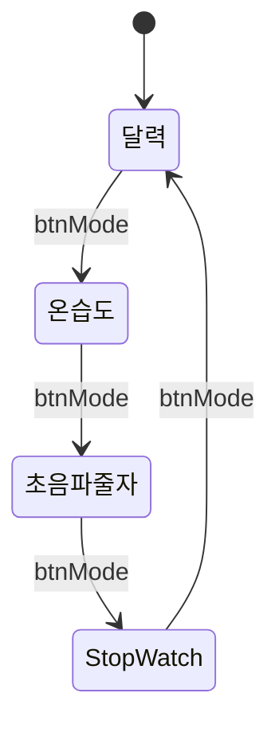
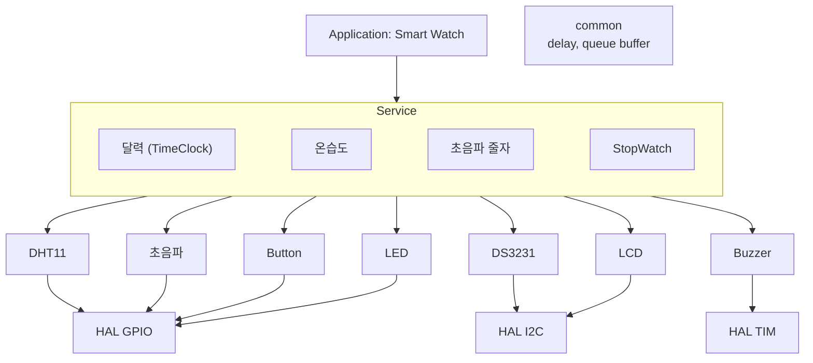
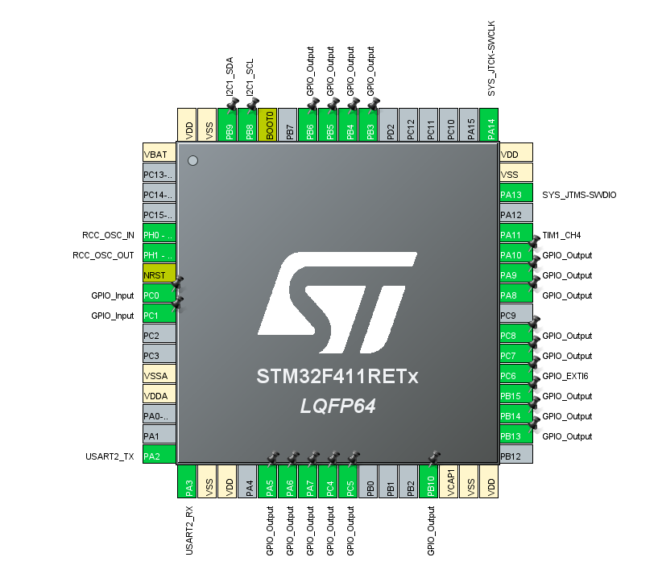

# digital_clock_all_in_one — DHT11 + SR04 + 부저 + Queue 디지털 시계 통합

> 📅 2026-10-30 · 보드: NUCLEO-F411RE

지금까지 만든 driver / service를 하나의 디지털 시계 SW로 통합한 과제.
버튼 입력은 **queue buffer**에 이벤트로 쌓고, 핸들러가 하나씩 꺼내 각 모드에 전파하는 구조로 만듦.

## 파일 구조

```
Core/Src/
├── main.c
├── common/
│   ├── delay/
│   └── queue/                 # 버튼 이벤트 queue
├── ap/
│   ├── ap_main.c              # 버튼 이벤트 리스너/핸들러, 모드 FSM
│   └── service/
│       ├── TimeClock/  StopWatch/  temp_humid/  distance/  sound/  Display/
└── driver/
    ├── DHT11/  HCSR04/  DS3231/  buzzer/
    └── button/  led/  fnd/  lcd/
```

---

## 과제: dht11, sr04, 부저, queue를 디지털시계 sw에 통합

> - 모드: 달력(시계) → 온습도 → 초음파 줄자 → StopWatch → 달력 … (btnMode로 전환)
> - LCD 1번째 줄은 항상 시간 표시, 2번째 줄에 모드별 데이터(달력 / 온습도 / 거리 / StopWatch)
> - 사용 장치: LED, DS3231, DHT11, 초음파, Buzzer (FND는 옵션)
> - **queue buffer를 사용하시오** — button event에 대해 buffer 사용





### 핀 매핑



| 장치 | 핀 |
|---|---|
| I2C1 (LCD, DS3231) | PB8 SCL / PB9 SDA |
| DHT11 | PC8 |
| HC-SR04 | PC5 Trig / PC6 Echo (EXTI6) |
| Buzzer | PA11 (TIM1_CH4) |
| Button | PC0 (mode) / PC1 (run·stop) / PC3 (clear) |
| LED | PB15, PB14, PB13, PC4 |
| FND | PA5~PA10, PB3~PB6, PB10, PC7 |

### 타이머 세팅

- tim1: pwm generation ch4 - 부저 소리 제어에 활용
- tim3: 1ms 마다 업데이트, fnd 출력 제어에 활용 (비활성화)
- tim4: 10ms 마다 업데이트, stopwatch 및 watch의 시간계산에 활용
- tim10: ch6과 연결 (외부 인터럽트), 거리 측정시 엣지 확인에 활용

## 소스코드

### 버튼 이벤트 리스너 + 핸들러

```c
void buttonEventListener() {
	static uint32_t prevTime = 0;
	btn_event_t btn_cur = BTN_NONE;
	if (button_getState(&btnMode) == ACT_RELEASE) {
		btn_cur = BTN_MODE;
		queue_push(&q_btnEvent, &btn_cur);
	}
	if (button_getState(&btnRunStop) == ACT_RELEASE) {
		btn_cur = BTN_RUN_STOP;
		queue_push(&q_btnEvent, &btn_cur);
	}
	if (button_getState(&btnClear) == ACT_RELEASE) {
		btn_cur = BTN_CLEAR;
		queue_push(&q_btnEvent, &btn_cur);
	}

	if (HAL_GetTick() - prevTime >= 1000) {
		prevTime = HAL_GetTick();
		if (!queue_isEmpty(&q_btnEvent)) {
			queue_pop(&q_btnEvent, &btnEvent);

			if (btnEvent == BTN_MODE) {
				sound_button();
			}
			if (btnEvent == BTN_RUN_STOP) {
				sound_runstop();
			}
			if (btnEvent == BTN_CLEAR) {
				sound_clear();
			}
		}
	} else {
		btnEvent = BTN_NONE;
	}
}
```

- main loop 한 번에 버튼 입력도 하나씩, 버튼 반영도 하나씩
- 핸들러 부분에서는 queue에서 버튼 입력된 결과를 하나씩 받아 전파

### 핸들러에서 받은 버튼 이벤트 입력을 전역변수로 활용 및 전파

```c
void ap_timeClockMode(void) {
	if (btnEvent == BTN_MODE) {
		// 시계 -> 온습도 -> 거리 -> 스탑워치 -> 시계
		modeState = TEMP_HUMID_MODE;
	}

	TimeClock_t *pTimeClockTime = TimeClock_getTimeData();
	Disp_setTimeClockTime((timeClockTime_t*) pTimeClockTime, modeState);

	TimeDate_t *pTimeClockDate = TimeClock_getDateData();
	Disp_setTimeClockDate((timeClockDate_t*) pTimeClockDate);

	Disp_setMode(modeState);
}

void ap_tempHumidMode(void) {
	if (btnEvent == BTN_MODE) {
		modeState = DISTANCE_MODE;
	}

	TH_task();

	TimeClock_t *pTimeClockTime = TimeClock_getTimeData();
	Disp_setTimeClockTime((timeClockTime_t*) pTimeClockTime, modeState);

	dht11_data_t pTempHumid = { 0, };
	TH_getTempHumid(&pTempHumid);
	Disp_setTempHumid((tempHumid_t*) &pTempHumid);

	Disp_setMode(modeState);
}

void ap_distanceMode(void) {
	if (btnEvent == BTN_MODE) {
		modeState = STOP_WATCH_MODE;
	}

	if (btnEvent == BTN_RUN_STOP) {
		dist_request();
	}

	dist_task();

	TimeClock_t *pTimeClockTime = TimeClock_getTimeData();
	Disp_setTimeClockTime((timeClockTime_t*) pTimeClockTime, modeState);

	Disp_setDistance();

	Disp_setMode(modeState);
}
```

전체 코드: [`Core/Src/ap/ap_main.c`](Core/Src/ap/ap_main.c)

## 오류 발생

- 오류 상황: 온습도 센서 (dht11)에서 온습도를 측정하지 못하고 초기값인 0에 머무는 오류 발생
- 원인: tim3으로 1ms마다 fnd 변경하며 온습도 측정 중 인터럽트가 걸리며 측정에 영향 발생 → checksum 확인에서 오류가 생겨 값이 업데이트되지 않음
  - DHT11은 bit를 HIGH 길이(26~28us vs 70us)로 구분하는데, 측정 도중 ISR이 끼어들면 시간이 늘어나 bit를 잘못 읽음
- 임시방편으로 fnd isr을 비활성화시 온도 측정이 성공함

> 이 구조를 다시 정리하는 리뷰는 [SmartWatch_review](../SmartWatch_review)
