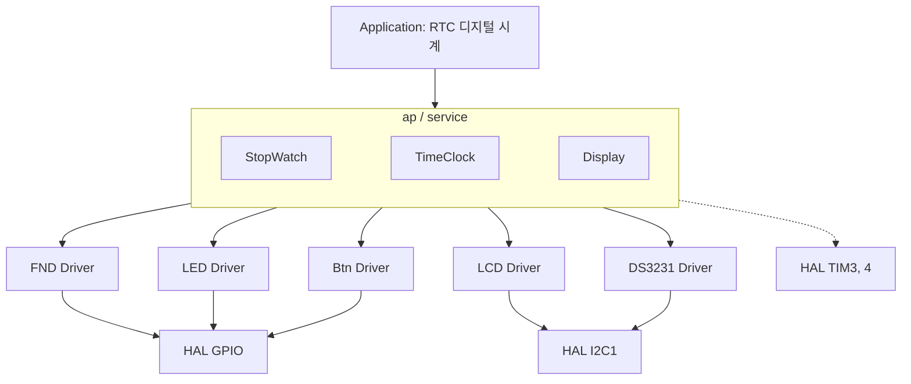
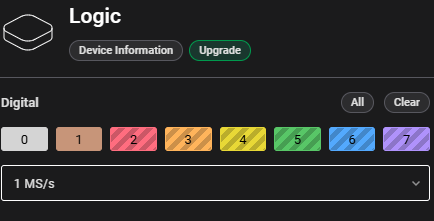
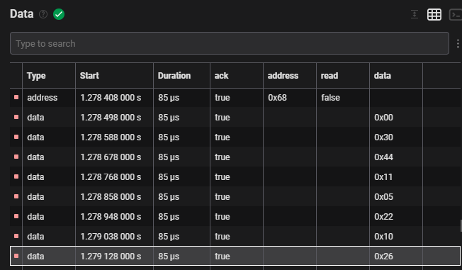

# realtime_clock_review — DS3231 드라이버 리뷰 + RTC 디지털 시계

> 📅 2026-10-22 · 보드: NUCLEO-F411RE

[realtime_clock](../realtime_clock)의 RTC 드라이버를 **"중심 데이터 → 접근 함수"** 순서로 다시 설계하고 (`driver/DS3231`),
로직 분석기로 I2C 신호가 실제로 어떻게 나가는지 확인함.

## 파일 구조

```
Core/Src/
├── main.c
├── ap/
│   ├── ap_main.c          # TIM3 → Disp_ISR, TIM4 → TimeClock/StopWatch_ISR
│   ├── StopWatch/  TimeClock/  Display/
└── driver/
    ├── button/  led/  fnd/  lcd/
    └── DS3231/            # RTC 드라이버 (리뷰 버전)
```

## 사용 핀 / 설정

| 항목 | 설정 |
|---|---|
| I2C1 (PB8 SCL / PB9 SDA) | LCD (0x27) + DS3231 (0x68) |
| TIM3 | 1ms (FND 출력) |
| TIM4 | 10ms (시계·스톱워치 시간 계산) |
| PC0 | 모드 버튼 (시계 ↔ 스톱워치) |

---

## 드라이버 만들고 rtc 디지털 시계 만들기

### sw architecture



## ds3231 드라이버

드라이버를 만드는 순서

1. **중심 Data 생각하기** → 구조체 변수 선언
2. **중심 Data를 Access하는 것은 함수로 표현**한다

### 1. 중심 데이터

- 중심 데이터가 가장 처음!
- 데이터 구조와 형태에 따라 driver 함수들의 구현이 달라지니까
- 시간 (hour, min, sec) / 달력 (day, date, month/century, year) → 레지스터 0x00 ~ 0x06 ([realtime_clock](../realtime_clock#ds3231-datasheet)의 register 표)

```c
typedef struct {
	uint8_t sec;
	uint8_t min;
	uint8_t hour;
} ds3231_time_t;

typedef struct {
	uint8_t day;
	uint8_t date;
	uint8_t month;
	uint8_t year;
} ds3231_date_t;

typedef struct {
	ds3231_time_t time;
	ds3231_date_t date;
} ds3231_datetime_t;
```

### 2. 중심 데이터에 access

- 시간 읽기 쓰기: ds3231\_getTime / ds3231\_setTime
- 날짜 읽기 쓰기: ds3231\_getDate / ds3231\_setDate
- 날짜, 시간 동시에 읽기 쓰기: ds3231\_getDateTime / ds3231\_setDateTime

전체 코드: [`Core/Src/driver/DS3231/ds3231.c`](Core/Src/driver/DS3231/ds3231.c)

```c
#define DS3231_I2C_ADR		(0x68<<1)
#define DS3231_TIMEOUT_MS	10

uint8_t bcd2bin(uint8_t v) {
	return ((v >> 4) * 10) + (v & 0x0f);
}

uint8_t bin2bcd(uint8_t v) {
	return ((v / 10) << 4) | (v % 10);
}

void ds3231_getTime(ds3231_time_t *t) {
	uint8_t buf[3];

	// repeated start 지원하는 hal 메서드 (중간에 stop sign 없음)
	HAL_I2C_Mem_Read(ds3231_hi2c, DS3231_I2C_ADR, DS3231_SEC, 1, buf, 3,
	DS3231_TIMEOUT_MS);

	t->sec = bcd2bin(buf[0] & 0x7f);
	t->min = bcd2bin(buf[1] & 0x7f);
	t->hour = bcd2bin(buf[2] & 0x7f);
}

// const: 매개변수 포인터 접근만 하고 변경 금지
void ds3231_setTime(const ds3231_time_t *t) {
	uint8_t buf[4];
	buf[0] = DS3231_SEC;      // 첫 byte = 레지스터 주소
	buf[1] = bin2bcd(t->sec);
	buf[2] = bin2bcd(t->min);
	buf[3] = bin2bcd(t->hour);

	HAL_I2C_Master_Transmit(ds3231_hi2c, DS3231_I2C_ADR, buf, 4, DS3231_TIMEOUT_MS);
	// 이렇게도 된다~
	// HAL_I2C_Mem_Write(ds3231_hi2c, DS3231_I2C_ADR, DS3231_SEC, 1, &buf[1], 3, DS3231_TIMEOUT_MS);
}
```

- repeated start
  - `HAL_I2C_Master_Transmit` (레지스터 주소) + `HAL_I2C_Master_Receive` 로 나눠 보내면 중간에 STOP이 들어감
  - `HAL_I2C_Mem_Read`는 레지스터 주소를 쓰고 STOP 없이 repeated start 후 바로 read
- `& 0x7f`, `& 0x3f`, `& 0x1f` … : 레지스터의 안 쓰는 bit / 다른 용도 bit(12/24, century 등)를 지우고 decode

### logic analyzer

- 신호 분석기



- ch0, ch1 사용해 i2c의 신호를 읽어보자

```c
ds3231_datetime_t rtc_datetime = { .date = { .year = 26, .month = 10,
		.date = 22, .day = 5 }, .time = { .hour = 11, .min = 44, .sec = 30 } };
ds3231_setDateTime(&rtc_datetime);
```



- i2c를 통해 잘 들어가고 있는 것 확인
  - address 0x68 (write) → data 0x00 (레지스터 주소: 초) → 0x30 (30초) → 0x44 (44분) → 0x11 (11시) → 0x05 (요일) → 0x22 (22일) → 0x10 (10월) → 0x26 (26년)
  - 모두 BCD로 들어감
