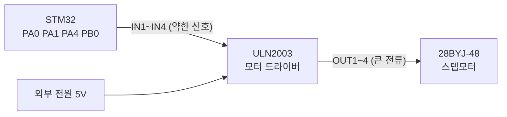
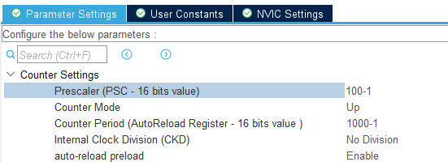

# stepmotor — 스텝모터 + 모터 드라이버 (ULN2003)

> 📅 2026-10-23 · 보드: NUCLEO-F411RE

28BYJ-48 스텝모터를 ULN2003 모터 드라이버로 구동하는 `driver/stepmotor`를 작성하고,
TIM9 인터럽트 주기마다 1 step씩 돌리면서 버튼으로 속도(ARR)를 바꿔봄.

## 파일 구조

```
Core/Src/
├── main.c                 # TIM9 콜백 → 1 step, 버튼으로 ARR 변경
└── driver/
    ├── button/
    └── stepmotor/         # 1-2상 여자 방식 step 패턴
```

## 사용 핀 / 설정

| 항목 | 설정 |
|---|---|
| PA0 / PA1 / PA4 / PB0 | ULN2003 IN1~4 → 모터 orange / yellow / pink / blue |
| PC1 / PC3 | 버튼 (up / down) |
| TIM9 | PSC 100, ARR 1000 → 1ms 마다 interrupt, **auto-reload preload = Enable** |
| 외부 전원 | 브레드보드 전원 모듈 5V → 모터 드라이버 (+, -) |

---

## 추가 디바이스: 모터, 모터 드라이버, 추가 전원 공급 장치

- 모터는 전기를 많이 먹는다
- stm32에서 공급하는 전기로 역부족! 그래서 추가로 전원을 공급해야한다



## 모터 돌리기

- ***스텝모터: 모터의 일종으로 회전운동을 하는 것이 아닌 1각씩 단계적으로 움직인다는*** 뜻으로 Stepper motor라는 이름으로 불리며 줄여서 스텝 모터
- 단순 회전 운동 몇초 x 얼마나 돌릴지, 몇도를 돌리는지 정확하게 알아야 할 때 → 스텝모터를 쓴다
- 에어컨 날개나 시계 같은거
- 가운데 출력축을 기준으로 rotor (영구 자석)이 출력축과 함께 돈다
- 전자석들을 rotor 주변으로 배치해서 어느 쪽으로 rotor가 돌아갈지 선택
- 톱니바퀴처럼 톱니가 있음. rotor는 올록볼록한 부분에 N/S극이 번갈아 배치되어있음. 전자석에 전류 흐름에 따라 s/n극 만들 수 있음
- 같은 극은 밀고 다른 극은 당김 → 0.몇도만 (1 톱니만) 움직인다

| 방식 | 동작 | 특징 |
|---|---|---|
| 1-2상 여자 (Half Step) | 코일 1개 통전 ↔ 2개 동시 통전을 번갈아 → 8 step이 한 사이클 | 같은 코일 수로 **각도가 더 정밀** (정밀 제어면 1-2상) |
| 2상 여자 | 매번 코일 2개 통전 → 4 step이 한 사이클 | 각도는 덜 정밀, **힘이 좋다** (힘이 필요하면 2상) |

<details>
<summary>1-2상 여자방식 동작 원리</summary>

- **동작 개략**: 1상 자석(코일 1개 통전)과 2상 자석(코일 2개 동시 통전) 상태를 번갈아가며 로터(영구 자석)를 미세하게 회전시키는 방식입니다.
- **스텝각 분할**: 기본 스텝각의 절반 단위(Half Step)로 정밀하게 제어할 수 있습니다. (예: 45° 단위 이동)
- **자기장 변화**: 코일 A와 코일 B의 전류(자기장)를 교차 공급하여 당기고 미는 힘을 조절하며 단계별로 회전합니다.

</details>

**28BYJ-48 주요 사양** ([datasheet](https://www.mouser.com/datasheet/2/758/stepd-01-data-sheet-1143075.pdf))

| 항목 | 값 |
|---|---|
| Rated voltage | 5V DC |
| Number of phase | 4 |
| Speed variation ratio (기어비) | 1/64 |
| Stride angle | 5.625° / 64 |
| 1바퀴 step 수 (half step) | 4096 |

**Half-Step Switching Sequence (CW, 1-2 Phase)** — 0 = 전류 흐름 (코일 ON)

| Lead Wire | 1 | 2 | 3 | 4 | 5 | 6 | 7 | 8 |
|---|---|---|---|---|---|---|---|---|
| 4 Orange | 0 | 0 | 1 | 1 | 1 | 1 | 1 | 0 |
| 3 Yellow | 1 | 0 | 0 | 0 | 1 | 1 | 1 | 1 |
| 2 Pink | 1 | 1 | 1 | 0 | 0 | 0 | 1 | 1 |
| 1 Blue | 1 | 1 | 1 | 1 | 1 | 0 | 0 | 0 |

- red (vcc, 5v)에서 전류가 흐르기 시작해 각 코일이 0이면 전류가 흐르고 1이면 전류가 흐르지 않음 \*전류 높이차 있어야 흐른다
- 각 코일에 - 되어있다 → 전류를 흘린다 → 각 코일을 0으로 만든다

### 연결

- pin 출력 전류는 약함
- 근데 모터는 전류가 많이 필요하다
- 그래서 모터가 크면 클수록 pin 전류만으로 돌리기 전류가 모자르다!
- 그래서 모터 드라이버에서 전류, 전압 공급 해줘야 한다
- 달링턴 회로: 큰 전류 필요할 때 쓰는 2단 트렌지스터 (버퍼)
- ULN2003: in 1에 1 넣으면 인버터를 거쳐서 out 1에 0이 나오게 됨 → coil에 0을 주면 전류가 흐른다!
  - high를 주면 외부로 0v / low를 주면 외부로 5v가 나간다~
- 따라서 코드에서 모터 드라이버에게 넘기는 신호는 (MCU 기준) **1 = 코일 ON** 이 된다

| 모터 선 | MCU 핀 |
|---|---|
| 1 blue | PB0 |
| 2 pink | PA4 |
| 3 yellow | PA1 |
| 4 orange | PA0 |

```c
// bit0 = orange, bit1 = yellow, bit2 = pink, bit3 = blue  (1 = 코일 ON)
uint8_t motorSteps[STEP_COUNT] = { 0x01, 0x03, 0x02, 0x06, 0x04, 0x0c, 0x08, 0x09 };

void StepMotor_writePattern(stepMotor_pin_t *pin_info, uint8_t step) {
	for (int i = 0; i < 4; i++) {
		HAL_GPIO_WritePin(pin_info[i].port, pin_info[i].pin,
				((step & (1 << i)) ? GPIO_PIN_SET : GPIO_PIN_RESET));
	}
}
```

전체 코드: [`Core/Src/driver/stepmotor/stepmotor.c`](Core/Src/driver/stepmotor/stepmotor.c)

### 속도 조절과 탈조

- rotor가 이동 가능한 속도보다 전자석의 변화속도가 더 빠르면 → 탈조 났다
  - rotor가 이동을 못한다



- auto reload preload = enable

```c
if (button_getState(&btn_up) == ACT_RELEASE) {
	__HAL_TIM_SET_AUTORELOAD(&htim9, 1000 - 1);
} else if (button_getState(&btn_down) == ACT_RELEASE) {
	__HAL_TIM_SET_AUTORELOAD(&htim9, 2000 - 1);
}
```

- 바로 period 값이 바뀌지 않고 기존 period 값 유지된 상태에서 count 모두 다 끝나서 0으로 떨어지면
- 그때 auto reload 되는 것!
- auto reload enable 안해놓으면 중간에 arr (auto reload register) 값 바꿀때 바로 바뀌어버려서
  - 예) CNT가 이미 새 ARR보다 커진 상태에서 ARR을 줄이면 → CNT가 0xFFFF까지 올라가 오버플로우될 때까지 interrupt가 안 걸린다

## 팀과제: 모터로 아날로그 시계

> 스텝모터를 이용한 아날로그 시계 + StopWatch 만들기
> - 아날로그 시계 동작은 시계 / stopwatch 모드에 맞게 동작한다

결과물: [proj_analog_clock_stopwatch](https://github.com/jeongmin-0113/proj_analog_clock_stopwatch) (별도 레포)
