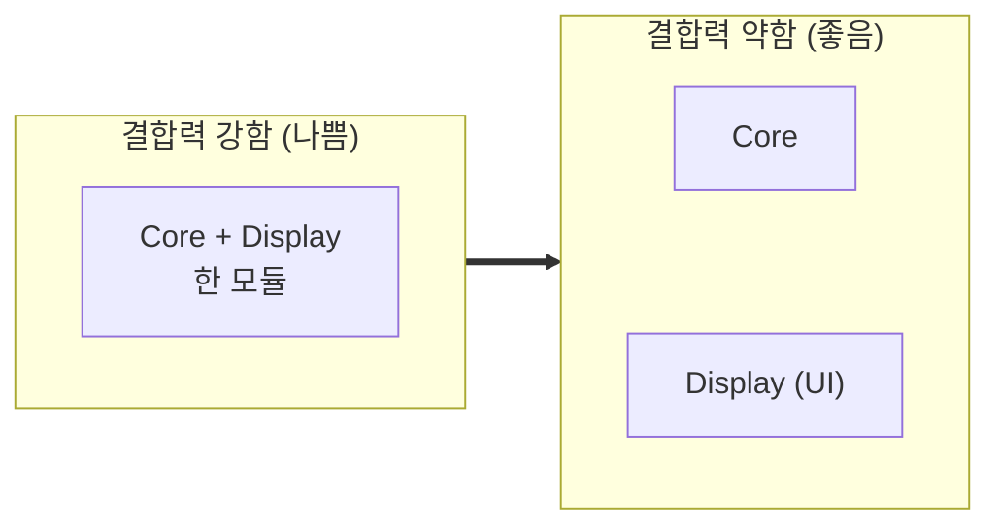
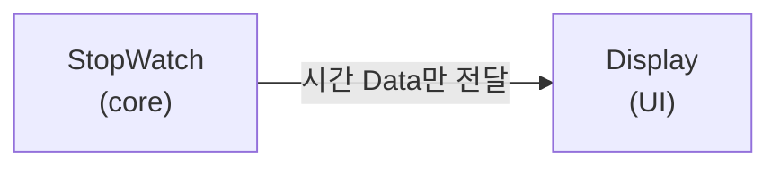
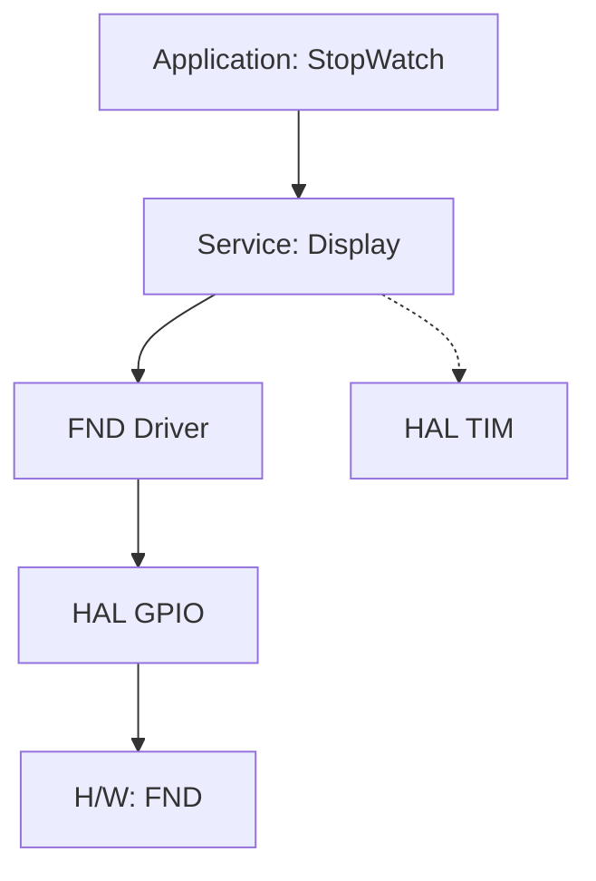
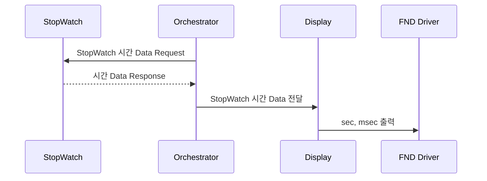

# stopwatch_timeclock_I2C_LCD — 코어/디스플레이 분리 (모듈 결합도 낮추기)

> 📅 2026-10-20 · 보드: NUCLEO-F411RE

스톱워치·시계 **코어 로직**과 **표시(Display)** 를 한 함수에서 같이 처리하던 구조를, 오케스트레이터(`ap_main`)가 데이터를 받아 Display 모듈에 넘기는 구조로 분리함.
FND든 LCD든 표시 장치가 바뀌어도 코어 코드는 건드리지 않도록 하는 게 목표 (다음 단계 LCD 출력은 [clock_I2C_LCD](../clock_I2C_LCD)).

## 파일 구조

```
Core/Src/
├── main.c
├── ap/
│   ├── ap_main.c          # orchestrator
│   ├── StopWatch/         # 코어: 스톱워치 시간 데이터
│   ├── TimeClock/         # 코어: 시계 시간 데이터
│   └── Display/           # 표시: 받은 시간 데이터를 FND에 출력
└── driver/
    ├── button/  led/  fnd/
```

---

### ap_main() ← 함수 이름 뒤 소괄호는 호출연산자

```c
int main() {
	...
	while (1) {
		ap_main();   // 함수 이름 = 함수 주소, () = 호출 연산자
	}
}
```

## 모듈의 결합력



```c
static void StopWatch_run() {
	if (button_getState(&btn_run_stop) == ACT_PUSH) {
		StopWatch_setState(STOP);
	}

	led_off(&led_stop);
	led_on(&led_run);

	if (stopWatch_data.msec < 50) {
		fnd_set_dp(FND_DIGIT_2, FND_DP_ON);
	} else {
		fnd_set_dp(FND_DIGIT_2, FND_DP_OFF);
	}
}
```

- 어플리케이션 코어 기능과 display 기능들이 서로 한 모듈에서, 한 함수에서 같이 동작 → 결합력이 강하다
  - 유지보수하기 별로임
  - 함수 이름 하나 바꾸면 다 들어가서 바꿔줘야 함..
- 코어와 display(UI)를 분리시키는게 좋다! → 결합력을 약하게 만들기



- 코어 기능은 Display 방식에 관여하지 않는다! FND 출력이든 LCD 출력이든 Display하는 모듈이 알아서 처리하는것.
  - 코어는 그냥 display할 데이터만 전달하는거임! 데이터 던져놓고 diplay가 알아서 하게 둠
  - display 코드 수정된다고 해도 core에 영향을 주면 안되는거임!
  - fnd에서 lcd로 바꾼다고 해서 core 코드가 변경되면 안됨 → 이러면 결합력 강한거. 안좋은 코드
  - display는 코어에서 받은 데이터를 조작해서 출력 방식을 결정하는거임

### core와 display 모듈 분리 - 결합력 약화하는 rule

1. ochestrator
   - core한테 데이터 내놔! 한 다음
   - display한테 데이터 출력해! 하고 던짐
2. shared memory (공유 메모리)
   - core가 계산한 코어 데이터를 공유 메모리에 넣음
   - display는 공유 메모리를 주기적으로 체크
   - → 데이터 있으면 데이터 가져가서 display

### display 모듈 만들기

- 중심 data: hour, min, sec, msec (stopwatch, timeclock)
- display device: fnd → fnd driver 활용
- 출력 방법
  - stopwatch: sec + msec, dp: 0.5초 토글 (RUN일 때)
  - timeclock: min + sec, dp: 0.5초 토글
  - 위와 같이 동작하는 함수 구현
  - 주기적으로 중심 데이터 출력 (Timer 활용 FND 출력)
- software structure



### 시퀀스 다이어그램



- request는 실선, response는 점선
- 호출하는 쪽이 화살표의 시작점, 호출되는 함수를 가진 쪽이 화살표의 끝점

```c
stopwatch_t* Stopwatch_getTimeData() {
	return &stopWatch_data;
}
```

```c
// stopwatch <-> och: request&response stopwatch time data
stopwatch_t *pStopwatchTime = Stopwatch_getTimeData();
// och -> display: deliver stopwatch time data to display
Disp_setStopwatchTime((time_t*) pStopwatchTime); // casting
```

```c
// receive stopwatch time data
void Disp_setStopwatchTime(time_t *pTime) {
	pStopWatchTime = pTime;
	Disp_showStopWatchTime();
}

// display sec, msec of time data
void Disp_showStopWatchTime(void) {
	uint16_t num = (pStopWatchTime->sec * 100) + pStopWatchTime->msec;
	fnd_set_num(num);

	if (pStopWatchTime->msec < 50) {
		fnd_set_dp(FND_DIGIT_2, FND_DP_ON);
	} else {
		fnd_set_dp(FND_DIGIT_2, FND_DP_OFF);
	}
}
```
