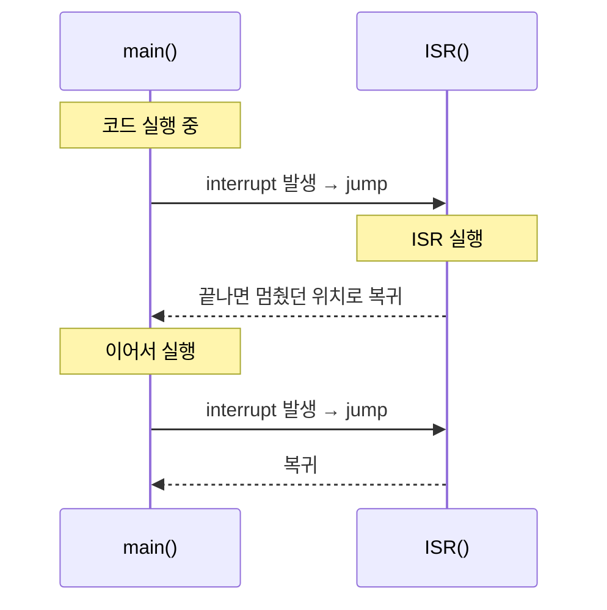
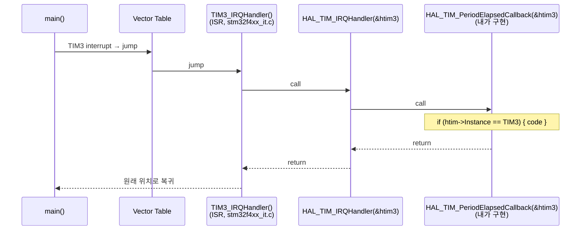
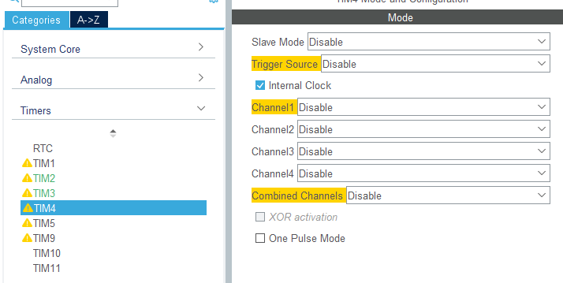
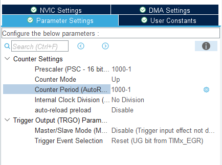
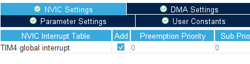

# stopwatch_watch_review — 인터럽트 동작 원리 + TIM4 스톱워치/시계

> 📅 2026-10-19 · 보드: NUCLEO-F411RE

인터럽트가 하드웨어적으로 어떻게 동작하는지(벡터 테이블, ISR, IRQ, 콜백)를 정리하고,
[upcounter_stopwatch](../upcounter_stopwatch)를 리뷰하며 시간 카운트를 **TIM4(10ms 주기)** 인터럽트로 옮김.

## 파일 구조

```
Core/Src/
├── main.c
├── ap/
│   ├── ap_main.c
│   ├── stopwatch/
│   └── watch/
└── driver/
    ├── button/  led/  fnd/
```

## 타이머 설정

| 타이머 | PSC / Period | 주기 | 용도 |
|---|---|---|---|
| TIM3 | 100 / 1000 | 1ms | FND 출력 |
| TIM4 | 1000 / 1000 | 10ms (100Hz) | 스톱워치·시계 시간 카운트 |

---

## OS의 동시성, 병렬 처리

- 사실 스케줄링을 통해 빠르게 작업을 번갈아가며 수행하는거임
- 완전히 동시에 처리된다 x 동시에 처리되는 것처럼 느껴진다 o
- fnd D1, D2, D3, D4도 절대 시간으로 보면 각각 하나씩 켜지지만, 눈으로 보기에는 다 켜져있는 것처럼 보인다
- 가장 기반이 되는 동작: interrupt

- 게임도 마찬가지. 연속된 화면처럼 보이지만
- 연산이 다 완료되면 한 화면 찍고 이게 반복
- 그래서 gpu 성능이 좋으면 fps가 잘나온다 → 빨리 계산되니까 화면이 빨리 나옴

## Interrupt 인터럽트

- 기술적 인터럽트의 동작 원리
  - 어떤 작업 A 실행 중에 B에 의해 실행중인 작업 A를 멈추고 정해진 위치로 이동, 그곳에 위치한 코드를 실행한 후 A가 멈췄던 위치로 돌아와 이어서 실행
- ISR: 인터럽트 서비스 루틴
  - 인터럽트되면 실행하는 함수, 기능



- jump 해서 ISR로 가는 걸 interrupt가 발생했다고 하는거임!
- cpu가 코드 실행할 때 다음 pc를 isr의 시작 주소로 설정 (jump), isr이 끝나면 저장되어있던 이전 pc를 불러와 pc+4 위치로 이동 (jump)
- isr의 정해진 주소는 어디냐? → vector table에 저장되어 있다!

**Vector table** (RM0383 Table 37 중 일부) — interrupt가 발생하면 무조건 이 주소로 jump

| Position | Priority | Acronym | Address |
|---|---|---|---|
| - | -3 (fixed) | Reset | 0x0000 0004 |
| - | -2 (fixed) | NMI | 0x0000 0008 |
| - | -1 (fixed) | HardFault | 0x0000 000C |
| - | 6 | SysTick | 0x0000 003C |
| 6 ~ 10 | 13 ~ 17 | EXTI0 ~ EXTI4 | 0x0000 0058 ~ 0x0000 0068 |
| 28 | 35 | TIM2 | 0x0000 00B0 |
| 29 | 36 | TIM3 | 0x0000 00B4 |
| 30 | 37 | TIM4 | 0x0000 00B8 |
| 38 | 45 | USART2 | 0x0000 00D8 |

startup 코드 (`startup_stm32f411retx.s`)의 vector table — 주소 자리에 **함수 이름(= 함수 시작 주소)** 이 들어있다

```asm
  .word TIM1_CC_IRQHandler
  .word TIM2_IRQHandler
  .word TIM3_IRQHandler
  .word TIM4_IRQHandler
  .word I2C1_EV_IRQHandler
  ...
```

- vector table의 tim2, tim3 위치로 점프 → tim2 안에는 정의한 함수 (isr) 있음 → 또 쩜프
- startup code: 부팅을 하기 위한 초기 코드
  - startup code에 함수 이름 (함수의 시작 주소) 들이 정의되어있음
- **IRQ**(Interrupt Request, 인터럽트 요청): **주변 장치가 CPU에 주의나 처리가 필요하다고 알리는 하드웨어 신호**

### 실제 interrupt의 하드웨어 내부 동작 순서

1. cpu가 pc에 의해 instruction memory에 있는 코드를 수행
2. 설정해놓은 interrupt 발생하면
3. 현재 동작중인 pc, stack pointer, register 임시 저장
4. next pc를 interrupt로 설정: interrupt에 해당하는 vector table에 저장된 주소로 무조건 jump
5. vector table에 저장된 isr 함수 주소로 다시 jump
6. isr 함수 내부 코드를 수행
7. 임시 저장된 pc + 4, stack pointer, register 복원

- 왜 vector table을 4byte 단위로?
  - 주소가 4byte임
  - 더 크게 해서 바로 코드 넣으면 안됨? vector table → isr 두번 거치는거 좀 그런거 아님?
    - isr이 코드 얼마나 클 줄 알고 리소스 얼마나 잡아야될지.. 감도 안잡힌다

- hal driver에서 interrupt 발생시 흐름



- 대부분의 흐름은 main 루프에서 담당하지만,
- interrupt(정의한 isr)는 다른 주체에 의해 실행된다
- 주체가 역으로 바뀌니까 callback (회신한다)는 말을 쓰는거임

- hal 내부 코드 handler에 내가 각 인터럽트에서 실행할 함수 작성해도 잘 실행된다

```c
void TIM2_IRQHandler(void)
{
  /* USER CODE BEGIN TIM2_IRQn 0 */

  /* USER CODE END TIM2_IRQn 0 */
  HAL_TIM_IRQHandler(&htim2);
  /* USER CODE BEGIN TIM2_IRQn 1 */

  /* USER CODE END TIM2_IRQn 1 */
}

/**
  * @brief This function handles TIM3 global interrupt.
  */
void TIM3_IRQHandler(void)
{
  /* USER CODE BEGIN TIM3_IRQn 0 */

  /* USER CODE END TIM3_IRQn 0 */
  HAL_TIM_IRQHandler(&htim3);
  /* USER CODE BEGIN TIM3_IRQn 1 */

  /* USER CODE END TIM3_IRQn 1 */
}
```

- priority: 우선순위 → 동시에 걸렸을 때는 이 우선순위를 따라 순서대로 실행된다

- 위 vector table의 Priority 열 (숫자가 작을수록 먼저)

## 실습: stopwatch watch review

- TIM4는 16bit짜리 counter period 가짐
- 1000분주 한 걸 또 1000분주 (1000 \* 1000) → (100mhz → 100khz → 100hz) 해서 10ms마다 인터럽트 걸리도록 만들기
- 100hz → 10ms 주기, 0.01초에 한번 인터럽트
- NVIC 설정은 꼭 해야지 인터럽트 걸림

<p>


</p>



### bit mask를 0으로 주로 판단하는 이유

```c
if ((dpData & (1 << 2)) == 0) {
	fnd_disp_number(11); // dp off
} else {
	fnd_disp_number(10); // dp on
}

// ex) dpData = 2b1101
//   2b1101
// & 2b0100   ← bit mask (1 << 2)
// = 2b0100   ← 결과는 1이 아니라 4
```

- if 조건 연산 결과값은 4 ≠ 1
- 전부 다 false 될 수 있으니 그냥 == 0 or ! 쓰자

## 과제: stopwatch도 tim4 쓰도록 변경하기

> 과제 결과물은 [stopwatch_timeclock_I2C_LCD](../stopwatch_timeclock_I2C_LCD)로 이어짐
