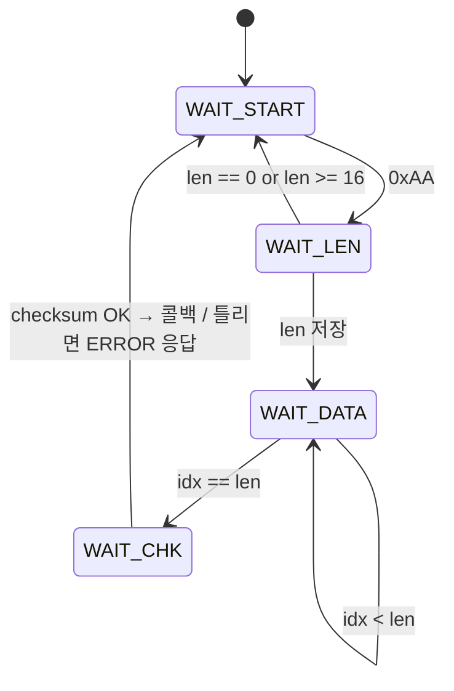

# uart_protocol — UART 바이너리 통신 프로토콜 (PC ↔ MCU)

> 📅 2026-11-04 ~ 05 · 보드: NUCLEO-F411RE

PC에서 "LED 켜", "거리 값 줘" 같은 요청을 보내면 MCU가 처리하고 결과를 돌려주는 **사용자 정의 바이너리 프레임**을 만든 실습.
수신은 1byte마다 Rx 인터럽트 → FSM 파서로 프레임을 조립하고, 명령 처리는 **함수 포인터 콜백**으로 앱 쪽에 넘김.
PC 쪽은 같은 프레임을 이해하는 Python(pyserial) 툴로 테스트.

## 파일 구조

```
Core/Src/
├── main.c                     # packet_doFunc (명령 처리), RxCplt / EXTI 콜백, 거리 응답
├── common/delay/
└── driver/
    ├── uart_protocol/         # 프레임 송신, 1byte FSM 파서, 콜백 등록
    ├── DHT11/  HCSR04/  led/
```

## 사용 핀

| 항목 | 핀 |
|---|---|
| USART2 (ST-Link VCP) | PA2 TX / PA3 RX, Rx interrupt |
| LED 0 ~ 3 | PB15, PB14, PB13, PC4 |
| DHT11 | PC8 |
| HC-SR04 | PC5 Trig / PC6 Echo (EXTI6), TIM10 (1MHz, us 카운트) |

---

## 왜 프로토콜이 필요한가

- I2C에 정해진 전송 format이 있듯이, UART 위에서도 **프레임 형식을 직접 정의**해야 의미 있는 명령 / 응답을 주고받을 수 있음
- 요청 성공 / 실패(에러)도 응답에 담아야 함
- 일반 시리얼 터미널(ComPortMaster)은 바이트를 그대로 보여줄 뿐 → **PC 쪽에도 같은 format을 아는 SW가 필요**

## 프레임 정의

| START | LEN | CMD | PAYLOAD | CHECKSUM |
|---|---|---|---|---|
| `0xAA` | CMD + PAYLOAD 바이트 수 | 1 byte | 0 ~ 14 byte | LEN + CMD + PAYLOAD 합 (하위 8bit) |

- START는 `0xAA` (`10101010`) — 0/1이 번갈아 나오는 bit 패턴이라 `0xAA`, `0x55`를 많이 씀
- 응답 CMD = 요청 CMD + `0x80` (`CMD_RSP_BASE`)
- 2byte 값은 **MSB first**로 보냄 (거리 = MSB × 256 + LSB) — 바이트 순서도 프로토콜에 정해 둬야 함

| 요청 CMD | 기능 | 요청 payload | 응답 payload |
|---|---|---|---|
| `0x10` ~ `0x13` | LED0 ~ 3 on/off | 1 = on, 0 = off | `0x00` OK / `0x01` ERROR |
| `0x14` | LED 상태 | — | 4byte (LED0 ~ 3) |
| `0x20` | 온습도 (DHT11) | — | 온도 정수/소수, 습도 정수/소수 |
| `0x30` | 거리 (SR04) | — | 거리(cm) MSB, LSB |

```
PC → MCU : AA 01 14 15            (LED 상태 요청: LEN=1, CMD=0x14, CHK=0x01+0x14)
MCU → PC : AA 05 94 01 00 01 00 9B
```

## 수신 FSM 파서



```c
void rx_parseByte(uint8_t rx_byte) {
	switch (rx_state) {
	case RX_WAIT_START:
		if (rx_byte == PKT_START) { rx_len = 0; rx_idx = 0; rx_state = RX_WAIT_LEN; }
		break;
	case RX_WAIT_LEN:
		if (rx_byte == 0 || rx_byte >= PKT_MAX_LEN) { rx_state = RX_WAIT_START; return; }
		rx_len = rx_byte;
		rx_state = RX_WAIT_DATA;
		break;
	case RX_WAIT_DATA:
		rx_buf[rx_idx++] = rx_byte;
		if (rx_idx >= rx_len) rx_state = RX_WAIT_CHK;
		break;
	case RX_WAIT_CHK:
		uint8_t data_check = rx_len;
		for (int i = 0; i < rx_len; i++) data_check += rx_buf[i];
		if (data_check == rx_byte) {
			packet_callback(rx_buf[0], &rx_buf[1], rx_len - 1);   // cmd, payload, len
		} else {
			uint8_t tx_payload = RSP_ERROR;
			UART_protocol_send(rx_buf[0] + CMD_RSP_BASE, &tx_payload, 1);
		}
		rx_state = RX_WAIT_START;
		break;
	}
}

void uart_protocol_it() {           // HAL_UART_RxCpltCallback에서 호출
	rx_parseByte(rx_byte);
	HAL_UART_Receive_IT(protocol_huart, (uint8_t*) &rx_byte, 1);   // 다음 1byte 수신 예약
}
```

- 길이를 모르는 프레임이라 `Receive_IT(…, 1)`로 **1byte씩** 받아 상태 머신으로 조립
- LEN 범위 검사로 버퍼 overflow 방지, checksum으로 깨진 프레임 거름

## 함수 포인터 콜백

```c
// 반환형 + 매개변수 형태가 같은 함수의 주소를 담는 자료형
typedef void (*uart_packet_callback_t)(uint8_t cmd, uint8_t *payload, uint8_t payload_len);

static uart_packet_callback_t packet_callback = 0;

void uart_protocol_init(UART_HandleTypeDef* huart, uart_packet_callback_t packet_cb) {
	protocol_huart = huart;
	packet_callback = packet_cb;
	HAL_UART_Receive_IT(protocol_huart, (uint8_t*) &rx_byte, 1);
}

// main.c
uart_protocol_init(&huart2, packet_doFunc);   // 괄호 없이 = 함수 주소
```

- `packet_doFunc()` → 함수 실행 / `packet_doFunc` → 함수 주소
- 프로토콜 드라이버는 **프레임만** 책임지고, 명령이 무슨 의미인지는 앱(main.c)이 등록한 콜백이 처리 → 드라이버가 LED / 센서를 몰라도 됨

## 센서 연동

처음엔 더미 값으로 응답을 확인하고, 이후 실제 드라이버로 교체.

```c
case CMD_TEMP_HUMID_REQ: {
	if (dht11_read(&TH_data) == DHT11_OK) {
		uint8_t tx_payload[] = { TH_data.t_int, TH_data.t_dec, TH_data.h_int, TH_data.h_dec };
		UART_protocol_send(cmd + CMD_RSP_BASE, tx_payload, 4);
	} else {
		uint8_t tx_payload = RSP_ERROR;
		UART_protocol_send(cmd + CMD_RSP_BASE, &tx_payload, 1);
	}
	break;
}
case CMD_DISTANCE_REQ:
	if (distStartFlag == 0 && HCSR04_start() == HCSR04_OK) distStartFlag = 1;   // 측정만 시작
	break;
```

```c
// main loop: echo 측정이 끝나면 그때 응답 (콜백 안에서 기다리지 않음)
if (distStartFlag) {
	uint32_t dist_us = 0;
	hcsr04_status_t state = HCSR04_getResult(&dist_us);
	if (state == HCSR04_OK) {
		uint32_t dist_cm = dist_us / 58;
		uint8_t tx_payload[2] = { (uint8_t)(dist_cm >> 8), (uint8_t)(dist_cm & 0xff) };
		UART_protocol_send(CMD_DISTANCE_REQ + CMD_RSP_BASE, tx_payload, 2);
		distStartFlag = 0;
	} else if (state == HCSR04_ERR_NO_ECHO) { /* ERROR 응답 */ }
}
```

- 콜백은 Rx **인터럽트 안에서** 실행되므로 오래 걸리는 초음파 측정은 시작만 하고, 결과 응답은 main loop에서

## PC 툴

```shell
pip install pyserial
python app.py
```

- 같은 프레임 형식으로 요청을 만들고 응답을 해석하는 Python GUI 툴 (강의 제공)로 LED 제어 / 온습도 / 거리 요청 동작 확인

> `uart_protocol.h`의 `REQ_FLOOR_*`, `REQ_ELEVATOR_*` 명령은 다음 엘리베이터 프로젝트용으로 미리 정의해 둔 것
