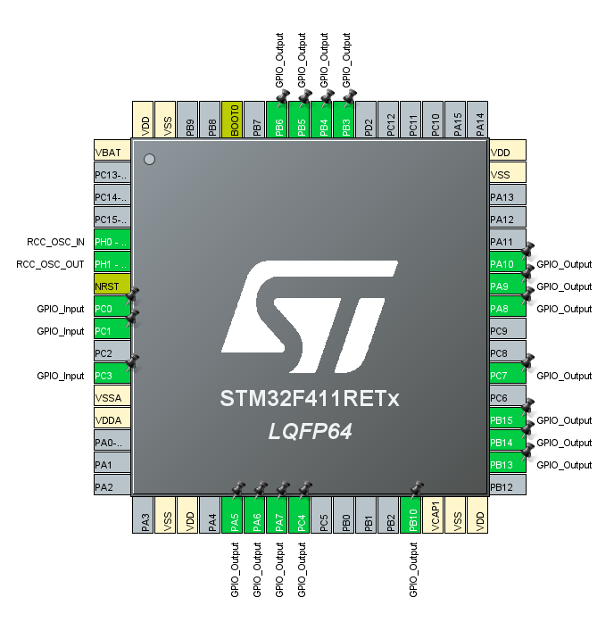
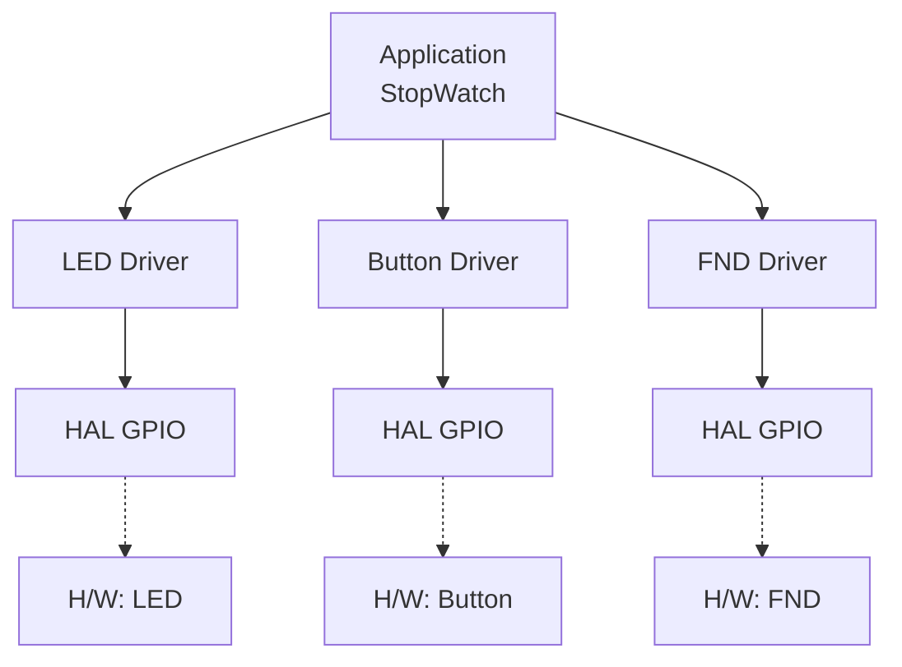
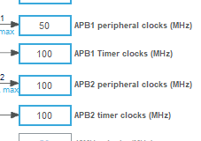
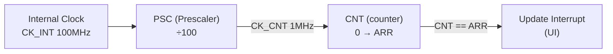
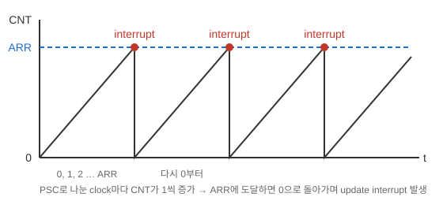
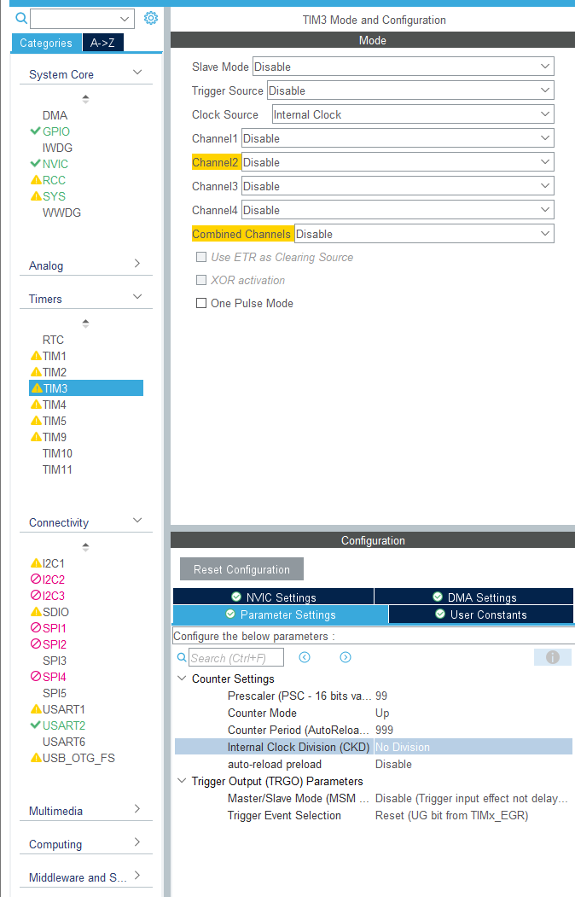
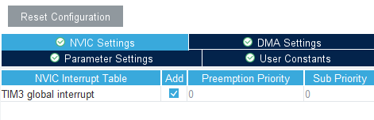
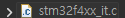
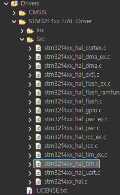
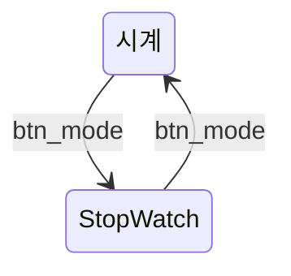

# upcounter_stopwatch — 타이머 인터럽트 스톱워치 + 시계

> 📅 2026-10-16 · 보드: NUCLEO-F411RE

[LED_Button](../LED_Button)의 LED/버튼 드라이버와 FND 드라이버를 조합한 스톱워치.
FND 갱신을 `while`문의 `HAL_Delay`가 아니라 **타이머 인터럽트(TIM3, 1ms)** 로 옮기고, 과제로 **시계 모드**(TIM2, 0.5s)를 추가함.

## 파일 구조

```
Core/Src/
├── main.c
├── ap/
│   ├── ap_main.c          # 모드 전환(STOPWATCH ↔ WATCH), 타이머 콜백
│   ├── stopwatch/         # 스톱워치 로직
│   └── watch/             # 시계 로직
└── driver/
    ├── button/  led/  fnd/
```

## 사용 핀 / 타이머

| 항목 | 설정 |
|---|---|
| PC0, PC1, PC3 | 택트 버튼 (PC0 = 모드 전환) |
| PB15, PB14, PB13, PC4 | LED |
| PB6, 5, 4, 3, 10, PA10, 9, 8, 7, 6, 5 | FND |
| TIM3 | PSC 100, Period 1000 → **1ms** 인터럽트 (FND 출력, 스톱워치 카운트) |
| TIM2 | PSC 100, Period 500000 → **0.5s** 인터럽트 (시계 DP 깜빡임 / 카운트) |

---

## 실습: stopwatch

### 1. 핀 세팅



- PC0,1,3 → 택트버튼
- PB15,14,13, PC4 : led
- PB6, 5, 4, 3, 10, PA10, 9, 8, 7, 6, 5: fnd

### 2. sw 구조



### 3. 소스



- apb1, apb2에 들어가는 타이머: 100MHz

## clock 분주기 (PSC와 타이머 인터럽트)



- psc (pre scaler): 100mhz → 1mhz 분주기
- cnt는 ARR까지 세면 한번 인터럽트 (TIM3: 1MHz로 1000번 → 1ms)



- ISR: interrupt service routine
  - 인터럽트 → 하던 일 끊고 ISR 진행하고 다시 돌아감



- source = internal clock을
- psc 몇번 분주? 100번
- psc에서 나온걸 또 몇번 분주? 1000번



- tim3을 interrupt로 쓰겠다~
- code generate하면

```c
TIM_HandleTypeDef htim3;
```

- main.c에 tim3 생김



- \_it : interrupt 코드 생김



- hal 라이브러리 코드도 생김

- `stm32f4xx_hal_tim.c` 안의 `HAL_TIM_PeriodElapsedCallback(TIM_HandleTypeDef*)` : 주기적으로 발생하는 콜백 함수 (`__weak`로 정의되어 있어 내 코드에서 다시 정의하면 그게 쓰인다)

```c
// 주기적으로 발생하는 인터럽트 콜백
void HAL_TIM_PeriodElapsedCallback(TIM_HandleTypeDef *htim)
{
  if (htim->Instance == TIM3) {
	  fnd_show_number();
  }
}
```

- 가져와서 내맘대로 구현
- 주의: driver에서 말고 내 코드에서 구현할것
- 주의: interrupt 안에서 delay 금지
- 주의: interrupt 코드 길게 쓰는건 별로

## 과제: 시계 기능 추가

> StopWatch에 **시계 기능**을 추가하기
> - btn_mode로 시계 ↔ StopWatch 전환, 나머지 버튼은 btn_run_stop, btn_clear
> - LED 4개: 시계 / stopwatch / stop / run 상태 표시
> - 시계는 FND에 `분.초` 표시, 가운데 DP는 0.5초 on / 0.5초 off
> - fnd driver 수정 가능, 시계용 Timer 기능 추가, interrupt를 사용해서 시간 증가 기능 구현



최종 구현 ([`Core/Src/ap/ap_main.c`](Core/Src/ap/ap_main.c)):

```c
// 주기적으로 발생하는 인터럽트 콜백
void HAL_TIM_PeriodElapsedCallback(TIM_HandleTypeDef *htim) {
	if (htim->Instance == TIM3) { // 1ms
		Stopwatch_timer();
		switch (clock_mode) {
		case STOPWATCH:
			fnd_show_number_old();
			break;
		case WATCH:
			fnd_show_number_time();
			break;
		}
	}
	if (htim->Instance == TIM2) { // 0.5s
		if (!fnd_getDotFlag()) {
			fnd_setDotFlag();
		} else {
			fnd_resetDotFlag();
			Watch_incCounter();
		}
	}
}
```

- PC0 버튼으로 STOPWATCH ↔ WATCH 모드 전환, 시계 모드일 때 LED(PB15) 켜짐

> 이 구조를 리뷰하며 TIM4로 옮긴 버전은 [stopwatch_watch_review](../stopwatch_watch_review)
