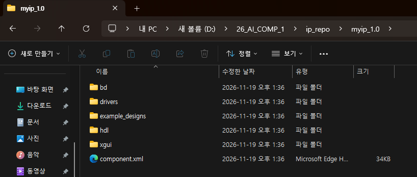
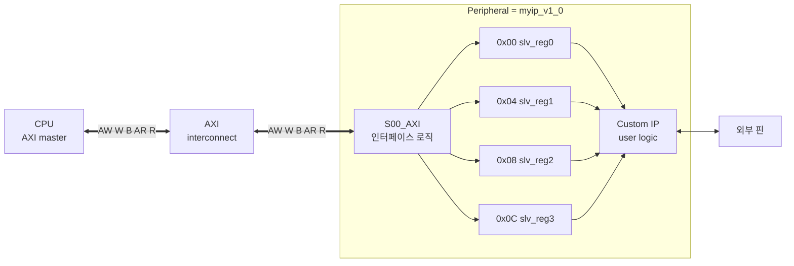
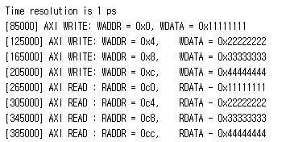
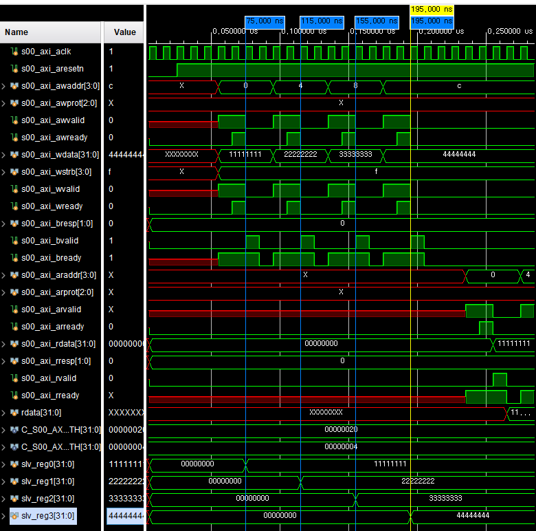
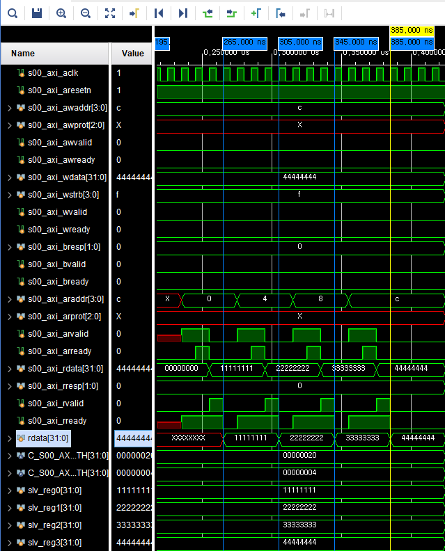
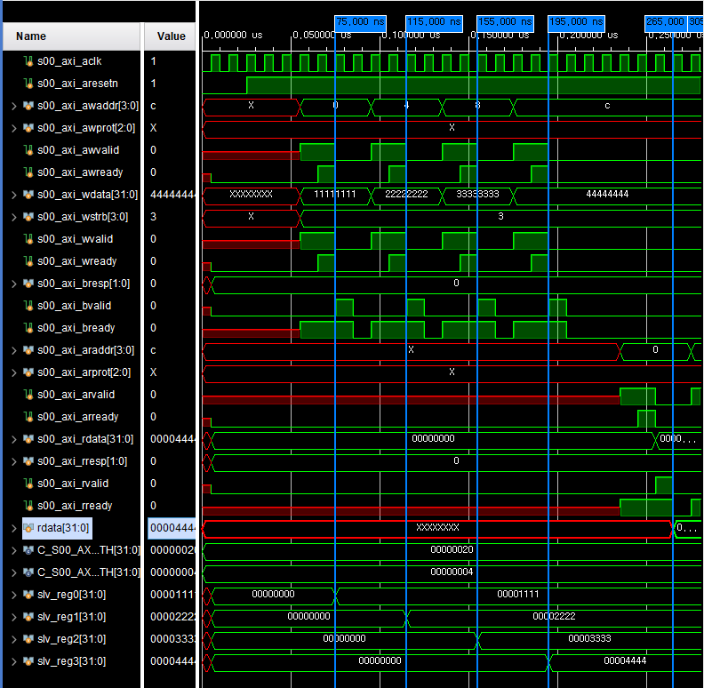
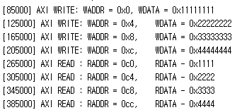

# AXI_Lite_template — Vivado AXI4-Lite peripheral 템플릿 분석 + master 모사 테스트벤치

> 📅 2026-11-19 · Vivado 2020.2 · Verilog / SystemVerilog TB · 실습

Vivado **Create and Package New IP**로 만든 AXI4-Lite slave 템플릿(`myip`)의 코드를 채널별로 분석하고,
**AXI master 동작을 흉내내는 task**를 가진 테스트벤치로 레지스터 4개에 write / read, **WSTRB byte mask**까지 확인한 프로젝트.
같은 날 직접 짠 slave와 비교: [AXI_master_slave_sim](../AXI_master_slave_sim)

## 파일 구조

```
AXI_Lite_template/
├── src/
│   ├── myip_v1_0.v            # top — S00_AXI 인스턴스만 감싼 wrapper (Vivado 생성)
│   └── myip_v1_0_S00_AXI.v    # AXI4-Lite slave 인터페이스 로직 + slv_reg0~3 (Vivado 생성)
├── tb/tb_AXI_Lite_template.sv # master 모사 task로 write 4 / read 4
└── images/
```

> `src/`는 Vivado가 생성한 템플릿 원본 (user logic 영역은 비어 있음). 생성 위치는 `ip_repo/myip_1.0/hdl/`.

---

## IP 생성

| 단계 | 설정 |
|---|---|
| Tools → Create and Package New IP | **Create a new AXI4 peripheral** |
| Peripheral Details | Name `myip`, Version `1.0`, IP location = 프로젝트 옆 `ip_repo` |
| Add Interfaces | Interface Type **Lite**, Mode **Slave**, Data Width **32**(Lite는 32bit 고정), Number of Registers **4**(기본값, 4~512) |
| 결과 | `ip_repo/myip_1.0/` 아래 `hdl/`, `drivers/`, `example_designs/`, `xgui/`, `component.xml` |



- `hdl/myip_v1_0.v`(top)과 `hdl/myip_v1_0_S00_AXI.v`(slave 로직)를 새 프로젝트에 **Add Sources**로 가져와 TB를 붙임

## 시스템 안에서의 위치



- 템플릿이 만들어 주는 건 **AXI 인터페이스 + 레지스터 4개**까지. 실제 기능(custom IP)은 레지스터를 읽고 쓰는 user logic으로 추가
- AXI4-Lite는 결국 **레지스터 access를 위한 protocol** → 설계할 때 "어떤 레지스터에 무엇을 어떻게 저장할지"가 중심
- 시뮬레이션에서는 CPU + interconnect 자리를 TB가 대신함

---

## 템플릿 slave 분석

### AW / W — 둘이 동시에 받음

```verilog
// axi_awready: AWVALID와 WVALID가 둘 다 있을 때 1clk assert
if (~axi_awready && S_AXI_AWVALID && S_AXI_WVALID && aw_en) begin
    axi_awready <= 1'b1;
    aw_en       <= 1'b0;          // write transaction 진행 중 표시
end else if (S_AXI_BREADY && axi_bvalid) begin
    aw_en       <= 1'b1;          // B handshake 끝 → 다음 transaction 받을 준비
    axi_awready <= 1'b0;
end else
    axi_awready <= 1'b0;

// 주소 저장 조건도 똑같음 → 같은 엣지에 READY와 주소 latch
if (~axi_awready && S_AXI_AWVALID && S_AXI_WVALID && aw_en)
    axi_awaddr <= S_AXI_AWADDR;
```

- `axi_wready`도 같은 조건(`~axi_wready && WVALID && AWVALID && aw_en`)으로 1clk → **AWREADY와 WREADY가 같은 사이클**에 올라감
- `aw_en`: transaction 하나가 B까지 끝나기 전에는 새 AW를 받지 않게 막는 flag
- `slv_reg_wren = axi_wready && WVALID && axi_awready && AWVALID` → 이 사이클에 레지스터 write

### W — WSTRB byte 단위 write

```verilog
case (axi_awaddr[ADDR_LSB+OPT_MEM_ADDR_BITS:ADDR_LSB])   // [3:2]
  2'h0:
    for (byte_index = 0; byte_index <= (C_S_AXI_DATA_WIDTH/8)-1; byte_index = byte_index+1)
      if (S_AXI_WSTRB[byte_index] == 1)
        slv_reg0[(byte_index*8) +: 8] <= S_AXI_WDATA[(byte_index*8) +: 8];
  ...
```

- `WSTRB`(4bit)의 각 비트가 32bit 데이터의 byte 하나에 대응 → 1인 byte만 저장
- `[(i*8) +: 8]` = i*8번 비트부터 **위로 8개** (part-select). i=1이면 `[15:8]`, i=2이면 `[23:16]`

| `WSTRB[3:0]` | byte3 | byte2 | byte1 | byte0 |
|---|---|---|---|---|
| `1111` | 저장 | 저장 | 저장 | 저장 |
| `0001` | 유지 | 유지 | 유지 | 저장 |
| `0011` | 유지 | 유지 | 저장 | 저장 |
| `1100` | 저장 | 저장 | 유지 | 유지 |

### B — AW와 W가 모두 끝난 뒤 응답

```verilog
if (axi_awready && S_AXI_AWVALID && ~axi_bvalid && axi_wready && S_AXI_WVALID) begin
    axi_bvalid <= 1'b1;
    axi_bresp  <= 2'b0;           // OKAY
end else if (S_AXI_BREADY && axi_bvalid)
    axi_bvalid <= 1'b0;
```

### AR / R — RVALID와 RDATA를 같은 엣지에

```verilog
assign slv_reg_rden = axi_arready & S_AXI_ARVALID & ~axi_rvalid;

always @(*)                                   // 주소 디코딩은 조합 회로
    case (axi_araddr[ADDR_LSB+OPT_MEM_ADDR_BITS:ADDR_LSB])
        2'h0: reg_data_out <= slv_reg0;  ...
    endcase

// rvalid 조건과 slv_reg_rden 조건이 같음 → RVALID <= 1, RDATA <= slv_reg 동시에 수행
if (axi_arready && S_AXI_ARVALID && ~axi_rvalid) axi_rvalid <= 1'b1;
if (slv_reg_rden)                                axi_rdata  <= reg_data_out;
```

### 직접 짠 slave와 비교

| | 템플릿 (`myip_v1_0_S00_AXI`) | 직접 작성 ([AXI_master_slave_sim](../AXI_master_slave_sim)) |
|---|---|---|
| 구조 | 신호별 `always @(posedge)` + 조건식 | 채널별 2상태 FSM |
| AW / W | AWVALID & WVALID 둘 다 보고 **같은 사이클**에 READY | AWREADY 다음 사이클에 WREADY |
| byte write | `WSTRB` 지원 | 없음 (항상 32bit) |
| 진행 중 차단 | `aw_en` flag | 없음 |
| 주소 폭 | `C_S_AXI_ADDR_WIDTH = 4` | 32bit |

---

## Simulation

TB가 AXI master 역할을 직접 함 (5채널 신호를 task 안에서 구동).

```systemverilog
task axi_write(logic [31:0] w_addr, logic [31:0] w_data);
    @(posedge s00_axi_aclk);
    s00_axi_awaddr <= w_addr;  s00_axi_awvalid <= 1'b1;     // AW
    s00_axi_wdata  <= w_data;  s00_axi_wvalid  <= 1'b1;     // W
    s00_axi_wstrb  <= 4'b1111;
    s00_axi_bready <= 1'b1;                                 // B: READY 미리
    wait (s00_axi_awready & s00_axi_wready);                // 템플릿은 둘이 동시에 뜸
    @(posedge s00_axi_aclk);
    s00_axi_awvalid <= 1'b0;  s00_axi_wvalid <= 1'b0;
    wait (s00_axi_bvalid);
    @(posedge s00_axi_aclk);
    s00_axi_bready <= 1'b0;
endtask
```

- `axi_read`: ARVALID + RREADY를 같이 올리고 ARREADY → RVALID 순으로 기다림
- 시나리오: reset 3clk → `0x0~0xC`에 `11111111~44444444` write → 순서대로 read





- AWVALID / WVALID가 같이 올라가고 다음 사이클 **AWREADY와 WREADY가 동시에** 1clk → 그 다음 사이클 BVALID. `slv_reg0~3`이 차례대로 저장됨



- ARVALID 다음 사이클 ARREADY, 그 다음 사이클 RVALID + RDATA. RREADY가 미리 떠 있어서 RVALID는 1clk 만에 내려감

### WSTRB = `4'b0011`

TB의 `s00_axi_wstrb`를 `4'b0011`로 바꿔서 다시 실행 (아카이브된 TB는 `4'b1111`).





- 하위 2byte만 저장되고 상위 2byte는 reset 값 0 유지 → `slv_reg0 = 0x00001111`, ..., `slv_reg3 = 0x00004444`

---

## 배운 내용

- Vivado가 AXI4-Lite slave 뼈대를 만들어 주므로, custom IP는 **레지스터 맵 설계 + user logic**에 집중하면 됨
- 템플릿은 FSM 없이 신호마다 `always` 블록 하나씩, 조건식으로 handshake를 처리. 같은 조건을 쓰는 블록(AWREADY ↔ 주소 latch, RVALID ↔ RDATA)은 **같은 엣지에 동시에** 동작
- `WSTRB`는 저장할 byte 위치의 mask → 1byte / 2byte / 4byte write를 레지스터 하나로 처리
- 템플릿은 AW와 W가 **둘 다 VALID일 때만** 받음 → TB도 AW, W를 함께 올리고 `awready & wready`를 같이 기다리게 작성
