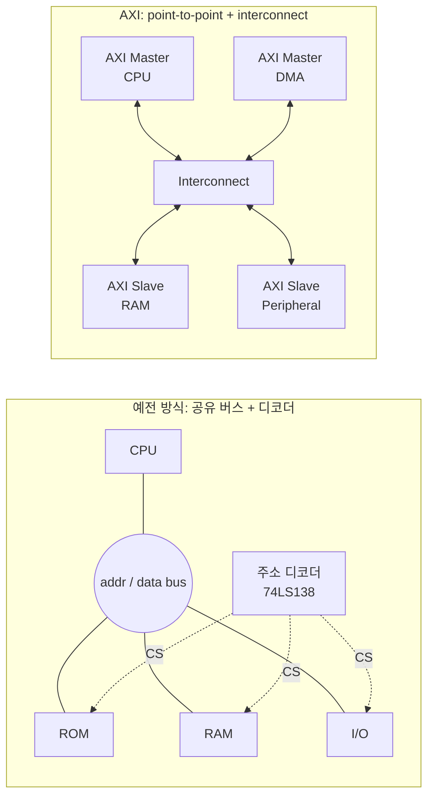
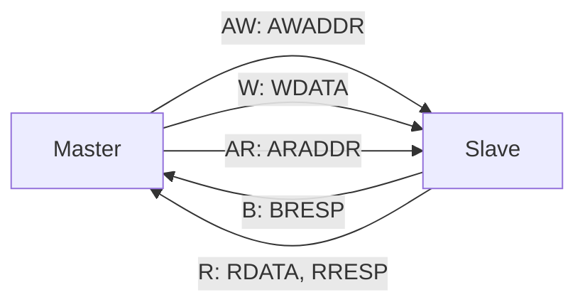
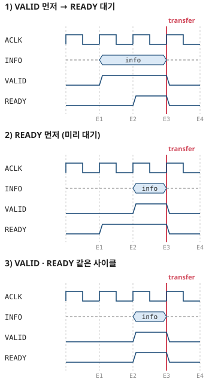
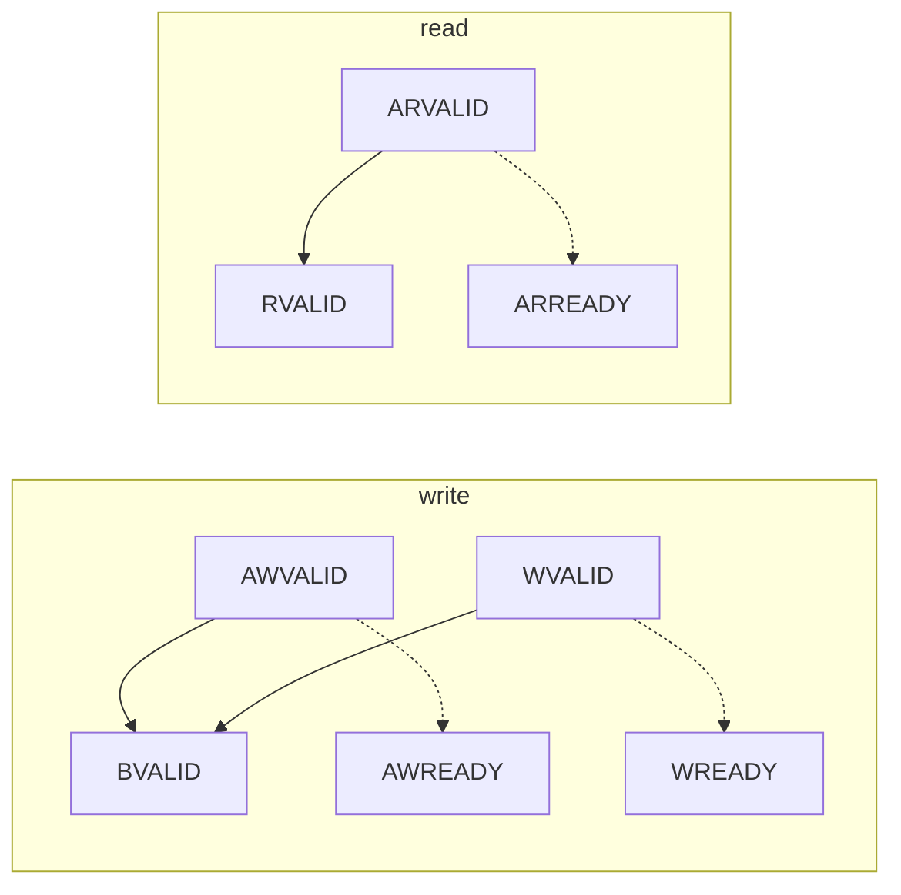
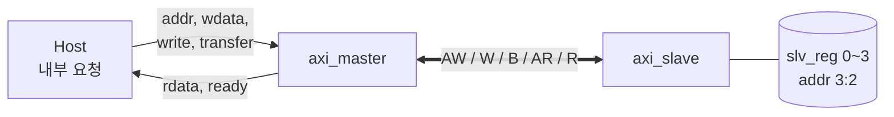
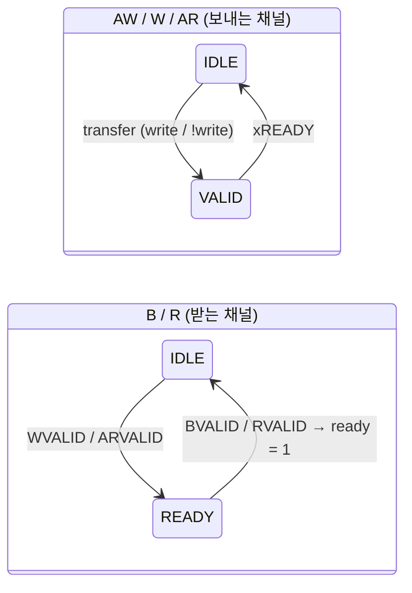
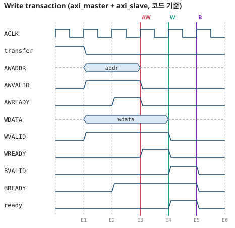
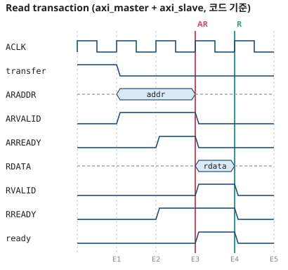

# AXI_Master — AXI4-Lite master / slave (채널별 handshake FSM)

> 📅 2026-11-18 · Vivado 2020.2 · SystemVerilog · 실습

ARM AMBA의 **AXI4-Lite** 프로토콜을 직접 구현한 프로젝트.
5개 채널(AW / W / B / AR / R)이 모두 같은 **VALID / READY handshake**를 쓴다는 점에 맞춰, master와 slave 모두 **채널마다 2상태 FSM 하나씩**으로 나눠 설계함.
slave는 32bit 레지스터 4개(`slv_reg[0:3]`)를 가진 메모리 맵 주변장치 역할.

## 파일 구조

```
AXI_Master/
├── src/
│   ├── axi_master.sv   # 내부 요청(addr, wdata, write, transfer) → AXI 5채널, 완료 시 ready
│   └── axi_slave.sv    # AXI 5채널 → slv_reg[0:3] write / read
└── images/             # 직접 그린 타이밍 다이어그램
```

> 테스트벤치는 아직 없음 (2026-11-18 기준). 아래 타이밍은 코드를 기준으로 사이클을 계산해 그린 것.

---

## 버스 → AXI



- 예전 버스는 주소를 모든 칩에 broadcast하고 **디코더가 상위 주소 비트로 칩 하나만 선택**(`/CS` low active)
- AXI는 master–slave 간 **point-to-point 인터페이스**. 여러 개를 잇는 건 interconnect(crossbar)가 담당하고, 메모리 맵 디코딩도 interconnect가 함 → 선택되지 않은 slave에는 신호가 가지 않음

### 메모리 맵 예 (디코더 방식, 16bit 주소)

| 상위 주소 `A15~A13` | 주소 범위 | 장치 |
|---|---|---|
| `000` | `0x0000 ~ 0x1FFF` | ROM |
| `001` | `0x2000 ~ 0x3FFF` | RAM |
| `010` | `0x4000 ~ 0x5FFF` | 8255 (I/O) |
| 나머지 | `0x6000 ~ 0xFFFF` | Reserved |

- ROM이 0번지에서 시작하는 것 외에는 **메모리 맵은 하드웨어 설계자가 정함**
- 칩 선택 핀은 대부분 low active(`/CS`, `/OE`, `/WR`) → 디코더 출력을 반전 없이 바로 연결 가능. 칩 내부 신호는 보기 쉬운 high active를 주로 씀

### AMBA 계열

| | 특징 |
|---|---|
| APB | 저속 주변장치용, pipeline 없음 |
| AHB | pipeline 동작, 공유 버스 |
| AXI4 | 채널 분리, burst 지원 (`xLAST`) |
| AXI4-Lite | burst 없음 (길이 · `LAST` 신호 없음), 한 번에 1 데이터 — **이번 구현** |
| AXI4-Stream | 한 방향 데이터 스트림, 주소 없음 |

## 5개 채널



| 채널 | 방향 | 정보 | VALID 쪽 / READY 쪽 |
|---|---|---|---|
| AW (write address) | M → S | `AWADDR` | master / slave |
| W (write data) | M → S | `WDATA` | master / slave |
| B (write response) | S → M | `BRESP` (`00` = OKAY) | slave / master |
| AR (read address) | M → S | `ARADDR` | master / slave |
| R (read data) | S → M | `RDATA`, `RRESP` | slave / master |

- AHB는 주소 하나 + write enable로 read / write를 구분했지만, AXI는 **read와 write 경로를 아예 분리** → 이론상 read와 write를 동시에 진행할 수 있어 bandwidth가 늘어남
- **transfer**: 한 채널에서 handshake 1번으로 정보 1개가 넘어가는 단위
- **transaction**: 기능 하나를 위한 transfer 묶음. write = AW + W + B, read = AR + R

## VALID / READY handshake



- 보내는 쪽이 정보와 함께 **VALID**, 받는 쪽이 **READY**. 방향은 채널마다 고정
- 전달은 READY가 올라가는 순간이 아니라 **VALID와 READY가 둘 다 1인 상태에서 맞는 상승 엣지**(그림의 E3)에 일어남
- VALID를 올린 쪽은 handshake 전까지 VALID와 정보를 **내리거나 바꾸면 안 됨**
- READY를 미리 올려 두면(2번) handshake에 드는 클럭을 줄일 수 있음. 예: AW 주소를 받았으면 곧 WDATA가 올 테니 slave가 WREADY를 미리 올림
- 3번처럼 VALID가 올라온 사이클에 바로 READY를 내려면 READY가 VALID의 **조합 논리**여야 함

### 채널 간 순서 (의존성)



실선은 반드시 지켜야 하는 순서, 점선은 허용되는 순서(READY가 VALID보다 먼저 올라와도 됨).

- BVALID는 AW와 W handshake가 **모두 끝난 뒤**에만 올림
- RVALID는 AR handshake가 끝난 뒤에만 올림
- AW와 W는 순서가 정해져 있지 않음 → 이 구현의 master는 AW와 W를 **동시에** 시작

---

## 구조



### axi_master — 채널별 FSM 5개



| 채널 | 상태 | 출력 |
|---|---|---|
| AW, W, AR | `IDLE` → `VALID` | `transfer`에서 시작해 상대 READY가 올 때까지 `xVALID = 1` 유지 |
| B | `B_IDLE` → `B_READY` | WVALID를 낸 다음 사이클부터 `BREADY = 1`로 응답 대기 |
| R | `R_IDLE` → `R_READY` | ARVALID를 낸 다음 사이클부터 `RREADY = 1`로 데이터 대기 |

```systemverilog
// 보내는 채널 (AW) — 조합 블록 맨 위에서 기본값을 줘서 latch 방지
always_comb begin
    aw_state_next = aw_state;
    AWVALID = 1'b0;
    AWADDR  = addr;
    case (aw_state)
        AW_IDLE:  if (transfer && write) aw_state_next = AW_VALID;
        AW_VALID: begin
            AWVALID = 1'b1;
            if (AWREADY) aw_state_next = AW_IDLE;   // handshake 엣지에서 복귀
        end
    endcase
end
```

- `ready = w_ready | read_ready` — B 또는 R handshake 사이클에 1clk 펄스로 내부에 완료를 알림
- `rdata = RDATA`는 조합 연결이라 `ready` 펄스가 나오는 사이클에 읽어야 함

### axi_slave — 받는 채널은 READY, 보내는 채널은 VALID

| 채널 | 상태 | 동작 |
|---|---|---|
| AW | `AW_IDLE` → `AW_READY` | AWVALID 다음 사이클에 `AWREADY = 1`(1clk), 그 엣지에서 `w_addr_reg <= AWADDR` |
| W | `W_IDLE` → `W_READY` | AW handshake 직후부터 `WREADY = 1`, `WVALID && WREADY`에서 `slv_reg[w_addr_reg[3:2]] <= WDATA` |
| B | `B_IDLE` → `B_VALID` | W handshake 다음 사이클 `BVALID = 1`, `BRESP = OKAY`, BREADY에서 복귀 |
| AR | `AR_IDLE` → `AR_READY` | ARVALID 다음 사이클에 `ARREADY = 1`(1clk), 주소 저장 |
| R | `R_IDLE` → `R_VALID` | AR handshake 엣지에서 RDATA를 레지스터에 올리고 `RVALID = 1`, RREADY에서 복귀 |

```systemverilog
// slave W 채널: AW를 받은 다음부터 WREADY를 미리 올려 둠 (READY 먼저 패턴)
W_IDLE:  if (AWREADY) w_state_next = W_READY;
W_READY: begin
    WREADY = 1'b1;
    if (WVALID) w_state_next = W_IDLE;
end
```

- 주소 `[3:2]`로 레지스터 4개 중 하나 선택 → byte 주소 `0x0, 0x4, 0x8, 0xC`가 각각 `slv_reg[0..3]`
- 모든 FSM이 1bit `enum` 2상태라 `always_comb` 맨 위 기본값 + `default`로 latch 없이 합성됨

## 타이밍 (코드 기준 계산)

`transfer`를 1clk 넣었을 때 master + slave 조합의 사이클.



| 엣지 | 일어나는 일 |
|---|---|
| E1 | master AW, W FSM이 동시에 VALID 상태로 |
| E2 | slave가 AWVALID를 보고 AW_READY로, master는 WVALID를 보고 BREADY를 미리 올림 |
| E3 | **AW handshake** — slave가 주소 저장, 바로 WREADY 준비 |
| E4 | **W handshake** — `slv_reg`에 기록, slave BVALID 준비 |
| E5 | **B handshake** — master `ready` 펄스(E4~E5 구간) |



| 엣지 | 일어나는 일 |
|---|---|
| E1 | master AR FSM VALID |
| E2 | slave AR_READY, master RREADY를 미리 올림 |
| E3 | **AR handshake** — slave가 RDATA를 레지스터에 올리고 RVALID |
| E4 | **R handshake** — master `rdata`, `ready` 펄스(E3~E4 구간) |

- write는 transfer 후 4clk, read는 3clk. slave의 AWREADY / ARREADY가 항상 **VALID 다음 사이클**에 올라가는 구조(1번 패턴)라 주소 채널마다 1clk씩 더 듦
- AXI4-Full이었다면 W 채널이 여러 번 반복되고 마지막 데이터에 `WLAST`가 붙음 (Lite는 데이터 1개라 없음)

---

## 배운 내용

### 왜 버스가 필요한가

- CPU 하나와 많은 주변장치(GPIO, TIM, UART, SPI, I2C, DMA ...)가 안정적이고 빠르게 통신해야 함 → 공통 규약(버스)
- ARM이 만든 on-chip 버스 규격이 **AMBA** (APB → AHB → AXI3 → AXI4 / Lite / Stream → ACE, CHI)
- AXI는 "버스"라기보다 **AXI protocol, AXI interface**라고 부름: 5개 채널이 같은 handshake 메커니즘을 공유하는 규약

### 칩 분리 → SoC

- 예전 보드: CPU, ROM, RAM, I/O(8255) 칩이 따로 있고 같은 이름의 핀(주소 / 데이터 선)끼리 연결, 74LS138 디코더가 칩 선택 → 보드가 커지고 비용 증가
- 지금은 한 칩 안에 모두 넣고(SoC), 디코더 역할은 interconnect가 맡음 → interconnect가 복잡해짐

### 설계 습관

- AXI 신호 이름은 앞에 `A`(ACLK, ARESETn), reset은 active-low
- `always_comb` 시작에서 next state와 출력에 **기본값**을 먼저 주면 case마다 빠짐없이 쓰지 않아도 latch가 생기지 않음 (master / slave 모두 latch 없음 확인)
- 기대값이 명확할 때는 READY를 미리 올려 handshake 클럭을 줄임 (slave의 WREADY, master의 BREADY / RREADY)
