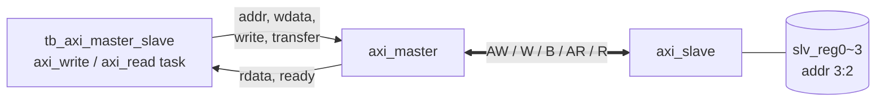
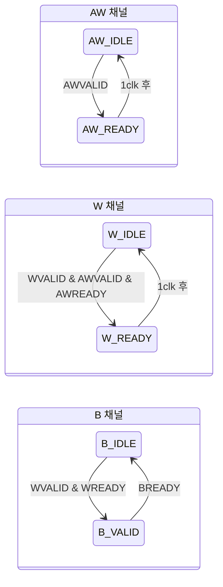
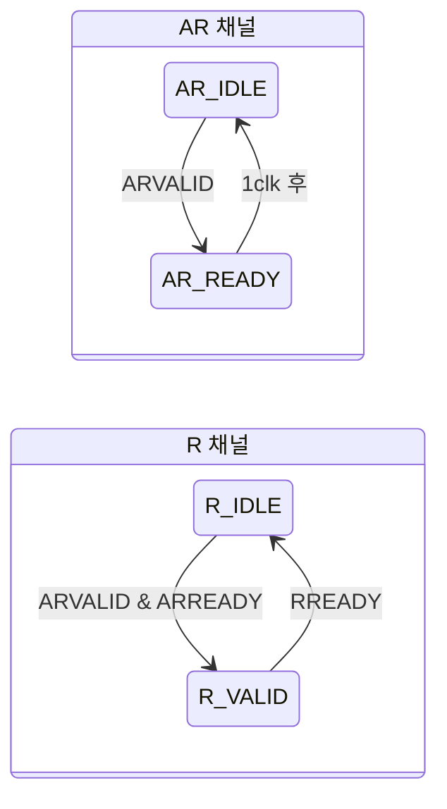
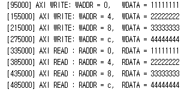
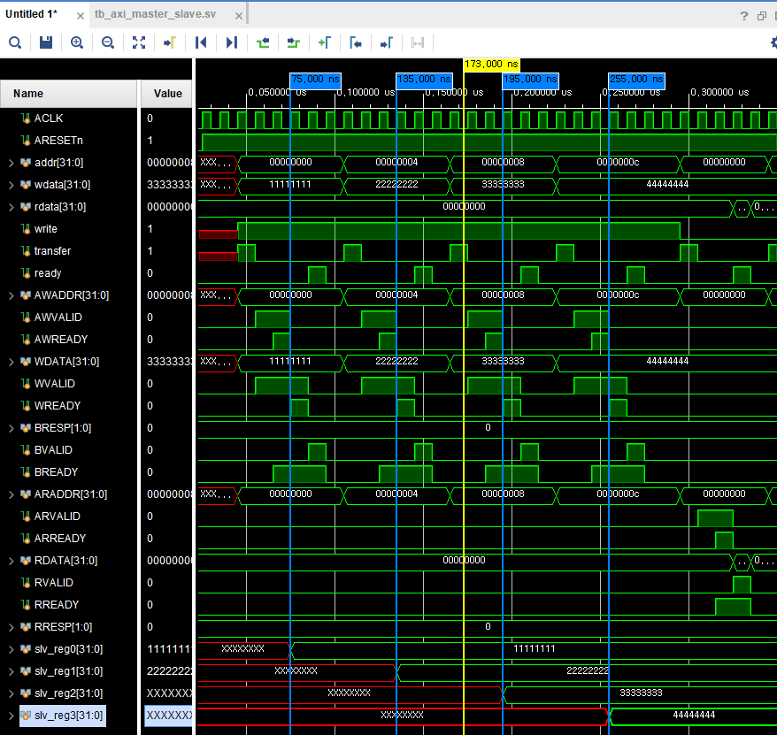
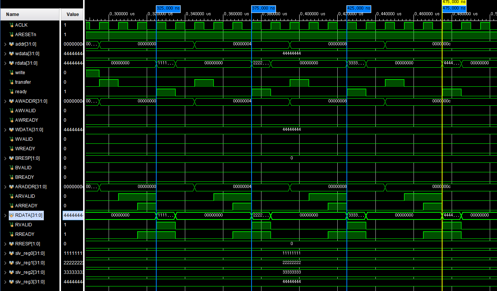
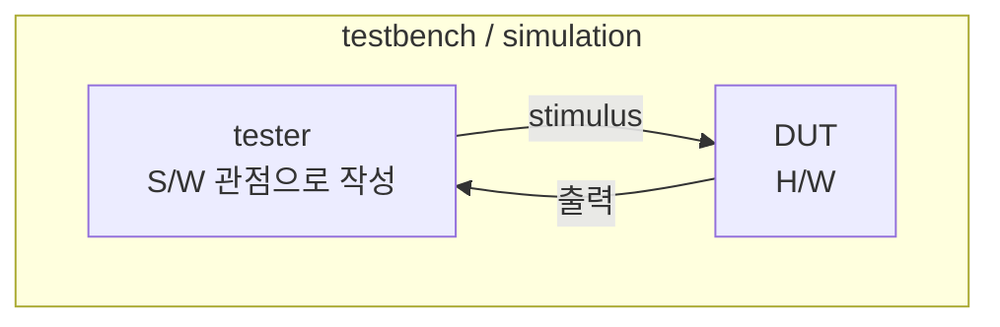

# AXI_master_slave_sim — AXI4-Lite slave 다시 짜기 + master–slave 연결 시뮬레이션

> 📅 2026-11-19 · Vivado 2020.2 · SystemVerilog · 실습

전날 만든 [AXI_Master](../AXI_Master)의 `axi_master`는 그대로 가져오고, **slave를 채널별 2상태 FSM으로 다시 작성**한 뒤 master와 직접 연결해 **테스트벤치로 write 4번 → read 4번**을 돌려 본 프로젝트.
slave는 32bit 레지스터 4개(`slv_reg0~3`, 주소 `0x0 / 0x4 / 0x8 / 0xC`)를 가진 메모리 맵 주변장치 역할.

## 파일 구조

```
AXI_master_slave_sim/
├── src/
│   ├── axi_master.sv          # 11/18 버전 그대로 — 내부 요청(addr, wdata, write, transfer) → AXI 5채널
│   └── axi_slave.sv           # 이번에 다시 작성한 slave — 채널별 FSM 5개 + slv_reg0~3
├── tb/tb_axi_master_slave.sv  # master + slave 연결, write / read task로 4개 레지스터 접근
└── images/                    # 시뮬레이션 결과 캡처
```

---

## 구조



- TB는 master의 **내부 인터페이스**만 건드림 → AXI 채널 신호는 master와 slave가 알아서 주고받음
- 두 모듈 포트 이름을 TB 신호 이름과 똑같이 맞춰 `.*`로 한 번에 연결

```systemverilog
axi_master dut_master (.*);
axi_slave  dut_slave  (.*);
```

## slave FSM

설계 전제: **write할 때 AW와 W(데이터)는 함께 들어옴** (master가 AW, W를 같은 사이클에 시작).

### write transaction



| 채널 | 상태 | 출력 / 동작 |
|---|---|---|
| AW | `AW_IDLE` → `AW_READY` | `AWREADY = 1`, `aw_addr = AWADDR` |
| W | `W_IDLE` → `W_READY` | `WREADY = 1`, `slv_reg[aw_addr[3:2]] = WDATA` |
| B | `B_IDLE` → `B_VALID` | `BVALID = 1`, `BRESP = 2'b00`(OKAY) |

### read transaction



| 채널 | 상태 | 출력 / 동작 |
|---|---|---|
| AR | `AR_IDLE` → `AR_READY` | `ARREADY = 1`, `ar_addr = ARADDR` |
| R | `R_IDLE` → `R_VALID` | `RVALID = 1`, `RDATA = slv_reg[ar_addr[3:2]]`, `RRESP = 2'b00` |

- `RVALID`는 **AR handshake가 끝난 뒤**에만 올라감 (ARVALID → ARREADY → RVALID 순서). RREADY는 master가 미리 올려 둬도 됨
- 레지스터 선택은 byte 주소의 `[3:2]` 비트 → `0x0, 0x4, 0x8, 0xC`가 `slv_reg0~3`

```systemverilog
// R 채널: VALID 상태에서 주소로 레지스터를 골라 RDATA로 내보냄
R_VALID: begin
    RRESP  = 2'b0;
    RVALID = 1'b1;
    case (ar_addr[3:2])
        2'd0: RDATA = slv_reg0;
        2'd1: RDATA = slv_reg1;
        2'd2: RDATA = slv_reg2;
        2'd3: RDATA = slv_reg3;
    endcase
    if (RREADY) r_state_next = R_IDLE;   // R handshake 후 복귀
end
```

> 11/18 버전 slave(`../AXI_Master/src/axi_slave.sv`)는 주소·레지스터를 `always_ff`에서 저장하고 `slv_reg[0:3]` 배열을 씀. 이번 버전은 레지스터를 4개로 풀어 쓰고 `case`로 고르는 방식.

---

## Simulation

```systemverilog
task axi_write(logic [31:0] w_addr, logic [31:0] w_data);
    @(posedge ACLK);
    addr = w_addr; wdata = w_data;
    write = 1; transfer = 1;     // master에 1clk 요청
    @(posedge ACLK);
    transfer = 1'b0;
    wait (ready);                // B handshake 완료까지 대기
    @(posedge ACLK);
    $display("[%0t] AXI WRITE: WADDR = %0h,\tWDATA = %0h", $time, addr, wdata);
endtask
```

- reset 3clk 후 해제 → `0x0, 0x4, 0x8, 0xC`에 `11111111 ~ 44444444` write → 같은 주소 순서대로 read
- `axi_read`도 같은 구조 (`write = 0`, `ready`에서 `rdata` 확인)



- write 4번, read 4번 모두 쓴 값 그대로 읽힘



- write: AWVALID / WVALID가 같이 올라가고, AWREADY → WREADY → BVALID 순서로 1clk씩 진행. B handshake마다 `slv_reg0 → 3`이 차례대로 채워짐



- read: ARVALID 다음 사이클 ARREADY, 그 다음 사이클 RVALID와 함께 RDATA에 해당 레지스터 값이 실림. master가 RREADY를 미리 올려 두어 RVALID가 1clk 만에 내려감

---

## 배운 내용

### 테스트벤치 = S/W로 H/W 확인하기



- tester는 하드웨어가 아니라 **소프트웨어(ROM 코드)를 짠다고 생각**하고 작성
- DUT에 입력(stimulus)을 넣었을 때 출력이 **기대값과 같은지** 확인하는 것이 검증의 기본
- master 동작을 `axi_write` / `axi_read` task로 묶어 두면 시나리오가 함수 호출처럼 읽힘

### 채널 순서

- write: AW와 W handshake가 **둘 다 끝나야** B 응답 (`WVALID & WREADY` → `B_VALID`)
- read: AR handshake가 끝나야 R 응답 (`ARVALID & ARREADY` → `R_VALID`)
