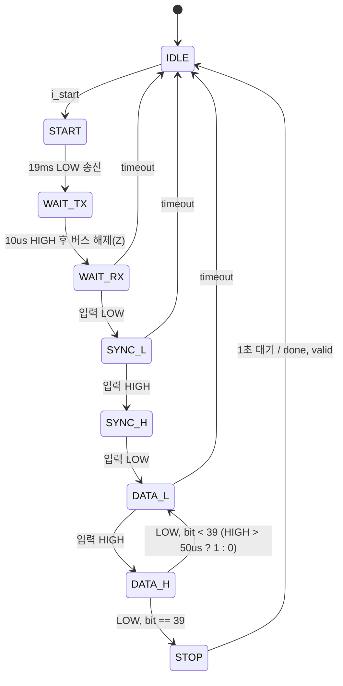

# DHT11_controller — DHT11 온습도 센서 1-wire 컨트롤러 + ILA 디버깅

> 📅 2026-08-13 ~ 14 · 보드: Basys3 · Vivado 2020.2 · 미니 프로젝트 2

선 하나로 송수신을 모두 하는 DHT11 센서의 프로토콜을 **`inout` 포트 + 3-state buffer**로 구현한 컨트롤러.
요청 신호를 보낸 뒤 버스를 놓고(`Z`), 센서가 보내는 40bit를 **HIGH 구간 길이(1us tick)로 0/1 판별**해 받은 뒤 checksum으로 유효성을 확인함.
보드 위에서 실제 신호를 보기 위해 Vivado **ILA(Integrated Logic Analyzer)** IP를 처음 사용.
(같은 센서를 STM32에서 GPIO로 구현한 버전: [STM32/dht11](../../STM32/dht11))

## 파일 구조

```
DHT11_controller/
├── src/
│   ├── top_dht11.v          # 디바운서 + 컨트롤러 + FND (sw로 온도/습도 선택)
│   ├── dht11_controller.v   # dht11_controller(FSM), dht11(초기 버전), tick_gen_1Mhz
│   ├── fnd_controller.v
│   └── btn_debouncer.v
└── tb/tb_dht11.v            # 센서 동작을 흉내 내는 task + 100회 랜덤 테스트
```

> `dht11_controller` 안에 `ila_0` 인스턴스가 있어 Vivado IP Catalog에서 ILA(probe 5개)를 생성해야 합성됨. 시뮬레이션만 할 때는 해당 인스턴스를 주석 처리.

## 사용 핀

| 포트 | 연결 |
|---|---|
| `btn_D` | 측정 시작 |
| `dht11_io` | Pmod → DHT11 DATA (`inout`, 모듈에 pull-up 내장) |
| `sw` | 0: 습도 / 1: 온도 표시 |
| `led` | ready |
| `fnd_com`, `fnd_data` | 정수부.소수부 표시 |

---

## DHT11 프로토콜

| 항목 | 범위 | 정확도 |
|---|---|---|
| 습도 | 20 ~ 90 %RH | ±5 % |
| 온도 | 0 ~ 50 ℃ | ±2 ℃ |
| 샘플링 주기 | 최소 1초 | 전원 인가 후 1초간은 신호 금지 |

```
MCU  ‾‾‾\______ ≥18ms ______/‾‾ (놓음, pull-up)
DHT                              \__80us__/‾‾80us‾‾\_50us_/‾ 26~28us(0) 또는 70us(1) ‾\_ ... ×40
```

- 40bit = 습도 정수 8 + 습도 소수 8 + 온도 정수 8 + 온도 소수 8 + **checksum 8** (앞 4바이트 합의 하위 8bit), **MSB first**
- 매 비트는 LOW 50us로 시작, 뒤따르는 **HIGH 길이**가 26~28us면 0, 70us면 1 → 중간값 **50us**를 기준으로 판별

## 구조

### inout + 3-state buffer

```verilog
inout dht11_io;
assign dht11_io = (io_control_reg) ? dht11_io_reg : 1'bz;   // 1: FPGA가 구동(write) / 0: 놓고 읽기(read)
```

- 한 선을 번갈아 쓰는 **half duplex** → 동시에 구동하면 multiple driver(X)
- `1'bz`로 놓으면 pull-up 저항 때문에 기본 HIGH, 센서가 LOW로 끌어내림

### synchronizer

```verilog
if (!io_control_reg) begin          // 읽기 모드일 때만
    dht11_input_reg  <= dht11_io;
    dht11_input_sync <= dht11_input_reg;
end
```

### FSM



| 상태 | `io_control` | 동작 |
|---|---|---|
| IDLE | 1 (HIGH 출력) | 시작 대기, `ready = 1` |
| START | 1 (LOW 출력) | 19ms (최소 18ms에 여유) |
| WAIT_TX | 1 (HIGH 출력) | 10us 유지 — 바로 읽기로 바꾸면 START에서 낸 LOW를 읽을 수 있어서 |
| WAIT_RX ~ DATA_H | 0 (Z, 읽기) | 센서 응답 LOW/HIGH(각 80us) 동기 후 40bit 수신 |
| STOP | 0 | 센서 최소 주기 1초 대기 후 checksum 비교 → `valid`, `done` |

```verilog
DATA_H: if (tick_1us) begin
    tick_count_next = tick_count_reg + 1;
    if (!dht11_input_sync) begin                      // HIGH 끝
        data_next[39 - bit_count_reg] = (tick_count_reg > 50);
        if (bit_count_reg == 39) begin
            n_state = STOP;
            data_sum_next = data_reg[39:32] + data_reg[31:24] + data_reg[23:16] + data_reg[15:8];
        end else begin
            n_state = DATA_L; bit_count_next = bit_count_reg + 1; tick_count_next = 0;
        end
    end
end
```

- 센서가 응답하지 않을 때 무한 대기를 막기 위해 **timeout 카운터**(8ms)로 IDLE 복귀

## Simulation

```verilog
assign dht11_io = (dht_sensor_io_control) ? dht11_sensor_io : 1'bz;   // 테스트벤치 쪽 센서 모델

task DHT11_SENSOR_TASK(input [31:0] i_data);
    ...
    i_start = 1; #10; i_start = 0;
    #19_000_000; #30_000;                       // MCU의 START, WAIT_TX
    dht_sensor_io_control = 1;                  // 센서가 버스를 잡음
    dht11_sensor_io = 0; #80_000;               // 응답 LOW
    dht11_sensor_io = 1; #80_000;               // 응답 HIGH
    sensor_data = {i_data, i_data[31:24] + i_data[23:16] + i_data[15:8] + i_data[7:0]};
    for (i = 0; i < 40; i = i + 1) begin
        dht11_sensor_io = 0; #50_000;
        dht11_sensor_io = 1;
        if (sensor_data[39 - i]) #70_000; else #27_000;
    end
    ...
    dht_sensor_io_control = 0;                  // 버스 놓기
    #1_000_000_000;                             // 1초
endtask
```

- 습도 / 온도 정수·소수부를 `$urandom`으로 만들어 **100회** 반복 → 받은 값과 `valid`로 PASS / FAIL 판정, 전부 PASS
- 테스트벤치도 DUT와 똑같이 3-state buffer로 버스를 잡았다 놓았다 하며 센서를 흉내 냄

---

## 배운 내용

### ILA (Integrated Logic Analyzer)

- FPGA 내부 신호를 **실제 보드에서 실시간 캡처**하는 Vivado 디버깅 IP (BRAM에 샘플 저장)
- 설정: 샘플 clk(시스템 clk), probe 개수 / 폭, sample depth(예: 1024 clk)
- trigger 조건(상승 / 하강 / 레벨)과 trigger position(윈도 중 위치)을 지정해 **보고 싶은 순간 전후만** 캡처
- probe와 depth를 늘리면 FPGA 자원을 그만큼 사용 → 볼 구간을 잘 골라야 함
- FPGA 전용 — ASIC에는 내부 IP를 넣을 수 없으니 시뮬레이션 / 다른 DFT 방식 사용
- SR04에서 ILA로 trigger 폭(약 11.5us)과 state 전이를 보드 위에서 확인

### 센서 데이터시트 읽기

- min / typ / max 사양, response time(습도 ~10초, 온도 6~30초) → 갱신 주기 결정의 근거
- **hysteresis**: 값이 올라갈 때와 내려갈 때 반응 기준이 다른 현상
- NTC(온도↑ 저항↓) / PTC(온도↑ 저항↑) 서미스터
- 100nF(104) 바이패스 커패시터로 전원 노이즈 필터링

### inout 포트

- 읽기는 항상 가능, **쓰기만 3-state buffer로 제어**
- 시뮬레이션에서는 DUT와 테스트벤치가 각각 `Z`를 내보내며 구동권을 넘김 (둘 다 구동하면 X)
