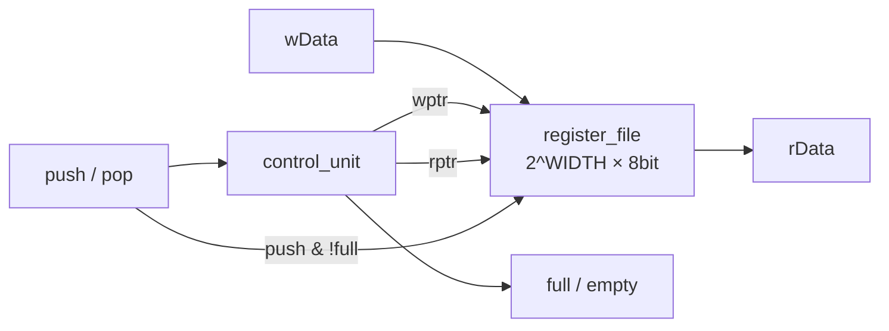

# FIFO — 4byte 동기식 FIFO + 랜덤 자가 검증 테스트벤치

> 📅 2026-08-10 ~ 11 · Vivado 2020.2 · 과제 10, 11 · 시뮬레이션

**register file + control unit(포인터, full / empty)** 구조의 동기식 FIFO를 설계하고,
처음엔 파형을 눈으로 보던 테스트벤치를 **랜덤 stimulus + 기대값 버퍼(scoreboard)로 PASS/FAIL을 자동 판정**하는 방식으로 바꾼 프로젝트.
이후 [FIFO_UART_loopback](../FIFO_UART_loopback)에서 UART 버퍼로, [FIFO_UVM](../FIFO_UVM)에서 UVM 검증 대상으로 다시 사용.

## 파일 구조

```
FIFO/
├── src/fifo.v       # fifo(top), register_file, control_unit
└── tb/tb_fifo.v     # task 기반 시나리오 + 256회 랜덤 테스트
```

---

## 구조



- **datapath**: `wData → register_file → rData`
- **control path**: `push / pop → control_unit → wptr / rptr, full / empty`
- 데이터를 물리적으로 shift하지 않고 **포인터만 이동** (shift는 오버헤드가 큼)

### register_file

```verilog
parameter DEPTH = 2 ** WIDTH;
reg [7:0] register_file [0:DEPTH-1];

always @(posedge clk) if (we) register_file[wAddr] <= wData;
assign rData = register_file[rAddr];     // 조합 출력: 현재 rptr의 데이터가 항상 보임
```

- 조합 출력이라 **pop 하기 전에 이미 맨 앞 데이터가 rData에 나와 있음** → "읽고 나서 pop"

### control_unit — 상태 없이 입력 조합으로

```verilog
case ({push, pop})
    2'b01: if (!empty_reg) begin                      // pop
               rptr_next = rptr_reg + 1;
               full_next = 1'b0;
               if (wptr_reg == rptr_next) empty_next = 1'b1;
           end
    2'b10: if (!full_reg) begin                       // push
               wptr_next  = wptr_reg + 1;
               empty_next = 1'b0;
               if (wptr_next == rptr_reg) full_next = 1'b1;
           end
    2'b11: if (full_reg)       begin rptr_next = rptr_reg + 1; full_next  = 0; end  // pop만
           else if (empty_reg) begin wptr_next = wptr_reg + 1; empty_next = 0; end  // push만
           else begin wptr_next = wptr_reg + 1; rptr_next = rptr_reg + 1; end       // 둘 다
endcase
```

| 동작 | 포인터 | 플래그 |
|---|---|---|
| push | `wptr++` | `empty = 0`, 다음 `wptr == rptr`이면 `full = 1` |
| pop | `rptr++` | `full = 0`, 다음 `rptr == wptr`이면 `empty = 1` |
| push + pop (full) | pop만 | `full = 0` |
| push + pop (empty) | push만 | `empty = 0` |
| push + pop (그 외) | 둘 다 ++ | 변화 없음 (간격이 유지되므로) |

- 포인터가 `WIDTH`bit라 `DEPTH`에서 자동으로 0으로 wrap-around (2의 거듭제곱 크기일 때)
- 처음엔 IDLE / EMPTY / FULL 상태 FSM으로 작성 → 상태 없이 `{push, pop}`과 플래그만으로 같은 동작이 가능해 단순화 (FSM 버전은 주석으로 남김)

#### 트러블슈팅

- **As-Is**: 4번 pop해서 비었는데 `empty`가 **1clk 늦게** 1이 됨
- **원인**: pop 분기에서 `wptr_next == rptr_reg`로 비교 (pop이면 바뀌는 쪽은 rptr)
- **To-Be**: `rptr_next == wptr_reg`로 비교 → 마지막 데이터가 나가는 순간 empty

## Simulation

### 1. task 기반 시나리오

```verilog
task TASK_PUSH(input [7:0] i_data);
    begin @(negedge clk); push = 1; pop = 0; wData = i_data; end
endtask
```

| 시나리오 | 확인 |
|---|---|
| push 5번 (a~e) | 4번째에 `full`, 5번째 `e`는 무시 |
| pop 5번 | a → b → c → d 순서, 4번째에 `empty`, 5번째 pop은 무시 |
| push 1번 후 push+pop 8번 | 포인터가 1 차이로 함께 이동, full / empty 안 뜸 |

### 2. 랜덤 자가 검증 (256회)

```verilog
for (i = 0; i < 256; i = i + 1) begin
    @(posedge clk); #1;                     // drive: posedge 직후
    push = $random % 2; pop = $random % 2; wData = $random % 256;

    @(negedge clk);                         // monitor & score: 반 clk 뒤
    if (push) begin
        if (!full) begin                    // 기대값 버퍼에 저장
            compare_buffer[push_cnt] = wData; push_cnt = push_cnt + 1;
            if (push_cnt == pop_cnt) buf_full = 1;
        end else if (buf_full_reg) pass_cnt = pass_cnt + 1;   // full 판정 비교
        else fail_cnt = fail_cnt + 1;
    end
    if (pop) begin
        if (!empty) begin
            if (compare_buffer[pop_cnt] == rData) pass_cnt = pass_cnt + 1;
            else fail_cnt = fail_cnt + 1;
            ...
        end
        ...
    end
end
```

- push 시 `compare_buffer`(테스트벤치 쪽 FIFO 모델)에 저장 → pop 시 DUT의 `rData`와 비교
- DUT의 `full` / `empty`도 버퍼 모델의 상태와 비교
- push · pop이 동시에 올 수 있으므로 `if-else`가 아니라 **다중 if**
- 결과: push / pop이 모두 0인 경우를 뺀 **254건 전부 PASS**

---

## 배운 내용

### 검증 기본 흐름

1. **stimulus 생성** — 직접 벡터 또는 `$random`
2. **drive 시점** — DUT가 샘플하는 순간(posedge)을 피해서. posedge 직후 `#1`에 넣으면 다음 posedge에 반영
3. **monitor & score** — 값이 안정된 시점(negedge)에 읽고 그 자리에서 pass / fail 판정

- posedge와 같은 순간에 값을 바꾸면 **race condition**
- 랜덤 테스트는 실제 사용처럼 다양한 조합을 만들어 직접 짜기 어려운 엣지 케이스를 찾음
- 파형 · 코드 · 로그를 같이 보고 왜 그 결과가 나왔는지 설명할 수 있어야 함

### `$display` vs `$strobe`

- `$display`: 실행 순서대로 즉시 출력 → 같은 time slot의 non-blocking 반영 **전** 값
- `$strobe`: time slot **마지막**에 출력 → 모든 갱신이 끝난 값

### 동기식 FIFO의 쓰임

- 보내는 쪽과 받는 쪽의 **처리 타이밍이 다를 때 버퍼**로 사용 (같은 clk)
- clk이 다르면 비동기식 FIFO (CDC, 멀티비트 전송)
- 같은 주소를 동시에 쓰고 읽으면 위험 → CDC 환경에서는 almost full / almost empty로 미리 알려주는 게 좋음
