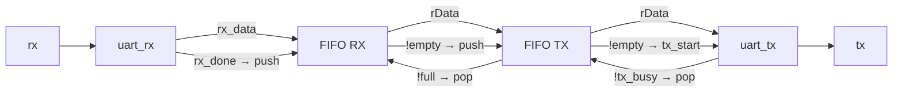

# FIFO_UART_loopback — UART RX → FIFO → FIFO → UART TX loopback

> 📅 2026-08-11 · 보드: Basys3 · Vivado 2020.2 · 과제 11

[UART](../UART)의 loopback 사이에 [FIFO](../FIFO) 두 개를 버퍼로 넣어,
PC가 보낸 바이트가 **RX FIFO → TX FIFO → UART TX**를 거쳐 그대로 돌아오는지 확인한 프로젝트.
TX가 바쁜 동안 들어온 데이터도 FIFO에 쌓였다가 순서대로 나가도록 하는 게 목적.
UART 동작을 흉내 내는 **송신 / 수신 task**로 256개 랜덤 바이트를 왕복시켜 자동 검증.

## 파일 구조

```
FIFO_UART_loopback/
├── src/
│   ├── uart_loop_back.v   # uart_fifo_loopback (top)
│   ├── fifo.v             # [FIFO]와 동일
│   ├── uart_rx.v, uart_tx.v
│   └── btn_debouncer.v
└── tb/
    ├── tb_uart.v          # tb_loop_back: UART 송신/수신 task + 랜덤 테스트
    └── tb_fifo.v
```

## 사용 핀

| 포트 | 핀 |
|---|---|
| `clk` | W5 (100MHz) |
| `rx` | B18 |
| `tx` | A18 |
| PC 설정 | 9600bps 8N1 |

---

## 구조



```verilog
fifo #(2) U_FIFO_RX (.wData(w_rx_data),      .push(w_rx_done),         .pop(!w_fifo_tx_full),
                     .rData(w_fifo_rx_data), .empty(w_fifo_rx_empty), ...);
fifo #(2) U_FIFO_TX (.wData(w_fifo_rx_data), .push(!w_fifo_rx_empty), .pop(!w_tx_busy),
                     .rData(w_fifo_tx_data), .full(w_fifo_tx_full),   .empty(w_fifo_tx_empty), ...);
uart_tx  U_UART_TX  (.tx_start(!w_fifo_tx_empty), .tx_data(w_fifo_tx_data), .tx_busy(w_tx_busy), ...);
```

| 연결 | 의미 |
|---|---|
| `rx_done → push` | 1바이트 수신 완료 시 RX FIFO에 저장 |
| RX FIFO `!empty` → TX FIFO `push` / TX FIFO `!full` → RX FIFO `pop` | 데이터가 있고 자리가 있으면 RX → TX로 이동 |
| TX FIFO `!empty → tx_start` / `!tx_busy → pop` | TX가 쉬고 있으면 꺼내서 전송 |

- FIFO가 **조합 출력**이라 pop 전에 `rData`에 맨 앞 데이터가 이미 나와 있음 → `tx_start`와 같은 clk에 `tx_data` 사용 가능

## Simulation

### UART 송신 / 수신을 흉내 내는 task

```verilog
parameter TICK_PERIOD = 10 * (100_000_000 / 9600);   // 1bit 시간 (ns)

task SENDER_FOR_UART_RX(input [7:0] send_data);   // PC TX 역할
    begin
        rx = 0; #TICK_PERIOD;                                   // start
        for (i = 0; i < 8; i = i + 1) begin rx = send_data[i]; #TICK_PERIOD; end
        rx = 1; #TICK_PERIOD;                                   // stop
    end
endtask

task RECEIVER(output [7:0] data);                  // PC RX 역할
    begin
        wait (~tx);                       // start bit 대기
        #(TICK_PERIOD / 2);               // 비트 가운데로 이동
        if (tx) $display("%t: start bit error", $time);
        for (j = 0; j < 8; j = j + 1) begin #TICK_PERIOD; data[j] = tx; end
        #TICK_PERIOD;
        if (~tx) $display("%t: stop bit error", $time);
    end
endtask
```

### 랜덤 테스트

```verilog
for (k = 0; k < 256; k = k + 1) begin
    send_data = $random % 256;
    SENDER_FOR_UART_RX(send_data);
    RECEIVER(receive_data);
    if (send_data == receive_data) pass_cnt = pass_cnt + 1;
    else                           fail_cnt = fail_cnt + 1;
end
```

- 256개 랜덤 바이트 **모두 PASS**
- 파형 확인: `rx_done` → 다음 clk에 RX FIFO 0번지 저장 → 다음 clk에 TX FIFO로 이동 → `tx_start` → start bit 출력, 입력 `rx`와 출력 `tx`가 같은 104,160ns 비트 주기의 같은 파형

---

## 배운 내용

- **valid / ready 핸드셰이크 감각**: "보낼 게 있다(`!empty`)" + "받을 자리가 있다(`!full`, `!busy`)"가 동시에 성립할 때만 데이터를 옮김
- 처리 속도가 다른 블록 사이(UART TX는 1바이트에 ~1ms)에 FIFO를 두면 앞 단이 기다리지 않아도 됨
- 테스트벤치에서 **프로토콜을 흉내 내는 task**(BFM 개념)를 만들면 DUT 입출력을 실제 상대 장치처럼 다룰 수 있음 → 이후 UVM의 driver / monitor로 이어지는 개념
- 시스템 레벨 블록도를 먼저 그리고 신호가 블록도대로 흐르는지 파형으로 하나씩 따라가며 검증
