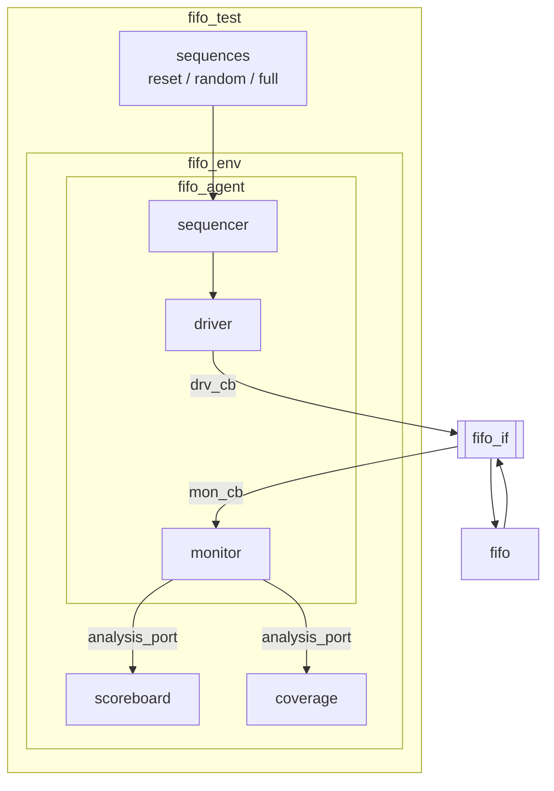

# FIFO_UVM — 동기식 FIFO UVM 검증 환경 + functional coverage

> 📅 2026-08-25 ~ 09-07 · Synopsys VCS / Verdi · SystemVerilog + UVM · 개인 발표 2

[FIFO](../FIFO)를 SystemVerilog로 옮긴 **8bit × 16 slot 동기식 FIFO**를 DUT로,
sequence · sequencer · driver · monitor · scoreboard · coverage · agent · env · test로 이루어진 **UVM 검증 환경**을 구성한 프로젝트.
`clocking block`으로 drive / sample 시점을 고정하고, scoreboard의 기대값 모델로 PASS / FAIL을, covergroup으로 기능 커버리지를 측정함.

## 파일 구조

```
FIFO_UVM/
└── tb/tb_fifo.sv     # interface + UVM 컴포넌트 전체 + tb_fifo 모듈
```

> 저장소의 `tb_fifo.sv`는 발표 전 **중간 버전**입니다. DUT(`fifo.sv`)는 폴더에 포함되어 있지 않고, 아래 "최종 버전과의 차이"에 적은 부분이 다릅니다.

## 실행 (VCS / Verdi)

```bash
find . -name "*.sv" > files.f           # uvm 패키지·interface가 먼저 오도록 순서 확인
vcs -full64 -sverilog -ntb_opts uvm -debug_access+all -kdb -f files.f -l comp.log
./simv -l sim.log +UVM_TESTNAME=fifo_test
grep -E 'UVM_(ERROR|FATAL)' sim.log     # 판정은 눈이 아니라 grep으로
verdi -ssf wave.fsdb &                  # $fsdbDumpfile("wave.fsdb")
```

---

## 목표와 결과

| | 목표 | 결과 |
|---|---|---|
| 설계 | 8bit × 16 slot FIFO, push / pop / full / empty | 완료 |
| 검증 | UVM 환경 + 다중 sequence | reset / random / full sequence 구성 |
| 커버리지 | push · pop · full · empty 80% 이상 | **100%** (full일 때 push, empty일 때 pop 포함) |
| 판정 | — | 모든 테스트에서 FAIL 0 |

## UVM 환경 구조



| 클래스 | 상속 | 역할 |
|---|---|---|
| `fifo_seq_item` | `uvm_sequence_item` | reset, push, pop, i_data(rand) + o_data, full, empty |
| `fifo_sequence` 등 | `uvm_sequence` | `start_item` → `randomize` → `finish_item`으로 item 생성 |
| `fifo_driver` | `uvm_driver` | `get_next_item` → `drv_cb`로 구동 → `item_done` |
| `fifo_monitor` | `uvm_monitor` | `mon_cb`로 샘플 → `analysis_port.write()` |
| `fifo_scoreboard` | `uvm_scoreboard` | `analysis_imp`의 `write()`에서 기대값 비교 |
| `fifo_coverage` | `uvm_subscriber` | `write()`마다 `covergroup.sample()` |
| `fifo_agent` / `fifo_env` / `fifo_test` | `uvm_agent` / `uvm_env` / `uvm_test` | `build_phase`에서 생성, `connect_phase`에서 연결, `run_phase`에서 sequence 실행 |

```systemverilog
// tb 모듈: interface를 config DB에 등록하고 테스트 시작
uvm_config_db#(virtual fifo_if)::set(null, "*", "f_if", f_if);
run_test("fifo_test");

// driver / monitor build_phase: config DB에서 꺼냄
if (!uvm_config_db#(virtual fifo_if)::get(this, "", "f_if", f_if))
    `uvm_fatal(get_name(), "unable to access fifo interface")
```

## 타이밍 — clocking block

```systemverilog
clocking drv_cb @(posedge clk);
    default input #1step output #1;      // 엣지 1ns 뒤 구동 → 다음 엣지까지 setup 9ns
    output reset, i_push, i_pop, i_data;
endclocking

clocking mon_cb @(posedge clk);
    default input #1step;                // 엣지 직전(1step 전) 값을 샘플
    input reset, i_push, i_pop, i_data, o_data, full, empty;
endclocking
```

- FIFO 출력은 조합 출력이라 pop이 들어간 **다음 posedge에 rptr이 바뀌며 다음 데이터로 변함** → 엣지 **직전** 값을 읽어야 pop된 데이터와 비교 가능 → `input #1step`

## Scoreboard 판정 기준

| 입력 | DUT 상태 | 판정 |
|---|---|---|
| push | not full | 기대값 버퍼에 저장 → PASS |
| push | full | 버퍼 모델도 full이면 PASS, 아니면 FAIL |
| pop | not empty | 버퍼 맨 앞 == `o_data`면 PASS |
| pop | empty | 버퍼 모델도 empty면 PASS, 아니면 FAIL |
| 둘 다 0 | — | SKIP |

- `report_phase`에서 receive / pass / fail / skip 집계 출력
- 한 사이클에 push · pop이 모두 1이면 두 번 판정되어 receive 수와 합계가 맞지 않는 한계가 있음

## Coverage

```systemverilog
covergroup fifo_cg;
    cp_i_push: coverpoint f_item.i_push { bins push = {1}; bins not_push = {0}; }
    cp_i_pop:  coverpoint f_item.i_pop  { bins pop  = {1}; bins not_pop  = {0}; }
    cp_full:   coverpoint f_item.full   { bins full = {1}; bins not_full = {0}; }
    cp_empty:  coverpoint f_item.empty  { bins empty = {1}; bins not_empty = {0}; }
    cx_push_pop:  cross cp_i_push, cp_i_pop;
    cx_push_full: cross cp_i_push, cp_full;    // full일 때 push (엣지 케이스)
    cx_pop_empty: cross cp_i_pop,  cp_empty;   // empty일 때 pop (엣지 케이스)
endgroup
```

- `i_data` / `o_data`의 256개 bin은 FIFO 제어 동작과 무관해 최종 버전에서 제외 (중간 버전에는 남아 있음)

## 트러블슈팅

| 증상 | 원인 | 해결 |
|---|---|---|
| `full` 커버리지 50% | 랜덤 push / pop만으로는 16칸이 꽉 차는 경우가 거의 안 나옴 | push만 20번 하는 `fifo_full_sequence` 추가 |
| sequence는 끝났는데 monitor가 끝없이 반복 | 마지막 구간에서 `drop_objection` 누락 | test의 `run_phase`에 `raise` / `drop` 쌍 정리 |

```systemverilog
// 최종 test run_phase: reset → random → full → random
phase.raise_objection(this);
reset_seq.start(env.agt.sqr);
seq.start(env.agt.sqr);
full_seq.start(env.agt.sqr);
seq.start(env.agt.sqr);
repeat (5) @(posedge env.agt.drv.f_if.clk);
phase.drop_objection(this);
```

## 최종 버전과의 차이 (저장소 파일 기준)

- `fifo_reset_sequence`, `fifo_full_sequence`가 없고 random sequence 1회만 실행
- scoreboard가 `f_item.push` / `f_item.pop`을 참조 (item 필드명은 `i_push` / `i_pop`)
- `fifo_seq_item.o_data`가 1bit `logic`으로 선언됨 (최종 버전은 `logic [7:0]`)
- coverage에 `i_data` / `o_data` / cross(push, pop, i_data) 포함

## 발표 피드백

- 블록도에 datapath / control path 구분해서 그리기
- 검증 목표 → 검증 플랜 → 플랜대로 됐는지 재확인 순서로
- reset sequence 후 full / empty / wptr / rptr 초기화도 확인
- coverage로 볼 것과 **assertion**으로 볼 것을 구분
- 파형(VCS / Verdi)을 appendix에 넣어 실제 동작 근거 제시
- 트러블슈팅은 단순 디버깅이 아니라 어려운 문제를 해결한 과정

---

## 배운 내용

### UVM phase

| phase | 종류 | 하는 일 |
|---|---|---|
| `build_phase` | function, top-down | 컴포넌트 생성 (`type_id::create`), config DB get |
| `connect_phase` | function, bottom-up | 포트 연결 (`seq_item_port` ↔ `seq_item_export`, analysis 포트) |
| `run_phase` | task | 시간이 흐르는 동작 (drive, monitor, sequence 실행) |
| `report_phase` | function | 결과 출력 |

- `raise_objection` ~ `drop_objection`: 이 구간이 끝나야 run_phase가 종료됨
- `` `uvm_info `` (verbosity로 출력 제어), `` `uvm_error ``, `` `uvm_fatal ``

### TLM 연결

- sequencer ↔ driver: `get_next_item()` / `item_done()` (pull 방식)
- monitor → scoreboard / coverage: `uvm_analysis_port.write()` → 연결된 모든 subscriber의 `write()` 호출 (1:N broadcast)

### Linux / VCS 흐름

파일리스트(`find`) → 컴파일(`vcs`) → 실행(`simv -l`) → 파형(`verdi`) → 판정(`grep`)

- `-debug_access+all`(파형·강제값), `-kdb`(Verdi 소스 추적), `-l`(로그 분리)
- 로그 분석: `grep -A 5 -B 2 'UVM_FATAL'`, `sort | uniq -c | sort -rn`
- 긴 회귀는 `nohup ./simv &`, package · interface는 파일리스트 앞쪽에
