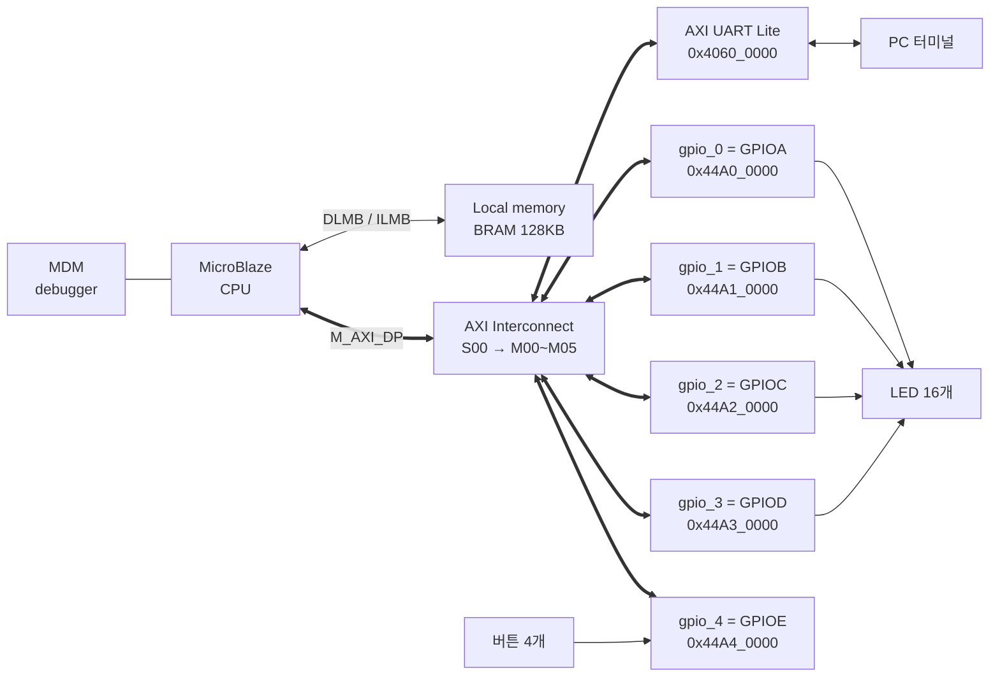
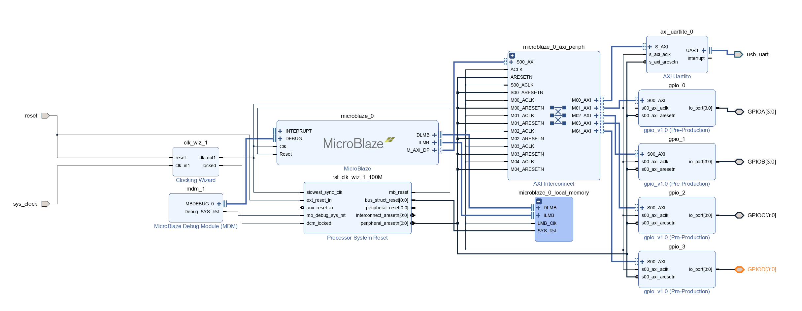
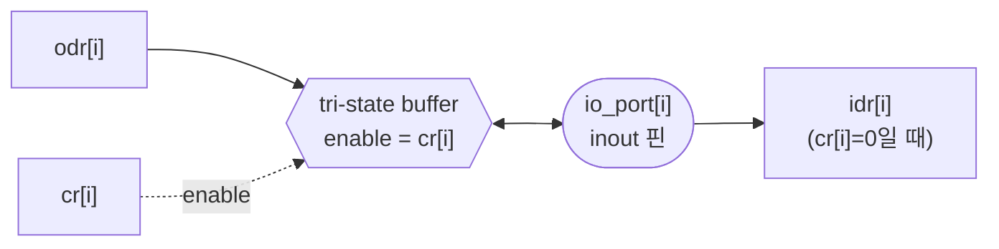
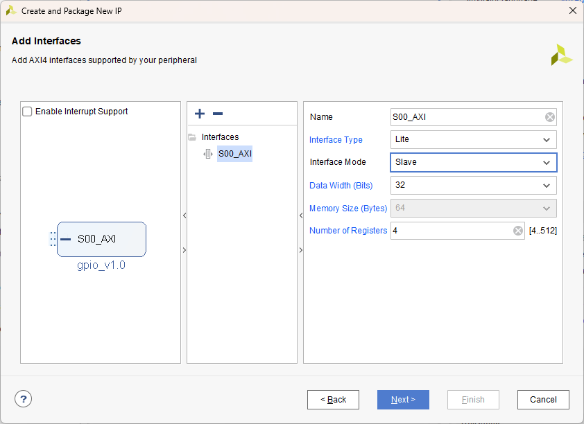
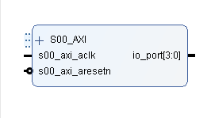
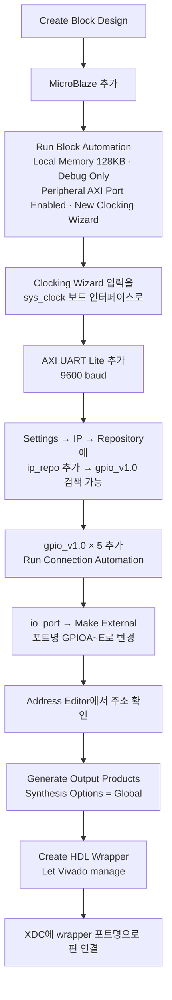
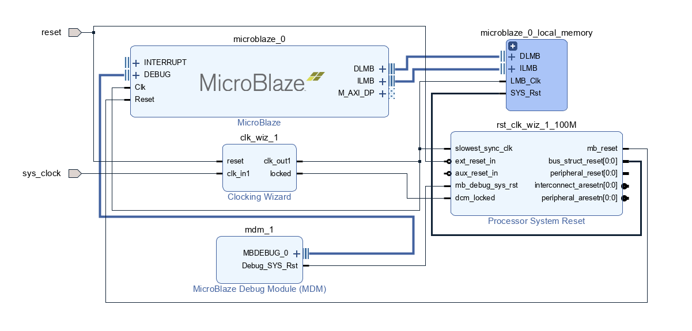
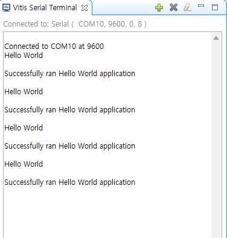
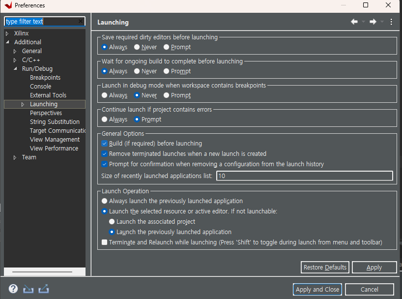
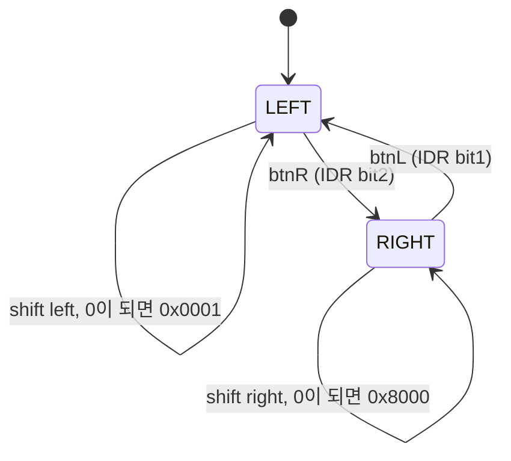

# MicroBlaze_AXI_GPIO — 직접 만든 AXI4-Lite GPIO IP를 MicroBlaze에 붙이고 Vitis C 프로그램으로 LED 제어

> 📅 2026-11-20 · 보드: Basys3 · Vivado 2020.2 / Vitis 2020.2 · Verilog + C · 실습 + 과제

3상태(tri-state) 버퍼 기반 **4bit GPIO 모듈**을 만들고, **Create and Package New IP**로 AXI4-Lite slave를 씌워 `gpio_v1.0` IP로 패키징함.
Block Design에서 **MicroBlaze + AXI Interconnect + UART Lite**에 GPIO IP 5개(GPIOA~E)를 붙인 뒤, 하드웨어(XSA)를 export해서 **Vitis**에서 C로 레지스터를 직접 써서 LED 16개를 제어함.
STM32에서 쓰던 `GPIOx->ODR` 스타일 구조체 접근을 직접 만든 하드웨어 위에서 처음 재현해 본 작업.
이전 단계: [AXI_Lite_template](../AXI_Lite_template), [AXI_master_slave_sim](../AXI_master_slave_sim)

## 파일 구조

```
MicroBlaze_AXI_GPIO/
├── ip_repo/                                   # Vivado IP Repository로 등록하는 폴더
│   ├── gpio_1.0/
│   │   ├── component.xml                      # IP 패키징 정보 (IP Packager 생성)
│   │   ├── hdl/gpio_v1_0.v                    # IP top — S00_AXI + gpio 인스턴스, io_port 추가
│   │   ├── hdl/gpio_v1_0_S00_AXI.v            # AXI4-Lite slave — slv_reg0=CR, slv_reg1=ODR, 0x08 읽기=IDR
│   │   ├── drivers/gpio_v1_0/src/Makefile     # wildcard 수정 (Vitis 빌드 오류 해결)
│   │   ├── xgui/, bd/
│   └── edit_gpio_v1_0.srcs/sources_1/imports/new/gpio.v   # tri-state GPIO 코어
├── bd/
│   ├── gpio_design_1.bd                       # MicroBlaze Block Design
│   └── gpio_design_1_wrapper.v                # HDL wrapper (Vivado 자동 생성, 참고용)
├── constraints/Basys-3-Master.xdc             # GPIOA~D → LED 16개, GPIOE → 버튼 4개, UART
├── sw/
│   ├── led_pingpong/main.c                    # 과제 1: LED 16개 왕복
│   └── led_button/main.c                      # 과제 2: 버튼으로 LED 흐름 방향 전환
└── images/
```

> `gpio.v`가 `ip_repo/edit_gpio_v1_0.srcs/...` 아래에 있는 이유: `component.xml`이 이 파일을 `../edit_gpio_v1_0.srcs/sources_1/imports/new/gpio.v` 상대 경로로 참조함. 경로를 그대로 두어야 `ip_repo/`를 IP Repository로 추가했을 때 IP가 바로 인식됨.
>
> Block Design의 Xilinx IP(MicroBlaze, Clocking Wizard, UART Lite 등)는 `.bd`를 열면 Vivado가 다시 생성함 (Generate Output Products 필요). Vivado 프로젝트, `.xsa`, Vitis platform/BSP는 올리지 않음.

## 사용 핀

| 포트 | 연결 | 모드 (`CR`) |
|---|---|---|
| `sys_clock` | W5 (100 MHz) | — |
| `reset` | U18 (`btnC`, active high) | — |
| `GPIOA[3:0]` | LD0~LD3 (U16, E19, U19, V19) | output (`0x0F`) |
| `GPIOB[3:0]` | LD4~LD7 (W18, U15, U14, V14) | output |
| `GPIOC[3:0]` | LD8~LD11 (V13, V3, W3, U3) | output |
| `GPIOD[3:0]` | LD12~LD15 (P3, N3, P1, L1) | output |
| `GPIOE[3:0]` | `btnU` T18, `btnL` W19, `btnR` T17, `btnD` U17 | input (`0x00`) |
| `usb_uart_rxd / txd` | B18 / A18 (9600 baud) | — |

---

## 전체 구조



| 블록 | 역할 |
|---|---|
| `microblaze_0` | Xilinx soft-core CPU (FPGA 로직으로 구현) |
| `microblaze_0_local_memory` | **ILMB** = instruction local memory (프로그램, ROM 역할) / **DLMB** = data local memory (RAM) — 같은 BRAM 128KB를 둘 다 0x0에 매핑 |
| `mdm_1` | MicroBlaze Debug Module — Vitis에서 JTAG로 프로그램 다운로드·디버깅 |
| `clk_wiz_1` | Clocking Wizard (PLL/MMCM) — 외부 100 MHz `sys_clock`에서 안정된 내부 클럭 생성 |
| `rst_clk_wiz_1_100M` | Processor System Reset — 클럭 lock 이후 CPU·버스·주변장치 reset 순서 관리 |
| `axi_uartlite_0` | `xil_printf` 출력용 UART (stdout). 수업에서 빼면 문제가 생긴다고 해서 기본으로 추가 |
| `gpio_0~4` | 직접 만든 `gpio_v1.0` IP × 5 |



과제 1 단계(GPIOA~D)의 Block Design. 과제 2에서 버튼 입력용 `gpio_4`(GPIOE)를 하나 더 추가함 (`bd/gpio_design_1.bd`는 GPIOE까지 포함된 최종본).

---

## GPIO 코어 (`gpio.v`)

STM32 GPIO처럼 레지스터 3개로 동작을 정의함.

| 레지스터 | offset | 방향 | 의미 |
|---|---|---|---|
| `CR` (control) | `0x00` | CPU → IP | 비트별 모드. `1` = output, `0` = input |
| `ODR` (output data) | `0x04` | CPU → IP | output 모드 핀에 내보낼 값 |
| `IDR` (input data) | `0x08` | IP → CPU | input 모드 핀에서 읽은 값 |
| — | `0x0C` | — | `slv_reg3` (미사용) |

```verilog
genvar i;
generate
    for (i = 0; i < 4; i = i + 1) begin
        assign io_port[i] = (cr[i]) ? odr[i] : 1'bz;      // output 모드: ODR 값을 핀으로 구동
        assign idr[i]     = (cr[i]) ? 1'bz   : io_port[i]; // input 모드: 핀 구동을 끊고(Z) 핀 값을 IDR로
    end
endgenerate
```



- `CR`이 32bit 레지스터라 **비트마다 독립적으로** 3상태 버퍼 enable에 연결 가능 → 핀 4개를 각각 input / output으로 설정
- `generate for` + `genvar`로 비트별 `assign` 4줄을 반복 생성 (주석 처리된 수동 버전과 동일)
- 핀이 `inout`이므로 Block Design에서 Make External 하면 양방향 포트로 나감

## AXI4-Lite slave에 연결 (`gpio_v1_0_S00_AXI.v`)

Create and Package New IP → **Create a new AXI4 peripheral** → Lite / Slave / 32bit / 레지스터 4개(기본값) → **Edit IP**로 user logic 추가.



```verilog
// Users to add ports here
output wire [3:0] cr,
output wire [3:0] odr,
input  wire [3:0] idr,
...
reg [C_S_AXI_DATA_WIDTH-1:0] slv_reg0; // cr
reg [C_S_AXI_DATA_WIDTH-1:0] slv_reg1; // odr
reg [C_S_AXI_DATA_WIDTH-1:0] slv_reg2; // idr (실제로는 읽기에 쓰지 않음)
...
case (axi_araddr[ADDR_LSB+OPT_MEM_ADDR_BITS:ADDR_LSB])
    2'h0   : reg_data_out <= slv_reg0;
    2'h1   : reg_data_out <= slv_reg1;
    2'h2   : reg_data_out <= {28'b0, idr}; // slv_reg2 대신 idr을 read data에 직결
    2'h3   : reg_data_out <= slv_reg3;
    default: reg_data_out <= 0;
endcase
...
assign cr  = slv_reg0[3:0];
assign odr = slv_reg1[3:0];
```

- 쓰기 경로(`CR`, `ODR`)는 템플릿의 `slv_reg0/1`을 그대로 사용 → 하위 4bit만 꺼내 코어로 전달
- 읽기 경로는 `0x08`에서 레지스터 대신 **핀 값을 바로** 읽도록 수정 → CPU가 쓰는 값이 아니라 외부에서 들어오는 값이므로
- IP top(`gpio_v1_0.v`)에는 외부 포트 `inout [3:0] io_port` 추가, 내부 `wire cr/odr/idr`로 S00_AXI와 `gpio` 코어를 연결



패키징된 `gpio_v1.0` IP — AXI 인터페이스 + `io_port[3:0]`.

### drivers Makefile 수정

IP Packager가 만든 `drivers/gpio_v1_0/src/Makefile`을 그대로 두면 Vitis에서 BSP 빌드 시 컴파일 오류가 남. 소스 목록을 `wildcard`로 수정함.

```makefile
INCLUDEFILES=$(wildcard *.h)
LIBSOURCES=$(wildcard *.c)
OUTS = $(wildcard *.o)
```

---

## Block Design 구성 순서





Block / Connection Automation 직후의 MicroBlaze 기본 구성 (CPU, local memory, MDM, Clocking Wizard, Processor System Reset).

- **Generate Output Products**: `inout` 포트가 있는 설계는 Synthesis Options를 **Global**로. Number of jobs는 합성에 쓸 스레드 수
- **HDL wrapper**: Block Design은 그 자체로 top이 될 수 없어서 wrapper로 감싸야 함. wrapper의 포트명(`GPIOA`, `reset`, `sys_clock`, `usb_uart_rxd/txd` …)이 그대로 XDC의 `get_ports` 이름이 됨

### Address map

| Slave | Base | Range |
|---|---|---|
| `dlmb_bram_if_cntlr` / `ilmb_bram_if_cntlr` | `0x0000_0000` | 128K |
| `axi_uartlite_0` | `0x4060_0000` | 64K |
| `gpio_0` (GPIOA) | `0x44A0_0000` | 64K |
| `gpio_1` (GPIOB) | `0x44A1_0000` | 64K |
| `gpio_2` (GPIOC) | `0x44A2_0000` | 64K |
| `gpio_3` (GPIOD) | `0x44A3_0000` | 64K |
| `gpio_4` (GPIOE) | `0x44A4_0000` | 64K |

- IP 하나에 64K가 할당되지만 실제로 쓰는 건 레지스터 4개(`0x00~0x0C`)
- C 코드의 `GPIOx_BASEADDR`이 이 표와 일치해야 함

---

## Vivado → Vitis


- **XSA**: 하드웨어 구조(+ bitstream)만 담긴 파일. instruction memory(ROM)는 비어 있음 → 기능은 C 프로그램을 빌드해서 넣어야 함
- Vitis = Xilinx의 Eclipse 기반 소프트웨어 IDE. Vivado의 Tools → Launch Vitis IDE
- 프로젝트 폴더 안에 Vitis용 workspace 폴더를 따로 만들어서 열고, platform과 application을 그 안에 둠
- New Application Project → **Create a new platform from hardware (XSA)** 에서 XSA 선택 → 프로젝트 이름 지정 → Hello World 템플릿

### Hello World



Launch Hardware 후 Vitis Serial Terminal(COM 포트, 9600 baud)에서 `xil_printf` 출력 확인. ComPortMaster 같은 외부 터미널로도 확인 가능.



Preferences → Run/Debug → Launching → **Build (if required) before launching** 체크 → Launch 할 때마다 수정된 코드가 자동으로 빌드되어 항상 최신 프로그램이 올라감.

---

## 소프트웨어

### 레지스터 접근 방식

처음엔 주소를 매크로로 하나씩 역참조, 과제에서는 STM32 HAL처럼 **구조체 포인터**로 정리함.

```c
// 1) 포인터 역참조 매크로 (LED 깜빡이기 실습, 노션 필기)
#define GPIOA_CR   *(uint32_t*)(GPIOA_BASEADDR + 0x00)
#define GPIOA_ODR  *(uint32_t*)(GPIOA_BASEADDR + 0x04)

// 2) 구조체 오버레이 (과제) — 멤버 순서 = 레지스터 offset 0x00, 0x04, 0x08
typedef struct {
	volatile uint32_t CR;
	volatile uint32_t ODR;
	volatile uint32_t IDR;
} GPIO_TypeDef;
#define GPIOA  ((GPIO_TypeDef *)0x44a00000)

GPIOA->CR  = 0x0f;   // 하위 4bit 모두 output
GPIOA->ODR = 0x0f;   // LED 4개 on
```

- 버튼을 읽는 과제 2부터 멤버에 `volatile` 추가 → `IDR`은 하드웨어가 바꾸는 값이라 컴파일러가 읽기를 생략·캐싱하면 안 됨
- `usleep(us)` / `sleep(s)` 는 `sleep.h`

### 과제 1 — LED 16개 왕복 (`sw/led_pingpong`)

16bit `mask` 하나를 shift 해서 4bit씩 잘라 GPIOA~D의 `ODR`에 나눠 씀.

```c
if (mask == 0) {                    // 끝까지 밀려서 0이 되면 방향 전환
    if (!flag) { flag = 1; mask = 0x8000; }
    else       { flag = 0; mask = 0x0001; }
} else {
    if (!flag) mask = mask << 1;    // LD0 → LD15
    else       mask = mask >> 1;    // LD15 → LD0
}
GPIOA->ODR =  mask & 0x000f;
GPIOB->ODR = (mask & 0x00f0) >> 4;
GPIOC->ODR = (mask & 0x0f00) >> 8;
GPIOD->ODR = (mask & 0xf000) >> 12;
usleep(100000);                     // 100 ms
```

### 과제 2 — 버튼으로 방향 바꾸는 LED stream (`sw/led_button`)

GPIOE를 input(`CR = 0x00`)으로 두고 `btnL` / `btnR`로 흐름 방향을 정함. 끝에 도달하면 같은 방향의 처음부터 다시 흐름.

```c
GPIOE->CR = 0x00;                         // input mode

if ((GPIOE->IDR & 0x02) > 0) flag = 0;    // GPIOE[1] = btnL → 왼쪽(LD0 → LD15)
else if ((GPIOE->IDR & 0x04) > 0) flag = 1; // GPIOE[2] = btnR → 오른쪽(LD15 → LD0)

if (mask == 0) mask = (!flag) ? 0x0001 : 0x8000;   // 한쪽 끝을 지나면 반대편 끝에서 재시작
else           mask = (!flag) ? (mask << 1) : (mask >> 1);
```



- 버튼은 루프마다(100 ms) 한 번 polling → 누르고 있는 동안만 인식, 별도 debounce 없음
- 보드 동작 영상은 노션 학습노트에 있음

---

## 배운 내용

### CPU에서 peripheral을 다루는 방식
- CPU는 AXI interconnect를 통해 peripheral을 **메모리처럼** 읽고 씀 (memory-mapped I/O). peripheral 쪽은 AXI interface 뒤에 레지스터를 두고, 그 레지스터 값으로 custom IP를 제어
- GPIO는 `CR`(모드), `ODR`(출력), `IDR`(입력) 레지스터면 충분 → STM32 GPIO 레지스터 구조와 같은 개념을 직접 하드웨어로 구현

### Custom IP 패키징
- Create and Package New IP가 AXI4-Lite slave 템플릿 + driver + 패키징 정보까지 생성 → **Edit IP**로 user port / user logic만 추가하고 Re-Package
- 만든 IP는 다른 프로젝트에서 Settings → IP → Repository로 `ip_repo` 폴더를 추가해야 IP Catalog에서 검색됨
- driver `Makefile`의 소스 목록을 `wildcard`로 고치지 않으면 Vitis에서 빌드 오류

### MicroBlaze 시스템
- MicroBlaze를 넣고 **Run Block Automation**하면 local memory, debug module, clock, reset 블록이 같이 생성됨. 이후 **Run Connection Automation**이 AXI 연결을 자동으로 잡아줌
- local memory 포트: DLMB = data(RAM), ILMB = instruction(ROM)
- PLL(Phase-Locked Loop): 외부 기준 클럭의 위상·주파수를 감지해서 원하는 주파수의 안정적인 클럭을 만드는 회로 → Clocking Wizard가 담당
- UART peripheral은 넣어 두는 게 안전 (stdout 장치)
- 외부로 나갈 포트는 **Make External** → 포트 이름을 바꿔 두면 wrapper와 XDC에서 그 이름을 그대로 씀

### HW / SW 분리
- Vivado가 만든 XSA는 "구조만 있는 CPU 시스템". 실제 기능은 Vitis에서 C로 작성해 ROM(BRAM)에 올림
- 같은 하드웨어 위에서 소프트웨어만 바꿔 LED 왕복 → 버튼 제어로 기능 변경 가능 → 하드웨어는 범용 peripheral로 두고 동작은 SW로 정의하는 구조
