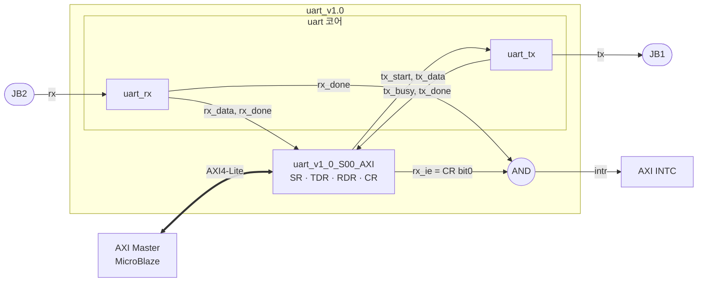
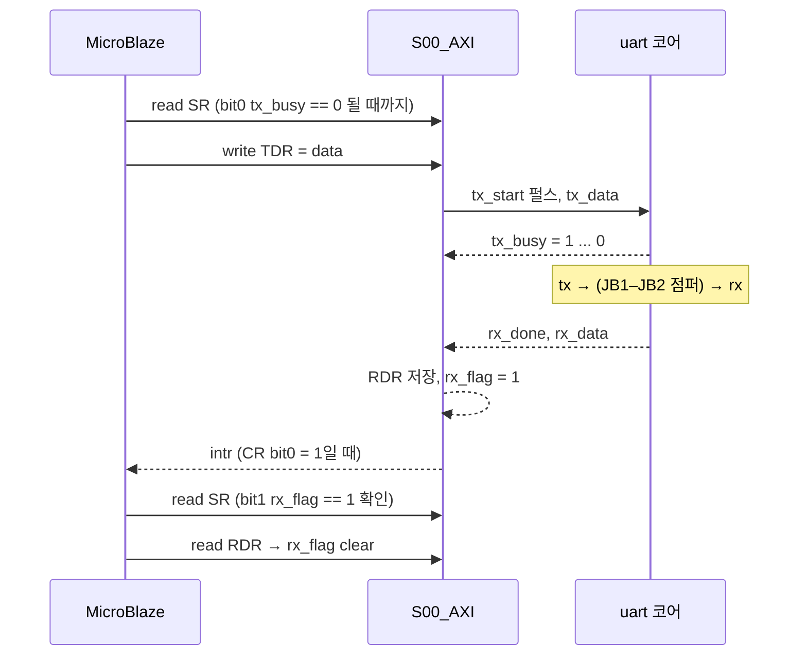
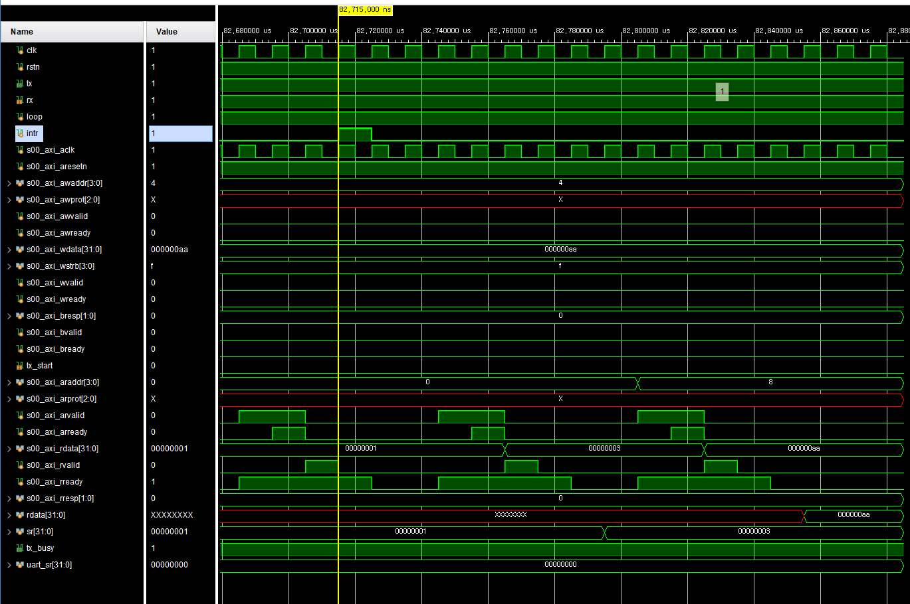
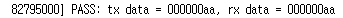
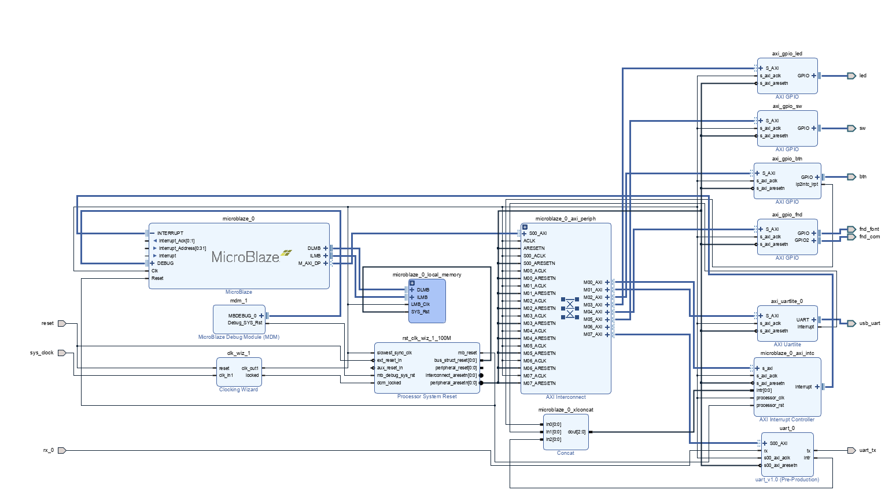
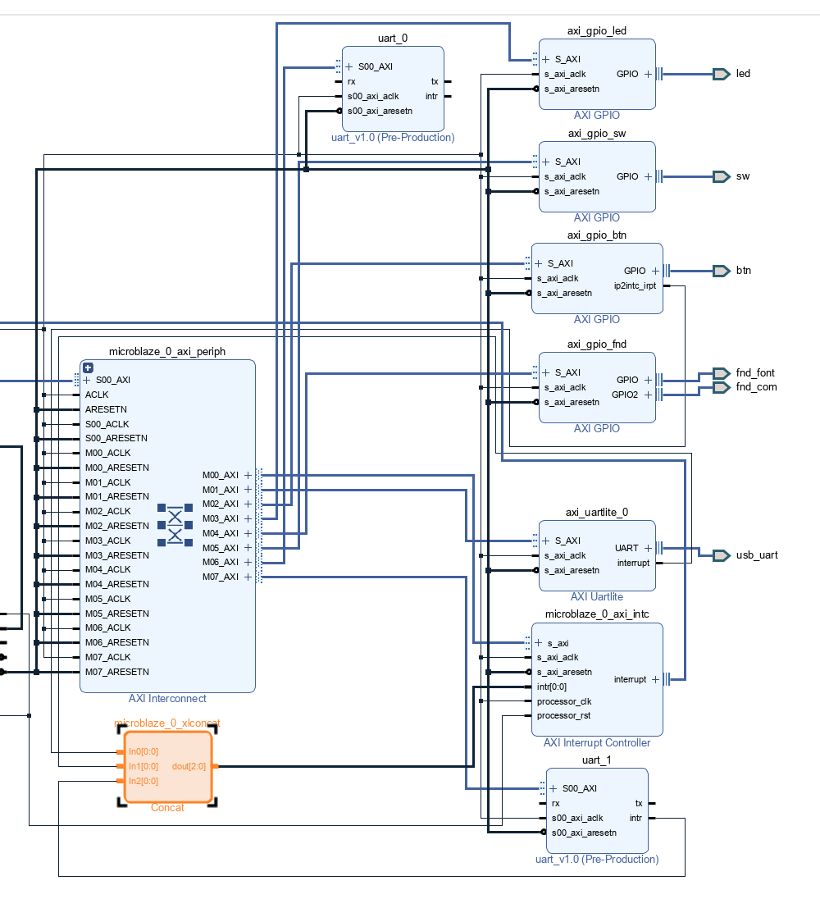
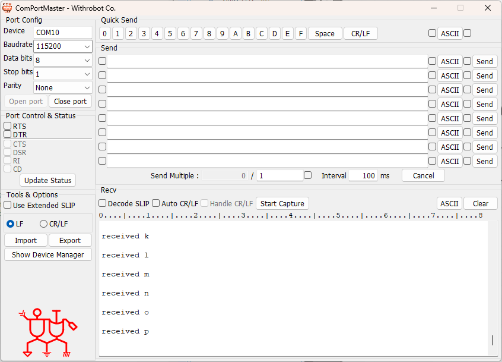

# MicroBlaze_AXI_UART — 직접 만든 UART를 AXI4-Lite IP(+rx 인터럽트)로 패키징해 MicroBlaze에 연결

> 📅 2026-11-24 · 보드: Basys3 · Vivado 2020.2 / Vitis 2020.2 · Verilog + SystemVerilog TB + C · 실습

전날 만든 [UART_AXI](../UART_AXI) 코어(115200bps TX / RX)에 **AXI4-Lite slave 레지스터 4개(SR · TDR · RDR · CR)**를 붙여 `uart_v1.0` IP로 패키징함.
CR bit0을 **rx 인터럽트 enable**로 두고 `intr = rx_ie & rx_done` 출력을 추가해 **AXI Interrupt Controller**에 연결.
Block Design은 MicroBlaze + Xilinx 기본 **AXI GPIO**(LED · SW · BTN · FND) + UART Lite + 직접 만든 UART로 구성하고, Vitis C 드라이버로 PMOD **JB1 → JB2 loopback** 송수신을 보드에서 확인함.
이전 단계: [MicroBlaze_AXI_GPIO](../MicroBlaze_AXI_GPIO) (직접 만든 GPIO IP), [AXI_Lite_template](../AXI_Lite_template)

## 파일 구조

```
MicroBlaze_AXI_UART/
├── ip_repo/uart_1.0/                     # Vivado IP Repository로 등록하는 폴더
│   ├── component.xml                     # IP 패키징 정보 (intr: SENSITIVITY = LEVEL_HIGH)
│   ├── hdl/uart_v1_0.v                   # IP top — S00_AXI + uart 코어, tx / rx / intr 포트
│   ├── hdl/uart_v1_0_S00_AXI.v           # AXI4-Lite slave — SR / TDR / RDR / CR
│   ├── src/uart_review.v                 # UART 코어 (uart, uart_tx, uart_rx)
│   └── drivers/, xgui/, bd/              # IP Packager 생성
├── tb/tb_axi_uart.sv                     # AXI master task로 레지스터 접근, tx→rx loopback PASS/FAIL
├── bd/
│   ├── design_1.bd                       # MicroBlaze Block Design
│   └── design_1_wrapper.v                # HDL wrapper (Vivado 자동 생성, 참고용)
├── constraints/Basys-3-Master.xdc        # LED / SW / BTN / FND / UART Lite / uart_tx(JB1) · uart_rx(JB2)
├── sw/hello_uart/
│   ├── main.c                            # 'a'~'z' 1초마다 송신 → loopback 수신 → xil_printf
│   ├── driver/my_uart/uart.[ch]          # UART_Typedef 구조체 + Transmit / Receive / RxAvailable
│   └── button/button.[ch]                # XGpio 기반 버튼 드라이버 (이번 main에서는 미사용)
└── images/
```

> IP 시뮬레이션 프로젝트(`20261124_axi_uart`)의 `hdl/` 파일은 `ip_repo/uart_1.0/hdl/`과 동일해서 `ip_repo` 쪽만 올림.
> Block Design의 Xilinx IP(MicroBlaze, AXI GPIO, AXI INTC, UART Lite 등)는 `.bd`를 열면 다시 생성됨 (Generate Output Products 필요). Vivado 프로젝트, `.xsa`, Vitis platform/BSP는 올리지 않음.

## 사용 핀

| 포트 | 연결 |
|---|---|
| `sys_clock` | W5 (100 MHz) |
| `reset` | U18 (`btnC`) |
| `led_tri_io[15:0]` | LD0~LD15 |
| `sw_tri_io[15:0]` | SW0~SW15 |
| `btn_tri_io[3:0]` | `btnU` T18, `btnL` W19, `btnR` T17, `btnD` U17 |
| `fnd_font_tri_io[7:0]` / `fnd_com_tri_io[3:0]` | 7-segment 세그먼트 / 자리 선택 |
| `uart_tx` / `uart_rx` | **JB1 (A14) / JB2 (A16)** — 직접 만든 UART, 점퍼로 서로 연결해 loopback |
| `usb_uart_rxd` / `usb_uart_txd` | B18 / A18 — UART Lite (`xil_printf`, 115200 baud) |

---

## IP 구조



### 레지스터 맵

| 레지스터 | offset | 접근 | 내용 |
|---|---|---|---|
| `SR` (status) | `0x00` | R | bit0 `tx_busy`, bit1 `rx_flag` — 레지스터가 아니라 신호를 read data에 직결 |
| `TDR` (tx data) | `0x04` | R/W | write 시 `[7:0]` 저장 + `tx_start` 1클럭 펄스 |
| `RDR` (rx data) | `0x08` | R | `rx_done` 때 `rx_data` 저장. 읽으면 `rx_flag` clear |
| `CR` (control) | `0x0C` | R/W | bit0 = rx 인터럽트 enable (`rx_ie`) |

Vivado 템플릿은 `slv_reg0~3` write를 always 블록 하나에서 처리함 → **레지스터별로 always 블록을 분리**해서 master가 쓰는 레지스터(TDR, CR)와 하드웨어가 쓰는 레지스터(RDR, rx_flag)를 나눔. SR · RDR 주소로 들어온 write는 무시.

```verilog
// TDR: write → tx_start 1클럭 펄스
tx_start_r <= 0;
if (slv_reg_wren && axi_awaddr[ADDR_LSB+OPT_MEM_ADDR_BITS:ADDR_LSB] == 2'h1) begin
    uart_tdr[7:0] <= S_AXI_WDATA[7:0];  // 하위 8bit만 업데이트
    tx_start_r    <= 1;
end

// RDR / rx_flag: 하드웨어가 set, master read가 clear
if (rx_done) begin
    uart_rdr[7:0] <= rx_data;
    rx_flag       <= 1'b1;
end else if (slv_reg_rden && axi_araddr[ADDR_LSB+OPT_MEM_ADDR_BITS:ADDR_LSB] == 2'h2) begin
    rx_flag <= 1'b0;                    // RDR을 읽으면 자동 clear
end

// read mux: SR은 신호를 그대로 조합
2'h0 : reg_data_out <= {{30{1'b0}}, rx_flag, tx_busy};
```

```verilog
// uart_v1_0.v (IP top)
assign intr = rx_ie & rx_done;   // CR bit0이 1일 때만 rx_done 펄스를 인터럽트로
```

- STM32 NVIC에서 인터럽트를 켜고 끄던 것을 **IP 내부 CR 비트**로 구현한 형태
- `intr`은 `rx_done`과 같은 1클럭 펄스. `component.xml`의 인터럽트 인터페이스 sensitivity는 `LEVEL_HIGH`

### 송수신 순서 (SW 관점)



## Simulation

`tb_axi_uart.sv` — DUT `uart_v1_0`의 `tx`와 `rx`를 같은 `loop`에 연결하고, AXI master 동작을 task로 작성해 레지스터 단위로 테스트.

```systemverilog
task axi_writeData(logic [31:0] addr, logic [31:0] data);
    // AW · W 동시에 valid → awready && wready 대기 → valid 내림 → bvalid 대기 → bready 내림
task axi_readData(input logic [31:0] addr, output logic [31:0] data);
    // AR valid → arready 대기 → rvalid 대기 → rdata 캡처

do axi_readData(SR_ADDR, sr); while (sr & (1 << 0));     // tx_busy 해제 대기
axi_writeData(CR_ADDR, 8'h01);                           // rx 인터럽트 enable
axi_writeData(TDR_ADDR, 8'haa);                          // 송신
do axi_readData(SR_ADDR, sr); while (!(sr & (1 << 1)));  // rx_flag 대기
axi_readData(RDR_ADDR, rdata);                           // 수신값 비교 → PASS / FAIL
```

- 1차: `CR = 0x01`, `0xAA` 송신 → 인터럽트 발생 + 데이터 비교
- 2차: `CR = 0x00`, `0x44` 송신 → 인터럽트가 나오지 않아야 하는 경우 (인터럽트는 파형으로 확인)



- 수신 완료 시점(약 82.715us)에 `intr`이 1클럭 High
- 이어지는 SR 폴링에서 `rdata`가 `0x1`(tx_busy) → `0x3`(tx_busy + rx_flag)로 바뀜. RX는 stop bit 중앙에서 끝나고 TX는 stop bit를 끝까지 내보내므로 잠깐 둘 다 1
- `araddr = 8`(RDR) 읽기에서 `0x000000aa` 반환



---

## Block Design



- Run Block Automation에서 **Interrupt Controller** 체크 → `microblaze_0_axi_intc` + `xlconcat`이 자동 생성됨 (Local Memory 128KB, Debug Only, New Clocking Wizard는 이전과 동일)
- GPIO는 직접 만든 IP 대신 **Xilinx AXI GPIO**를 사용: `axi_gpio_led` / `sw` / `btn` / `fnd`(dual channel: font + com)
- 인터럽트 3개를 `xlconcat`으로 묶어 INTC `intr[2:0]`에 연결



| 인터럽트 ID | 소스 |
|---|---|
| 0 | `axi_gpio_btn` `ip2intc_irpt` |
| 1 | `axi_uartlite_0` `interrupt` |
| 2 | `uart_0` `intr` (직접 만든 IP) |

### Address map (`xparameters.h`)

| Slave | Base |
|---|---|
| `axi_gpio_btn` | `0x4000_0000` |
| `axi_gpio_led` | `0x4001_0000` |
| `axi_gpio_fnd` | `0x4002_0000` |
| `axi_gpio_sw` | `0x4003_0000` |
| `axi_uartlite_0` | `0x4060_0000` |
| `microblaze_0_axi_intc` | `0x4120_0000` |
| `uart_0` | `0x44A1_0000` |

---

## Vitis C

### UART 드라이버 (`driver/my_uart`)

STM32 HAL처럼 레지스터 배치를 구조체로 정의하고 base address를 포인터로 캐스팅해 접근.

```c
typedef struct {
    uint32_t SR;    // 0x00
    uint32_t TDR;   // 0x04
    uint32_t RDR;   // 0x08
    uint32_t CR;    // 0x0C
} UART_Typedef;

#define UART0 ((UART_Typedef *) XPAR_UART_0_S00_AXI_BASEADDR)

uint8_t UART_RxAvailable(UART_Typedef* uart) { return (uart->SR & (1 << 1)) ? 1 : 0; }

void UART_Transmit(UART_Typedef* uart, uint8_t tx_data) {
    while (uart->SR & (1 << 0));   // busy면 대기
    uart->TDR = tx_data;           // TDR write = 전송 시작
}

void UART_Receive(UART_Typedef* uart, uint8_t* rx_data) {
    *rx_data = (uint8_t) uart->RDR; // 읽으면 하드웨어가 rx_flag clear
}
```

### main

```c
while (1) {
    UART_Transmit(UART0, tx_data);              // JB1으로 송신
    tx_data = (tx_data == 'z') ? 'a' : tx_data + 1;
    sleep(1);
    if (UART_RxAvailable(UART0)) {              // JB2로 돌아온 데이터
        UART_Receive(UART0, &rx_data);
        xil_printf("received %c\n\r", rx_data); // UART Lite → PC
    }
}
```

- GPIO는 Xilinx 드라이버(`XGpio_Initialize`, `XGpio_SetDataDirection`)로 LED 출력 / SW · BTN 입력 방향만 설정
- 인터럽트 서비스 루틴은 아직 없음 → 수신은 `SR` 폴링

### 보드 결과



JB1–JB2를 점퍼로 연결한 상태에서 ComPortMaster(115200 8N1)에 `received k`, `l`, `m` … 이 1초 간격으로 출력됨 → 직접 만든 UART IP의 송신 · 수신 · SR / RDR 레지스터 동작 확인.

---

## 배운 내용

### 레지스터 성격에 따라 always 블록 분리
- 템플릿처럼 모든 레지스터를 한 always 블록에서 쓰면 "master만 쓰는 레지스터"가 전제됨
- status / rx data처럼 **하드웨어가 갱신하는 레지스터**가 생기면 레지스터마다 always 블록을 나누고, 누가 언제 쓰는지(write 금지 / read 시 clear 등)를 블록별로 명확히 하는 편이 안전

### 인터럽트 enable을 IP 안에
- MCU의 peripheral 인터럽트 enable 비트처럼, CR 비트로 인터럽트 출력을 마스킹
- IP 밖에서는 AXI Interrupt Controller가 여러 인터럽트를 모아 MicroBlaze `INTERRUPT` 하나로 전달 → Block Automation에서 Interrupt Controller를 선택하면 `xlconcat`까지 자동 구성

### Xilinx 기본 IP 활용
- AXI GPIO는 dual channel(GPIO / GPIO2)과 인터럽트 출력(`ip2intc_irpt`)을 지원 → FND font / com을 IP 하나로 처리
- `xparameters.h`에 base address, device ID, 인터럽트 vector ID(`XPAR_INTC_0_UART_0_VEC_ID` 등)가 자동 생성됨 → C에서는 이 매크로만 참조
