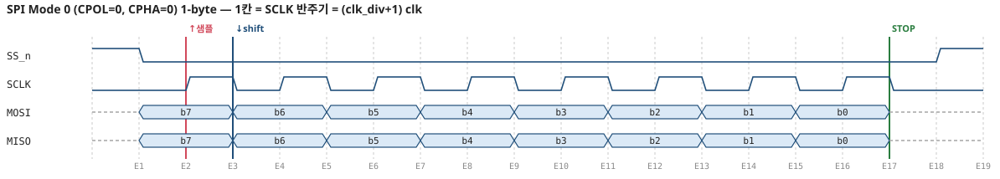
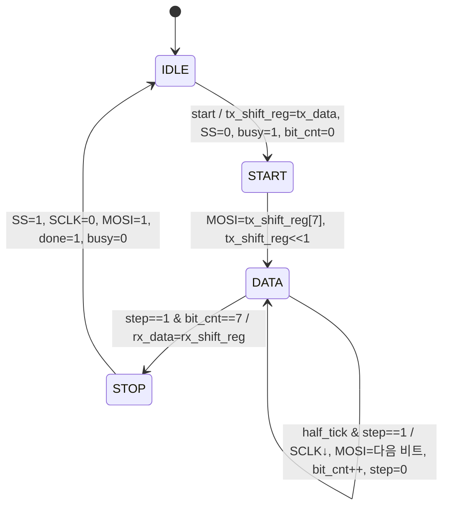
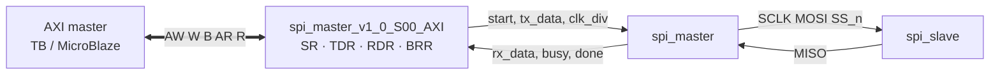
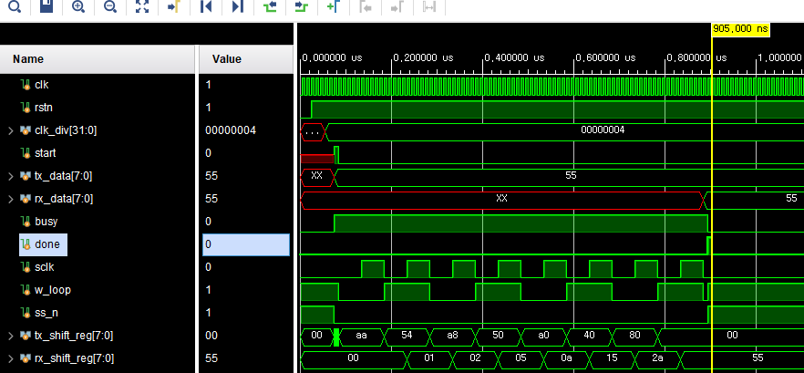
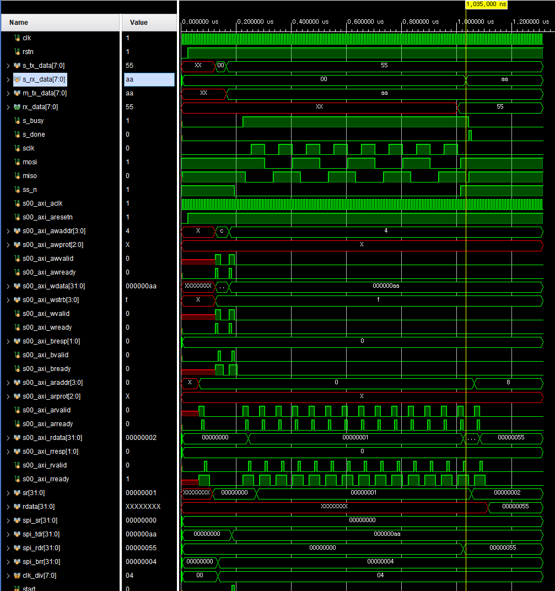

# SPI_AXI — SPI master / slave (Mode 0) + AXI4-Lite 래퍼

> 📅 2026-11-25 · 보드: Basys3 (xc7a35tcpg236-1) · Vivado 2020.2 · Verilog / SystemVerilog · 실습

시리얼 통신 3종(UART / SPI / I2C)을 비교하고 **SPI Mode 0 (CPOL=0, CPHA=0)** master를 수업에서 함께 설계함.
master에 맞춰 **SPI slave**(2FF synchronizer + SCLK edge 검출)와 **AXI4-Lite 래퍼**(`SR` · `TDR` · `RDR` · `BRR`)를 따로 작성하고,
AXI master 모사 TB → AXI SPI master → SPI slave 경로로 1바이트 full-duplex 교환을 확인함.
AXI 래퍼 구조는 [MicroBlaze_AXI_UART](../MicroBlaze_AXI_UART)와 같은 방식.
MicroBlaze + FND 과제는 별도 레포에서 진행.

## 파일 구조

```
SPI_AXI/
├── src/
│   ├── spi_master.v              # SPI master — half_tick 분주, IDLE/START/DATA/STOP FSM
│   ├── spi_slave.v               # SPI slave — 2FF sync, SCLK rising/falling 검출
│   ├── axi_temp_v1_0.v           # module spi_master_v1_0 — AXI 래퍼 top (S00_AXI + spi_master)
│   └── axi_temp_v1_0_S00_AXI.v   # module spi_master_v1_0_S00_AXI — 레지스터 4개
├── tb/tb_spi_master.sv           # TB 3개: tb_spi_master / tb_spi_master_slave / tb_spi_axi_master_slave
└── images/
```

> 파일명은 IP 템플릿(`axi_temp`) 그대로이고 모듈명만 `spi_master_v1_0*`로 바꾼 상태.
> 제약 파일 없음 — 시뮬레이션만 수행. Block Design(`design_1`)은 비어 있어 제외.

| 구분 | 내용 |
|---|---|
| 수업에서 함께 작성 | SPI 이론, `spi_master.v`, `tb_spi_master` (MOSI–MISO loopback) |
| 개인 구현 | `spi_slave.v`, AXI4-Lite 래퍼 (`spi_master_v1_0`, `_S00_AXI`), `tb_spi_master_slave`, `tb_spi_axi_master_slave` |

---

## 시리얼 통신 비교

| | UART | SPI | I2C |
|---|---|---|---|
| 특징 | 가장 오래되고 단순함 | 3개 중 가장 빠름 (수 ~ 수십 Mbps) | 느리지만 확장성 좋음 |
| 동기 | 비동기 (baud rate 약속) | 동기 (master가 SCLK 공급) | 동기 |
| 주 용도 | 디버그 콘솔, 모듈 간 통신 | 메모리, 디스플레이 등 속도가 필요한 slave | 측정 주기가 긴 센서, 실시간성이 필요 없는 메모리 |

## SPI

- **동기식 직렬 통신**: master가 SCLK를 만들고 양쪽이 그 클럭을 기준으로 송수신함. SPI에서 master는 SCLK를 발생시키는 쪽
- **Full duplex**: MOSI와 MISO가 따로 있어서 송신과 수신이 동시에 일어남
  → master가 slave 데이터를 읽으려면 MOSI로 무언가(dummy data)를 보내야 MISO로 데이터가 들어옴
- **1:N**: slave 수는 SS 핀 수만큼. 통신할 때는 slave 하나만 활성화해서 데이터 출처를 구분함
- 노이즈에 약해서 PCB 안 칩 사이처럼 짧은 거리에 적합함. 배선이 15cm를 넘으면 중간에 buffer를 다는 편이 안정적 (선 저항으로 전압 강하)

| 신호 | 방향 | 역할 |
|---|---|---|
| `SCLK` | master → slave | 동기 클럭, 송수신 타이밍 |
| `MOSI` | master → slave | Master Out Slave In |
| `MISO` | slave → master | Master In Slave Out |
| `SS_n` (CS) | master → slave | slave 선택, **active low** |

### CPOL / CPHA

| 설정 | 0 | 1 |
|---|---|---|
| CPOL (SPO, polarity) | SCLK idle = Low | SCLK idle = High |
| CPHA (SPH, phase) | SCLK **첫 번째** edge에서 샘플 | SCLK **두 번째** edge에서 샘플 |

조합으로 Mode 0 ~ 3이 나오고, 일반적으로 **Mode 0 (CPOL=0, CPHA=0)** 을 가장 많이 씀 → 이번 구현도 Mode 0.



| 시점 | 하는 일 | MOSI / MISO |
|---|---|---|
| 상승 edge (샘플) | 상대 비트를 읽어 shift register LSB로 넣음 | 그대로 유지 |
| 하강 edge (shift) | 다음 MSB를 출력 | 여기서 바뀜 |

- MSB first. master와 slave의 shift register가 하나의 링처럼 8번 돌고 나면 서로 값이 바뀌어 있음
- 첫 비트(b7)는 SCLK edge 전에 미리 나가 있어야 함 → 양쪽 FSM 모두 `START` 상태에서 b7을 먼저 내보냄
- 그림은 `spi_master.v` 기준으로 그린 것 (1칸 = `half_tick` 간격)

---

## SPI master — `spi_master.v`

| 포트 | 방향 | 설명 |
|---|---|---|
| `clk_div[7:0]` | in | SCLK 분주값 (`START`에서 `clk_div_r`로 래치) |
| `start` | in | 1클럭 펄스로 전송 시작 (`IDLE`에서만 반응) |
| `tx_data[7:0]` / `rx_data[7:0]` | in / out | 송신 / 수신 바이트 |
| `busy` / `done` | out | 전송 중 / 완료 1클럭 펄스 |
| `sclk`, `mosi`, `miso`, `ss_n` | | SPI 외부 포트 |

### 분주

`half_tick`은 `clk_div + 1` 클럭마다 1이 되고, 그때마다 SCLK가 토글됨.

```
SCLK    = sysclk / (2 * (clk_div + 1))
clk_div = sysclk / (2 * SCLK) - 1

clk_div = 4  → 100MHz / 10  = 10 Mbps   (TB 설정)
clk_div = 49 → 100MHz / 100 = 1 Mbps
```

### FSM



```verilog
DATA: begin
    if (half_tick) begin
        sclk_r <= ~sclk_r;
        if (step == 1'b0) begin                        // SCLK 0→1 : 수신
            step         <= 1;
            rx_shift_reg <= {rx_shift_reg[6:0], miso};
        end else begin                                 // SCLK 1→0 : 송신
            step         <= 0;
            mosi_r       <= tx_shift_reg[7];
            tx_shift_reg <= {tx_shift_reg[6:0], 1'b0};
            bit_cnt      <= bit_cnt + 1;
            if (bit_cnt == 7) begin                    // START 1bit + DATA 7bit
                state     <= STOP;
                rx_data_r <= rx_shift_reg;
            end
        end
    end
end
```

- `step` 한 비트로 같은 `half_tick`을 수신 차례 / 송신 차례로 나눔 → edge 종류를 따로 검출할 필요 없음
- `half_tick_cnt`는 `IDLE`이 아닐 때만 셈 → 전송이 없을 때 SCLK가 멈춰 있음
- `rx_data`는 8번째 하강 edge에서 한 번에 갱신 → 전송 중 중간값이 밖으로 보이지 않음

---

## SPI slave — `spi_slave.v`

slave는 SCLK를 받는 쪽이라서 SCLK를 클럭으로 쓰지 않고 **시스템 클럭으로 SCLK를 샘플링해 edge를 검출**함.

```verilog
// 2FF synchronizer — sclk, mosi, ss_n 모두 동일하게
sclk_sync0 <= sclk;   sclk_sync <= sclk_sync0;

// DATA 상태: 직전 값과 비교해 edge 검출
prev_sclk <= sclk_sync;
case ({prev_sclk, sclk_sync})
    2'b01: rx_shift_reg <= {rx_shift_reg[6:0], mosi_sync};   // rising → 수신
    2'b10: begin                                             // falling → 송신
        miso_r       <= tx_shift_reg[7];
        tx_shift_reg <= {tx_shift_reg[6:0], 1'b0};
        bit_cnt      <= bit_cnt + 1;
        if (bit_cnt == 7) begin state <= STOP; rx_data_r <= rx_shift_reg; end
    end
endcase
```

- FSM은 master와 같은 IDLE / START / DATA / STOP 모양. `IDLE`에서 `ss_n_sync == 0`이면 `tx_data` 래치 → `START`에서 b7을 MISO에 출력
- `DATA` 도중 `ss_n_sync`가 1이 되면 `IDLE`로 복귀 → 전송이 중간에 끊겨도 다음 전송을 처음부터 받음
- `mosi`도 `sclk`와 같은 2단 동기화를 거침 → 두 신호의 지연이 같아서 rising edge에서 읽는 MOSI 값이 어긋나지 않음
- 시스템 클럭으로 SCLK를 샘플링하므로 SCLK가 시스템 클럭보다 충분히 느려야 함 (TB는 `clk_div = 4`, 10Mbps)

> 참고: `clk_div`는 **3 이상**이어야 합니다 (코드 기준 계산, 시뮬레이션으로는 미확인).
> slave는 SCLK 하강을 2FF sync + `prev_sclk` 비교로 검출하므로, master가 SCLK를 내린 뒤 약 3클럭 후에 `miso_r`을 갱신합니다.
> master는 하강 후 `clk_div + 1` 클럭 뒤 다음 `half_tick`(상승)에서 `miso`를 샘플하므로, `clk_div ≤ 2`이면 갱신 전 이전 비트를 읽게 됩니다.
> 첫 비트도 같은 조건입니다 (`ss_n` 동기화 2클럭 + `IDLE → START → miso` 출력).
> 속도를 더 올리려면 slave 동기화 지연을 줄이거나, master 샘플 시점을 늦추는 방식이 필요합니다.

---

## AXI4-Lite 래퍼 — `spi_master_v1_0`



| offset | 이름 | 접근 | 내용 |
|---|---|---|---|
| `0x00` | `SR` | R | bit0 `busy`, bit1 `done` (master 신호를 그대로 읽음) |
| `0x04` | `TDR` | R/W | [7:0] 송신 바이트. **write 하면 `start` 1클럭 펄스** → 전송 시작 |
| `0x08` | `RDR` | R | [7:0] 수신 바이트. master `done` 때 갱신 |
| `0x0C` | `BRR` | R/W | [7:0] `clk_div` (baud rate) |

```verilog
// TDR write = 전송 시작
start_r <= 0;
if (slv_reg_wren && axi_awaddr[3:2] == 2'h1) begin
    spi_tdr[7:0] <= S_AXI_WDATA[7:0];   // 하위 8bit만
    start_r      <= 1;                   // 다음 클럭에 0으로 복귀 → 1클럭 펄스
end

// done이 오면 수신 바이트 저장
if (done) spi_rdr[7:0] <= rx_data;

// read mux
2'h0 : reg_data_out <= {{30{1'b0}}, done, busy};
```

- Vivado AXI4-Lite 템플릿의 handshake(`aw_en`, `axi_*ready`, `bvalid`, `rvalid`)는 그대로 두고 레지스터 부분만 바꿈 ([AXI_Lite_template](../AXI_Lite_template) 참고)
- 템플릿의 `slv_reg0~3` 일괄 write 대신 레지스터마다 always 블록을 나눔 → write 가능한 레지스터는 `TDR`, `BRR`뿐
- 사용 순서: `BRR` 설정 → `SR.busy == 0` 확인 → `TDR` write → `SR.done` 폴링 → `RDR` read

---

## Simulation

`tb/tb_spi_master.sv` 한 파일 안에 TB 모듈 3개. Simulation top을 바꿔 가며 실행 (마지막 설정은 `tb_spi_axi_master_slave`).

| TB | 구성 | 시나리오 |
|---|---|---|
| `tb_spi_master` | master 단독, `mosi`–`miso` loopback | `0x55`, `0xAA`, `0x11`, `0xCC`, `0x66` 송신 → 보낸 값이 그대로 수신되는지 |
| `tb_spi_master_slave` | master ↔ slave 직결 | `$urandom` 바이트 100회 교환, 양방향 비교 PASS / FAIL 출력 |
| `tb_spi_axi_master_slave` | AXI 래퍼 ↔ slave | `SR` 폴링 → `BRR=4` → `TDR=0xAA` (slave tx `0x55`) → `SR.done` 폴링 → `RDR` read, 비교 |

### `tb_spi_master` — loopback



`tx_shift_reg`가 `aa → 54 → a8 → …`로 왼쪽 shift되고, 같은 비트가 `rx_shift_reg`에 `01 → 02 → 05 → …`로 쌓여 8비트 후 `rx_data = 0x55`가 됨. SCLK 8주기 동안 `ss_n = 0`, `busy = 1`.

### `tb_spi_axi_master_slave` — AXI 경유



- `BRR = 4` write 후 `TDR = 0xAA` write → `start` 펄스, SCLK 8주기
- `SR` read 값 `0x0` → `0x1`(busy) → `0x2`(done)
- 전송 후 slave `s_rx_data = 0xAA`, master 쪽 `RDR = 0x55` → 양방향 교환 확인

> `tb_spi_master_slave`(랜덤 100회)는 실행 로그가 남아 있지 않음 (2026-11-25 기준).

---

## 배운 내용

### 동기식 통신에서 master의 의미
- SPI에서 master는 "누가 명령하느냐"가 아니라 **SCLK를 누가 만드느냐**로 정해짐
- full duplex라서 읽기만 하고 싶어도 dummy byte를 보내야 함 → 읽기와 쓰기가 항상 한 트랜잭션

### Mode 0 한 비트의 흐름
- 하강 edge에서 데이터를 바꾸고 상승 edge에서 읽음 → 읽는 시점에는 반주기 동안 값이 안정되어 있음
- 첫 비트는 edge 없이 SS가 내려간 직후 나가야 해서 FSM에 `START` 상태를 따로 둠

### master와 slave의 구현 차이
| | master | slave |
|---|---|---|
| SCLK | `half_tick`으로 직접 생성 | 시스템 클럭으로 샘플링 |
| edge 판단 | `step` 플래그 (내가 만든 edge라 이미 앎) | `{prev_sclk, sclk_sync}` 비교 |
| 입력 동기화 | 불필요 (자기 클럭 도메인) | `sclk`, `mosi`, `ss_n` 2FF |
| 시작 조건 | `start` 펄스 | `ss_n` 하강 |

### Verilog 모듈을 Block Design에 바로 추가
- IP로 패키징하지 않아도 Block Design 빈 곳 우클릭 → **Add Module**로 RTL 모듈을 블록으로 넣을 수 있음 (module reference)
- 빠르게 연결을 확인할 때 쓰고, 최종 과제는 AXI 래퍼를 IP로 패키징해서 사용할 예정
