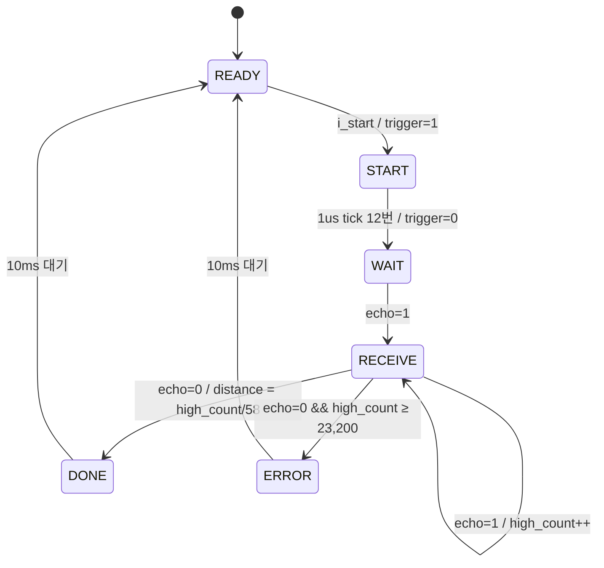

# SR04_controller — HC-SR04 초음파 거리 센서 컨트롤러

> 📅 2026-08-12 · 보드: Basys3 · Vivado 2020.2 · 미니 프로젝트 2 준비

HC-SR04 초음파 센서를 FPGA에서 직접 제어하는 FSM 컨트롤러.
버튼을 누르면 **10us 이상 trigger 펄스**를 내보내고, **echo가 HIGH인 시간을 1us 단위로 세어** `us / 58 = cm`로 거리를 계산해 FND에 표시함.
비동기 입력인 echo는 **F/F 2단 synchronizer**로 clk에 맞춤.

## 파일 구조

```
SR04_controller/
├── src/
│   ├── top_sr04.v          # 버튼 디바운서 + echo synchronizer + 컨트롤러 + FND
│   ├── sr04_controller.v   # sr04_controller(FSM), tick_gen_1Mhz, *_example(수업 예제)
│   ├── fnd_controller.v    # fnd_in 9bit로 확장
│   └── btn_debouncer.v
└── tb/tb_sr04_controller.v # echo 모사 task + 반복 측정
```

## 사용 핀

| 포트 | 연결 |
|---|---|
| `btn_D` | 측정 시작 버튼 |
| `trigger` | Pmod JA4 → SR04 Trig |
| `echo` | Pmod JA3 ← SR04 Echo |
| SR04 VCC / GND | Pmod JA6 / JA5 |
| `led[0]` | ready (측정 가능) |
| `led[1]` | error (측정 실패 / 범위 초과) |
| `fnd_com`, `fnd_data` | 거리(cm) 표시 |

---

## HC-SR04 동작

```
trigger  __|‾‾‾‾‾‾|______________________________________
            ≥10us
echo     __________________|‾‾‾‾‾‾‾‾‾‾‾‾‾‾‾‾|____________
                            ← 왕복 시간 t →
distance(cm) = t(us) / 58
```

- trigger 최소 10us → 센서가 40kHz 초음파 8펄스 발사
- echo HIGH 길이 = 음파 왕복 시간. 측정 범위 2 ~ 400cm (≈ 23,200us)
- echo가 끝나고 다음 trigger까지 최소 10ms 간격 필요

## FSM



| 상태 | 동작 | 출력 |
|---|---|---|
| READY | 시작 대기 | `o_ready = 1` |
| START | 1us tick 12번 동안 trigger HIGH (≥ 10us 여유) | `trigger = 1` |
| WAIT | echo 상승 대기 | |
| RECEIVE | echo HIGH 동안 1us마다 카운트 | |
| DONE | 거리 계산, 10ms 대기 (센서 재측정 간격) | `o_done` 1clk |
| ERROR | 400cm 초과 → 거리 0, 10ms 대기 | `o_error = 1` |

```verilog
RECEIVE: if (w_tick_1us) begin
    if (echo == 1) high_count_next = high_count_reg + 1;
    else if (high_count_reg >= 23_199) begin          // 400cm 초과
        n_state = ERROR; distance_next = 0; ...
    end else begin
        n_state = DONE;
        distance_next = high_count_reg / 58;          // us → cm
        ...
    end
end
```

- `tick_gen_1Mhz`: 100MHz를 100 clk마다 1clk tick → **1us 해상도**

### echo synchronizer

```verilog
always @(posedge clk, posedge reset)
    if (reset) begin echo_reg <= 0; echo_sync <= 0; end
    else       begin echo_reg <= echo; echo_sync <= echo_reg; end
```

- 센서 출력은 FPGA clk과 무관한 **비동기 신호** → 그대로 FSM에 넣으면 metastable 위험 → F/F 2단으로 동기화 (2clk 지연은 1us 해상도에 비해 무시 가능)

## Simulation

```verilog
task SRO4_TASK(input [..] wait_time, input [..] high_time);   // us 단위
    begin
        @(negedge clk) i_start = 1;  @(negedge clk) i_start = 0;
        @(negedge trigger);                 // trigger 끝난 뒤
        #(wait_time * 1_000);  echo = 1;    // wait_time 후 echo 시작
        #(high_time * 1_000);
        @(negedge clk) echo = 0;
    end
endtask

SRO4_TASK(200, 580);    // 580us → 10cm 기대
```

| 구간 | 확인 |
|---|---|
| READY → START | `i_start` 즉시 `n_state` 변경, 다음 posedge에 trigger 1 |
| START | trigger 약 11us 이상 유지 → 센서 요구(10us) 만족 |
| WAIT | 테스트벤치 wait_time(200us) 동안 유지 |
| RECEIVE → DONE | 580us 카운트 → `distance = 10` |
| DONE → READY | 10,000us 후 복귀 |

- echo를 negedge에 내리기 때문에 마지막 tick에서 약 1us 오차가 보이지만, 그 1us는 echo가 0이라 카운트되지 않음

## 트러블슈팅

- 처음 버전은 WAIT / RECEIVE에서 **전체 대기 시간(60ms) 타임아웃**을 별도 카운터로 셌음 → 카운터가 늘며 타이밍 여유(WNS)가 0 근처까지 감소
- RECEIVE의 범위 판정을 **echo가 끝날 때 high_count로 한 번만** 하도록 바꾸고 타임아웃 카운터 제거 (코드에 주석으로 남김)
- trigger 카운트를 10 → 11(12회)로 늘려 10us 최소 조건에 여유 확보

---

## 배운 내용

- **센서 데이터시트 → 타이밍 요구사항 → FSM 상태**로 옮기는 순서 (trigger 폭, echo 측정, 재측정 간격, 측정 범위)
- 외부 비동기 입력은 반드시 synchronizer를 거친 뒤 사용
- 나눗셈(`/ 58`)은 조합논리가 커서 timing에 영향 → 상태 전이 시점에 한 번만 계산하고 레지스터에 저장
- Basys3 **Pmod 커넥터**(JA/JB/JC, 12핀: 신호 8 + VCC/GND 2쌍)로 외부 센서 연결
