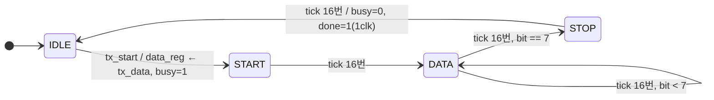
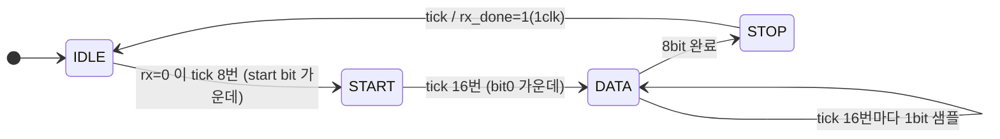
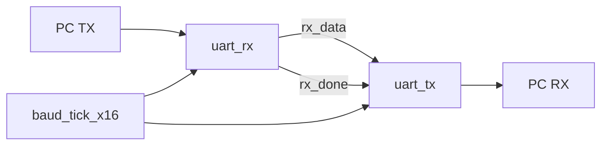

# UART — 9600bps UART TX / RX와 PC loopback

> 📅 2026-08-05 ~ 06 · 보드: Basys3 · Vivado 2020.2 · 과제 9

PC(ComPortMaster)와 Basys3 사이 **UART 통신**을 직접 구현.
TX는 상태마다 비트를 하나씩 내보내는 11상태 FSM으로 시작해 `IDLE / START / DATA / STOP` 4상태 + 카운터 구조로 줄였고,
RX는 **baud rate × 16 오버샘플링**으로 각 비트의 가운데를 읽도록 설계. 마지막에 RX로 받은 바이트를 그대로 TX로 돌려보내는 loopback으로 보드 검증.

## 파일 구조

```
UART/
├── src/
│   ├── uart_tx.v          # uart_controller(top), uart_tx, uart_tx_origin(11상태 버전),
│   │                      # baud_tick_x16, baud_tick, baud_tick_origin
│   ├── uart_rx.v          # uart_rx (x16 오버샘플링)
│   ├── uart_loop_back.v   # rx_done → tx_start 연결
│   └── btn_debouncer.v
└── tb/tb_uart.v
```

## 사용 핀 / 설정

| 항목 | 설정 |
|---|---|
| `clk` | 100MHz (W5) |
| `rx` | B18 (USB-UART 브리지 칩 → FPGA) |
| `tx` | A18 (FPGA → USB-UART 브리지 칩) |
| PC 설정 | 9600 bps, 8 data bit, parity none, 1 stop bit (8N1) |

---

## UART 프레임

```
 idle ‾‾‾‾‾\_____/‾‾‾‾\____/ ... \_____/‾‾‾‾‾‾‾‾ idle
           START  D0   D1   ...   D7   STOP
             0   (LSB first)           1
```

| 구간 | 값 | 의미 |
|---|---|---|
| idle | 1 | 쓰지 않을 때는 항상 HIGH |
| start | 0 | HIGH → LOW로 "전송 시작" 알림 |
| data | 8bit | **LSB first** → 받는 쪽은 오른쪽 shift로 SIPO |
| stop | 1 | 다시 HIGH. 보통 1bit |

- 9600bps → 1bit = 1/9600s ≈ **104.16us** = 100MHz 기준 10,416 clk

## TX

### 1차: 비트마다 상태 (`uart_tx_origin`)

`IDLE → START → BIT_0 → ... → BIT_7 → STOP` 11상태, baud tick마다 다음 상태로.
동작은 하지만 상태가 많고, 전송 도중 `tx_data`가 바뀌면 **바뀐 값이 그대로 섞여 나가는** 문제가 있음.

### 2차: 4상태 + 카운터 (`uart_tx`)



```verilog
DATA: begin
    if (i_baud_tick) begin
        if (tick_count_reg == 0) begin
            tx_next   = data_reg[0];               // LSB부터 출력
            data_next = {1'b0, data_reg[7:1]};     // 오른쪽 shift (PISO)
        end
        if (tick_count_reg >= 15) begin
            tick_count_next = 0;
            if (bit_count_reg >= 7) n_state = STOP;
            else bit_count_next = bit_count_reg + 1;
        end else tick_count_next = tick_count_reg + 1;
    end
end
```

| 개선 | 내용 |
|---|---|
| `data_reg` | `tx_start` 순간 `tx_data`를 내부 레지스터에 저장 → 전송 중 입력이 바뀌어도 안전 |
| `tx_busy` | START ~ STOP 동안 1 → 상위 모듈이 새 데이터를 보내면 안 되는 구간 |
| `tx_done` | STOP 끝나는 순간 1clk tick → "다음 데이터 줘" |
| x16 tick 공유 | RX와 같은 x16 tick 사용, 16번 세면 1bit. `tx_start` 후 baud tick을 기다리는 WAIT 상태 제거 (오차 최대 1/16bit) |

## RX — x16 오버샘플링

비동기 신호를 언제 읽을지가 핵심. 비트가 바뀌는 순간에 읽으면 **metastable**, 너무 자주 읽어도 경계에서 흔들림.
→ baud tick을 16배로 만들어 **각 비트의 가운데(8번째 tick)** 에서 읽음.



```verilog
// DATA: tick_count == 0 인 순간 = 비트 가운데 → MSB 쪽으로 넣고 오른쪽으로 밀기
if (tick_count == 0) data_next = {rx, data_reg[7:1]};
```

```verilog
// 100MHz / (9600 × 16) ≈ 651 clk 마다 1 tick
parameter F_COUNT = 100_000_000 / (9600 * 16);
assign counter_next = (counter_reg == F_COUNT - 1) ? 0 : counter_reg + 1;   // CL로 분리
assign o_baud_tick  = (counter_reg == F_COUNT - 1);
```

## Loopback



## 트러블슈팅

| 증상 | 원인 | 해결 |
|---|---|---|
| RX 결과 LED가 안 보임 | IDLE에서 `data_next = 0`으로 초기화 → 받자마자 지워짐 | 초기화 삭제, 마지막 수신값 유지 |
| RX 값이 이상함 | shift를 `{rx, data_reg[6:0]}`로 잘못 씀 | `{rx, data_reg[7:1]}` (LSB를 버려야 shift) |
| loopback 시 `1`(0x31) → `b`(0x62), 값이 2배 | TX의 shift가 `tick_count == 15` 블록 안에 있어 출력 전에 한 번 더 밀림 | shift를 `tick_count == 0` 시점으로 이동 |
| 전송 중 데이터 오염 | `tx_data`를 직접 사용 | `tx_start` 때 `data_reg`에 래치 |

---

## 배운 내용

### 직렬 vs 병렬, 동기 vs 비동기

| | 직렬 | 병렬 |
|---|---|---|
| 선 | 1개 | 여러 개 |
| 문제 | — | 선 간 crosstalk, 도착 시간 차 → 장거리 불가 |
| 예 | UART, USB, SATA, I2C, SPI, Ethernet, PCIe(lane), SerDes | 칩 내부 버스(AHB, AXI), DDR |

| | 동기식 | 비동기식 |
|---|---|---|
| clock | 공유 (edge 또는 level에서 샘플) | 없음 → **baud rate를 미리 약속**, start/stop bit로 프레임 구분 |
| 로직 | 단순 | 타이밍을 직접 맞춰야 해서 복잡 |
| 예 | I2C, SPI | UART, USB, Ethernet |

- **half duplex**: 선 1개를 번갈아 사용 (양쪽이 동시에 구동하면 multiple driver) / **full duplex**: TX, RX 선을 분리해 동시 송수신 (UART)
- 기기끼리 **GND를 꼭 공유** — 기준 전압이 다르면 1/0을 다르게 인식
- 최근 I/O는 CMOS push-pull 3.3V: PMOS가 High로 밀고(push) NMOS가 Low로 당김(pull)

### Parity bit

- even: 패리티 포함 1의 개수가 짝수 / odd: 홀수. XOR로 계산
- 오류 **검출만** 가능 (2bit 동시에 바뀌면 못 잡음) → 요즘은 CRC 사용

### ASM (Algorithmic State Machine) chart

- 상태(사각형) · 조건(마름모) · Moore 출력(상태 안) · Mealy 출력(조건 뒤 타원)으로 FSM을 문서화
- 알고리즘 → 의사코드 → ASM chart → 코드 순으로 설계하면 빠진 전이를 찾기 쉬움

### FPGA 구조

- **CLB** = LUT(진리표를 저장한 작은 RAM, 조합논리) + F/F(순차논리) + MUX(둘 중 무엇을 내보낼지)
- 배선 자원, BRAM, clocking, I/O 블록(ESD 보호 다이오드)
- SRAM 기반이라 전원이 꺼지면 설정이 사라짐 → 켤 때 외부 flash에서 bitstream을 다시 읽음
- Vivado의 auto P&R이 LUT/FF 배치(placement)와 배선(routing)을 타이밍 제약에 맞춰 자동 수행
- CPU는 소수의 연산기로 순차 처리, FPGA는 많은 연산기로 **병렬 처리** → 낮은 clk으로도 비슷한 처리량
