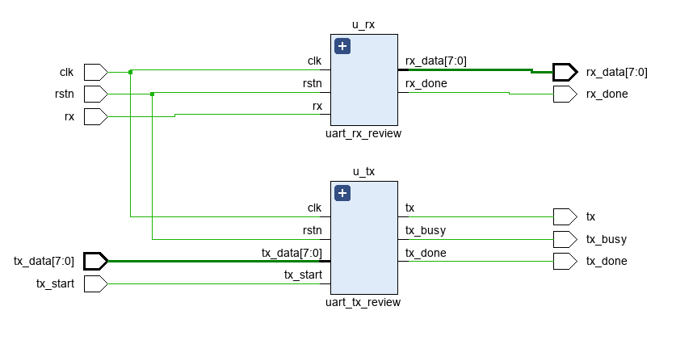
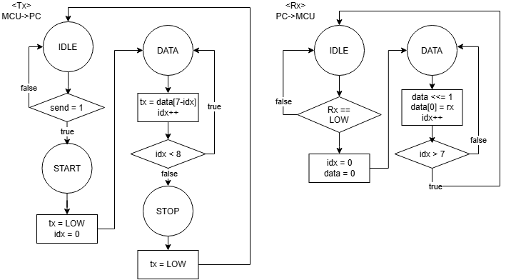
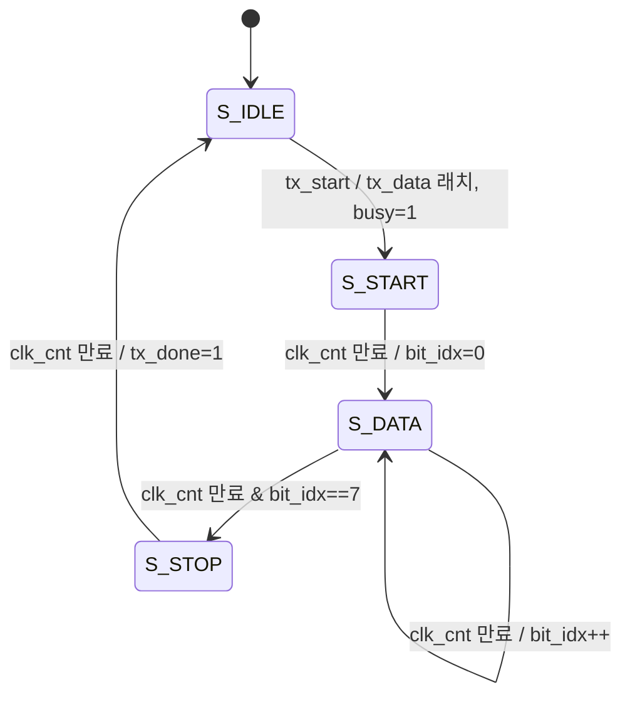
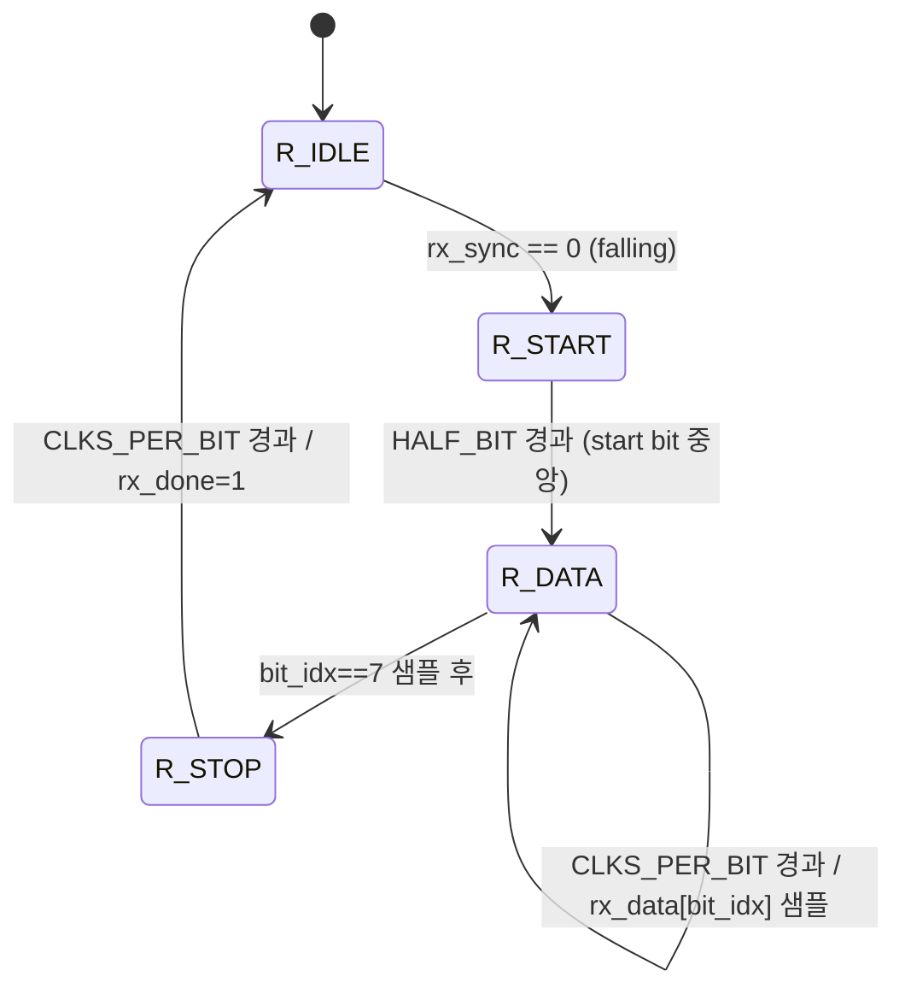
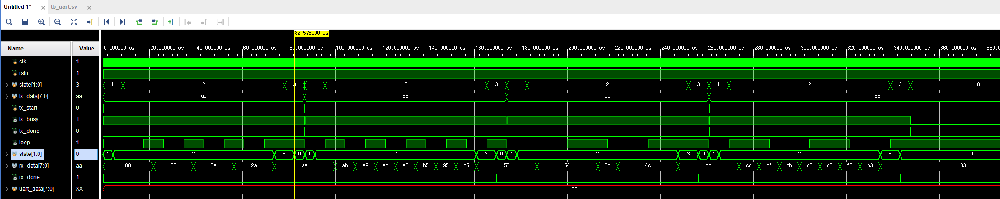
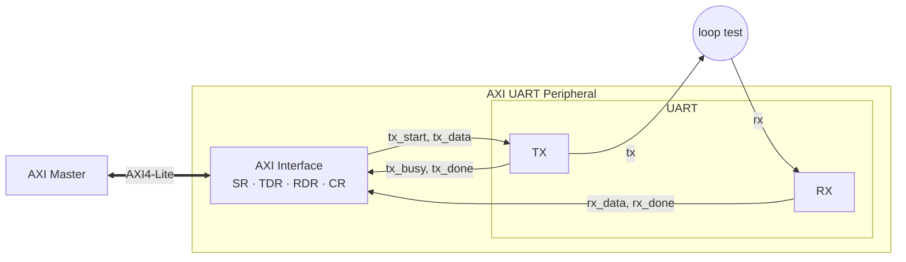

# UART_AXI — AXI UART peripheral용 UART 코어 재작성 (115200bps TX / RX)

> 📅 2026-11-23 · 보드: Basys3 (xc7a35tcpg236-1) · Vivado 2020.2 · Verilog / SystemVerilog · 실습

AXI4-Lite UART peripheral을 만들기 전 단계로 **UART TX / RX 코어를 다시 작성**함.
08월 [UART](../UART)는 9600bps · x16 오버샘플링 구조였고, 이번에는 `CLK_FREQ`, `BAUD_RATE`를 **parameter**로 받는 115200bps 코어로
클럭 카운터 기반 **비트 중앙 샘플링** + 2단 **synchronizer**를 적용. TX 출력을 RX 입력에 바로 연결한 loopback TB로 4바이트 송수신 확인.
AXI 레지스터 쪽 설계(SR / TDR / RDR)는 다음 날 작업으로 이어짐.

## 파일 구조

```
UART_AXI/
├── src/
│   ├── uart_review.v   # uart(top), uart_tx_review, uart_rx_review — 115200bps, parameter화
│   └── uart.sv         # 1차 초안 (SV): tick_gen + uart_tx + uart_rx (x16 tick), top에서 사용 안 함
├── tb/tb_uart.sv       # tx → rx loopback, 0xAA / 0x55 / 0xCC / 0x33 전송
└── images/
```

> 제약 파일 없음 — 시뮬레이션만 수행한 상태.

---

## 구조



`uart` top은 `uart_tx_review`, `uart_rx_review`를 감싸기만 하고, 내부 신호(`tx_start`, `tx_data`, `tx_busy`, `tx_done`, `rx_data`, `rx_done`)는 그대로 밖으로 냄 → 나중에 AXI slave 레지스터에 바로 연결하기 위한 인터페이스.

| parameter | 기본값 | 파생값 |
|---|---|---|
| `CLK_FREQ` | 100_000_000 | |
| `BAUD_RATE` | 115_200 | `CLKS_PER_BIT = 868` (1bit ≈ 8.68us) |
| | | `HALF_BIT = 434` (RX 시작 비트 중앙까지) |

## 1차 초안 → 재작성



처음 그린 TX / RX ASM. 상태 전이와 `idx++`가 **매 클럭** 일어나도록 그려서 baud rate 개념이 빠져 있었음
→ "baud rate에 맞게 상태 전이 및 idx 증가 처리", "RX는 metastability를 고려해 비트 중앙값을 읽을 것"이라는 피드백을 받고 다시 작성.

| | `uart.sv` (초안) | `uart_review.v` (재작성) |
|---|---|---|
| 언어 | SystemVerilog (`logic`, `typedef enum`, `always_comb`) | Verilog-2001 |
| 타이밍 | 별도 `tick_gen` 모듈의 baud tick / x16 tick | FSM 내부 `clk_cnt`로 직접 카운트 |
| FSM 스타일 | 2-process (state reg + comb next) | 1-process (`case` 안에서 바로 갱신) |
| baud | 9600 고정 | `CLK_FREQ / BAUD_RATE` parameter |
| 외부 인터페이스 | `start`, `tx_done` | `tx_start`, `tx_busy`, `tx_done` 추가 |
| RX 입력 | 직접 사용 | 2FF synchronizer 후 사용 |

## TX — `uart_tx_review`



```verilog
S_IDLE: begin
    tx_r <= 1'b1;  tx_busy_r <= 1'b0;  tx_done_r <= 1'b0;
    if (tx_start) begin
        state     <= S_START;
        tx_data_r <= tx_data;    // 시작 시점에 데이터 래치 → 전송 중 입력 변화 무시
        tx_busy_r <= 1'b1;
        clk_cnt   <= 0;
    end
end
S_DATA: begin
    tx_r    <= tx_data_r[bit_idx];   // LSB first
    clk_cnt <= clk_cnt + 1;
    if (clk_cnt == CLKS_PER_BIT) begin   // 한 비트 시간 경과
        clk_cnt <= 0;
        if (bit_idx == 7) state <= S_STOP;
        else              bit_idx <= bit_idx + 1;
    end
end
```

- `tx`, `tx_busy`, `tx_done` 모두 레지스터 출력 → glitch 없는 핀 출력
- `tx_busy`는 START ~ STOP 동안 1, `tx_done`은 STOP → IDLE 전이 때 1클럭 펄스
- `S_IDLE`에서만 `tx_start`를 보므로 전송 중 들어온 start는 무시됨 → 상위(TB / AXI)는 `tx_busy == 0`을 확인하고 써야 함

## RX — `uart_rx_review`



```verilog
// 2FF synchronizer: 비동기 rx를 clk 도메인으로
rx_sync0 <= rx;
rx_sync  <= rx_sync0;

S_START: begin
    clk_cnt <= clk_cnt + 1;
    if (clk_cnt == HALF_BIT - 1) begin      // start bit 중앙에 정렬
        state <= S_DATA;  clk_cnt <= 0;  bit_idx <= 0;
    end
end
S_DATA: begin
    clk_cnt <= clk_cnt + 1;
    if (clk_cnt == CLKS_PER_BIT - 1) begin  // 중앙에서 1bit 뒤 = 다음 비트 중앙
        clk_cnt <= 0;
        rx_data_r[bit_idx] <= rx_sync;
        ...
```

- falling edge 검출 후 **반 비트**만 기다려 start bit 중앙에 맞추고, 이후 한 비트씩 건너뛰며 매번 **비트 중앙**에서 샘플
- x16 오버샘플링(08월 UART) 대신 클럭 카운터로 직접 중앙을 잡음 → 100MHz면 1bit = 868클럭이라 해상도 충분
- `rx_data`는 비트 단위로 채워지므로 수신 도중 값이 변함 → **`rx_done` 펄스 시점의 값만 유효**

```
rx      ‾‾‾‾\_______/‾‾‾‾‾‾‾\_______/ ...
            |  START |  D0   |  D1   |
            |<-HALF->|
                     ^ 샘플   ^ 샘플      (중앙, CLKS_PER_BIT 간격)
```

## Simulation

`tb_uart.sv`에서 DUT의 `tx`와 `rx`를 같은 `loop` wire에 연결해 loopback 구성.

```systemverilog
task uart_writeData(logic [7:0] w_data);
    @(posedge clk);
    wait (tx_busy == 1'b0);   // 이전 전송이 끝날 때까지 대기
    tx_data  <= w_data;
    tx_start <= 1;            // 1클럭 펄스
    @(posedge clk);
    tx_start <= 0;
endtask
// 0xAA, 0x55, 0xCC, 0x33 순서로 전송
```



- TX `state`가 1→2→3→0을 4번 반복, 프레임 하나 ≈ 87us, 4바이트 전송이 약 350us에 끝나고 `tx_busy` 하강
- RX `rx_data`가 비트 단위로 채워지며(`00 → 02 → 0a → 2a → aa`) 각 프레임 끝 `rx_done` 펄스 시점에 **aa / 55 / cc / 33** 으로 송신값과 일치
- 판정은 파형 육안 확인. `uart_readData` task는 비어 있고 자동 비교(scoreboard)는 아직 없음

---

## 다음 단계: AXI UART peripheral 설계 구상

수업 판서를 바탕으로 정리한 레지스터 구성. 구현은 다음 날 AXI 작업에서 진행.



| 레지스터 | 역할 | 접근 |
|---|---|---|
| SR (Status) | bit0 `tx_busy`, bit1 `rx_flag` | 읽기 전용 |
| TDR (Transmit Data) | `[7:0]` → `tx_data` | 쓰기 시 `tx_start` 1클럭 펄스 |
| RDR (Receive Data) | `rx_done` 시 `rx_data` 저장 | 읽기 전용 |
| CR (Control) | 제어 | 읽기 / 쓰기 |

- **송신**: master가 TDR에 write → `TDR[7:0]`이 `tx_data`로, `tx_start` 1클럭 High → 전송 중 SR.`tx_busy` = 1 → 완료 시 0
- **수신**: `rx_done` High → `rx_data`를 RDR에 저장, SR.`rx_flag` set → master가 RDR을 읽으면 `rx_flag` 자동 clear
- Vivado AXI 템플릿은 `slv_reg0~3` write를 always 블록 하나에서 처리 → **레지스터별로 always 블록을 나눠** 읽기 전용 레지스터(SR, RDR)는 하드웨어가, 쓰기 레지스터는 master가 갱신하도록 분리하는 방향

---

## 배운 내용

### baud rate와 FSM
- UART FSM의 상태 전이·비트 인덱스 증가는 클럭이 아니라 **비트 시간(1/baud)** 단위로 일어나야 함
- `CLKS_PER_BIT = CLK_FREQ / BAUD_RATE` 를 parameter로 빼두면 9600 / 115200 등 속도 변경이 인스턴스 parameter 하나로 끝남

### RX 샘플링
- 비동기 입력 `rx`는 2FF synchronizer로 metastability 완화 후 사용
- 비트 경계 근처는 값이 불안정 → **비트 중앙**에서 샘플. 반 비트 대기로 중앙에 정렬한 뒤 1bit 간격 샘플

### 상위 블록과의 인터페이스
- `tx_busy`(레벨)와 `tx_done`(펄스)을 둘 다 내보내면 상위에서 폴링(busy)과 이벤트(done) 처리를 모두 할 수 있음
- 이 신호들이 그대로 AXI 상태 레지스터(SR) 비트가 됨 → 코어 인터페이스를 먼저 정리해두는 것이 peripheral 설계의 출발점
