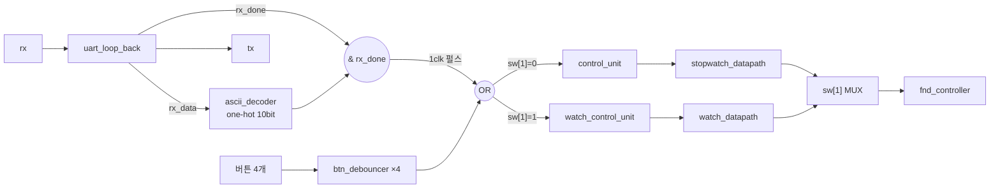
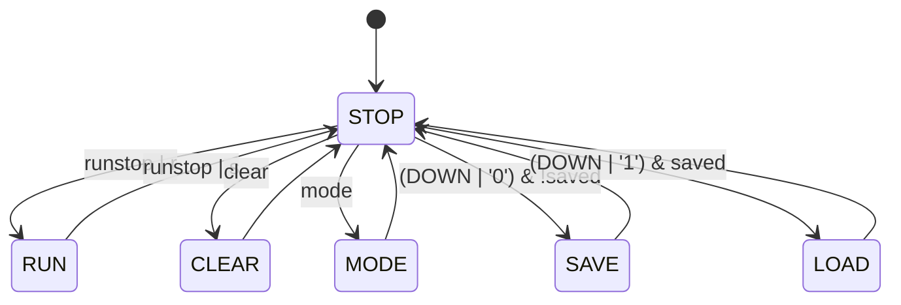
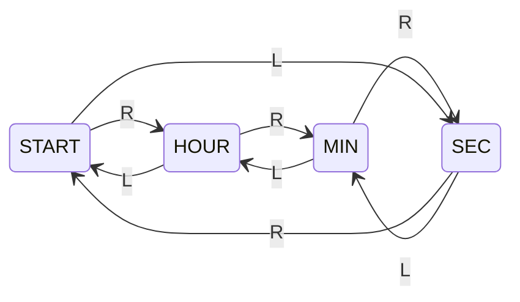

# UART_stopwatch — 스톱워치 + 시계를 버튼과 PC(UART)로 제어

> 📅 2026-07-29 ~ 08-07 · 보드: Basys3 · Vivado 2020.2 · 프로젝트 1 (2인) + 미니 프로젝트

[stopwatch](../stopwatch)를 확장해 **스톱워치 + 시계(watch)** 를 한 보드에서 전환하며 쓰는 프로젝트(프로젝트 1)에,
[UART](../UART)를 붙여 **PC에서 ASCII 한 글자로 버튼과 같은 조작**을 할 수 있게 만든 미니 프로젝트.
기존 버튼 동작은 그대로 두고, UART 명령을 1clk 펄스로 바꿔 버튼 입력과 OR로 합치는 방식으로 붙임.

## 파일 구조

```
UART_stopwatch/
├── src/
│   ├── stopwatch.v           # top_stopwatch, stopwatch_datapath(save/load), time_counter, tick_gen
│   ├── control_unit.v        # 스톱워치 FSM: STOP/RUN/CLEAR/MODE/SAVE/LOAD
│   ├── watch_control_unit.v  # 시계 설정 자리 선택 FSM: START/HOUR/MIN/SEC
│   ├── watch_datapath.v      # 시계 카운터 + up/down demux
│   ├── uart_loop_back.v      # ascii_decoder, uart_loop_back
│   ├── uart_tx.v, uart_rx.v
│   ├── fnd_controller.v
│   └── btn_debouncer.v
└── create_project.tcl
```

## 입력 / 출력

| 입력 | 스톱워치 (`sw[1]=0`) | 시계 (`sw[1]=1`) |
|---|---|---|
| `btn_L` | run / stop | 설정 자리 ← |
| `btn_R` | clear | 설정 자리 → |
| `btn_UP` | mode (up ↔ down) | 선택 자리 +1 |
| `btn_DOWN` | save / load | 선택 자리 −1 |
| `sw[0]` | 초:1/100초 ↔ 시:분 화면 | 〃 |
| `sw[2]` | — | 12시간제 표시 |
| `led` | 저장된 기록 있음 | — |
| `rx` / `tx` | UART 9600 8N1 (받은 글자는 그대로 echo) | |

### UART 명령

| 스톱워치 (소문자) | | 시계 (대문자) | |
|---|---|---|---|
| `r` (0x72) | run | `U` (0x55) | +1 |
| `s` (0x73) | stop | `D` (0x44) | −1 |
| `c` (0x63) | clear | `L` (0x4C) | 자리 ← |
| `m` (0x6D) | mode | `R` (0x52) | 자리 → |
| `0` (0x30) | save | | |
| `1` (0x31) | load | | |

---

## 구조



### 1. UART 명령 → 버튼과 같은 1clk 펄스

```verilog
// rx_data → one-hot (해당 없는 글자는 0)
always @(*) begin
    o_signals = 10'b0;
    case (i_data)
        8'h72: o_signals = 10'b1000_0000_00;   // r
        ...
        8'h31: o_signals = 10'b0000_0000_01;   // 1
    endcase
end

// rx_done(1clk)과 AND → 디바운서 출력과 같은 모양의 펄스
assign {w_ascii_run, ..., w_ascii_load} = w_ascii_decoded & {10{w_rx_done}};
```

- RX는 shift 도중에도 `rx_data`가 계속 바뀌므로(중간에 우연히 `0x55`가 만들어지기도 함), **`rx_done`일 때만** 유효한 명령으로 사용
- 이미 디바운서가 1clk 펄스를 만들어 주므로 같은 형식으로 맞춰 `|`로 합침 → control unit은 거의 수정 없이 재사용

```verilog
.i_clear((w_ascii_clear | w_btn_R)  & !sw[1]),   // 버튼 or UART, 스톱워치 모드일 때만
.i_mode ((w_ascii_mode  | w_btn_UP) & !sw[1]),
```

- run/stop은 한 버튼이 토글이지만 UART는 `r`, `s`가 따로 있어 `i_ascii_run`, `i_ascii_stop` 입력을 별도로 추가

### 2. 스톱워치 — save / load



- datapath가 `save` 때 현재 시:분:초:1/100초를 레지스터에 저장하고 `o_is_data_saved = 1`(LED 점등)
- `load` 때 저장값을 카운터에 다시 로드하고 `o_is_data_saved = 0` → 버튼 하나로 저장/불러오기 토글

### 3. 시계 — 설정 자리 선택 + up/down



- `demux_1x3`: 현재 선택된 자리(HOUR / MIN / SEC)의 카운터에만 up/down 펄스 전달, START에서는 아무 자리도 안 바뀜
- `watch_time_counter`: tick으로 흐르면서 `i_up` / `i_down`으로 직접 ±1 (overflow·underflow 처리), 시는 `INIT_NUM = 12`로 12시에서 시작
- 12시간제(`sw[2]`): 13~23 → 1~11, 0 → 12로 **표시만** 변환 (내부는 24시간)

## Simulation 확인 항목

- `r` 수신 → `rx_done` 1clk 동안만 `w_ascii_run` 펄스 → STOP → RUN, `s`로 RUN → STOP
- `L` / `R` → watch control unit 상태 이동, HOUR 상태에서 `U` / `D` → 12 → 13 → 12
- `0` → SAVE 상태, 저장 레지스터에 값 확인, `is_data_saved = 1` / `1` → LOAD, 값 복원, `is_data_saved = 0`

## 프로젝트 1 피드백 → 반영

| 피드백 | 반영 |
|---|---|
| watch control unit 검증 부족 | 테스트벤치 재구성 |
| save/load 레지스터가 파형에 안 보임 | 저장 레지스터를 파형에 추가 |
| 카운터 carry(tick) 전달, 버튼 입력 타이밍이 안 보임 | 카운터 입출력 tick, 디바운서 출력 시점까지 시뮬레이션 |
| 모듈 단위 검증만 함 | 통합된 top 안에서의 동작 검증 필요 |
| 트러블슈팅 근거 부족 | 오류 파형 → 디버깅 지점 → 수정 후 파형 순서로 정리 |

---

## 배운 내용

- **인터페이스 맞추기**: 새 입력원(UART)을 기존 입력(디바운스된 버튼)과 같은 형태(1clk 펄스)로 만들면 기존 FSM을 거의 그대로 재사용 가능
- **유효 신호(valid/done)로 데이터 qualify**: 데이터 버스는 중간값이 지나갈 수 있으니 `done`과 AND해서만 사용
- **one-hot 인코딩**: 명령마다 1bit → 디코딩 없이 바로 제어 신호로 연결, OR로 합치기 쉬움
- 발표 / 보고서: 보드 핀 설명표(pin · symbol · I/O · 기능), 두괄식, 블록도·흐름도 중심, top / datapath / control unit 위주로 설명
