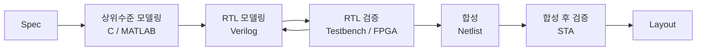

# adder — Half / Full adder → 4bit → 8bit Full adder

> 📅 2026-07-16 · 보드: Basys3 · Vivado 2020.2 · 과제 1

반가산기(HA)부터 시작해 **HA 2개 → 1bit FA → 4bit FA(ripple carry) → 4bit FA 2개 → 8bit FA** 순서로
하위 모듈을 인스턴스화하며 계층적으로 쌓아 올린 프로젝트. 8bit는 모든 입력 조합(256 × 256)을 시뮬레이션으로 검증함.

## 파일 구조

```
adder/
├── src/
│   ├── adder.v              # half_adder, full_adder, full_adder_4bit
│   └── full_adder_8bit.v    # full_adder_4bit × 2
├── tb/
│   ├── tb_adder.v           # FA / 4bit FA 테스트벤치
│   └── tb_full_adder_8bit.v # 8bit 전수 검사
└── images/
```

## 사용 핀 (8bit)

| 포트 | 보드 |
|---|---|
| `b[7:0]` | SW0 ~ SW7 |
| `a[7:0]` | SW8 ~ SW15 |
| `s[7:0]` | LD0 ~ LD7 |
| `c` | LD15 (L1) |

---

## 설계

### 1. Half adder

| a | b | s | c |
|---|---|---|---|
| 0 | 0 | 0 | 0 |
| 0 | 1 | 1 | 0 |
| 1 | 0 | 1 | 0 |
| 1 | 1 | 0 | 1 |

`s = a ^ b`, `c = a & b`

 

(왼쪽: 설계 전 그린 블럭도 / 오른쪽: Vivado schematic — gates 때와 달리 설계한 그대로 나옴)

### 2. 1bit Full adder = HA × 2


```verilog
half_adder HA1 (.a(a),  .b(b),    .s(s1), .c(c1));
half_adder HA2 (.a(s1), .b(c_in), .s(s2), .c(c2));

assign s = s2;
assign c = c1 | c2;
```

- 최종 carry를 `c1 | c2`로 해도 되는 이유: 입력이 1bit 3개라 최대값이 3(`11`) → **c1과 c2가 동시에 1이 될 일이 없음**


- `s1`, `c1`, `c2`는 FA 포트가 아니라 내부 wire → Scope에서 `dut`를 선택하고 Objects에서 끌어와 relaunch 해야 보임

### 3. 4bit Full adder (ripple carry)

```verilog
module full_adder_4bit (
    input  [3:0] a, b,
    input        cin,
    output [3:0] s,
    output       c
);
    wire c1, c2, c3;
    full_adder FA1 (.a(a[0]), .b(b[0]), .c_in(cin), .s(s[0]), .c(c1));
    full_adder FA2 (.a(a[1]), .b(b[1]), .c_in(c1),  .s(s[1]), .c(c2));
    full_adder FA3 (.a(a[2]), .b(b[2]), .c_in(c2),  .s(s[2]), .c(c3));
    full_adder FA4 (.a(a[3]), .b(b[3]), .c_in(c3),  .s(s[3]), .c(c));
endmodule
```

- 처음엔 `a0, a1, ...`로 비트마다 포트를 따로 뒀다가 **벡터(`[3:0]`)로 리팩토링**
- 수업 버전은 첫 carry를 `1'b0`으로 고정 → 과제에서 `cin` 입력을 추가해 "진짜" full adder로 만듦

### 4. 8bit Full adder = 4bit FA × 2


```verilog
full_adder_4bit FA1 (.a(a[3:0]), .b(b[3:0]), .cin(1'b0), .s(s[3:0]), .c(c2));
full_adder_4bit FA2 (.a(a[7:4]), .b(b[7:4]), .cin(c2),   .s(s[7:4]), .c(c));
```

## Simulation

```verilog
for (i = 0; i < 256; i = i + 1) begin
    for (j = 0; j < 256; j = j + 1) begin
        a = i;
        b = j;
        #10;
    end
end
```


- 255 + 0 = 255 (c=0) → 255 + 1 = 0 (c=1) 처럼 **overflow 경계**에서 carry가 올라가는 것 확인
- 엣지 케이스: 0/0, 1/0, 15/1, 127/1, 255/1, 255/255 등 각 자리 올림이 생기는 값 위주로 확인

## 트러블슈팅

- **As-Is**: Basys3 스위치가 16개라 `a[7:0]`, `b[7:0]`을 할당하면 `cin`에 줄 스위치가 없음
- **To-Be**: 보드 검증 버전은 `cin`을 `1'b0`으로 고정 (현재 `full_adder_8bit.v`). 이후 push button을 `cin`으로 매핑해 확장 가능

---

## 배운 내용

### 숫자 표현 `1'b0`

`<비트 수>'<진법><값>` — `b` 2진 / `d` 10진 / `h` 16진 / `o` 8진 (생략 시 10진)

```verilog
a = 8'b0000_0000;   // _ 로 자리 구분 가능
a = 8'hFF;          // 255
```

- **Verilog의 기본 크기는 1bit** (C는 32bit, Python은 무제한) → 하드웨어는 자원을 아껴야 하니까
- 테스트벤치에서는 `integer`(32bit) 사용 가능 (합성 대상 아님)

### Z와 X — 칩 나가기 전에 꼭 잡아야 함

| 값 | 의미 | 위험 |
|---|---|---|
| X | 충돌 (0과 1이 동시에 구동, 쇼트) | 실제 보드에서 소자 손상 |
| Z | 연결 안 됨 (high impedance, 플로팅) | 0/1 사이를 떠다니며 오동작 |

### 시스템 반도체 설계 과정



- **RTL 모델링**: 하위 모듈 인스턴스(구조적), `assign`(데이터 flow), `always`(행위 수준). 합성 안 되는 구문은 쓰면 안 됨
- **RTL 검증**: 알고리즘 엔지니어가 준(또는 검증 엔지니어가 만든) 입력 벡터로 테스트벤치 구성. 버그는 여기서 다 잡아야 함
- **합성(synthesis = compile)**: 소스 → 게이트 수준 논리회로 + 최적화
- **합성 후 검증**: 기능 + 타이밍. STA로 setup / hold time 위반 확인
- **Layout**: 실제 칩에 부피를 갖게 배치. 이때 배선의 기생 R·C·L이 생겨 RC delay, crosstalk, IR drop 발생
- **수율**: 웨이퍼 1장에서 정상 동작하는 die 비율. 70%가 마지노선, 80% 이상이면 안정화

### VS Code 팁

- `Ctrl + Shift + P` → 포맷팅 / 문법 오류 확인
- `Alt + ↑/↓` → 코드 줄 통째로 이동
- Vivado waveform → 우클릭 **Radix**로 진법 표시 변경
