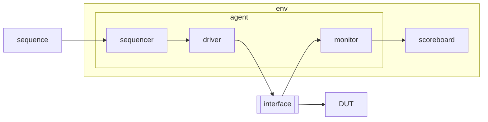

# adder_UVM — UVM 환경 세팅과 첫 sequence item

> 📅 2026-08-24 · Vivado 2020.2 · SystemVerilog + UVM · 작성 중

8bit 덧셈기를 DUT로 UVM 검증 환경을 만들기 시작한 실습.
Vivado 시뮬레이터에서 UVM 라이브러리를 쓰도록 설정하고, [adder_sv](../adder_sv)의 `transaction` 클래스를 **`uvm_sequence_item`을 상속한 `seq_item`** 으로 바꿔 factory에 등록하는 단계까지 작성함.
(interface와 DUT 인스턴스만 만들어 둔 상태. 전체 UVM 환경은 [FIFO_UVM](../FIFO_UVM)에서 완성)

## 파일 구조

```
adder_UVM/
├── src/adder.sv            # always_comb y = a + b (9bit 결과)
└── tb/tb_adder_uvm.sv      # uvm include/import, adder_if, seq_item, tb 모듈
```

## Vivado에서 UVM 사용 설정

`Settings → Simulation`

| 탭 | 항목 | 값 |
|---|---|---|
| Compilation | `xsim.compile.xvlog.more_options` | `-L uvm` |
| Elaboration | `xsim.elaborate.xelab.more_options` | `-L uvm` |
| Elaboration | `xsim.elaborate.debug_level` | `all` |

```systemverilog
`include "uvm_macros.svh"   // `uvm_* 매크로 정의
import uvm_pkg::*;          // UVM 클래스 전부
```

- 로컬 에디터에서는 `uvm_macros.svh`를 못 찾아 빨간 줄이 뜨지만 시뮬레이터에서는 정상 동작

---

## DUT

```systemverilog
always_comb begin       // 감시 목록(@(*)) 자동
    y = a + b;          // 9bit라 carry 포함
end
```

## seq_item

```systemverilog
class seq_item extends uvm_sequence_item;
    rand bit [7:0] a;
    rand bit [7:0] b;
    bit      [8:0] y;

    function new(string name = "ADDER_Seq_item");
        super.new(name);
    endfunction

    `uvm_object_utils_begin(seq_item)          // factory 등록
        `uvm_field_int(a, UVM_DEFAULT)         // 필드 자동화
        `uvm_field_int(b, UVM_DEFAULT)
        `uvm_field_int(y, UVM_DEFAULT)
    `uvm_object_utils_end                      // 매크로 끝에는 ; 없음
endclass
```

| 매크로 | 역할 |
|---|---|
| `` `uvm_object_utils_begin/end `` | 클래스를 **UVM factory**에 등록 → `seq_item::type_id::create("item")`로 생성, 실행 중 다른 확장 클래스로 override 가능 |
| `` `uvm_field_int(x, UVM_DEFAULT) `` | `print()`, `copy()`, `compare()`, `pack()`, `unpack()`에 해당 필드를 자동 포함 |

```systemverilog
// factory override 예: seq_item을 요청하면 확장 클래스가 생성됨
seq_item::type_id::set_type_override(my_extended_seq_item::get_type());
item = seq_item::type_id::create("item");
```

- override로 바뀐 객체가 제대로 동작하려면 phase나 메서드가 `virtual`이어야 함 ([sv_oop](../sv_oop) ex6)

---

## 배운 내용 — 직접 만든 SV 환경 vs UVM



| 직접 만든 SV 환경 | UVM |
|---|---|
| `transaction` | `uvm_sequence_item` (+ `uvm_sequence`로 생성 시나리오 분리) |
| `generator` | `uvm_sequence` + `uvm_sequencer` |
| `mailbox` | sequencer ↔ driver 내부 TLM 포트 (`get_next_item` / `item_done`), `uvm_analysis_port` |
| `new()`로 직접 생성 · 연결 | `type_id::create()` + `build_phase` / `connect_phase` |
| `fork ~ join_any` 관리 | phase가 알아서 병렬 실행, `raise/drop_objection`으로 종료 제어 |

- UVM은 검증 환경의 **표준 프레임워크** — 부품은 이미 있고, 직접 신경 쓸 것은 **transaction 정의, 환경 구성, 타이밍(drive / sample 시점)**
