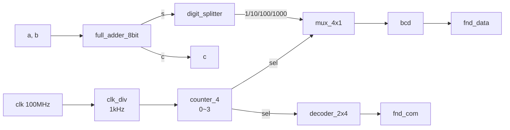

# adder_fnd — 8bit Full adder 결과를 7-segment(FND)에 10진수로 출력 + clock divider

> 📅 2026-07-20 ~ 21 · 보드: Basys3 · Vivado 2020.2 · 과제 2, 3-1

[adder](../adder)의 8bit FA 합(`s`)을 Basys3의 4자리 7-segment에 **10진수**로 띄우는 프로젝트.
처음엔 버튼(`btn_L`, `btn_R`)으로 표시할 자리를 골랐지만, 다음 날 **clock / reset / 순차논리**를 배우고
100MHz → 1kHz 분주기 + 0~3 카운터로 자리를 자동으로 돌려 4자리를 동시에 보이게 만듦.
같은 날 과제로 2 / 4 / 6 / 12분주(duty 1:1, 2:1, 1:2) 모듈도 작성.

## 파일 구조

```
adder_fnd/
├── src/
│   ├── adder_fnd.v          # top: full_adder_8bit + fnd_controller
│   ├── full_adder_8bit.v    # (+ half_adder를 게이트 프리미티브로 작성)
│   ├── fnd_controller.v     # clk_div, counter_4, decoder_2x4, digit_splitter, mux_4x1, bcd
│   └── clk_div_100mhz.v     # 과제 3-1: 2/4/6/12분주 모듈
├── tb/tb_clk_div.v          # 1kHz 분주기 + 과제 분주 모듈 테스트벤치
└── images/                  # schematic
```

## 사용 핀

| 포트 | 보드 | 핀 |
|---|---|---|
| `clk` | 100MHz 오실레이터 | W5 |
| `a[7:0]` | SW8 ~ SW15 | V2, T3, T2, R3, W2, U1, T1, R2 |
| `b[7:0]` | SW0 ~ SW7 | V17, V16, W16, W17, W15, V15, W14, W13 |
| `fnd_data[7:0]` | CA ~ CG, DP | W7, W6, U8, V8, U5, V5, U7, V7 |
| `fnd_com[3:0]` | AN0 ~ AN3 | U2, U4, V4, W4 |
| (버튼 버전) `btn_L` / `btn_R` | BTNL / BTNR | W19 / T17 |

---

## 구조



| 모듈 | 역할 |
|---|---|
| `digit_splitter` | `%`, `/`로 1 / 10 / 100 / 1000의 자리 분리 |
| `mux_4x1` | `sel`에 해당하는 자리 숫자 하나만 선택 |
| `decoder_2x4` | `sel` → 켤 자리(AN) 하나만 0 |
| `bcd` | 숫자(0~F) → 7-segment 8bit 패턴 |
| `clk_div` | 100MHz → 1kHz (잔상 없이 보이도록) |
| `counter_4` | 1kHz마다 0 → 1 → 2 → 3 → 0, 버튼 대신 `sel` 자동 생성 |

### 1. 7-segment 구동 원리 (Basys3)

- **AN0~3 (자리 선택)**: PNP 트랜지스터 → **0을 줘야 해당 자리가 켜짐**
- **CA~CG, DP (세그먼트)**: common anode 구조 → 다이오드는 전압차가 있어야 켜지므로 **0을 줘야 세그먼트가 켜짐**
- 4자리가 데이터 선(CA~DP)을 공유 → 한 번에 한 자리만 켤 수 있음 → 빠르게 돌려가며 켜서 **잔상**으로 4자리를 동시에 보이게 함 (dynamic 구동)

```verilog
always @(bcd_in) begin
    case (bcd_in)
        4'h0: bcd_out = 8'hC0;
        4'h1: bcd_out = 8'hF9;
        // ...
        4'hF: bcd_out = 8'h8E;
    endcase
end
```

### 2. 자리수 분리 / 선택

```verilog
assign digit_1    = seg_data % 10;
assign digit_10   = (seg_data / 10) % 10;
assign digit_100  = (seg_data / 100) % 10;
assign digit_1000 = (seg_data / 1000) % 10;
```


- 8bit 합의 최대값은 255(+carry)라 **1000의 자리는 항상 0** → 합성기가 연산을 지우고 GND에 붙여버림 (불필요한 연산 최적화)

 

- 삼항 연산자 체인(`? :`)은 **우선순위가 있는 MUX 체인**으로, `case`는 **하나의 병렬 MUX**로 합성됨

### 3. 버튼 → 클럭 기반 자동 전환

처음 버전: `.digit_sel({btn_L, btn_R})` — 결합 연산자 `{}`로 버튼 2개를 2bit `sel`로 묶음 (왼쪽이 MSB)


(첫 실습: 4bit FA + `fnd_com = 4'b1110` 고정으로 1의 자리만 표시)

개선 버전: `clk_div`(1kHz) → `counter_4`가 `sel`을 자동으로 0~3 반복

```verilog
module counter_4 (input clk, input reset, output [1:0] digit_sel);
    reg [1:0] counter_reg;
    assign digit_sel = counter_reg;

    always @(posedge clk, posedge reset) begin
        if (reset) counter_reg <= 0;
        else       counter_reg <= counter_reg + 1;   // 11 + 1 = 00 (overflow로 자동 0~3)
    end
endmodule
```

- schematic에서 `RTL_REG_ASYNC`(플립플롭, 순차논리) + `RTL_ADD`(조합논리)로 나옴
- `reset`이 없으면 `counter_reg`의 초기값이 **X** → 동작이 이상해짐. 그래서 비동기 reset으로 초기화

### 4. Clock divider (100MHz → 1kHz)

```verilog
always @(posedge clk, posedge reset) begin
    if (reset) begin
        counter_reg <= 0;
        clk_reg     <= 1'b0;
    end else begin
        counter_reg <= counter_reg + 1;
        if (counter_reg == (50000 - 1)) begin   // 5만 clk마다 반전 → 10만 분주
            counter_reg <= 0;
            clk_reg     <= ~clk_reg;
        end
    end
end
```

- Basys3 clk 주기 10ns → 100MHz. 그대로 자리를 바꾸면 너무 빨라 잔상만 보임
- 반주기 = 50,000 clk → 1주기 = 100,000 clk = 1ms → **1kHz**, duty 1:1
- 테스트벤치는 `always #5 clk = ~clk;`로 하드웨어와 같은 10ns 주기 클럭 생성 → 500,000ns마다 반전 확인

### 5. 과제 3-1: N분주 · duty ratio

| 모듈 | 출력 | 방법 | 카운터 |
|---|---|---|---|
| `clk_div_2` | 50MHz | 매 clk마다 반전 | 없음 |
| `clk_div_4` | 25MHz | 2 clk마다 반전 | 1bit (0~1) |
| `clk_div_6` | 16.6MHz | 3 clk마다 반전 | 2bit (0~2) |
| `clk_div_12` | 8.3MHz, 1:1 | 6 clk마다 반전 | 3bit (0~5) |
| `clk_div_12_2_1` | 8.3MHz, 2:1 | cnt==3 → 1, cnt==11 → 0 | 4bit (0~11) |
| `clk_div_12_1_2` | 8.3MHz, 1:2 | cnt==7 → 1, cnt==11 → 0 | 4bit (0~11) |

- **N분주(duty 1:1)**: N/2 clk마다 반전. 카운터 비트 수는 셀 경우의 수에 맞춰 최소로
- **duty ratio 조절**: 반전(`~clk_reg`) 대신 특정 카운트에서 1, 주기 끝에서 0으로 **하드코딩**

#### 트러블슈팅

- **As-Is**: 12분주 2:1 / 1:2에서 `clk_reg <= ~clk_reg`로 짰더니 결과가 의도와 **정반대**로 나옴
- **원인**: reset 후 출력 clk이 **0부터 시작**한다는 걸 고려하지 않음 (첫 구간이 LOW)
- **To-Be**: 0/1을 직접 대입 (`clk_reg <= 1'b1;` / `clk_reg <= 1'b0;`)

---

## 배운 내용

### 조합논리 vs 순차논리

| | 조합논리 (CL) | 순차논리 (SL) |
|---|---|---|
| 의존 | 현재 입력만 | 현재 입력 + **이전 상태** (clk) |
| 문법 | `assign`, `always @(*)` + `=` | `always @(posedge clk, posedge reset)` + `<=` |
| 하드웨어 | 게이트, MUX | 플립플롭 (+ 조합논리) |

### blocking `=` vs non-blocking `<=`

- `<=`는 값을 **예약**해 두고 always 블록이 끝난 뒤 **한꺼번에 반영** → 같은 블록의 `if`에서 읽는 값은 반영 전 값
- 같은 변수에 두 번 예약하면 **마지막 예약이 이김** (`counter_reg <= counter_reg + 1;` 후 `counter_reg <= 0;`)
- 순차논리에서는 `<=`, 조합논리에서는 `=`

### always / case와 latch

- `always @(감시 변수)`: 변수가 바뀔 때마다 실행. **always의 출력은 항상 `reg`**, 안에서 `assign` 사용 불가
- **Latch**: 모든 조건을 처리하지 않으면 툴이 "이전 값을 유지해야 한다"고 판단해 의도치 않은 래치를 만듦
  → `default`까지 포함한 **full case**로 모든 경우를 처리해서 제거

### 게이트 프리미티브

```verilog
xor (s, a, b);          // 프리미티브 (output, input0, input1, ...)
xor XOR1 (s, a, b);     // 프리미티브 인스턴스
assign s = a ^ b;       // 연산자
```

- 셋 다 기능 · 성능 동일

### 자료형과 4상태 논리

| net (연결) | variable (값 저장) |
|---|---|
| `wire`(기본), `tri`, `wand`, `wor`, `supply0/1`, `tri0/1`(pull-down/up) | `reg`, `integer`, `real`, `time` |

| 값 | 의미 |
|---|---|
| 0 / 1 | GND / Vcc |
| X | 알 수 없음 — 신호 충돌, 쇼트 (multiple driver) |
| Z | high impedance — 전기적으로 끊어짐 |

- 모듈 I/O: **output · inout은 항상 wire**, 값을 받는 쪽은 항상 wire
- 숫자 표현: 비트 수 생략 시 32bit, `'s`를 붙이면 signed. 비트가 부족하면 MSB 왼쪽에 0을 채움 (단 MSB가 x/z면 x/z로 채움)

```verilog
inta = -12 / 4;      // -3   (signed 정수)
intb = -'d12 / 4;    // 1073741821  (unsigned 32bit로 해석)
intc = -'sd12 / 4;   // -3
intd = -4'sd12 / 4;  // 1    (4bit 1100 = -4 → -(-4) / 4)
```

### Timing Summary

- 순차논리부터는 타이밍 리포트를 꼭 확인
- **WNS(Worst Negative Slack)** 가 음수면 해결해야 함. 10ns 주기 중 여유가 7.7ns 남으면 OK

### 인코더 / 디코더

- 인코더: 많은 bit → 적은 bit / 디코더: 적은 bit → 많은 bit (`decoder_2x4`: 2bit → one-cold 4bit)
