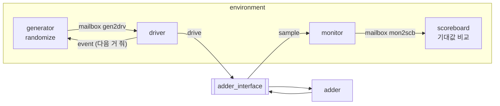

# adder_sv — SystemVerilog 클래스 기반 테스트벤치 첫 실습 (가감산기)

> 📅 2026-08-18 ~ 19 · Vivado 2020.2 · SystemVerilog · 시뮬레이션

8bit 가감산기(`mode = 0` 덧셈 / `1` 뺄셈)를 DUT로 두고,
Verilog식 `initial` 테스트벤치를 **interface · transaction · generator · driver · monitor · scoreboard · environment** 클래스로 한 단계씩 쪼개 나간 실습.
마지막엔 각 컴포넌트를 `fork ~ join_any`로 **병렬 실행**하고 `mailbox` / `event`로 동기화하는 구조까지 완성. 이후 [register_sv](../register_sv), [FIFO_UVM](../FIFO_UVM)의 뼈대가 됨.

## 파일 구조

```
adder_sv/
├── src/adder.sv       # assign {c, s} = mode ? a - b : a + b;
└── tb/tb_adder.sv     # interface + class 6개 + tb 모듈
```

---

## 검증 환경 구조



| 컴포넌트 | 역할 |
|---|---|
| `interface` | DUT 포트 묶음. 클래스 ↔ 하드웨어 연결 지점 |
| `transaction` | 한 번의 입력 / 출력 데이터 묶음 (`rand` 입력 + 출력 필드) |
| `generator` | `randomize()`로 stimulus 생성 → mailbox |
| `driver` | mailbox에서 꺼내 interface에 drive |
| `monitor` | interface의 입력·출력을 샘플링 → mailbox |
| `scoreboard` | 기대값(`a ± b`)과 DUT 출력 비교, PASS / FAIL 집계 |
| `environment` | 위 컴포넌트와 mailbox / event를 생성·연결하고 실행 |

## 단계별 발전

1. **generator만**: `tr.randomize()` 결과를 `vif`에 직접 대입, `#10` 반복
2. **+ monitor**: 1ns 뒤 interface를 읽어 그 자리에서 비교
3. **+ environment**: 반복 횟수 · 타이밍을 environment가 관리 (gen / mon의 `run`은 1회 동작만)
4. **generator / driver 분리**: `mailbox`로 transaction 전달
5. **monitor / scoreboard 분리**: 관찰과 판정을 나눔
6. **병렬 실행**: 각 `run()`을 `forever`로 바꾸고 `fork ~ join_any`

```verilog
// environment
task run();
    fork
        gen.run(20);     // 20번 생성하면 끝남
        drv.run();       // forever
        mon.run();       // forever
        scb.run();       // forever
    join_any             // gen이 끝나면 다음 줄로
    scb.done();
endtask
```

```verilog
// generator: 하나 만들고 driver가 소비할 때까지 대기
repeat (run_count) begin
    tr = new;
    tr.randomize();
    gen2drv_mbox.put(tr);
    @(event2gen);
end

// driver: 꺼내서 drive, 10ns 뒤 event 발생
forever begin
    gen2drv_mbox.get(tr);
    vif.a = tr.a; vif.b = tr.b; vif.mode = tr.mode;
    #10;
    ->event2gen;
end
```

- `event` 없이 generator를 `forever`로 돌리면 **시간이 흐르지 않은 채 0ns에서 무한 생성** → driver가 소비할 때마다 event로 다음 생성을 허락

### constraint random

```verilog
class transaction;
    rand bit [7:0] a, b;
    rand bit       mode;
    logic    [7:0] s;      // 출력은 DUT에서 받으므로 rand 아님
    logic          c;

    constraint mode_dist2 { mode dist {0 :/ 90, 1 :/ 10}; }   // 덧셈 90%, 뺄셈 10%
    // constraint in_range { a inside {[1:127]}; }
    // constraint mode_distribute { if (mode == 0) b inside {0,1,2,3,15,20,127}; else b > 128; }
endclass
```

## 트러블슈팅

- 기대값을 `integer`에 담았더니 뺄셈 결과를 **signed로 해석**해 비교가 틀림 → DUT와 같은 폭의 `bit [7:0]`, `bit`로 맞춰 해결

---

## 배운 내용

### SystemVerilog를 쓰는 이유

- **constraint random** stimulus, **동시성**(fork / join), **assertion**, OOP로 재사용 가능한 검증 환경
- 설계보다 **검증**에서 주로 사용. 문법은 C + C++ + 약간의 Java / Python

### Verilog → SystemVerilog

| | Verilog | SystemVerilog |
|---|---|---|
| 신호 타입 | `wire` / `reg` 구분 | `logic` 하나로 (assign · always 모두 가능) |
| 2-state 타입 | — | `bit`, `int`, `byte` (0/1만, 시뮬레이션 자원 절약) |
| always | `always` | `always_ff`, `always_comb`, `always_latch` (의도 명시) |
| 확장자 | `.v` | `.sv` |

### OOP 개념

- **캡슐화 / 추상화**: 내부를 몰라도 기능만 알고 사용, 내부 보호
- **상속**: 기존 클래스를 물려받아 재사용·확장
- **다형성**: 같은 이름의 기능이 상황에 따라 다르게 동작 (overriding / overloading)

### 정적 / 동적 할당

- `transaction tr;` → **handle**(포인터 같은 것)만 정적으로 생성
- `tr = new;` → 객체가 **heap**에 동적 생성, handle이 가리킴. `new`는 생성자(재정의 가능)
- 매번 `new`해서 mailbox에 넣어야 서로 다른 객체가 전달됨 (같은 객체를 재사용하면 덮어씀)
- 안 쓰는 객체는 garbage collector가 정리

### virtual interface

- 클래스(소프트웨어, 동적)에서 interface(하드웨어, 정적)를 참조하려면 `virtual` 키워드로 연결
- `env = new(.vif(adder_if));` 처럼 tb 모듈에서 실제 interface를 넘겨줌

### mailbox / event (IPC)

- `mailbox`: 클래스 간 transaction을 주고받는 **FIFO**. `get`은 비어 있으면 대기
- `event`: `->e`로 발생, `@(e)`로 대기 → 실행 순서 동기화

### fork / join

| | 다음 줄로 넘어가는 시점 |
|---|---|
| `fork ~ join` | 모든 스레드 종료 후 |
| `fork ~ join_any` | 하나라도 끝나면 (가장 많이 씀) |
| `fork ~ join_none` | 즉시 |

- `begin ~ end`는 순차 실행, `fork ~ join`은 병렬 실행
- `vivado`의 `randc`는 기대대로 순환하지 않을 수 있으니 주의
- 학습 사이트: ChipVerify, EDA Playground
