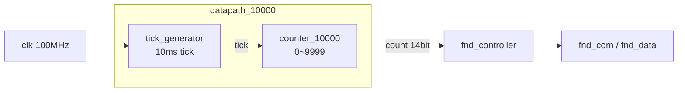

# counter_10000 — tick generator + 0 ~ 9999 카운터를 FND에 표시

> 📅 2026-07-22 · 보드: Basys3 · Vivado 2020.2 · 과제 4

100MHz clk으로 **10ms 주기 tick**을 만들고, tick마다 1씩 올라가는 **10000진 카운터** 값을 [adder_fnd](../adder_fnd)에서 만든 `fnd_controller`로 4자리 7-segment에 출력.
카운터 + tick generator를 `datapath`로 묶고, top에서 `fnd_controller`와 연결하는 구조를 처음 잡은 프로젝트.
(up/down · run/stop · clear 기능을 추가한 버전은 [counter_updown](../counter_updown))

## 파일 구조

```
counter_10000/
├── src/
│   ├── counter_10000.v    # top_module_10000, datapath_10000, counter_10000, tick_generator
│   └── fnd_controller.v   # fnd_in 14bit로 확장
└── tb/tb_counter_10000.v  # tb_top_module_10000, tb_datapath_10000, tb_tick_gen
```

## 사용 핀

| 포트 | 보드 |
|---|---|
| `clk` | 100MHz (W5) |
| `reset` | 버튼 |
| `fnd_data[7:0]`, `fnd_com[3:0]` | 7-segment |

---

## 구조



### tick_generator — 10ms마다 1clk 폭의 펄스

```verilog
reg [$clog2(1_000_000)-1:0] counter_reg;   // 0 ~ 999,999 → 20bit

always @(posedge clk, posedge reset) begin
    if (reset) begin
        counter_reg <= 0;
        tick_reg    <= 0;
    end else begin
        counter_reg <= counter_reg + 1;
        if (counter_reg == 1_000_000 - 1) begin
            counter_reg <= 0;
            tick_reg    <= 1'b1;
        end else begin
            tick_reg    <= 1'b0;   // 나머지 999,999 clk 동안은 0
        end
    end
end
```

- 10ns × 1,000,000 = **10ms** 주기, duty 1 : 999,999 인 신호
- clock divider(duty 1:1)와 달리 **딱 1clk만 1** → 다른 모듈이 같은 `clk`을 쓰면서 "이번 clk에 동작할지"만 판단하게 해 줌 (enable 신호)

### counter_10000

```verilog
reg [$clog2(10_000)-1:0] tick_cnt;   // 0 ~ 9999 → 14bit

always @(posedge clk, posedge reset) begin
    if (reset) tick_cnt <= 0;
    else begin
        if (i_tick)                tick_cnt <= tick_cnt + 1;
        if (tick_cnt == 10_000 - 1) tick_cnt <= 0;
    end
end
```

- 카운터도 **시스템 `clk`** 으로 동작하고, `i_tick`이 1인 clk에서만 +1
- 시뮬레이션에서 count는 **tick의 하강엣지 시점에 증가**하는 것처럼 보임 → tick이 1이 된 clk을 다음 posedge에서 관측하기 때문

### fnd_controller 인터페이스 변경

- `fnd_in`, `digit_splitter.seg_data`를 8bit → **14bit**로 확장
- 8bit FA와 연결했을 때 GND에 붙어 있던 **1000의 자리 출력이 정상 연결**되는 것을 schematic으로 확인

## Simulation

| 테스트벤치 | 시간 | 확인 |
|---|---|---|
| `tb_tick_gen` | 1,000,000 × 10ns × 2 | counter 999,999 다음 clk에 tick 1 → 1clk 후 0, 주기 10ms |
| `tb_datapath_10000` | × 10 | tick 10번 → count 0 → 10 |
| `tb_top_module_10000` | × 20 (200ms) | count 값대로 `fnd_data` 출력 |

- 보드 검증 엣지 케이스: 1 / 10 / 100 / 1000의 자리가 바뀌는 순간, 9999 → 0 overflow

---

## 배운 내용

### `$clog2`

- `$clog2(N)` = N을 표현하는 데 필요한 비트 수 (⌈log₂N⌉). `reg [$clog2(10_000)-1:0]` → 14bit
- 숫자 중간의 `_`는 가독성용 구분자 (`1_000_000`)

### tick(enable) vs 분주 clock

| | 분주 clock (`clk_div`) | tick |
|---|---|---|
| 모양 | duty 1:1 느린 clock | 1clk 폭 펄스 |
| 사용 | 다른 모듈의 `clk`로 연결 | 같은 `clk`을 쓰고 `if (tick)` 조건으로 사용 |
| 특징 | clock domain이 여러 개 생김 | **모든 F/F가 하나의 clock**으로 동작 → 타이밍 분석이 단순 |

### datapath / top 계층 분리

- `datapath`: 실제 데이터를 만들고 바꾸는 부분 (tick + counter)
- top: datapath와 출력장치(`fnd_controller`)를 연결만 함 → 이후 control unit을 붙이기 쉬운 구조 ([counter_updown](../counter_updown))
