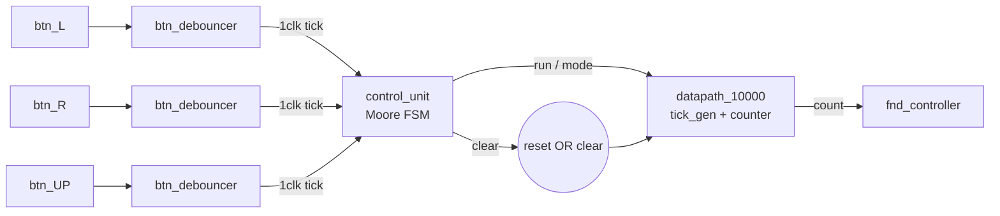
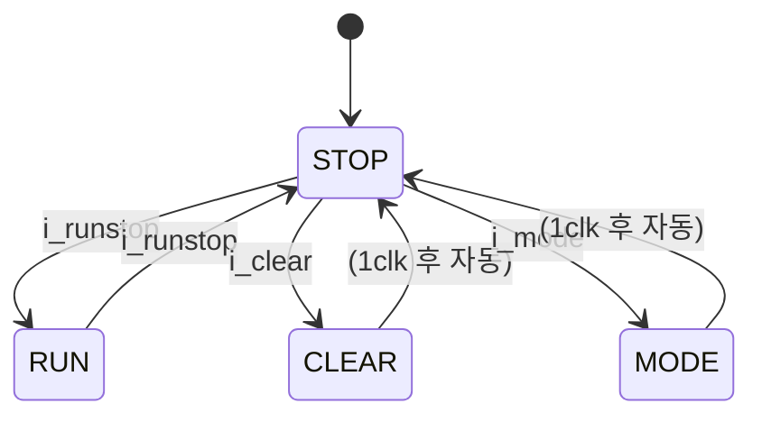
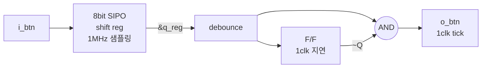

# counter_updown — Up/Down 카운터 + FSM control unit + 버튼 디바운서

> 📅 2026-07-23 ~ 27 · 보드: Basys3 · Vivado 2020.2 · 과제 4(기능 추가), 6, 8

[counter_10000](../counter_10000)에 **up/down · run/stop · clear** 기능을 붙이고,
스위치 대신 **버튼**으로 조작하도록 Moore FSM `control_unit`을 추가한 프로젝트.
버튼을 1번 눌렀는데 여러 번 반영되는 문제를 **디바운서 + 엣지 검출기**(`btn_debouncer`)로 해결하고,
mode 토글이 안 되던 문제를 **출력을 순차논리(피드백 구조)로 바꿔서** 해결함.

## 파일 구조

```
counter_updown/
├── src/
│   ├── counter_10000.v   # top_module_10000, datapath_10000, counter_10000, tick_generator
│   ├── control_unit.v    # Moore FSM (STOP / RUN / CLEAR / MODE)
│   ├── btn_debouncer.v   # 1MHz 샘플링 SIPO + rising edge 검출
│   └── fnd_controller.v
└── tb/
    ├── tb_top_module_10000.v
    └── tb_debouncer.v
```

## 사용 핀

| 포트 | 보드 | 기능 |
|---|---|---|
| `clk` | W5 | 100MHz |
| `reset` | 버튼 | 전체 초기화 |
| `btn_L` | BTNL | run / stop |
| `btn_R` | BTNR | clear |
| `btn_UP` | BTNU | mode (up ↔ down) |
| `fnd_data`, `fnd_com` | 7-segment | 카운트 표시 |

---

## 구조



- `control_unit`의 출력은 **스위치처럼 계속 유지되는 레벨 신호** → 기존 datapath는 수정 없이 재사용
- `clear`는 `reset`과 OR로 묶어 datapath · fnd_controller를 초기화

## 1. Up/Down 카운터 (과제 4 기능 추가)

```verilog
if (i_tick && run) begin
    case (mode)
        0: tick_cnt <= tick_cnt + 1;     // up
        1: tick_cnt <= tick_cnt - 1;     // down
    endcase
    if (tick_cnt == 10_000 - 1 && !mode) tick_cnt <= 0;      // overflow  9999 → 0
    else if (tick_cnt == 0 && mode)      tick_cnt <= 9999;   // underflow 0 → 9999
end
```

### 트러블슈팅

- **증가 모드 최대값이 6300 근처에서 잘림**: overflow / underflow 조건을 mode와 반대로 매핑 → mode 조건 재확인 후 수정
- **down 모드에서 0이 아주 잠깐만 보이고 바로 9999**: overflow·underflow 검사가 `i_tick` 밖에 있어서 매 clk마다 검사됨
  → 검사를 **`if (i_tick && run)` 안으로** 옮겨 tick이 올 때만 처리

## 2. Control unit (과제 6) — Moore FSM



| 상태 | `o_runstop` | `o_clear` | `o_mode` |
|---|---|---|---|
| STOP | 0 | 0 | 유지 |
| RUN | 1 | 0 | 유지 |
| CLEAR | 0 | 1 | 유지 |
| MODE | 0 | 0 | **반전** |

- 상태 전이는 항상 STOP을 거침 (RUN 중 clear 입력은 무시, `if-else if` 순서상 run이 clear보다 우선)

### 출력을 순차논리로 (피드백 구조)

처음엔 출력을 `c_state`로부터 조합논리로 만들었는데, 조합논리는 이전 값을 저장하지 않아 **`o_mode = ~o_mode` 토글이 불가능**(항상 0).
→ 출력도 상태처럼 `*_reg` / `*_next` 쌍으로 만들어 F/F에 저장.

```verilog
// state + output register (SL)
always @(posedge clk, posedge reset) begin
    if (reset) begin
        c_state <= STOP;
        run_stop_reg <= 0; clear_reg <= 0; mode_reg <= 0;
    end else begin
        c_state <= n_state;
        run_stop_reg <= run_stop_next;
        clear_reg    <= clear_next;
        mode_reg     <= mode_next;
    end
end

// next state + next output (CL)
always @(*) begin
    n_state = c_state;
    run_stop_next = run_stop_reg; clear_next = clear_reg; mode_next = mode_reg;
    case (c_state)
        STOP:  begin
                   run_stop_next = 0; clear_next = 0;
                   if      (i_runstop) n_state = RUN;
                   else if (i_clear)   n_state = CLEAR;
                   else if (i_mode)    n_state = MODE;
               end
        RUN:   begin run_stop_next = 1; if (i_runstop) n_state = STOP; end
        CLEAR: begin clear_next = 1;    n_state = STOP; end
        MODE:  begin mode_next = ~mode_reg; n_state = STOP; end
    endcase
end

assign {o_clear, o_runstop, o_mode} = {clear_reg, run_stop_reg, mode_reg};
```

- 출력이 F/F를 거치므로 **1clk 늦게** 나오지만 glitch 없는 깨끗한 출력

## 3. 버튼 디바운서 (과제 8)

### 왜 필요한가

1. 사람 손으로 **1clk(10ns)짜리 입력은 불가능** → 누르고 있는 clk 수만큼 상태가 바뀜 (짝수 clk이면 원래 상태로 돌아옴)
2. **기계적 노이즈(채터링)**: 누르는 순간 접점이 여러 번 붙었다 떨어짐
3. 버튼은 clk과 무관한 **비동기 입력** → clk에 동기화 필요

### 구현



```verilog
// 100MHz → 1MHz (50clk마다 반전)
// 1MHz마다 버튼 값을 1bit씩 밀어 넣음
always @(posedge w_1mhz, posedge reset)
    if (reset) q_reg <= 8'h00;
    else       q_reg <= {i_btn, q_reg[7:1]};

assign debounce = &q_reg;                 // 8번 연속 1일 때만 1 → 노이즈 제거

always @(posedge clk, posedge reset)
    if (reset) edge_reg <= 1'b0;
    else       edge_reg <= debounce;      // 1clk 지연

assign o_btn = debounce & ~edge_reg;      // rising edge에서만 1clk 동안 1
```

- **샘플링 속도를 낮추는 이유**: 노이즈는 느린데 100MHz로 샘플링하면 8bit가 거의 같은 지점을 찍어 노이즈도 1로 통과할 수 있음 → 1MHz(1us 간격)로 늦춤
- **XOR가 아니라 `& ~`** 인 이유: XOR는 falling edge까지 검출
- 같은 clock domain이라 F/F 1개, CDC 환경이면 F/F 2단 synchronizer 사용

### Simulation (`tb_debouncer`)

| 시나리오 | 입력 | 결과 |
|---|---|---|
| 정상 | 10us 누름 | `debounce` 상승 순간 `o_btn` 1clk tick |
| 너무 짧음 | 5ns | SIPO 1bit만 영향 → 노이즈로 제거 |
| 길게 누름 | 20ms | 누르고 있어도 tick 1번, 뗄 때(falling)는 무반응 |

### control_unit 시뮬레이션에서 확인한 것 (디바운서 적용 전)

- `n_state`는 조합논리라 버튼 입력 즉시 바뀌고, `c_state`는 다음 posedge에 반영
- RUN이 된 직후에도 버튼이 아직 1이면 `n_state`가 곧바로 STOP으로 바뀜 → 길게 누르면 토글이 반복
- run + clear 동시 입력 → `if-else if` 우선순위로 run만 반영

---

## 배운 내용

### 다중 if vs if-else if 우선순위 ([multi_if_vs_if_else_if](../multi_if_vs_if_else_if))

- 다중 `if`: **마지막** 조건이 우선순위 가장 높음 / `if-else if`: **첫** 조건이 가장 높음
- 우선순위 높은 조건일수록 출력에 가까운 MUX에 붙음

### Moore vs Mealy

| | Moore | Mealy |
|---|---|---|
| 출력 | 현재 상태 | 현재 상태 + 입력 |
| 입력 → 출력 반영 | 다음 clk | 즉시 (조합 출력) |
| 상태 수 | Mealy보다 1개 정도 많음 | 적음 |

### 파형 분석 순서

조합논리(`n_state`)는 입력 즉시 → 순차논리(`c_state`)는 clk posedge → 출력(Moore)은 `c_state`를 따라감. 이 순서로 보면 1clk 어긋남의 원인을 찾기 쉬움.
