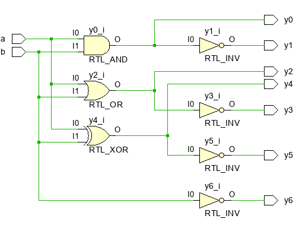
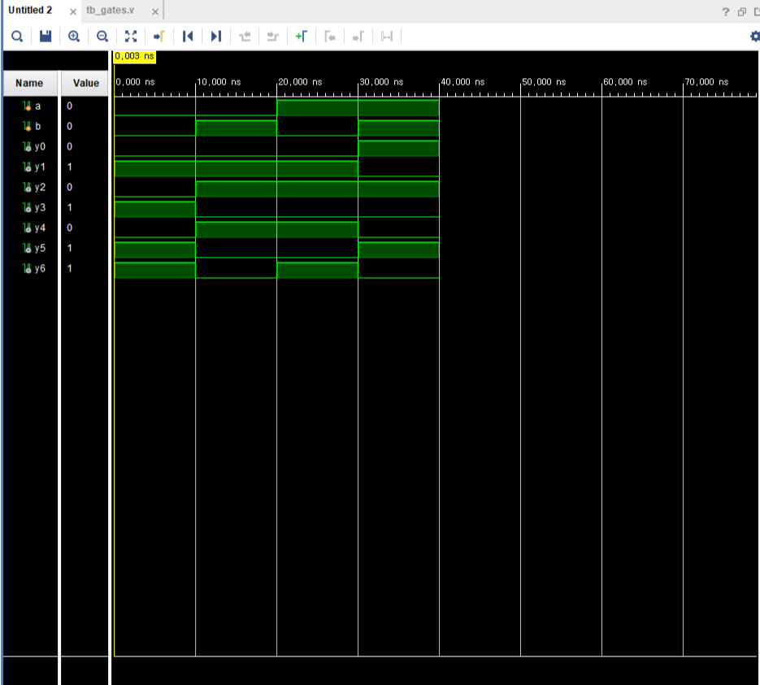
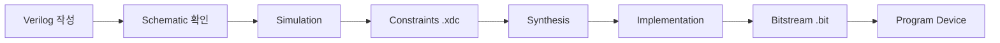

# gates — 기본 논리 게이트와 Vivado RTL flow

> 📅 2026-07-15 · 보드: Basys3 (Artix-7 XC7A35T) · Vivado 2020.2

Verilog 첫 실습. 1bit 입력 `a`, `b`에 대해 AND / NAND / OR / NOR / XOR / XNOR / NOT 결과를 `assign`으로 출력하고,
**모듈 작성 → schematic → 시뮬레이션 → constraints → 합성 → 구현 → bitstream → 보드 업로드** 까지 한 번 돌려본 프로젝트.

## 파일 구조

```
gates/
├── src/gates.v              # 게이트 7개 assign
├── tb/tb_gates.v            # 입력 4가지 조합 테스트벤치
├── constraints/gates.xdc    # 스위치 / LED 핀 매핑
└── images/                  # schematic, waveform
```

## 사용 핀

| 포트 | 보드 | 핀 |
|---|---|---|
| `a` | SW1 | V16 |
| `b` | SW0 | V17 |
| `y0` ~ `y6` | LD0 ~ LD6 | U16, E19, U19, V19, W18, U15, U14 |

---

## 동작

| 출력 | 식 | 게이트 |
|---|---|---|
| `y0` | `a & b` | AND |
| `y1` | `~(a & b)` | NAND |
| `y2` | `a \| b` | OR |
| `y3` | `~(a \| b)` | NOR |
| `y4` | `a ^ b` | XOR (다를 때 1) |
| `y5` | `a ~^ b` = `~(a ^ b)` | XNOR (같을 때 1) |
| `y6` | `~b` | NOT |

```verilog
assign y0 = a & b;
assign y1 = ~(a & b);
assign y2 = a | b;
assign y3 = ~(a | b);
assign y4 = a ^ b;
assign y5 = a ~^ b;
assign y6 = ~b;
```



- schematic에서 `~(a&b)`와 `a&b`가 따로 그려지지 않을 수 있음 → 합성기가 같은 게이트를 공유하도록 **자원을 최적화**해 준 것
- 논리 연산 `!` (논리 부정) vs 비트 연산 `~` (비트 부정)은 다름

## Simulation

```verilog
module tb_gates();
    reg a, b;                               // 입력: 값을 강제로 바꿔야 하니 reg
    wire y0, y1, y2, y3, y4, y5, y6;        // 출력: 그대로 보기만 하니 wire

    gates dut (.a(a), .b(b), .y0(y0), /* ... */ .y6(y6));

    initial begin
        a = 0; b = 0;
        #10; a = 0; b = 1;
        #10; a = 1; b = 0;
        #10; a = 1; b = 1;
        #10;          // 마지막 입력의 결과를 보려면 시간이 조금이라도 지나야 함
        $stop;        // 안 멈추면 기본 1000ns까지 돌아감
    end
endmodule
```



---

## 배운 내용

### Verilog 기본 문법

- `` ` `` (백틱): 컴파일러 지시어. C의 `#include`의 `#` 같은 역할
- `` `timescale 1ns / 1ps ``: **시간 단위 / 정밀도**. `#10` → 10ns
- `;` 는 문장 종결자. `endmodule`, `endcase` 같은 end 류에는 안 붙임
- 포트 선언은 `input a, b, output y0, y1, ...` 처럼 한 줄로 묶어도 됨

### wire vs reg

| | wire | reg |
|---|---|---|
| 하드웨어 의미 | 그냥 금속선 (연결) | 값을 저장하는 변수 |
| 값 저장 / 재할당 | ❌ | ⭕ |
| 테스트벤치에서 | 출력을 그대로 관찰 | 입력에 값을 강제로 넣을 때 |

- 선언 안 한 변수를 쓰면 에러 없이 **1bit wire를 암묵적으로 생성** → 위험하니 항상 선언하기

### assign

- "항상 연결" — 하드웨어적으로 금속선으로 이어 놓는 것. 위에서 아래로 실행되는 게 아니라 **동시에 동작**
- 시뮬레이터는 딜레이·노이즈가 없는 이상적인(idle) 환경이라 결과도 동시에 나옴
- 합성기는 코드를 한 줄씩 읽지만, 실제 배치는 신호 흐름과 의존성에 따라 함

### Top module

- 칩 외부와 I/O를 주고받을 수 있는 유일한 모듈. 서브모듈은 top을 통해서만 외부와 통신
- 테스트벤치(`tb_gates`)는 **시뮬레이션의 top**. 가상 환경이라 보통 포트가 없음
- `gates dut (...)` → 모듈 `gates`를 `dut`(design under test)라는 이름으로 **인스턴스화** (C의 `int a`처럼)

### 시간 ↔ 주파수 (T = 1/f)

| 시간 | 주파수 |
|---|---|
| 1 s | 1 Hz |
| 1 ms (10⁻³) | 1 kHz |
| 1 us (10⁻⁶) | 1 MHz |
| 1 ns (10⁻⁹) | 1 GHz |
| 1 ps (10⁻¹²) | 1 THz |

### Vivado 설계 · 배포 flow



1. **Schematic**: 회로가 끊기거나 잘못 연결된 곳 확인
2. **Simulation**: 테스트벤치(`initial`, `#delay`, `$stop`)로 입력을 바꾸며 waveform 확인
3. **Constraints**: 포트 ↔ 보드 핀(`PACKAGE_PIN`), 전압(`IOSTANDARD LVCMOS33`) 매핑
4. **Synthesis**: 코드를 논리 게이트로 변환 + 최적화 ("소프트웨어를 하드웨어로")
5. **Implementation**: 합성된 게이트를 FPGA 내부 자원에 배치(place) · 배선(route)
6. **Bitstream** 생성 → 보드에 program → DONE LED 켜지면 동작 확인

### Implementation report

| 리포트 | 보는 것 |
|---|---|
| Timing | Setup / Hold **slack** — 양수면 OK, 음수면 타이밍 위반 |
| Utilization | LUT, FF, BRAM, DSP 사용량(%) |
| Power | 정적 전력(누설) / 동적 전력(토글) |
| DRC | 배치·배선 규칙, I/O 전압 설정 위반 |

### Basys3 보드

| 부품 | 내용 |
|---|---|
| SW0 ~ SW15 | 슬라이드 스위치 (위 1 / 아래 0) |
| LD0 ~ LD15 | LED |
| BTNU/D/L/R/C | 푸시 버튼 5개 |
| DISP1 | 4자리 7-segment |
| JA/JB/JC, JXADC | Pmod 확장 커넥터 |
| JP1 | 부팅 모드 점퍼 (JTAG/USB · QSPI flash · USB host) |
| Shared UART/JTAG USB | JTAG: bitstream 업로드 · UART: PC와 시리얼 통신 |
| DONE LED | bitstream 업로드 완료 시 점등 |

### 회로 소자 / 반도체 용어

- R 저항, L 인덕터(전류 변화 시 역기전력으로 전류 유지), C 커패시터(전하 충·방전으로 전압 유지), D 다이오드(단방향), T 트랜지스터
- Silicon Die(실제 연산 칩) → 패키지(다리·커버를 씌운 칩) → 보드(칩 + 부품을 연결한 기판)
