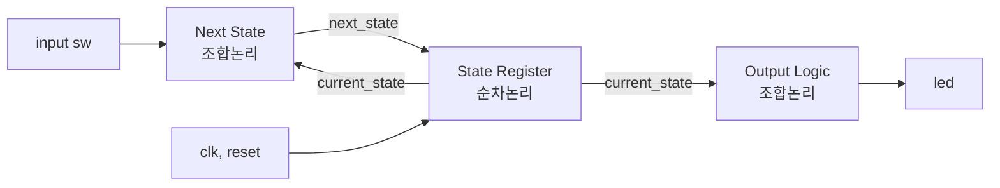
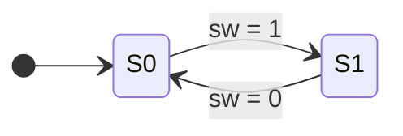
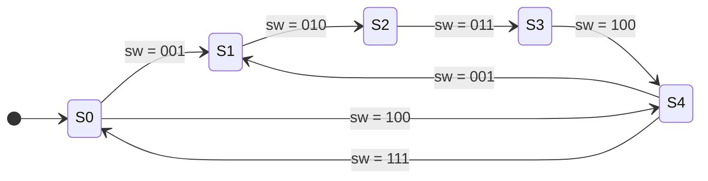

# moore_fsm — Moore FSM (2상태 LED → 5상태 LED)

> 📅 2026-07-23 ~ 24 · Vivado 2020.2 · 과제 5 · 시뮬레이션

스위치 입력에 따라 LED 상태가 바뀌는 **Moore FSM**을 작성.
실습에서 만든 2상태 FSM(`fsm_moore_led01`)을 바탕으로 과제로 5상태 FSM(`fsm_moore_led03`)을 설계하고,
다음 날 리뷰에서 배운 **초기값으로 full case 처리하는 방식**(`fsm_moore_led03_example`)으로 다시 작성함.

## 파일 구조

```
moore_fsm/
├── src/fsm_moore_led01.v   # fsm_moore_led01 (2상태), fsm_moore_led03 (5상태), fsm_moore_led03_example
└── tb/tb_moore_fsm.v       # 5상태 FSM 시나리오 테스트벤치
```

---

## Moore FSM 구조



| 블록 | 문법 | 역할 |
|---|---|---|
| State register | `always @(posedge clk, posedge reset)` + `<=` | clk마다 `current_state <= next_state` |
| Next state logic | `always @(*)` + `=` | 현재 상태 + 입력 → 다음 상태 |
| Output logic | `always @(*)` 또는 `assign` | **현재 상태만으로** 출력 결정 (Moore) |

- **Moore**: 출력이 현재 상태에만 의존 → 출력이 clk에 동기되어 안정적
- **Mealy**: 출력이 현재 상태 + 입력에 의존 → 반응이 1clk 빠르지만 입력 glitch가 출력으로 전달될 수 있음

## 1. 2상태 FSM (`fsm_moore_led01`)



`S0` → led 0, `S1` → led 1

## 2. 5상태 FSM (`fsm_moore_led03`)



| 상태 | 인코딩 | led |
|---|---|---|
| S0 | `3'b111` | `000` |
| S1 | `3'b001` | `001` |
| S2 | `3'b010` | `010` |
| S3 | `3'b011` | `011` |
| S4 | `3'b100` | `100` |

- 상태를 `parameter`로 정의하고, 전이 조건 스위치 값도 같은 코드로 맞춤 (S4 → S0 전이 신호는 `111`)
- 정의되지 않은 경로의 `sw`가 들어오면 **현재 상태 유지**

### full case 처리 — 두 가지 방법

```verilog
// (1) 각 분기마다 default / else (과제 제출 버전)
S1: begin
    if (sw == S2) next_state = S2;
    else          next_state = current_state;
end
...
default: next_state = current_state;
```

```verilog
// (2) always 시작에서 초기값 지정 (리뷰 후 example 버전, 권장)
always @(*) begin
    next_state = current_state;      // 아무 조건에도 안 걸리면 유지
    case (current_state)
        S1: if (sw == S2) next_state = S2;
        S2: if (sw == S3) next_state = S3;
        ...
    endcase
end
```

- 조합논리 `always`에서 어떤 경로든 값이 할당되지 않으면 **latch** 생성 → 과제 중 latch 경고가 떠서 default로 제거함
- (2) 방식이 `default`, `else`를 한 번에 커버해서 실수가 적음

## Simulation

```verilog
parameter delay_fsm = 20;
...
sw = dut.S1; #delay_fsm;   // S0 → S1
sw = dut.S2; #delay_fsm;   // S1 → S2
sw = dut.S3; #delay_fsm;   // S2 → S3
sw = dut.S4; #delay_fsm;   // S3 → S4
sw = dut.S0; #delay_fsm;   // S4 → S0
sw = dut.S4; #delay_fsm;   // S0 → S4
sw = dut.S1; #delay_fsm;   // S4 → S1
sw = dut.S3; #delay_fsm;   // S1 → S3 경로 없음 → S1 유지
sw = dut.S4; #delay_fsm;   // S1 → S4 경로 없음 → S1 유지
```

- 테스트벤치에서 `dut.S1`처럼 **계층 참조**로 DUT 내부 parameter 사용
- `next_state`는 조합논리라 `sw`가 바뀌면 **즉시** 변함 / `current_state`는 **다음 clk posedge**에 반영 / `led`는 `current_state`가 바뀌면 즉시 변함

---

## 배운 내용

### 메타스테이블과 CDC

- **setup time**: clk 엣지 **전**에 D가 유지돼야 하는 시간 / **hold time**: 엣지 **후** 유지 시간
- 이 구간에 D가 바뀌면 출력이 0도 1도 아닌 상태로 흔들리는 **metastable** 발생 (언젠가는 안정화되지만 언제일지 모름)
- clock이 서로 다른 모듈·칩·디바이스 사이(CDC, Clock Domain Crossing)에서 발생 → 칩 설계는 **발생 확률을 낮추는 방향**으로
  - 1bit: F/F 2단 synchronizer / 멀티비트: 비동기 FIFO, handshake, MCP
- 디바이스 간 인터페이스는 무조건 CDC 환경
- 신호마다 지나는 조합논리 경로(critical path)가 달라 늦게 도착하는 신호가 있으면 **glitch** 발생 가능

### Latch vs Flip-flop

| | Latch | Flip-flop |
|---|---|---|
| 동작 | level-sensitive (enable 동안 투명) | edge-triggered (엣지 순간만 샘플) |
| 용도 | 보통 의도치 않게 생기면 제거 대상 | 순차논리 기본 소자 |

- 한 `always`에 `posedge`와 `negedge`를 같이 쓰지 말 것 → 필요하면 블록을 나누거나, clk 주파수를 2배로 올려 한쪽 엣지만 쓰기

### `$display` vs `$strobe`

```verilog
#10 b <= a + 1;
$display(...);   // Active region → non-blocking 반영 전 값 (b = 34)
$strobe(...);    // Postponed region → 반영 후 값 (b = 35)
```

### 삼항 연산자 체인과 critical path

- `? :` 를 길게 이으면 **우선순위 MUX가 직렬로** 쌓임 → 앞 조건일수록 우선순위 높음
- MUX 단수가 늘면 critical path가 길어져 **negative slack** 위험
