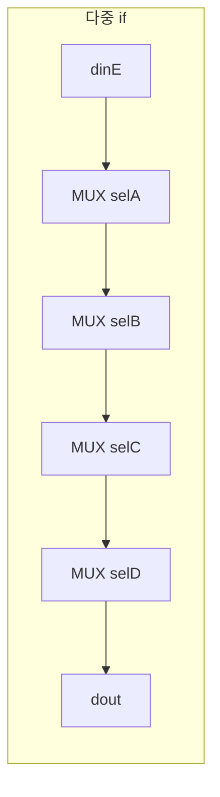
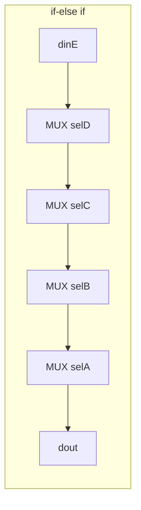

# multi_if_vs_if_else_if — 다중 if vs if-else if 우선순위와 합성 결과

> 📅 2026-07-27 · Vivado 2020.2 · schematic 비교 실습

같은 입력·출력을 가진 두 모듈을 **다중 `if`** 와 **`if-else if`** 로 각각 작성해
조건의 우선순위가 어떻게 달라지고 어떤 MUX 구조로 합성되는지 schematic으로 비교한 실습.

## 파일 구조

```
multi_if_vs_if_else_if/
└── src/practice_02.v    # if_if, if_else
```

---

## 코드

```verilog
// 다중 if : 나중 if가 앞의 결과를 덮어씀 → 마지막 조건(selD)이 우선순위 최고
always @(*) begin
    dout = dinE;
    if (selA) dout = dinA;
    if (selB) dout = dinB;
    if (selC) dout = dinC;
    if (selD) dout = dinD;
end
```

```verilog
// if-else if : 처음 참인 조건에서 끝남 → 첫 조건(selA)이 우선순위 최고
always @(*) begin
    dout = dinE;
    if      (selA) dout = dinA;
    else if (selB) dout = dinB;
    else if (selC) dout = dinC;
    else if (selD) dout = dinD;
end
```

- 두 모듈 모두 `dout = dinE;`로 **초기값을 먼저 줘서** 어떤 조건도 참이 아닐 때의 latch를 막음

## 합성 결과

둘 다 2:1 MUX 4개가 **직렬로** 연결된 우선순위 MUX 체인이 되지만, 순서가 반대.





| | 우선순위 최고 | 출력에 가장 가까운 MUX |
|---|---|---|
| 다중 if | 마지막 조건 `selD` | `selD` |
| if-else if | 첫 조건 `selA` | `selA` |

- **우선순위가 높은 조건일수록 출력에 가까운 MUX**에 붙음 → 그 조건이 1이면 앞의 결과와 상관없이 바로 출력되기 때문

## 배운 내용

- 조건문을 쓰는 순서가 곧 하드웨어 구조(우선순위 MUX의 순서)가 됨
- MUX가 직렬로 길어지면 뒤쪽 입력의 **critical path**가 길어짐 → 우선순위가 필요 없는 선택이면 `case`(병렬 MUX)가 유리
- [counter_updown](../counter_updown)의 control unit에서 run과 clear가 동시에 눌리면 run만 반영되는 것도 `if-else if` 우선순위 때문
